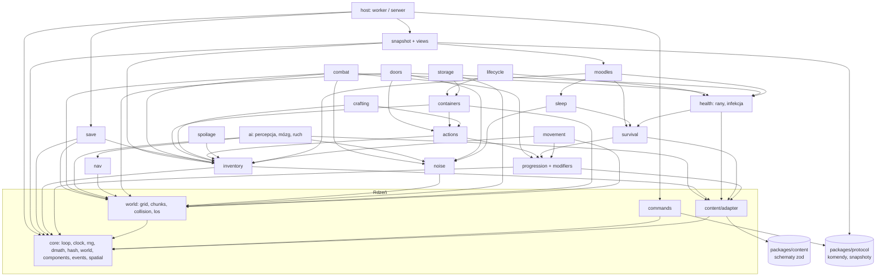

# Architektura `packages/sim`

Status: uzgodniona architektura (Symulacja, 30.09.2026).
Dotyczy: `packages/sim`, a także styku z `packages/content`, `packages/protocol`, `apps/game` i `apps/server`.
Źródła: `docs/PLAN.md` (zasady architektury 1–5, etapy) oraz `docs/TASKS.md`.

Ten dokument opisuje, jak zbudujemy symulację: strukturę kodu, kontrakty między modułami i kolejność prac. Kodu pakietu jeszcze nie ma. Szkielet monorepo (pnpm + Turborepo, TS strict, Vitest) przygotowuje Silnik, a `packages/sim` powstanie na nim w Etapie 1.

---

## 1. Cele i ograniczenia

### 1.1 Cele
1. **Jeden kod symulacji wszędzie.** Ten sam pakiet działa w Web Workerze w przeglądarce, w Node na serwerze (później multiplayer), w testach Vitest i w narzędziach typu replay.
2. **Determinizm.** Stan początkowy (seed, zawartość, opcjonalny zapis) plus ta sama sekwencja komend daje bit w bit ten sam stan po każdym ticku. Na tym opierają się replay, testy regresji, wykrywanie rozjazdów w multiplayerze i powtarzalne błędy.
3. **Zawartość jako dane.** Sim nie zna konkretnych przedmiotów, receptur, cech ani typów zombie. Wszystko przychodzi z `packages/content` (schematy zod od Modules) jako zwalidowany pakiet danych.
4. **Komendy zamiast bezpośrednich zmian stanu.** Z zewnątrz stan zmieniają wyłącznie komendy. Render i UI tylko czytają snapshoty i zdarzenia.
5. **Budżet wydajności.** 200 aktywnych zombie plus gracz mieszczą się w średnio **≤ 4 ms na tick** (p95 ≤ 8 ms) na średnim laptopie. Przy 20 Hz budżet ticku to 50 ms, ale worker dzieli CPU z renderem, więc liczymy z dużym zapasem.

### 1.2 Twarde ograniczenia (egzekwowane narzędziami)
| Zasada | Jak egzekwujemy |
|---|---|
| Brak DOM, Three.js, React | `tsconfig` pakietu ma `"lib": ["ES2022"]` bez `DOM` i `WebWorker`. ESLint `no-restricted-imports` blokuje `three`, `react` i `apps/*`. |
| Brak `Math.random` | ESLint `no-restricted-properties` (`Math.random`). Jedyne źródło losowości to `core/rng`. |
| Brak zegara ściennego | ESLint `no-restricted-globals` / `no-restricted-properties`: `Date`, `performance`, `setTimeout`, `setInterval`, `queueMicrotask`, `requestAnimationFrame`. Czas w sim to wyłącznie numer ticku. |
| Brak niedeterministycznych funkcji matematycznych | `Math.sin`, `cos`, `tan`, `atan2`, `exp`, `log`, `pow` (z niecałkowitym wykładnikiem) i `hypot` zakazane w sim. Używamy `core/dmath` (patrz 1.4). |
| Brak asynchroniczności w ticku | `step()` jest synchroniczne. Żadnych `Promise` ani `await` wewnątrz systemów. I/O (zapis, wczytanie zawartości) robi host poza tickiem. |
| Stały krok | `TICK_MS = 50`, `TICKS_PER_SECOND = 20`. Systemy nie dostają `dt` jako zmiennej: każdy liczy w jednostkach „na tick”, a tempo przelicza się ze stałych. |

### 1.3 Stały krok 50 ms i czas gry
- Tick to niepodzielna jednostka czasu. Stan `N+1 = step(stan N, komendy dla ticku N)`.
- Czas gry: `worldSettings.dayLengthMinutes = 60`, czyli jeden dzień gry trwa jedną godzinę rzeczywistą przy ×1. Przyspieszenie (×2 lub ×4) polega na **wykonaniu większej liczby ticków w tym samym czasie rzeczywistym**, nigdy na wydłużeniu `dt`. Dzięki temu ×1, ×2 i ×4 dają identyczny wynik.
- Zegar gry (`core/clock`) przelicza ticki na minuty, godziny i dni gry zgodnie z `worldSettings.dayLengthMinutes = 60` (wartość zapisana w świecie). Licznik przeżytych dni jest pochodną numeru ticku i ticku narodzin postaci.
- Tempa w danych Modules podaje **w punktach statystyki 0–100 na minutę gry** (np. `worldSettings.survival.needs.hungerPerMin = 0.0175`). Przy `dayLengthMinutes = 60` minuta gry to 50 ticków (2,5 s). Systemy przetrwania nie przeliczają temp na tick: liczą **raz na pełną minutę gry** (`clock` zgłasza, które minuty upłynęły w ticku), więc przyrost jest duży względem precyzji f32 i nie kumuluje błędów zaokrągleń.

### 1.4 Jak unikamy rozjazdów float
Zakładamy ten sam silnik JS po obu stronach tylko w singleplayerze. Serwer w Node (V8) i klienci w Firefox (SpiderMonkey) czy Safari (JSC) muszą dawać ten sam wynik, dlatego:
1. **Dozwolone są tylko operacje, które IEEE 754 zaokrągla poprawnie:** `+ - * /`, `Math.sqrt`, `Math.fround`, `Math.floor/ceil/round/trunc`, `Math.abs/min/max`, `Math.imul`. Te dają identyczne wyniki na każdym silniku.
2. **Trygonometria i inne funkcje przestępne** idą przez `core/dmath`. Kąty trzymamy jako liczby całkowite w „binarnych stopniach” (`u16`, 65536 = 360°). `sin`/`cos` biorą wartości z tablicy 4096 wpisów, generowanej przy starcie wyłącznie operacjami z punktu 1 (szereg Taylora lub CORDIC) albo zapisanej na stałe w źródle. `atan2` liczymy przybliżeniem wielomianowym w tych samych operacjach.
3. **Pozycje i prędkości** trzymamy w komponentach `Float32Array`. Każdy zapis przechodzi przez `Math.fround`, więc wartość jest zawsze poprawnie zaokrągloną liczbą f32. Obliczenia pośrednie idą w f64, a zapis do komponentu je kwantyzuje. To wystarcza, bo rozjazd powstaje tylko wtedy, gdy wynik zależy od silnika, a tu nie zależy.
4. **Zakaz FMA i „sprytnych” optymalizacji** nie dotyczy JS (silniki nie łączą `a*b+c` w FMA), ale zakazujemy **sumowania w niezdefiniowanej kolejności**: suma po encjach zawsze w kolejności `StableId`.
5. **Stan logiczny w liczbach całkowitych, gdzie tylko się da:** kafle, HP ścian i drzwi, ilości, XP (w setnych), zegar. Statystyki przetrwania trzymamy w `f32` **w skali 0–100** (jak w danych; temperatura w °C, waga w kg), z tą samą dyscypliną `fround`.
6. **Porównania z progiem** (np. moodle) robimy na wartościach po `fround`, więc wynik progu jest stabilny.
7. **Test krzyżowy:** ten sam scenariusz uruchamiamy w Node i w przeglądarce (Vitest browser mode lub Playwright w Chromium, Firefox i WebKit) i porównujemy hash stanu (patrz 8.3).

Rezerwa: gdyby test krzyżowy wykazał rozjazd, którego nie da się łatwo usunąć, przechodzimy na liczby stałoprzecinkowe (Q16.16 w `Int32Array`) dla pozycji. API komponentów `Position` się nie zmieni, zmieni się tylko implementacja `dmath` i ruchu.

### 1.5 Stała kolejność iteracji
- **Kolejność systemów** jest zapisana w jednej tablicy w `core/pipeline.ts` (patrz 2.3). Nie ma dynamicznej rejestracji w czasie gry.
- **Kolejność encji:** każda encja dostaje `StableId` (rosnący `u32`, nigdy nie odzyskiwany, zapisywany w save). Id encji bitecs mogą być odzyskiwane i po wczytaniu gry będą inne, dlatego systemy wrażliwe na kolejność (zużywające RNG, rozstrzygające konflikty, sumujące) iterują po wyniku zapytania **posortowanym po `StableId`**. Posortowana tablica jest cache'owana per zapytanie i unieważniana, gdy zmieni się skład zapytania (dodanie lub usunięcie komponentu). Koszt jest znikomy, bo skład zmienia się rzadko.
- **Brak iteracji po kluczach obiektów z danymi.** Rejestr zawartości ma tablice posortowane po `id` (string), a indeksy numeryczne nadaje się w tej kolejności.
- `Map` i `Set` iterują w kolejności wstawiania, co jest deterministyczne, ale w stanie symulacji i tak preferujemy tablice lub mapy z kluczami `StableId` sortowane przy zapisie.
- **Rozstrzyganie remisów** jest zawsze jawne: kolejka priorytetowa A* porównuje `(f, h, indeksKafla)`, wybór celu przez zombie porównuje `(dystans², StableId)`.
- **Komendy w ticku** stosujemy w kolejności `(playerId, seq)` (patrz 2.4).

---

## 2. Struktura `packages/sim/src` i moduły

### 2.1 Drzewo katalogów
```
packages/sim/
  package.json          # zależności: bitecs, @deadzone/content, @deadzone/protocol
  tsconfig.json         # lib: ES2022, bez DOM
  src/
    index.ts            # publiczne API: createSim, loadSim, Sim (step, enqueue, snapshot, serialize, hash)
    core/
      loop.ts           # FixedStepLoop: akumulator (niezależny od hosta, czas podaje host)
      clock.ts          # tick → czas gry, dzień, pora doby, oświetlenie globalne
      rng.ts            # sfc32 + splitmix32, nazwane strumienie, RNG pochodne (chunk, encja)
      dmath.ts          # kąty u16, tablice sin/cos, atan2, isqrt, lerp z fround
      hash.ts           # hash stanu (xxHash32 po kanonicznej serializacji)
      world.ts          # SimWorld: świat bitecs + zasoby (grid, itemStore, rng, eventy)
      components.ts     # rejestr komponentów: nazwa, schemat pól, wersja, serializowalny?
      pipeline.ts       # jedyna lista systemów i ich faz
      events.ts         # bufor zdarzeń ticku (SimEvent[])
      spatial.ts        # spatial hash (komórki 4×4 kafle) z deterministyczną kolejnością
      stableSort.ts     # cache posortowanych zapytań
    content/
      adapter.ts        # ContentBundle (z packages/content) → indeksy numeryczne, stałe per tick
    commands/
      queue.ts          # kolejka per tick, porządkowanie, okno ticków
      validate.ts       # walidacja strukturalna i gameplayowa
      apply.ts          # dispatch komend do intencji w komponentach
    world/
      grid.ts           # siatka kafli: typ, przechodniość, ściany krawędziowe, pomieszczenia
      chunks.ts         # chunki 32×32, wczytywanie, diffy
      collision.ts      # kolizje okrąg–kafel, okrąg–okrąg
      los.ts            # linia wzroku (DDA po kaflach i krawędziach)
    systems/
      movement/         # intencja ruchu → prędkość → kolizje → pozycja
      survival/         # statystyki przetrwania
      moodles/          # progi statystyk → poziomy moodli
      health/           # części ciała, rany, krwawienie, leczenie, infekcja
      sleep/
      inventory/        # ekwipunek, torby, ręce, waga
      containers/       # kontenery, przeszukiwanie, generowanie lootu
      storage/          # schowki stawiane i przenoszone
      spoilage/         # psucie jedzenia (leniwie)
      noise/
      ai/               # percepcja (wzrok, słuch), mózg (FSM), wędrowanie, gonienie
      nav/              # A*, flow field, cache ścieżek
      combat/           # wręcz, palna, rzucanie
      progression/      # umiejętności, XP, cechy (także dynamiczne), modyfikatory
      actions/          # kolejka akcji czasowych + rejestr handlerów
      crafting/
      doors/            # drzwi, okna, barykady
      lifecycle/        # śmierć, spawn, sprzątanie encji
    snapshot/
      render.ts         # pakowanie stanu widocznego do bufora binarnego
      views.ts          # widoki UI (ekwipunek, statystyki) jako delty „na zmianę”
    save/
      serialize.ts
      deserialize.ts
      migrations/       # v1 → v2 → …
    host/               # osobny entry point @deadzone/sim/worker (lib: WebWorker)
      worker.ts         # pętla czasu rzeczywistego + protokół wiadomości
      protocol.ts       # re-export typów z @deadzone/protocol
  test/
    fixtures/           # mini-content i mini-mapy do testów
    determinism/        # testy hash, replay, save/load
  bench/                # vitest bench: 200 zombie, pathfinding
```
Reguła warstw (ESLint `import/no-restricted-paths` albo `eslint-plugin-boundaries`): `core` nie importuje niczego z `systems`; `systems/*` importują `core`, `world`, `content` i tylko jawnie wymienione inne systemy (graf w sekcji 3); `host` może importować wszystko, ale nic nie importuje `host`. Każdy system ma testy w `systems/<nazwa>/*.test.ts`.

Konwencja pakietów: nazwy publicznych pakietów mają postać `@deadzone/*` (np. `@deadzone/sim`, `@deadzone/protocol`, `@deadzone/content`). Monorepo używa `module: "NodeNext"` i `moduleResolution: "NodeNext"`; importy względne w TypeScript mają rozszerzenie `.js`. `packages/sim` nie importuje `three`, `react`, `node` ani DOM; egzekwuje to ESLint oraz `tsconfig` z biblioteką `ES2022` bez `DOM` i `WebWorker`.

### 2.2 Rdzeń

#### Pętla ticku z akumulatorem (`core/loop.ts`)
Sim sam nie zna czasu rzeczywistego. Host (worker, serwer) wywołuje `advance(realDeltaMs)`:
```ts
interface LoopState { accumulatorMs: number; speed: 0 | 1 | 2 | 4; maxTicksPerAdvance: number }
// advance: acc += realDeltaMs * speed; while (acc >= 50 && n < max) { sim.step(); acc -= 50; n++ }
// Jeśli n == max, nadmiar akumulatora jest obcinany (ochrona przed „spiralą śmierci”).
// Zwraca alpha = acc / 50 dla interpolacji renderu.
```
Akumulator i `speed` należą do hosta, nie do stanu symulacji: nie są hashowane ani zapisywane. Stan sim zmienia wyłącznie `step()`. `maxTicksPerAdvance` domyślnie 5 przy x1 i proporcjonalnie więcej przy przyspieszeniu, z limitem budżetu czasu (patrz 5.4).

#### RNG z seedem (`core/rng.ts`)
- Generator **sfc32** (stan 4 × u32, okres ≥ 2¹²⁸, szybki na `Math.imul` i przesunięciach). Seed rozkładamy przez **splitmix32**.
- **Osobne strumienie**, żeby zmiana w jednym systemie nie przesuwała losowości w innych (np. dodanie rzutu w walce nie zmienia lootu):
  | Strumień | Użycie |
  |---|---|
  | `world` | decyzje globalne, spawn hord, pogoda (później) |
  | `ai` | wędrowanie, rozrzut decyzji zombie |
  | `combat` | trafienia, obrażenia, ugryzienia, rozrzut broni palnej |
  | `health` | infekcja, powikłania ran |
  | `survival` | drobne losowe zdarzenia przetrwania i snu |
  | `actions` | sukces akcji, np. rozbiórki |
  | `progression` | losowe elementy XP i cech dynamicznych |
  | `physics` | `gaitSeed` zombie przy spawnie, rzuty zachwiania i przewrócenia, czas leżenia (2 losowania na trafienie), rozrzut obrażeń od naporu tłumu (1 losowanie na impuls naporu) |
- **RNG pochodne** (bezstanowe z punktu widzenia zapisu): `rngFor(seed, 'loot', chunkX, chunkY, containerIndex)`. Loot kontenera zależy tylko od seeda i położenia, a nie od kolejności odwiedzania. Dzięki temu „zapis = seed + diff chunków” działa: nieotwarty kontener nie musi być zapisany.
- Strumień to obiekt `{ s0, s1, s2, s3 }` przechowywany w `SimWorld.rng`. Zapis gry zapisuje cztery u32 każdego strumienia.
- API: `nextU32()`, `nextFloat()` (`[0,1)` z 24 bitów przez `fround`), `int(min, max)`, `chance(p)`, `pickWeighted(table)`. Wagi w tablicach lootu są całkowite.

#### Świat ECS (`core/world.ts`)
```ts
interface SimWorld {
  ecs: World;               // bitecs
  tick: number;             // u32, numer bieżącego ticku
  seed: number;
  options: WorldOptions;    // worldSettings.dayLengthMinutes = 60, opcje sandboxa
  content: ContentIndex;    // tylko do odczytu
  rng: Record<RngStream, Sfc32State>;
  grid: TileGrid;           // world/grid
  items: ItemStore;         // instancje przedmiotów poza ECS (patrz 2.5)
  spatial: SpatialHash;
  noise: NoiseBuffer;       // hałasy bieżącego ticku
  events: SimEvent[];       // zdarzenia dla hosta, czyszczone po odczycie
  nextStableId: number;
}
```
Encje ECS: gracz, zombie, kontener w świecie (szafka, lodówka, skrzynia), stos przedmiotów na ziemi, drzwi, okno, pocisk lub rzucony przedmiot w locie. **Przedmioty w ekwipunku i kontenerach nie są encjami ECS**, tylko rekordami w `ItemStore`. Dom może mieć setki przedmiotów, a ECS służy do rzeczy, które coś robią co tick.

#### Kontrakt contentu (`packages/content` → `packages/sim`)
`ContentBundle` buduje `buildContentBundle(packs)` w `packages/content`: najpierw waliduje dane schematami zod, następnie scala mody w kolejności ładowania i na końcu zamraża wynik. Bundle zawiera pola: `items`, `recipes`, `skills`, `traits`, `professions`, `moodles`, `lootTables`, `zombieTypes`, `worldSettings`. Identyfikator ma format `namespace:nazwa-kebab`, np. `base:canned-beans`; nie dodajemy prefiksu typu. Sim mapuje identyfikatory na indeksy liczbowe wewnętrznie, ale w zapisie zawsze przechowuje stringi.

Jednostki danych są jawne: kg, minuty gry, kafle (1 kafel = 1 m = 1 jednostka świata), statystyki 0–100 i stopnie C. Gdy jednostka nie wynika z kontekstu, jest w nazwie pola, np. `weightKg`, `durationMin`, `rangeTiles`. Modyfikator ma postać `{ stat, op: 'add' | 'mul', value, when? }`; `when` jest opcjonalnym obiektem deklaratywnym (`moodle + minLevel` albo `skill + minLevel`), nigdy kodem. Progi moodli są danymi i zawierają histerezę.

#### Kontrakt mapy i chunków (`world/chunks.ts`)
Mapa demo jest w całości w pamięci, ale sim i render uzyskują do niej dostęp wyłącznie przez API `getChunk` i `getTile`. Chunk ma rozmiar 32×32 i adres `(cx, cy, z)`, gdzie `z` oznacza piętro. Każda warstwa jest płaską tablicą `Uint16Array` długości 1024, indeksowaną `y * 32 + x`; w JSON zapisujemy ją jako RLE lub base64, a w pamięci jako typed array. Budżet mapy wynosi poniżej 15 MB.

Warstwy to `floor` i osobna `roof`; renderer ukrywa `roof` razem ze ścianami na podstawie `buildingId`. Krawędzie północne i zachodnie są zapisane dla każdego kafla wraz z typem (`wall`, `window`, `door`) i id contentu. Stan dynamiczny (otwarte, rozbite, zabite deskami oraz zawartość kontenerów) sim trzyma osobno, poza plikiem chunka. Pokoje mapuje `roomId` na typ i `buildingId`. Obiekt ma id contentu, kafel, rotację `0–3` (co 90°) i opcjonalny offset; światła są obiektami z flagą w content.

Manifest zawiera wersję formatu, rozmiar chunka, wysokość piętra w jednostkach świata i listę chunków. Render pobiera dane przez `getChunk`, a zmiany dostaje jako `chunkChanged` z diffami.

#### Rejestr komponentów (`core/components.ts`)
Komponenty to tablice typowane (SoA) z bitecs. Każdy jest rejestrowany z metadanymi:
```ts
interface ComponentMeta {
  name: string;              // stabilna nazwa w zapisie, np. "Position"
  version: number;           // wersja układu pól (migracje zapisu)
  fields: Record<string, 'f32' | 'i32' | 'u32' | 'u16' | 'u8' | 'i8'>;
  serialize: boolean;        // false dla komponentów pochodnych (cache, np. PathCache)
  hash: boolean;             // czy wchodzi do hasha stanu
}
```
Wspólne komponenty rdzenia: `StableId`, `Position {x, y, floor}`, `Velocity`, `Facing {angle u16}`, `Collider {radius}`, `Kind {kind u8}`, `ContentRef {defIndex}`, `Dead` (tag), `RenderVisible` (tag). Komponenty modułów są opisane przy modułach.

### 2.3 Kolejność systemów (pipeline)
Jedna lista, wykonywana w każdym ticku:

| # | Faza | System | Uwagi |
|---|---|---|---|
| 1 | Wejście | `commands.apply` | komendy ticku N → intencje (`MoveIntent`, `ActionRequest`…) |
| 2 | Czas | `clock` | czas gry, dzień, które minuty gry upłynęły w ticku (systemy 12–14 liczą raz na minutę gry) |
| 3 | Akcje | `actions` | przerwania (ruch, sen, śmierć, zagrożenie), postęp akcji czasowych, zakończenie → efekty (jedzenie, picie, bandaż, przeszukanie, rozpakowanie; później craft) |
| 4 | Ruch | (`movement` od Etapu 4 jest krokiem 10a) | gracz: intencja → prędkość (chód, moodle, w tym `heavy-load`, kara toreb), kolizje z gridem |
| 4a | Ekwipunek | `inventory` | stat `carry-load`, współczynnik prędkości toreb, zamknięcie panelu kontenera poza zasięgiem (co tick, po ruchu) |
| 5 | Świat | `doors` | otwieranie, zamykanie, uderzenia zombie, barykady → aktualizacja gridu |
| 6 | Hałas | `noise.collect` | bufor hałasów: usuwa starsze niż `ai.farThinkEveryTicks` (zombie czytają hałasy z ostatniego okna myślenia) |
| 7–8 | AI | `ai.brain` | percepcja (wzrok, słuch; co 4 ticki według `StableId % 4`, daleko co 20) + FSM: idle ↔ wander, investigate, chase, search |
| 9 | Nawigacja | `nav` | flow field goniących i A* w limicie budżetu |
| 10 | Ruch | `ai.locomotion` | cel → intencja ruchu zombie (pole, prosta, ścieżka), rozpychanie; kolizje liczy wspólny `movement` |
| 10a | Ruch | `movement`, `movement.facing` | gracz i zombie: intencja → prędkość → kolizje z gridem (tu w Etapie 4, bo zombie korzystają z tego samego kroku) |
| 10a′ | Fizyka | `physics` | ciała graczy i zombie (`physics/*`): timery stanów (trafienie, zachwianie, przewrócenie → wstawanie), odrzut z `moveCircle`, idle/walk/run. Ruch czyta ją przez `registerMovementModifier` (obciążenie, wytrzymałość, bezwładność, brak kontroli), a `combat` zgłasza trafienia przez `physicsHit`. Na końcu: wzajemne odpychanie zombie w tłumie (masa, przesunięcie wykonuje ruch w następnym ticku przez `push`) i napór tłumu na zamknięte drzwi / okna / płoty (`physics/crowd.ts`) |
| 10b | Hałas | `noise.footsteps` | kroki graczy, którzy się ruszyli (co `footstepEveryTicks`, promień wg chodu) |
| 10c | AI | `ai.threat` | zagrożenie per gracz (goniące zombie, zombie w promieniu), budzenie hałasem i zombie |
| 11 | Walka | `combat` | ataki gracza i zombie, trafienia, pchnięcia, pociski, rzuty |
| 12 | Zdrowie | `health` | rany, krwawienie, gojenie, zakażenie brudem, wirus, gorączka (przez `sickness`), HP (na minutę gry) |
| 13 | Przetrwanie | `survival` | głód, pragnienie, zmęczenie, wytrzymałość, sytość, waga, nuda, stres, niezadowolenie, przemoczenie, temperatura (na minutę gry) |
| 14 | Sen | `sleep` | zasypianie, regeneracja, budzenie |
| 15 | Rozwój | `progression` | naliczenie XP z bufora, awanse, cechy dynamiczne |
| 16 | Stan | `moodles` | przeliczenie poziomów moodli co tick (na końcu, po wszystkich statystykach) i cache modyfikatorów |
| 17 | Porządek | `lifecycle` | śmierć, zamiana zombie w zwłoki, usuwanie encji, `StableId` |
| 18 | Wyjście | `spatial.rebuild`, `views.diff` | odświeżenie spatial hash i widoków UI; eventy gotowe do odczytu |

Stan po Etapie 4 (PR 1): kolejność w `core/pipeline.ts` to `commands.apply → clock → actions → noise.collect → ai.brain → nav → ai.locomotion → movement → movement.facing → noise.footsteps → ai.threat → inventory → health → survival → sleep → moodles → lifecycle`. Percepcja i decyzje są w jednym kroku `ai.brain` (dla każdego zombie: najpierw percepcja w jego ticku myślenia, potem timery stanu). Spatial hash zombie jest przebudowywany na początku `ai.brain`. `doors`, `combat` i `progression` jeszcze nie istnieją.

`containers`, `storage`, `spoilage` i `crafting` nie mają własnego kroku co tick. Działają przez komendy (1) i handlery akcji (3), a psucie liczy się leniwie. `inventory` (4a) tylko przelicza obciążenie i zasięg panelu; przenoszenie przedmiotów robią komendy. Zmiana kolejności to decyzja architektoniczna: wymaga aktualizacji tego dokumentu i złotych hashy w testach.

### 2.4 System komend
Typy komend i snapshotów leżą w `packages/protocol` (zgodnie z PLAN.md), a sim je importuje. Koperta:
```ts
type PlayerId = number;            // u8/u16 nadawany przez hosta (singleplayer: 0)
interface CommandEnvelope {
  tick: number;                    // tick, w którym komenda ma zostać zastosowana
  playerId: PlayerId;              // w multiplayerze nadaje serwer z połączenia, nie z treści
  seq: number;                     // rosnący numer per gracz (duplikaty, kolejność, ack)
  cmd: Command;
}
type Command =
  | { t: 'move'; dx: -1 | 0 | 1; dy: -1 | 0 | 1; run: boolean; sneak: boolean } // stan „trzymany” do zmiany
  | { t: 'aim'; angle: number /* u16 */ }
  | { t: 'attack'; charge?: boolean }
  | { t: 'shove' }
  | { t: 'interact'; target: StableId }                // drzwi, okno, kontener
  | { t: 'startAction'; action: ActionKind; args: ActionArgs }
  | { t: 'cancelAction' }
  | { t: 'moveItem'; item: ItemId; to: ContainerRef; slot?: number }
  | { t: 'equip'; item: ItemId; hand: 'L' | 'R' | 'both' | 'back' }
  | { t: 'useItem'; item: ItemId }                     // jedz, pij, czytaj → akcja czasowa
  | { t: 'dropItem'; item: ItemId } | { t: 'throwItem'; item: ItemId; angle: number; power: number }
  | { t: 'craft'; recipe: string; count: number }
  | { t: 'placeStorage'; item: ItemId; tile: TileRef; rot: 0 | 1 | 2 | 3 }
  | { t: 'sleep' } | { t: 'wake' }
  | { t: 'reload' } | { t: 'hotbar'; slot: 1 | 2 | 3 | 4 | 5 }
  | { t: 'createCharacter'; profession: string; traits: string[] };
```
- **Stan po Etapie 3** (typy w `protocol/commands.ts`, pole `type` zamiast `t`): `move`, `aim`, `sleep`, `wake`, `bandage {part, itemId?}`, `pickUp {item, count?}`, `drop {item, count?}`, `moveItem {item, to, count?}` (`to` = id kontenera z widoku), `equip {item, slot}` (sloty `EquipSlot` z contentu: `hand_primary` = prawa, `hand_secondary` = lewa, `back`, `belt`, …), `unequip {slot}`, `openContainer {container}`, `closeContainer`, `useItem {item, part?}`, `cancelAction`, `placeStorage {item, x, y}`, `pickUpStorage {container}`, a tylko w trybie dev `debugWound`, `debugStat`, `debugGiveItem {itemId, count?}`. `interact`/`startAction` z listy powyżej zastępują na razie `openContainer` i `useItem`.
- **Stan po Etapie 4 (PR 1):** `move` ma opcjonalne `gait: 'sneak' | 'walk' | 'run'` (domyślnie `walk`; bieg przy wytrzymałości 0 = chód). Dev: `debugSpawnZombie {x, y, z?, count?, zombieType?}` (wolne kafle spiralą wokół punktu) i `debugNoise {x, y, z?, radiusTiles, volume?}`. Zombie na starcie: `createSim({ spawnZombies })` i `init.zombies` w workerze.
- **Kolejka per tick** (`commands/queue.ts`): `Map<tick, CommandEnvelope[]>`. Przed zastosowaniem sortujemy po `(playerId, seq)`. Komenda z `tick < bieżący` jest w singleplayerze przesuwana na bieżący tick (host i tak nadaje tick), a w multiplayerze odrzucana albo przesuwana zgodnie z polityką serwera (6.4). Komendy z tickiem bardziej w przyszłości niż okno (np. 40 ticków) są odrzucane.
- **Walidacja dwustopniowa:** (a) strukturalna, czyli schemat zod z `@deadzone/protocol/schema` na granicy hosta (worker lub serwer), poza tickiem (główne wejście `@deadzone/protocol` ma tylko stałe, typy i kodowanie snapshotu, bez zod, więc nie trafia do bundla wątku głównego gry); (b) gameplayowa w `validate.ts` w ticku, na aktualnym stanie: czy gracz żyje, czy przedmiot jest w jego zasięgu i posiadaniu, czy cel jest w zasięgu interakcji (≤ 1,5 kafla), czy receptura jest znana i spełniona. Odrzucenie nie rzuca wyjątku, tylko emituje zdarzenie `commandRejected { seq, reason }`.
- **Komendy są jedynym wejściem**, więc log `CommandEnvelope[]` plus stan początkowy wystarcza do replaya. Host może go nagrywać (tryb debug, raport błędu).
- Komendy stanowe (`move`, `aim`) ustawiają intencję trwającą do następnej komendy. Nie wysyłamy ruchu co tick, tylko przy zmianie, co zmniejsza ruch sieciowy.

### 2.5 Moduły gameplayu
Format opisu: **Odpowiedzialność / Komponenty i stan / Wejścia / Wyjścia / Zależności / Etap**.

#### Ruch i kolizje (`systems/movement`, `world/*`)
- **Odpowiedzialność:** ruch gracza (chód, bieg, skradanie), obrót do celu myszy, kolizje z kaflami, ścianami krawędziowymi, meblami i innymi encjami, zmiana pięter (schody, później).
- **Komponenty:** `Position`, `Velocity`, `Facing`, `Collider`, `MoveIntent {dx, dy, run, sneak}`, `MoveStats {baseSpeed}`.
- **Wejścia:** komendy `move` i `aim`, modyfikatory z `inventory` (obciążenie), `survival` i `moodles` (zmęczenie, ból), `progression` (sprint, kondycja).
- **Wyjścia:** nowe pozycje, hałas kroków do `noise`, XP „sprint/skradanie” do bufora `progression`, zdarzenie `footstep` dla dźwięków.
- **Zależności:** `core`, `world/grid`, `world/collision`.
- **Etap:** 1 (ruch WASD, celowanie, kolizje).

#### Przetrwanie: statystyki (`systems/survival`)
- **Odpowiedzialność:** głód, pragnienie, zmęczenie, wytrzymałość (stamina), nuda, stres, niezadowolenie, temperatura ciała (od pory doby, odzieży, wysiłku, później pogody), waga ciała w dłuższym okresie (pod cechy otyłość i niedowaga).
- **Komponenty:** `vitals` (SoA f32 w `SurvivalWorld`, klucze = id statystyk z contentu: `health`, `hunger`, `thirst`, `fatigue`, `endurance`, `pain`, `stress`, `panic`, `boredom`, `unhappiness`, `sickness`, `infection`, `wetness`, `bleeding`, `satiety`, `body-temperature-c`, `body-weight-kg`; 0–100 poza °C i kg), `kcal` (bilans energii, z niego `body-weight-kg`).
- **Wejścia:** tempa z contentu, modyfikatory z cech, wysiłek z `movement` i `combat`, efekty jedzenia i picia z handlerów `actions`, sen z `sleep`.
- **Wyjścia:** wartości statystyk, obrażenia z głodu i odwodnienia do `health`, zdarzenia progowe przez `moodles`.
- **Zależności:** `core`, `content`, `progression/modifiers`.
- **Etap:** 2.

#### Moodle (`systems/moodles`)
- **Odpowiedzialność:** zamiana statystyk i stanów na poziomy moodli 0–4 (np. „Głodny 2”, „Ból 3”, „Gorączka”, „Infekcja”, „Obciążony”, „Panika”) według progów z contentu, histereza przy zmianie poziomu, efekty moodli jako modyfikatory (np. ból spowalnia akcje).
- **Komponenty:** `Moodles {level: Uint8Array[MOODLE_COUNT]}`, czyli jeden wpis na zdefiniowany moodle (indeks z `ContentIndex`).
- **Wejścia:** `Stats`, `BodyHealth`, `Inventory.weight`, `Sleep`, stan paniki z `ai` (widoczne zombie).
- **Wyjścia:** poziomy dla `views` (chipy w HUD), modyfikatory dla `movement`, `combat`, `actions`, zdarzenie `moodleChanged {id, from, to}`.
- **Zależności:** `survival`, `health`, `inventory`, `sleep`, `content`.
- **Etap:** 2.

#### Rany i infekcja (`systems/health`)
- **Odpowiedzialność:** ciało podzielone na części (dłonie L/P, przedramiona, ramiona, głowa, szyja, tułów górny i dolny, pachwina, uda, golenie, stopy L/P, łącznie 17 jak w PZ), rany (zadrapanie, rana szarpana, ugryzienie, głęboka rana, złamanie w późniejszym etapie), krwawienie, opatrunki (czyste i brudne), zakażenie rany (brud) oddzielnie od **infekcji zombie** (wirus: nieuleczalny, gorączka, śmierć i przemiana), ból, HP ogólne, śmierć.
- **Komponenty:** HP to `vitals.health`; rany jako lista poza ECS per `StableId` gracza (`Wound {id, part, kind, ageMin, healed f32, bandaged, bandageAgeMin, dirt}`, kilka ran na część ciała), wirus `virus/virusStart/virusIncubation/virusDeath`. Rodzaje ran (`scratch`, `laceration`, `bite`, `deep`) i ich tempa są danymi (`worldSettings.survival.wounds.types`), części ciała to `BODY_PARTS` z `protocol`.
- **Wejścia:** trafienia z `combat` (część ciała, typ, siła), szansa ugryzienia i zadrapania od zombie (RNG `health`, tabele z contentu), akcje `bandage`, `disinfect`, głód i odwodnienie z `survival`.
- **Wyjścia:** HP, ból i gorączka dla `moodles`, zdarzenia `wounded`, `bleeding`, `infected` (ukryte przed graczem do objawów), `died {cause}` dla `lifecycle` i ekranu śmierci.
- **Zależności:** `core`, `content`, `survival`.
- **Etap:** 2 (rany, krwawienie, bandaże, infekcja i gorączka), 4 (ugryzienia i szansa infekcji w walce).

#### Sen (`systems/sleep`)
- **Odpowiedzialność:** zasypianie (warunki: zmęczenie, łóżko lub podłoga, brak widocznych zombie), regeneracja zmęczenia, jakość snu (łóżko, cechy „Insomnia”, „Wakeful”), budzenie przez hałas, ból albo zombie w pobliżu, żądanie przyspieszenia czasu do hosta.
- **Komponenty:** `Sleep {state u8 (awake|falling|asleep), quality f32, startedTick u32}`.
- **Wejścia:** komendy `sleep`/`wake`, `Stats.fatigue`, hałas z `noise`, wykrycie przez `ai`, modyfikatory cech.
- **Wyjścia:** regeneracja w `survival`, zdarzenia `fellAsleep`, `wokeUp {reason}`, **`timeScaleHint {speed}`** dla hosta (singleplayer: host przełącza szybkość; multiplayer: ignorowane albo tylko gdy wszyscy śpią).
- **Zależności:** `survival`, `noise`, `content`.
- **Etap:** 2.

#### Ekwipunek i torby (`systems/inventory`)
- **Odpowiedzialność:** instancje przedmiotów, hierarchia pojemników (postać → założone torby → ich zawartość), waga i obciążenie z **redukcją wagi toreb**, ręce L/P i oburęczne, plecy, szybkie sloty 1–5 (przypisania), podnoszenie, upuszczanie, przenoszenie między pojemnikami.
- **Stan poza ECS (`ItemStore`):**
  ```ts
  interface ItemInstance {
    id: ItemId;               // u32, stabilny, zapisywany
    def: number;              // indeks definicji w ContentIndex
    container: ContainerRef;  // { kind: 'actor'|'bag'|'world'|'ground', id }
    count: number;            // stos
    condition: number;        // trwałość (i16)
    uses: number;             // np. naboje w magazynku, łyki w butelce
    createdTick: number;      // pod psucie
    extra?: Uint8Array | null // rzadkie dane, np. zapisany tekst, lista naboi
  }
  ```
  Komponenty ECS: `Inventory {weightCache f32, capacity f32}`, `Equipped {handL, handR, back}` (ItemId), `Hotbar {slots[5]}`.
- **Wejścia:** komendy `moveItem`, `equip`, `dropItem`, `hotbar`, handlery akcji (zjedzenie zużywa przedmiot), `containers` (przeniesienie z kontenera).
- **Wyjścia:** waga i obciążenie dla `movement` i `moodles`, zdarzenia `inventoryChanged` (dla widoku UI), `itemEquipped`.
- **Zależności:** `core`, `content`.
- **Etap:** 3.
- **Stan po Etapie 3:** `items/store.ts`, `items/inventory.ts`, `systems/inventory.ts`. Przedmiot w ekwipunku to rekord `ItemInstance {id, def, loc, count, condition, uses, ageMin, ageStamp, inner, placed}` (bez `createdTick` i `extra`, patrz 9.6); pojemniki to `ItemContainer` rodzaju `inventory` / `bag` / `world` / `ground`. Założony przedmiot zostaje w głównym ekwipunku, a sloty są osobno (`PlayerItems.slots`), więc waga liczy się raz. Szybkie sloty 1–5 jeszcze nie istnieją.

#### Schowki (`systems/storage`)
- **Odpowiedzialność:** schowki jako kontenery świata z pojemnością (skrzynie, szafki, lodówki, bagażniki później): postawienie skrzyni z przedmiotu (`placeStorage`), podniesienie pustej lub pełnej (waga zawartości wlicza się do przedmiotu), zapis zawartości w diffie chunka, lodówka spowalnia psucie przy zasilaniu (później elektryczność).
- **Komponenty:** `WorldContainer {capacity f32, containerType u8, chunkKey u32, flags}`, `Placeable {sourceDef}`.
- **Wejścia:** komendy `placeStorage`, `interact`, `moveItem`.
- **Wyjścia:** nowe encje kontenerów, zmiany gridu (przeszkoda), zdarzenia `storagePlaced`, `storagePicked`, oznaczenie chunka jako zmienionego (`chunks.markDirty`).
- **Zależności:** `inventory`, `containers`, `world/chunks`.
- **Etap:** 3.
- **Stan po Etapie 3:** schowki z mapy to kontenery `world` tworzone przy starcie z `objects` chunków (typ z `containers/` albo `placeable.containerType`). Postawiona skrzynia to przedmiot na stosie `ground` z flagą `placed` i własnym kontenerem o typie schowka (bez komponentu ECS i bez kolizji). `pickUpStorage` zamienia schowek z mapy z `pickupItem` w przedmiot z zawartością. Diffy chunków i zapis przyjdą z `save`.

#### Kontenery i przeszukiwanie (`systems/containers`)
- **Odpowiedzialność:** kontenery z mapy (meble z definicji chunka), **leniwe generowanie lootu** przy pierwszym otwarciu z tablic dobieranych **po parze pokój + pojemnik** (`lootTable.rooms` i `lootTable.containers`, np. `base:room-kitchen` + `base:kitchen-cabinet`; `chance`, `rolls`, wpisy `item` lub zagnieżdżone `table`), z wagą wpisu skalowaną rzadkością (`rarity` × `worldSettings.loot.rarityWeightPct`: `max(1, floor(weight × pct / 100))`, 0 przy pct = 0, same liczby całkowite) (RNG pochodny od seeda i położenia), akcja „Przeszukaj” z czasem zależnym od umiejętności, zbieractwa i cech, stan „przeszukany”.
- **Komponenty:** `WorldContainer` (wspólny ze schowkami), `LootState {generated u8, searchedBy bitmask}`.
- **Wejścia:** `interact`/`startAction(search)`, loot tables z contentu, typ pomieszczenia z gridu.
- **Wyjścia:** instancje w `ItemStore`, zdarzenia `containerOpened {items}`, `searchComplete`, XP zbieractwa, hałas otwierania (drobny).
- **Zależności:** `inventory`, `actions`, `world/grid`, `content`, `core/rng`.
- **Etap:** 3 (kontenery, przeszukiwanie), 7 (loot tables zależne od pomieszczeń).
- **Stan po Etapie 3:** `items/loot.ts`. Tabela: pierwsza (po id), której `rooms` zawiera typ pomieszczenia schowka, a `containers` jego typ (pusta lista = każdy), inaczej `defaultLootTable` typu. RNG pochodny `deriveSeed(seed, 'loot', x, y, z, typ, ordinal na kaflu)`, generowanie przy pierwszym ukończonym przeszukaniu. Czas przeszukania to `searchMin / search-speed`. Pomieszczenia już działają (warstwa `room` i `rooms` w `SimChunk`).

#### Psucie jedzenia (`systems/spoilage`)
- **Odpowiedzialność:** świeżość jedzenia bez tykania każdego przedmiotu. Świeżość to funkcja `(tick − createdTick) × współczynnik miejsca` z progami „świeże / czerstwe / zepsute” z definicji. Zmiana miejsca (lodówka, gotowanie) zapisuje „wiek efektywny” w `ItemInstance.extra` albo przesuwa `createdTick`.
- **Komponenty:** brak własnych, operuje na `ItemStore`.
- **Wejścia:** definicje (`food.spoilage.freshMin`, `rottenMin` w minutach gry, opcjonalnie `rottenInto`), typ kontenera (`containerType.spoilageMultiplier`: lodówka ×0,3, zamrażarka ×0,05 przy zasilaniu), gotowanie z `crafting`.
- **Wyjścia:** funkcje zapytań `freshness(item, tick)` dla `views`, efektów jedzenia (zatrucie z zepsutego) i hashu (liczone deterministycznie z ticku).
- **Zależności:** `inventory`, `content`, `clock`.
- **Etap:** 3.
- **Stan po Etapie 3:** `items/spoilage.ts`. Zamiast `createdTick` przedmiot ma `ageMin` (wiek efektywny) i `ageStamp` (minuta gry zapisu); wiek teraz = `ageMin + (teraz − ageStamp) × mnożnik kontenera`, a każde przeniesienie najpierw zapisuje wiek. Mnożnik to `spoilageMultiplier` typu schowka (także postawionej skrzyni), przy `requiresPower` tylko z prądem (`ItemStore.powered`, na razie zawsze `true`). Łupy starzeją się od startu świata. `rottenInto` jeszcze nie działa.

#### Hałas (`systems/noise`)
- **Odpowiedzialność:** jeden bufor hałasów na tick: `{x, y, radius, volume, sourceKind, sourceId}`. Źródła: kroki (bieg głośniej, skradanie ciszej), strzał (zależny od broni), rozbicie okna, walenie w drzwi, upadek rzuconego przedmiotu (wabik), akcje (barykadowanie młotkiem), alarmy (później). Tłumienie przez ściany: promień efektywny liczymy prosto, ×0,5 za każdą ścianę na linii (DDA po krawędziach), bez propagacji dźwięku po grafie w demo.
- **Komponenty:** brak (bufor w `SimWorld.noise`), opcjonalnie `NoiseEmitter` dla stałych źródeł.
- **Wejścia:** `movement`, `combat`, `doors`, `actions`.
- **Wyjścia:** bufor dla `ai.perception` i `sleep`, zdarzenia `noise` dla renderu i debug (kręgi hałasu).
- **Zależności:** `core`, `world/los`.
- **Etap:** 4 (w Etapie 1 powstaje sam bufor i hałas kroków).
- **Stan po Etapie 4 (PR 1):** `ai/noise.ts`. `emitNoise(w, x, y, z, radius, volume, source, lingerSec?)` dopisuje do `AiWorld.noises` (stan, w hashu); źródła `NOISE_SOURCES`: `footstep`, `action`, `break`, `attack`, `shot`, `impact`, `lure`, `debug`. Słyszalność: odległość ≤ `radius × hearingRange / noise.referenceHearingTiles × wallMul^ściany` (ściany i okna na prostej, DDA po krawędziach, maks. `maxWalls`), tylko na tym samym piętrze. Kroki co `footstepEveryTicks` (0,5 s): skradanie 1,5 kafla, chód 5, bieg 12 (× stat `footstep-noise`). Start akcji czasowej robi mały hałas (`noise.actions`). Rozbijanie nie istnieje bez `doors`; źródło `break` czeka. W trybie dev każde źródło daje zdarzenie `noise`.

#### AI zombie (`systems/ai`)
- **Odpowiedzialność:** percepcja (wzrok: stożek, zasięg zależny od światła i skradania, LOS po gridzie; słuch: hałasy z bufora w promieniu), pamięć celu (ostatnia znana pozycja z czasem wygaśnięcia), FSM zachowań: `idle` → `wander` → `investigate(noise)` → `chase(target)` → `attack` / `bangDoor` / `lunge`, utrata celu i powrót do wędrowania. Gromadzenie się w hordy wynika z tego, że zombie podążają za hałasem i za innymi goniącymi zombie (odpowiednik „stadnego” zachowania z PZ).
- **Komponenty:** `Zombie {typeIndex}`, `ZombieStats {hp, speed, sightRange, hearingRange, strength}` (z typu, z rozrzutem RNG przy spawnie), `Brain {state u8, stateTick u32, targetId u32, targetX, targetY, memoryUntil u32}`, `Perception {nextThinkTick u32}`.
- **Rozkład obciążenia:** percepcja i decyzje co 4 ticki (5 Hz), rozłożone według `StableId % 4`. Ruch liczony jest co tick. Zombie daleko od graczy (> 2 chunki) przechodzą w tryb uproszczony (wędrówka co 20 ticków, bez LOS).
- **Wejścia:** pozycje graczy, bufor hałasu, `grid` (LOS, światło), typy zombie z contentu, RNG `ai`.
- **Wyjścia:** intencje ruchu dla `ai.locomotion`, żądania ścieżki dla `nav`, żądania ataku dla `combat`, uderzenia w drzwi dla `doors`, zdarzenia `zombieAlerted` (dźwięk, wskaźnik zagrożenia w HUD).
- **Zależności:** `noise`, `nav`, `world/los`, `core/spatial`, `content`.
- **Stan po Etapie 4 (PR 1):** `ai/{state,zombies,brain,locomotion,threat,vision,commands,hash,config}`. Komponent `Zombie {is, type, state, stateTick, targetId, tx, ty, memoryUntil, alert, hp, speedMul, stuck}`, ciało jak gracz (`Position`, `Velocity`, `Facing`, `Collider` 0,3, `MoveIntent`, `AimIntent`, `MoveStats`). Typy z `bundle.zombieTypes` (posortowane po id): prędkości `wander`/`chase` (kafle/s → na tick, rozrzut ±10 % przy spawnie), `sightRangeTiles`, `hearingRangeTiles`, `health`, `spawnWeight` (losowanie typu strumieniem `world`). Stany: `idle` (pauza 2–8 s) → `wander` (cel ≤ 6 kafli), `investigate` (idzie do hałasu, czeka 4–10 s albo `lingerSec` wabika), `chase` (widzi gracza; pamięć 6 s po utracie wzroku), `search` (8 s wokół ostatniej pozycji) → `idle`. Głośniejszy hałas przejmuje badanie; gonienie ze świeżą pamięcią ignoruje hałasy. Wzrok: patrz „Widzenie” niżej. Zdarzenie `zombieAlerted {zombie, reason: 'noise'|'sight', x, y}` przy wejściu w badanie lub gonienie. Zombie przy graczu (`reachTiles`) staje i się obraca; ataki przyjdą z `combat`. Zombie nie zderzają się ze sobą (tylko miękkie rozpychanie) ani z graczem.
- **Widzenie (`ai/vision.ts`, ten sam model dla gracza i zombie, dane `worldSettings.vision`):** zasięg = zasięg bazowy (gracz `dayRangeTiles`, zombie `sightRangeTiles` typu) × czynnik światła przy celu. Czynnik: 1 w dzień, `nightFactor` w nocy (liniowo o świcie 5–7 i zmierzchu 19–21, stałe w `ai/config.ts`), w świetle + `lightBonus × intensity`, najwyżej 1. Światła: obiekty mapy z blokiem `light` (`requiresPower` tylko przy zasilaniu) i światło w ręce (`tool.light`, np. `base:flashlight`, albo placeable z `light` bez zasilania). Stożek latarki i bateria nie są jeszcze symulowane (świeci, gdy jest w ręce). Strefa mapy z `role: 'dark'` liczy się jak noc; gracz w niej bez światła jest dla zombie niewidoczny (ale słyszalny), światło go zdradza. `enabled: false` wyłącza model (pełna widoczność). Skradanie × `sneakVisibilityMul`. Zombie widzą w stożku ±70° od kierunku patrzenia, bliżej niż 2,5 kafla dookoła; linia wzroku po krawędziach (`world/los.ts`): ściany blokują, okna (i drzwi, na razie otwarte) nie. Hook kar gracza `sightPenaltyMul` (ból > 40, gorączka > 37,5 °C, mnożone, min. 0,4) i `playerSightRange()` pod UI i walkę.
- **Etap:** 4.

#### Pathfinding i flow field (`systems/nav`)
- **Odpowiedzialność:** A* na siatce kafli (8 kierunków, koszty całkowite 10/14, zakaz ścinania rogów przy ścianach, drzwi zamknięte jako koszt „do rozbicia” dla zombie, nieprzechodnie dla ścieżki gracza), **flow field** (Dijkstra od kafla celu w oknie 64×64 kafle wokół gracza), aktualizowany, gdy gracz zmieni kafel, najczęściej co 5 ticków. Zombie w trybie `chase` w zasięgu pola czytają kierunek z pola (koszt O(1) na zombie, co daje hordy). Pojedyncze zombie idące do hałasu poza polem używają A* z cache.
- **Budżet:** maks. 2000 rozwinięć węzłów A* na tick, kolejka żądań FIFO po `(tickŻądania, StableId)`. Niedokończone żądania czekają na następny tick. Brak ścieżki w limicie oznacza ruch „na wprost” z omijaniem.
- **Komponenty:** `PathRequest {goalX, goalY, requestedTick}`, `PathCache` (nie serializowany, odtwarzany po wczytaniu), `FlowFollower` (tag).
- **Stan po Etapie 4 (PR 1):** `nav/{grid-nav,astar,flow,system}`. Maska kroków per kafel (8 bitów, cache per chunk, liczona leniwie) zamiast sprawdzania krawędzi w pętli. A* w oknie bbox + 24 kafle (ponowienie z 64, gdy okno się wyczerpie), limit 1500 rozwinięć na żądanie i 2000 na tick, kolejka FIFO. Ścieżka zombie trzymana w `AiWorld.paths` (w hashu: cel, długość, kursor). Flow field (Dial, okno 64 × 64) per gracz gonionego przez zombie, który nie idzie prosto; przebudowa przy zmianie kafla gracza, najczęściej co 5 ticków. Zombie idzie prosto, gdy odcinek do celu nie przecina krawędzi ani pustki (`walkableLine`, sprawdzane w ticku myślenia). Zablokowany ponad 20 ticków liczy ścieżkę od nowa.
- **Wejścia:** `grid` (przechodniość, drzwi, okna), żądania z `ai`.
- **Wyjścia:** kierunki ruchu, `path` dla debug renderu.
- **Zależności:** `world/grid`, `core`.
- **Etap:** 4.

#### Walka (`systems/combat`)
- **Odpowiedzialność:** walka wręcz (łuk ataku i zasięg z definicji broni, czas zamachu w tickach, koszt wytrzymałości, pchnięcie powalające zombie, dobijanie leżących, szansa trafienia i krytyka ze skilla, obrażenia, trwałość broni, pęknięcie broni), broń palna (hitscan z rozrzutem zależnym od skilla, ruchu i moodli, amunicja i magazynki w `ItemInstance.uses`, pudełka amunicji jako osobny rodzaj przedmiotu `ammo_box` (`ammoBox {ammo, count}`, rozpakowanie to akcja), strzelba w danych bazowych to `base:pump-shotgun` (i `base:double-barrel-shotgun`), przeładowanie jako akcja czasowa, hałas strzału, zacięcia przy niskiej trwałości), rzucanie przedmiotami (encja w locie, lot paraboliczny liczony w 2D + wysokość, lądowanie = hałas-wabik, obrażenia przy trafieniu), ataki zombie (zasięg, czas, szansa przebicia odzieży, ugryzienie / zadrapanie / rana szarpana w wylosowaną część ciała).
- **Komponenty:** `Attacker {cooldownUntil u32, swingStart u32, weapon ItemId}`, `Health {hp}` (zombie), `Knockdown {untilTick}`, `Projectile {vx, vy, vz, ownerId, item}`.
- **Wejścia:** komendy `attack`, `shove`, `reload`, `throwItem`, żądania ataku z `ai`, statystyki broni z contentu, modyfikatory `progression`, `moodles`, RNG `combat`.
- **Wyjścia:** obrażenia zombie, trafienia gracza do `health`, hałas do `noise`, XP do `progression`, zdarzenia `hit {attacker, target, part, damage}`, `shot`, `weaponBroke`, `zombieKilled` (licznik zabitych na ekranie śmierci).
- **Zależności:** `inventory`, `health`, `noise`, `world/los`, `core/spatial`, `progression/modifiers`, `content`.
- **Etap:** 4.

#### Umiejętności i cechy (`systems/progression`)
- **Odpowiedzialność:** umiejętności 0–10 w kategoriach (walka, przetrwanie, rzemiosło, ruch), XP za akcje (bufor XP wypełniany przez inne systemy, naliczany w jednym miejscu), mnożniki XP (zawód, cechy, książki: czytanie książki poziomu N daje mnożnik dla poziomów N..N+1), odblokowanie receptur (magazyny), tworzenie postaci z bilansem punktów, **cechy dynamiczne** (zdobywane i tracone z warunkami z danych, np. otyłość z `Nutrition.weightKg`, „Wytrzymały” za długotrwały wysiłek).
- **Warstwa modyfikatorów:** cechy, zawody, moodle i przedmioty produkują modyfikatory `{stat: 'hungerRate', op: 'mul'|'add', value}` z danych. `progression/modifiers` agreguje je per encja do `ModifierCache` (odświeżanym przy zmianie źródeł), a inne systemy tylko go czytają. To główny punkt rozszerzalności pod „setki sposobów rozwoju” i mody.
- **Komponenty:** `Skills {level: Uint8Array[SKILL_COUNT], xp: Uint32Array[SKILL_COUNT]}`, `Traits` (bitset / lista indeksów), `Profession {index}`, `KnownRecipes` (bitset), `ReadProgress` (poza ECS: mapa książka → strony), `ModifierCache` (pochodny, nieserializowany).
- **Wejścia:** bufor XP, `createCharacter`, handlery czytania, warunki cech dynamicznych.
- **Wyjścia:** poziomy i mnożniki dla wszystkich systemów, zdarzenia `xpGained {skill, amount}` (toasty „+3”), `levelUp`, `traitGained/Lost`.
- **Zależności:** `core`, `content` (tu nie zależy od systemów gameplayu; to one zależą od niego).
- **Etap:** 5 (modyfikatory w wersji minimalnej powstają już w Etapie 2, bo potrzebuje ich `survival`).

#### Kolejka akcji czasowych i crafting (`systems/actions`, `systems/crafting`)
- **Odpowiedzialność `actions`:** per gracz kolejka akcji czasowych (przeszukaj, zjedz, wypij, zabandażuj, czytaj, przeładuj, craftuj, zabarykaduj, rozbierz mebel, gotuj). Akcja ma czas w tickach wyliczany przy starcie (bazowy z danych × modyfikatory skilla i moodli), postęp i warunki przerwania (ruch, atak, obrażenia, utrata celu). Po zakończeniu handler z rejestru stosuje efekt. Handlery to jedyne miejsce „zmiany świata” przez akcje.
  ```ts
  interface ActionHandler<A> {
    kind: ActionKind;
    validate(w: SimWorld, actor: Eid, args: A): RejectReason | null;
    duration(w: SimWorld, actor: Eid, args: A): number;   // ticki
    onTick?(w: SimWorld, actor: Eid, args: A, progress: number): void; // np. hałas młotka
    complete(w: SimWorld, actor: Eid, args: A): void;
    interruptOn: InterruptFlags;
  }
  ```
- **Odpowiedzialność `crafting`:** receptury z danych (składniki z ilościami i tagami, np. „dowolna tkanina”, narzędzia nieniszczone, wymagany poziom skilla, stacja: ognisko lub kuchenka, czas, produkty, XP). Wybór konkretnych instancji składników jest deterministyczny (najpierw najbardziej zużyte, remis po `ItemId`). Składniki są rezerwowane przy starcie i zużywane przy zakończeniu. Gotowanie zmienia definicję lub stan przedmiotu, barykadowanie i rozbiórka korzystają z `doors` i gridu.
- **Komponenty:** `ActionQueue {currentKind u8, startTick u32, endTick u32, argsRef u32}` (argumenty w tablicy obok), `ActionReservations` (poza ECS).
- **Wejścia:** komendy `startAction`, `cancelAction`, `craft`, `useItem`, receptury z contentu.
- **Wyjścia:** efekty w innych modułach, zdarzenia `actionStarted {kind, durationTicks}`, `actionProgress` (UI liczy pasek lokalnie z `startTick` i `endTick`, bez eventu co tick), `actionCompleted`, `actionInterrupted`.
- **Stan po Etapie 3:** `actions/queue.ts` (kolejka: bieżąca akcja + do 8 w kolejce, czas liczony przy starcie w minutach gry × ticki na minutę) i handlery w `items/actions.ts`: `search`, `eat`, `drink`, `bandage`, `unpack`. Przerywa: intencja ruchu, sen, śmierć, hook zagrożenia (`threatNearby`), `cancelAction`; przy końcu handler waliduje ponownie (`target-lost`). Zdarzenia `actionStarted {endTick}`, `actionCompleted`, `actionInterrupted {reason}`, widok `action`. Rezerwacje składników przyjdą z craftingiem.
- **Zależności:** `inventory`, `progression`, `content`. Handlery rejestrują moduły docelowe (`health` → bandaż, `containers` → przeszukaj, `doors` → barykada), więc `actions` nie zależy od nich w kodzie.
- **Etap:** `actions` minimalnie w Etapie 3 (przeszukiwanie, jedzenie), pełne w Etapie 6 z craftingiem.

#### Drzwi i okna (`systems/doors`)
- **Odpowiedzialność:** stany drzwi (otwarte, zamknięte, zamknięte na klucz, wyważone) i okien (zamknięte, otwarte, rozbite, z odłamkami szkła, zabarykadowane 1–4 deskami, zasłony), HP drzwi i barykad, uderzenia zombie, rozbicie okna (hałas, ryzyko skaleczenia przy przechodzeniu), wchodzenie przez okno jako akcja czasowa. Aktualizacja gridu (przechodniość, LOS, tłumienie hałasu) przy każdej zmianie stanu.
- **Komponenty:** `Door {state u8, hp i16, lockKey u16}`, `Window {state u8, barricade u8, barricadeHp i16, curtains u8}`, `EdgeRef {tileIndex, side}`.
- **Wejścia:** `interact`, akcje (barykaduj, przejdź przez okno), `ai` (walenie), `combat` (rozbicie bronią lub rzutem).
- **Wyjścia:** zmiany gridu, hałas, rany (szkło) do `health`, zdarzenia `doorChanged`, `windowBroken`.
- **Zależności:** `world/grid`, `noise`, `health`, `actions` (rejestracja handlerów).
- **Etap:** 6 (barykadowanie), 7 (pełne drzwi i okna). Proste otwieranie drzwi potrzebne jest już w Etapie 1 (budynek z wnętrzem), więc wtedy powstaje minimalny `Door`.

#### Zapis gry (`save/*`)
- **Odpowiedzialność:** serializacja i deserializacja całego stanu symulacji, migracje formatu (szczegóły w sekcji 7).
- **Wejścia/wyjścia:** `serialize(world): SaveBlob`, `deserialize(blob, content): SimWorld`. I/O (IndexedDB, chmura) należy do hosta.
- **Zależności:** `core/components` (rejestr), `world/chunks`, `ItemStore`.
- **Etap:** 7 (lokalnie, IndexedDB), 8 (chmura przez API Serwera). Szkielet serializacji i hash powstaje już w Etapie 1, bo używają go testy determinizmu.

#### Pozostałe drobne moduły
- `lifecycle`: śmierć gracza (`died`, zwłoki jako kontener z ekwipunkiem, później przemiana w zombie przy infekcji), śmierć zombie (zwłoki, loot z typu), spawn zombie przy wczytaniu chunka (gęstość z danych mapy i typu strefy), usuwanie encji na końcu ticku (nigdy w trakcie iteracji innego systemu).
- `clock`: licznik dni i pora doby (dla renderu dzień/noc i dla percepcji: światło wpływa na zasięg wzroku zombie).
- Cele i zadania z Etapu 7 („Znajdź benzynę…”): osobny moduł `objectives` na później. Warunki czytane z danych, śledzone przez zdarzenia sim. Opiszę go osobno przed Etapem 7.

---

## 3. Graf zależności modułów

Strzałka `A --> B` oznacza, że A importuje B lub czyta jego stan. Nie ma cykli. Tam, gdzie efekt musi płynąć „pod prąd” (np. `health` bandażuje przez `actions`), stosujemy rejestrację handlerów lub bufory (XP, hałas) w `core`.



---

## 4. Granica z renderem

Render (`apps/game`, Silnik) **nigdy nie czyta stanu ECS bezpośrednio** i nie importuje `systems/*`. Dostaje trzy rodzaje danych:

### 4.1 Snapshot renderu (co tick)
Kompaktowy bufor binarny tylko z tym, co widać (encje z `RenderVisible` w promieniu widoku kamery i w chunkach wczytanych przez klienta):
```ts
interface RenderSnapshotHeader {
  tick: number;
  gameTimeMinutes: number;     // dla oświetlenia dzień/noc
  entityCount: number;
}
// Rekord encji (stały rozmiar 28 B, little-endian):
// u32 stableId | u8 kind | u8 animState | u16 facing | f32 x | f32 y | f32 z
// u16 defIndex (model) | u8 flags (teleport, knockdown, dead, highlighted) | u8 reserved | u32 animStartTick
```
- `animState` to stan logiczny (idle, walk, run, attack, hit, fall, dead, eat, search…), a `animStartTick` pozwala renderowi odtworzyć fazę animacji. Sim nie zna klatek ani animacji Three.js.
- Flaga `teleport` oznacza, że renderer nie ma interpolować tej encji (np. wczytanie, przejście piętra).
- Stan statyczny świata (kafle, ściany) render bierze z danych mapy. Zmiany (drzwi, okna, rozbite szyby, postawione skrzynie) przychodzą jako zdarzenia `tileChanged` / `doorChanged`.

Stan po Etapie 4 (PR 1, `PROTOCOL_VERSION = 5`): bez nagłówka, `SNAPSHOT_ENTITY_STRIDE = 7` floatów f32 na encję: `stableId, x, y, z, facingRad, kind, anim`. Pierwszy rekord to lokalny gracz, potem pozostali gracze i zombie w kolejności `StableId`. `kind` = `SnapshotEntityKind` (`1` gracz, `2` zombie, `0` nieznany, np. dane mock), `anim` = `SnapshotAnim` (`0` idle, `1` walk, `2` run, `3` attack (zarezerwowane), `4` dead). Zombie: `run` w gonieniu, `walk` w pozostałych stanach ruchu. Gracz: `run` przy chodzie `run`, `dead` po śmierci.

Od `PROTOCOL_VERSION = 6` stride wynosi 8: na końcu rekordu jest `hpPct` (f32, 0–1). Dla gracza to zdrowie / 100 (1 bez contentu), dla zombie HP / `health` jego typu, a martwa encja ma 0 (`SnapshotField.hpPct = 7`).

### 4.2 Widoki UI (przy zmianie)
HUD i React UI potrzebują danych bogatszych, ale rzadziej zmiennych: ekwipunek, statystyki, moodle, umiejętności, aktualna akcja, lista przedmiotów otwartego kontenera. `snapshot/views.ts` utrzymuje wersję każdego widoku i wysyła **deltę tylko przy zmianie**, maksymalnie raz na tick:
```ts
type ViewPatch =
  | { v: 'player'; stats: {...}; moodles: [id, level][] }
  | { v: 'inventory'; containers: ContainerView[] }        // pełny widok zmienionego pojemnika
  | { v: 'action'; kind; startTick; endTick } | { v: 'skills'; ... };
```
Stan po Etapie 2: zaimplementowany jest widok gracza i zegara jako `SimViewPatch { clock?, player? }` w `protocol/views.ts` (wiadomość `{ kind: 'view', tick, view }`). Każde pole jest opcjonalne i oznacza zmianę: `stats` zawiera tylko zmienione statystyki (zaokrąglone do 0,1), `moodles` tylko zmienione poziomy (`{ id, level }`, 0 = zniknął), `wounds` pełną listę po każdej zmianie ran. Pierwszy widok po `init` jest pełny (patrz 9.5).

Stan po Etapie 3: `SimViewPatch` ma też `inventory` (nagłówek `{container, loadKg, capacityKg, hardLimitKg, carryLoad, equipped}` przy każdej zmianie plus `containers` z pełnym widokiem tylko zmienionych pojemników: główny ekwipunek i kontenery noszonych toreb, oraz `removed`), `container` (otwarty kontener w pełni albo `null`), `nearby` (schowki i stosy na ziemi w zasięgu, `searched`) i `action` (`{kind, startTick, endTick, item?, container?, part?, queued}` albo `null`). `ItemView` ma `def` (id contentu), `count`, `weightKg`, `condition?`, `uses?`, `freshness?`, `container?` (torba), `equipped?`, `placed?`.

Stan po Etapie 4 (PR 1): `SimViewPatch.threat` to poziom zagrożenia 0–100 dla HUD (25 za każde zombie goniące gracza, 10 za każde inne w promieniu `survival.sleep.wakeOnZombieTiles`, maks. 100); `clock.fastForwardBlocked` jest teraz prawdziwe.

### 4.3 Zdarzenia (co tick, lista)
`SimEvent` to unia dyskryminowana z `packages/protocol`: `footstep`, `noise`, `hit`, `shot`, `zombieAlerted`, `windowBroken`, `doorChanged`, `tileChanged`, `chunkChanged`, `xpGained`, `levelUp`, `moodleChanged`, `wounded`, `actionStarted/Completed/Interrupted`, `commandRejected`, `died`, `dayPassed`, `timeScaleHint`. Render używa ich do dźwięków, efektów cząsteczkowych, toastów i ekranu śmierci. Zdarzenia **nie są źródłem prawdy**: pominięcie zdarzenia nie może zepsuć stanu klienta, bo stan odtwarzamy ze snapshotu i widoków.

### 4.4 Interpolacja renderu między tickami
- Klient trzyma dwa ostatnie snapshoty `prev` (tick N−1) i `curr` (tick N). Rysuje stan `lerp(prev, curr, alpha)`, gdzie `alpha = czasOdOdbioruCurr / 50 ms` obcięte do [0, 1]. Przy braku nowego snapshotu klatka zostaje na `curr` (bez ekstrapolacji w singleplayerze).
- Kąt interpolujemy po najkrótszym łuku (`u16` różnica ze znakiem). Encje obecne tylko w `curr` pojawiają się bez interpolacji, a tylko w `prev` znikają (albo gra animacja śmierci ze zdarzenia).
- Efektywne opóźnienie obrazu to ~50 ms. Żeby celowanie było responsywne, **renderer obraca model gracza bezpośrednio z myszy** (kosmetycznie), a sim dostaje `aim` tylko przy zmianie kąta o ≥ 1° lub co 2 ticki. Ruch gracza w singleplayerze nie wymaga predykcji. Jeśli testy pokażą, że 50 ms przeszkadza, dodamy lokalną predykcję ruchu (patrz 6.2), bo `movement` jest czystą funkcją.
- Przy przyspieszeniu gry (×2/×4) render nadal interpoluje dwa ostatnie snapshoty, a worker wysyła tylko ostatni snapshot z paczki ticków wykonanych w jednej klatce.

---

## 5. Działanie w Web Workerze

### 5.1 Podział
- **Main thread** (`apps/game`): Three.js, React HUD, wejście (klawiatura, mysz) → komendy, dźwięk, IndexedDB (albo worker, patrz 7.4).
- **Worker** (`@deadzone/sim/worker`): trzyma `SimWorld`, prowadzi pętlę czasu rzeczywistego i wysyła snapshoty. To jedyne miejsce z `performance.now()` i `setTimeout`, ale poza pakietem rdzenia (`src/host`).

### 5.2 Protokół wiadomości
Typy leżą w `packages/protocol`. Każda wiadomość ma pole `type`.

**Main → worker (w górę):**
```ts
type ToWorker =
  | { type: 'init'; content: ContentBundle; newGame?: { seed: number; options: WorldOptions }; save?: ArrayBuffer }
  | { type: 'commands'; batch: Omit<CommandEnvelope, 'tick'>[] }  // tick nadaje worker przy odbiorze
  | { type: 'setSpeed'; speed: 0 | 1 | 2 | 4 }                 // 0 = pauza, tylko singleplayer
  | { type: 'requestSave'; reqId: number }
  | { type: 'returnBuffer'; buffer: ArrayBuffer }                   // oddanie bufora snapshotu do puli
  | { type: 'debug'; op: 'hash' | 'dumpEntity' | 'toggleOverlay'; arg?: unknown };
```
**Worker → main (w dół):**
```ts
type FromWorker =
  | { type: 'ready'; tick: number; contentHash: string }
  | { type: 'frame'; tick: number; snapshot: ArrayBuffer /* transferable */; views: ViewPatch[]; events: SimEvent[] }
  | { type: 'saveData'; reqId: number; blob: ArrayBuffer /* transferable */; meta: SaveMeta }
  | { type: 'perf'; tickMsAvg: number; tickMsP95: number; ticksBehind: number; entities: number }
  | { type: 'error'; message: string; fatal: boolean };
```
- **Transferable z pulą buforów:** worker pakuje snapshot do `ArrayBuffer` i przekazuje go w `postMessage(msg, [buffer])` bez kopiowania. Main po odczycie (albo po odrzuceniu `prev`) odsyła bufor przez `returnBuffer`. Pula 3–4 buforów usuwa presję na GC. Przy 200 zombie i 28 B/rekord to ~6 KB/tick, więc nawet kopiowanie byłoby tanie, ale pula to zero kosztu i gotowość na więcej encji.
- **`views` i `events`** idą strukturalnym klonem, bo są małe i rzadkie.
- **Opcja SharedArrayBuffer:** potrójny bufor snapshotu w SAB z licznikiem `Atomics` (worker pisze do wolnego slotu, podmienia indeks, main czyta najnowszy) usuwa `postMessage` na ścieżce renderu. Wymaga **cross-origin isolation** (nagłówki `COOP: same-origin` i `COEP: require-corp`), co wpływa na hosting, osadzanie zasobów z innych domen i popupy logowania Google (Supabase OAuth). Dlatego domyślnie transferable, a SAB tylko za flagą, jeśli profilowanie pokaże potrzebę. Protokół się nie zmienia: `frame.snapshot` staje się indeksem slotu.

### 5.3 Pauza i prędkość gry
- Pauza (`setSpeed 0`) jest dostępna wyłącznie w singleplayerze. Symulacja stoi i nic się nie wykonuje, ale gracz może otworzyć menu, ekwipunek, umiejętności i mapę oraz układać kolejkę akcji. Komendy menu są przyjmowane bez upływu czasu; kolejka akcji wykona się dopiero po wznowieniu.
- Prędkości singleplayera: ×1, ×2 i ×4 (sterowane `timeScaleHint`). Przy zagrożeniu w pobliżu przyspieszenie jest zablokowane i host wymusza ×1. Worker wykonuje `speed × realDelta / 50` ticków w klatce, z limitem budżetu 12 ms CPU na klatkę workera.
- Karta w tle (`visibilitychange`): main wysyła `setSpeed 0` (singleplayer: automatyczna pauza).

### 5.4 Pętla workera
Pętla opiera się na `setTimeout` lub `MessageChannel` co ~4 ms. Tempo liczymy z `performance.now()`, nie z liczby wywołań. Po wykonaniu ≥ 1 ticku worker wysyła jedną wiadomość `frame` z ostatnim snapshotem, zebranymi zdarzeniami wszystkich ticków i scalonymi widokami. Worker nie zależy od `requestAnimationFrame`.

---

## 6. Później na serwerze (multiplayer)

### 6.1 Ten sam pakiet w Node
`apps/server` importuje `@deadzone/sim` (rdzeń) i ma własnego hosta: pętla `setInterval`/`setImmediate` z akumulatorem, WebSocket (Colyseus albo własny), zapis do Supabase Storage. Rdzeń nie wymaga zmian, bo nie korzysta z DOM ani API przeglądarki. CI od Etapu 1 uruchamia testy determinizmu w Node, więc zgodność jest pilnowana od początku.

### 6.2 Kontrakt multiplayera
Multiplayer działa jako **serwer autorytatywny ze snapshotami/deltami** i predykcją klienta dla ruchu własnej postaci. Klient rekoncyliuje stan: przewija predykcję do ticku z serwera i ponownie stosuje niepotwierdzone komendy. Serwer ukrywa dane poza obszarem zainteresowania i zarządza snapshotami chunków; alternatywny model blokujący nie jest obsługiwany ani planowany.

### 6.3 Co musi zostać deterministyczne mimo snapshotów
- Cały `step()` na serwerze: replay sesji z logu komend (debug, antycheat, odtwarzanie błędów), testy, zgodność zapisów.
- `movement` + `collision` + modyfikatory, które wpływają na ruch po stronie klienta: predykcja musi dać to samo co serwer, inaczej postać „szarpie” przy każdej korekcie.
- Hash stanu jako narzędzie diagnostyczne: serwer może okresowo wysyłać hash stanu gracza, a klient porównuje go z predykcją.

### 6.4 Walidacja komend na serwerze
1. `playerId` z sesji połączenia (Supabase JWT → gracz), nigdy z treści komendy.
2. Schemat zod z `protocol` (typy, zakresy: `dx ∈ {-1,0,1}`, `angle ∈ [0, 65535]`, długości list).
3. Okno ticków: komenda dla ticku z przeszłości dostaje najbliższy przyszły tick (ruch) albo jest odrzucana (akcje z efektem); komendy za daleko w przyszłości są odrzucane.
4. Limity częstotliwości per typ (np. ≤ 1 `craft` na tick, ≤ 30 komend na sekundę łącznie) i `seq` rosnący.
5. Walidacja gameplayowa w `commands/validate.ts` (ta sama co w singleplayerze): własność przedmiotu, zasięg interakcji, możliwość akcji. Serwer nie ufa niczemu, co klient „wie”, tylko sprawdza na swoim stanie.

---

## 7. Zapis gry

### 7.1 Zawartość zapisu
```ts
interface SaveBlobV1 {
  format: 'deadzone-save';
  version: 1;                      // wersja formatu zapisu
  simVersion: string;              // wersja pakietu sim (semver) – diagnostyka
  content: { bundleHash: string; mods: { id: string; version: string }[] };
  seed: number;
  tick: number;
  options: WorldOptions;
  rng: Record<RngStream, [number, number, number, number]>;
  nextStableId: number; nextItemId: number;
  entities: {                      // kolumnowo, posortowane po StableId
    stableIds: Uint32Array;
    components: Record<string /*nazwa*/, { version: number; mask: Uint8Array; fields: Record<string, TypedArray> }>;
  };
  items: { /* kolumny ItemInstance posortowane po ItemId */ };
  chunks: Record<ChunkKey, ChunkDiff>;  // tylko zmienione chunki (kafle, meble, kontenery z wygenerowanym lootem)
  players: PlayerMeta[];               // nazwa postaci, dzień narodzin, statystyki na ekran śmierci
  pendingCommands: CommandEnvelope[];  // komendy już przyjęte na przyszłe ticki
}
```
- **Nie zapisujemy** stanu pochodnego (`PathCache`, `ModifierCache`, spatial hash, flow field, cache sortowań). Odtwarzamy go po wczytaniu, a test 8.3 sprawdza, że odtworzenie nie zmienia przebiegu.
- **Identyfikatory zawartości w zapisie to stringi** (np. `"base:canned-beans"`), a nie indeksy numeryczne. Indeksy zależą od zestawu modów, więc przy zapisie mapujemy indeks → id, a przy wczytaniu id → indeks. Brakujące id (usunięty mod) obsługuje polityka: przedmiot jest usuwany z ostrzeżeniem.
- **Świat = seed + diff chunków** (PLAN.md, zasada 5): chunk nigdy niezmieniony nie trafia do zapisu, bo generuje się ponownie z mapy i RNG pochodnego.

### 7.2 Kodowanie
Sam obiekt jest „strukturalnie klonowalny”. Lokalnie trafia do IndexedDB bez dodatkowego kodowania (IDB przechowuje TypedArray natywnie). Do chmury i eksportu pakujemy go do binarki: nagłówek JSON z długością plus sekcje TypedArray (albo MessagePack), skompresowane `CompressionStream('gzip')` (dostępne w przeglądarce i Node ≥ 18). Hash SHA-256 bloba jest w metadanych do wykrywania uszkodzeń.

### 7.3 Wersjonowanie i migracje
- `version` formatu rośnie przy każdej niekompatybilnej zmianie. `save/migrations/v1_to_v2.ts` itd. to czyste funkcje `(blob) => blob`, stosowane łańcuchowo przy wczytaniu. Każda ma test na zapisie-fiksturze z poprzedniej wersji (fiksturę commitujemy w `test/fixtures/saves/`).
- Komponent ma własny `version` w rejestrze. Drobne zmiany (nowe pole z wartością domyślną) obsługuje deserializator bez podnoszenia wersji formatu.
- Zapis z nowszej wersji niż obsługiwana jest odrzucany z czytelnym błędem.

### 7.4 Gdzie i kiedy
- **Etap 7:** IndexedDB (`deadzone` → store `saves`: `{id, meta, blob}` plus `saveMeta` do listy). Można utworzyć dowolną liczbę światów; każdy świat ma jedną żywą postać, a śmierć jest permadeath. Po śmierci tworzy się nową postać w tym samym świecie. Autozapis wykonujemy po każdym dniu gry i przy wyjściu. Worker serializuje (to trwa kilka ms) na granicy ticku, a zapis do IDB robi worker albo main (IDB działa w workerze). Zapis nie zatrzymuje renderu.
- **Etap 8:** ten sam blob wysyłany przez API Serwera do Supabase Storage (walidacja rozmiaru, wersji i RLS po stronie Serwera). Metadane w Postgres.

---

## 8. Strategia testów

### 8.1 Narzędzia
Vitest (unit + `vitest bench`), testy w Node w CI. Test krzyżowy przeglądarek przez Vitest browser mode (Playwright: Chromium, Firefox, WebKit) w osobnym jobie CI uruchamianym nocą i przy zmianach w `core/` lub `dmath`.

### 8.2 Testy per system
- Każdy system ma `*.test.ts` obok kodu. Budujemy mini-świat przez `createTestWorld({ seed, content: fixtureContent, map: fixtureMap })` z helperami `spawnPlayer`, `spawnZombie`, `runTicks(n)`, `enqueue(cmd)`.
- Content do testów to małe fikstury (kilka przedmiotów, 1 typ zombie, kilka moodli) zgodne ze schematami z `packages/content`. Testy nie zależą od prawdziwej zawartości gry, więc balans nie psuje testów.
- Przykłady: „bez jedzenia i picia postać umiera w oczekiwanym zakresie ticków” (kryterium Etapu 2), „rana nieopatrzona krwawi, bandaż zatrzymuje krwawienie”, „przeszukanie trwa X ticków i daje loot zgodny z tablicą i seedem”, „zombie słyszy strzał w promieniu R, nie słyszy za dwiema ścianami poza R/4”, „A* znajduje ścieżkę przez otwarte drzwi i nie przez zamknięte”, „crafting zużywa składniki dopiero przy zakończeniu, przerwanie zwalnia rezerwację”.

### 8.3 Testy determinizmu
1. **Ten sam seed + komendy → ten sam hash.** Scenariusz (gracz, 200 zombie, skrypt komend na 6000 ticków) uruchamiamy dwa razy i porównujemy `hash()` co 100 ticków.
2. **Złote hashe:** oczekiwane hashe scenariuszy są zapisane w repo. Zmiana logiki gry zmienia hash świadomie: aktualizacja przez `pnpm test -u` z opisem w PR. Nieoczekiwana zmiana to regresja.
3. **Save/load:** przebieg 2000 ticków ciągiem ma ten sam hash co 1000 ticków → `serialize` → `deserialize` → 1000 ticków. Test łapie niezapisany stan i zależność od kolejności id bitecs.
4. **Niezależność od prędkości:** ten sam log komend przy symulowanym ×1, ×2 i ×4 (inna liczba `advance`, te same ticki) daje ten sam hash.
5. **Krzyżowo:** Node i trzy silniki przeglądarek dają identyczne hashe (8.1).
6. **Niezależność strumieni RNG:** dodatkowy rzut w strumieniu `combat` nie zmienia wygenerowanego lootu.
7. **Statyczne:** reguły ESLint z 1.2 plus test, że pakiet buduje się z `lib: ES2022` (brak typów DOM oznacza błąd kompilacji przy użyciu `window`).

Hash: xxHash32 po kanonicznej serializacji (to samo co zapis, bez pól `hash: false`) plus `tick` i stany RNG. W trybie debug hash co tick pozwala wskazać pierwszy rozbieżny tick i komponent (bisekcja po komponentach).

### 8.4 Testy wydajności
- `bench/zombies200.bench.ts`: mapa 128×128, budynki, 200 zombie w trybie `chase` wokół gracza, flow field aktywny. Mierzymy średni i p95 czas `step()`. Próg w CI: średnio ≤ 4 ms na runnerze GitHub (z tolerancją). Regresja > 20% względem baseline oznacza ostrzeżenie w PR.
- `bench/pathfinding.bench.ts`: 100 żądań A* na mapie miasteczka, pomiar rozwinięć i czasu.
- Alokacje: bench sprawdza, że w stanie ustalonym `step()` nie alokuje (lub prawie nie) nowych obiektów. Bufory są reużywane, a w gorących pętlach nie ma domknięć.
- Kryterium Etapu 4 („200 zombie przy 60 fps”) mierzy Silnik w przeglądarce. Nasz bench pilnuje, żeby sim zmieścił się w swoim budżecie.

---

## 9. Kolejność implementacji i decyzje

### 9.1 Kolejność (zgodna z TASKS.md)
| Etap | Zadanie z TASKS.md | Co powstaje w `packages/sim` |
|---|---|---|
| 0 | (Silnik: monorepo, CI) | czekamy na szkielet; w międzyczasie ten dokument, uzgodnienia z Modules co do `protocol` i `content` |
| 1 | ECS (bitecs), RNG z seedem, system komend | `core/*` (rng, dmath, world, components, pipeline, events, hash), `commands/*`, szkielet `save/serialize` pod hash, `test/determinism` z pierwszymi złotymi hashami, reguły ESLint |
| 1 | Pętla 20 Hz w Web Workerze + interpolacja | `core/loop`, `host/worker`, protokół `ToWorker`/`FromWorker`, `snapshot/render`; interpolację po stronie klienta robimy razem z Silnikiem |
| 1 | Ruch WASD, celowanie, kolizje | `world/grid`, `world/collision`, `systems/movement`, minimalny `Door` (budynek z wnętrzem) |
| 2 | Statystyki, moodle, rany, infekcja, sen | `progression/modifiers` (minimalnie), `survival`, `health`, `moodles`, `sleep`, `lifecycle` (śmierć), `views` dla HUD |
| 3 | Ekwipunek, torby, schowki, kontenery, psucie | `ItemStore`, `inventory`, `containers` (leniwy loot z prostą tablicą), `storage`, `spoilage`, minimalne `actions` (przeszukaj, zjedz, wypij) |
| 4 | AI, hałas, pathfinding, walka, broń palna, rzuty, ugryzienia | `noise` (pełny), `nav` (A* + flow field), `ai`, `combat`, połączenie ugryzień z `health`; bench 200 zombie |
| 5 | Cechy dynamiczne, umiejętności, książki | `progression` (pełny: XP, poziomy, tworzenie postaci, cechy dynamiczne, czytanie) |
| 6 | Kolejka akcji, gotowanie, bandaże, barykady, rozbiórka | `actions` (pełny), `crafting`, handlery barykad i rozbiórki w `doors` i `world` |
| 7 | Drzwi i okna, cele, zapis IndexedDB | `doors` (pełny: okna, rozbijanie, wchodzenie), `objectives`, `save` (pełny + migracje), `world/chunks` z diffami, loot tables z pomieszczeniami |
| 8 | (Serwer: API zapisów) | eksport i import bloba, kompresja, walidacja wersji po stronie serwera (wspólna funkcja z sim) |

### 9.2 Decyzje i kontrakty
- **Czas:** `worldSettings.dayLengthMinutes = 60`; jeden dzień gry trwa godzinę rzeczywistą przy ×1. W singleplayerze dostępne są ×1, ×2 i ×4; przy pobliskim zagrożeniu przyspieszenie jest zablokowane.
- **Pauza:** tylko w singleplayerze. Sim stoi, ale można używać menu, ekwipunku, umiejętności i mapy oraz układać kolejkę akcji; nic nie wykonuje się do wznowienia.
- **Zapisy:** dowolna liczba światów, jedna żywa postać na świat, permadeath. Po śmierci tworzy się nową postać w tym samym świecie. Autozapis jest po każdym dniu gry i przy wyjściu.
- **Mapa:** demo jest w pamięci, lecz dostęp do niej odbywa się wyłącznie przez `getChunk` i `getTile`. Format: chunki 32×32, adres `(cx, cy, z)`, warstwy `Uint16Array[1024]`, krawędzie N/W, osobny `roof`, dynamiczne diffy poza plikiem chunka i budżet poniżej 15 MB.
- **Multiplayer:** serwer autorytatywny, snapshoty/delty i predykcja własnej postaci klienta.
- **Własność pakietów:** `packages/protocol` prowadzi Symulacja. Publiczne pakiety mają nazwy `@deadzone/*`, a kod używa NodeNext i importów względnych z `.js`.
- **Content:** `buildContentBundle(packs)` w `packages/content` waliduje zod, scala mody w kolejności ładowania i zamraża bundle. Identyfikatory mają format `namespace:nazwa-kebab`; sim używa indeksów wewnętrznych, a zapis stringów. Jednostki i deklaratywne modyfikatory są opisane w sekcji 2.2.

### 9.3 Decyzje techniczne (bez blokowania)
- Wersja bitecs: celujemy w aktualną stabilną (0.4.x, komponenty jako dowolne SoA). Jeśli okaże się niestabilna, zostaje 0.3.x (`defineComponent` + `Types`). Rejestr komponentów (2.2) izoluje resztę kodu od tej różnicy.
- Float32 + `dmath` zamiast fixed-point (z planem awaryjnym w 1.4).
- Przedmioty poza ECS (`ItemStore`).

### 9.4 Stan po pierwszym PR Etapu 1 (odstępstwa od powyższego)
Zaimplementowane: `core/{loop,rng,dmath,hash,world,components,pipeline}`, `commands/queue`, `world/{grid,collision}`, `systems/{input,movement}`, `snapshot/render`, `host/{worker-host,worker-entry,client}`. Świadome uproszczenia względem sekcji 2.4, 4.1 i 5.2 (do ujednolicenia w kolejnych PR):
- **Komendy** mają płaską postać `{ tick, playerId, seq, type: 'move', dx, dy } | { …, type: 'aim', x, y }` zamiast koperty `{ …, cmd: { t } }`. `move` przyjmuje wektor analogowy (`dx, dy ∈ [-1, 1]`, długość obcinana do 1), bez `run`/`sneak`; `aim` to punkt świata, a kąt `u16` liczy sim.
- **Protokół workera** używa pola `kind` i wiadomości `init | cmd | pause | resume | speed | release` → `ready | snapshot`. `init.map` to serializowalne `SimMapData` (lista chunków), bo funkcji `getChunk` nie da się przesłać przez `postMessage`. `release` oddaje bufor do puli. Brak jeszcze `views`, `events`, `perf`, `error` i zapisu.
- **Snapshot** to na razie `Float32Array` bez nagłówka: rekordy `[stableId, x, y, z, facingRad]`, gracz pierwszy, liczba encji = `długość / 5` (zamiast 28-bajtowego rekordu z 4.1). Pula buforów używa ponownie tylko buforów o dokładnie pasującym rozmiarze.
- **Kolizje:** okrąg r = 0,3 (kapsuła w rzucie 2D) z kaflami bez podłogi i krawędziami `edgeN`/`edgeW` (każde id ≠ 0 blokuje; adapter `apps/game` przepuszcza na razie krawędzie typu `door` jako otwarte, bo nie ma jeszcze stanu drzwi). Ruch rozdzielony po osiach (najpierw x, potem y) z analitycznym „sweepem”, więc nie ma przenikania przy dowolnej prędkości.
- **Facing** liczy własny `datan2` z `core/dmath` (szereg z redukcją zakresu, tylko `+ - * /`), a nie `Math.atan2`.

### 9.5 Stan po Etapie 2 (Przetrwanie) — kontrakt z danymi i odstępstwa
Dane Modules mają pierwszeństwo przed wcześniejszymi założeniami tego dokumentu. Zaimplementowane: `content/adapter`, `core/clock`, `survival/{state,wounds,commands}`, `systems/{clock,health,survival,sleep,moodles,lifecycle}`, `snapshot/views`.
- **Kontrakt z danymi:** statystyki 0–100 (°C i kg osobno), tempa w punktach na **minutę gry**, wszystkie wartości z `worldSettings.survival` (nazwy pól ze schematów `packages/content/src/schemas/survival`), `dayLengthMinutes = 60`. Rodzaje ran: `scratch`, `laceration`, `bite`, `deep` (złamania później). Psucie: `freshMin`/`rottenMin`, lodówka `spoilageMultiplier = 0.3`. Loot: `rarity` z `worldSettings.loot.rarityWeightPct`, tablice po parze pokój + pojemnik, pudełka amunicji `ammo_box`, strzelba `base:pump-shotgun`.
- **Content w workerze:** `init.content = { packs: [{ dir, files: [{ path, json }] }] }` (surowe pliki JSON paczek w kolejności wczytywania). Worker waliduje je i buduje `ContentBundle` (`buildContentBundle`), więc zod zostaje w workerze. Bez `content` sim działa jak w Etapie 1 (sam ruch), a `getSurvival()` zwraca `undefined`. `createSim({ content })` przyjmuje `ContentBundle` (albo obiekt z `worldSettings`, `moodles`, `items`).
- **Zegar:** start domyślnie dzień 1, 09:00 (jak tryb `base:survival`). `gameTime()` i widok `clock` pokazują czas ostatniego wykonanego ticku. Blokada przyspieszenia to hook `threatNearby()` (na razie zawsze `false`); worker wymusza ×1, gdy `fastForwardBlocked()`.
- **Aktywność:** na razie tylko `idle`, `walking` (niezerowa intencja ruchu) i `sleeping`; bieg, skradanie i walka przyjdą z komendą ruchu z `run`/`sneak` i z walką. Temperatura otoczenia jest stała (20 °C, opcja `ambientTemperatureC`), a schnięcie ma tempo „na zewnątrz”, bo sim nie zna jeszcze dachów.
- **Moodle:** progi i histereza z danych, tylko modyfikatory poziomu bieżącego (nie kumulują się). Na razie działają modyfikatory temp (`hunger-rate`, `thirst-rate`, `fatigue-rate`, `endurance-regen`, `healing-rate`, `move-speed`); pozostałe (np. `aim-accuracy`) przejmą walka i akcje. Moodle na statystykach, których sim jeszcze nie liczy (`carry-load`, `drunkenness`, `comfort`), pozostają ukryte. `injury` = 100 − `health`.
- **Rany:** krwawienie rany = `bleeding × (1 − healed)`, 0 po `clotsAfterMin` (0 = nie krzepnie), bandaż mnoży przez `bleedingMul` (brudny po `dirtyAfterMin`: `dirtyBleedingMul`). Zakażenie brudem losowane co minutę strumieniem `health`. Wirus losowany przy ranie od zombie (`zombieInfectionChance`), `infection` rośnie liniowo do śmierci, `sickness` i gorączka po inkubacji. Od Etapu 3 bandaż jest akcją czasową (`medical.durationMin`) z przedmiotem z ekwipunku, zużywanym na końcu (patrz 9.6).
- **Sen:** komendy `sleep` / `wake`, powierzchnia na razie zawsze `floor` (łóżka z meblami później). Zdarzenia `fellAsleep`, `wokeUp {reason}` i `timeScaleHint` (host decyduje o prędkości).
- **Protokół:** `PROTOCOL_VERSION = 3`. Nowe komendy `sleep`, `wake`, `bandage {part, itemId?}`, tylko w trybie dev (`init.dev`) `debugWound {part, wound, zombie?}` i `debugStat {stat, value}`. Worker → main: `view` (delta `SimViewPatch`: `clock`, `player {alive, sleeping, stats, moodles, wounds}`, tylko przy zmianie), `events` (lista `SimEvent`, m.in. `died`, `wounded`, `moodleChanged`, `dayPassed`) i `error`. Zamiast jednej wiadomości `frame` z 5.2 są osobne `snapshot`, `view` i `events`.
- **Determinizm:** stan przetrwania wchodzi do `hash()` (sekcja dopisywana tylko przy contencie, więc złote hashe samego ruchu się nie zmieniły). Nowy złoty hash scenariusza przetrwania jest w `test/survival-determinism.test.ts`.

### 9.6 Stan po Etapie 3 (Przedmioty i ekwipunek) — kontrakt z danymi i odstępstwa
Zaimplementowane: `items/{store,inventory,loot,spoilage,actions,commands,views,hash}`, `actions/queue`, `systems/inventory`. Content w sim to teraz `worldSettings`, `moodles`, `items`, `containers` i `lootTables`.
- **Mapa:** `SimChunk` ma opcjonalne `room` (warstwa), `rooms` (id → typ pomieszczenia) i `objects` (`{contentId, x, y}` w kaflach lokalnych), a `SimMap.listChunks?()` wylicza chunki. Z tych danych przy starcie powstają schowki świata (ids w kolejności chunków `z, cy, cx` i obiektów). Adapter mapy w `apps/game` musi je przekazać (zadanie Silnika); bez nich sim nie ma schowków.
- **Waga i obciążenie:** udźwig = `carry.baseCapacityKg` (× / + modyfikatory `carry-capacity-kg`; cechy przyjdą z postacią), limit twardy = udźwig × `hardLimitMultiplier` (podnoszenie ponad limit: `no-space`). `carry-load` = ładunek / udźwig × 100, więc moodle `base:heavy-load` (progi 100–175) spowalnia ruch z danych. `overloadSlowdownPerKg` nie jest używane, bo liczyłoby tę samą karę drugi raz (do decyzji Modules). Obciążenie nie zmienia zmęczenia, bo dane nie mają takiego efektu. Torba założona w swoim slocie (`bag.slots`) odejmuje `weightReductionPct` od wagi zawartości, a pełna spowalnia o `movementPenalty × zapełnienie`. `acceptsTags` ogranicza zawartość.
- **Ręce:** `hand_primary` = prawa, `hand_secondary` = lewa; broń `twoHanded` zajmuje obie. Torby tylko w swoich slotach, odzież w swoim slocie, reszta w rękach. Odzież nie daje jeszcze izolacji ani ochrony.
- **Jedzenie i picie:** `nutrition` przedmiotu dotyczy całości i dzieli się na `portions`; napój ma `perUse` na łyk. Głód poniżej 0 zamienia się w sytość (`satiety.perKcalWhenFull`), kalorie idą do bilansu. `openWith` wymaga noszonego narzędzia z tagiem, `emptyInto` zostaje po ostatniej porcji. Czasy akcji nie są jeszcze w danych, więc sim ma stałe (`EAT_PORTION_MIN = 1`, `DRINK_USE_MIN = 0,5`, `UNPACK_MIN = 0,5` minuty gry); propozycja dla Modules: `food.eatMin`, `drink.drinkMin`, `ammoBox.unpackMin`. Makroskładniki, `sicknessChance`, alkohol i efekty zepsutego jedzenia czekają na dane i system zatrucia.
- **Amunicja:** pudełko `ammo_box` rozpakowuje się akcją `unpack` na `ammoBox.count` naboi (stosy po `maxStack`). Broń palna i magazynki mają `uses` = naboje (startowo 0); ładowanie przyjdzie z walką.
- **Stosy:** przedmioty z `maxStack > 1` łączą się tylko przy identycznym stanie; przedmioty z własnym kontenerem (torby, skrzynie) nigdy się nie stackują.
- **Protokół:** `PROTOCOL_VERSION = 4`. Komendy w 2.4, widoki w 4.2. Nowe powody `commandRejected`: `no-item`, `out-of-range`, `no-space`, `missing-tool`, `busy`. Nowe zdarzenia: `actionStarted`, `actionCompleted`, `actionInterrupted`, `containerOpened {firstSearch}`, `itemUsed {action, itemId, freshness?}`. Komenda `bandage` nie jest już natychmiastowa: bierze bandaż z ekwipunku.
- **Determinizm:** cały `ItemStore` (kontenery, przedmioty, sloty, akcje) wchodzi do `hash()`. Złoty hash scenariusza przetrwania zmienił się (nowa sekcja i czasowy bandaż); nowy scenariusz przedmiotów jest w `test/items-determinism.test.ts`. Złoty hash samego ruchu bez zmian.

### 9.7 Stan po Etapie 4, PR 1 (hałas, widzenie, AI zombie, NPC w snapshocie) — kontrakt z danymi i odstępstwa
Zaimplementowane: `ai/*`, `nav/*`, `world/los.ts`, `core/spatial.ts` (opis w 2.5 „Hałas”, „AI zombie”, „Pathfinding”). Content w sim: dodatkowo `zombieTypes` (opcjonalne w `SimContent`).
- **Mapa:** `SimMap`/`SimMapData` mają opcjonalne `zones` (strefy z manifestu `{id, role, z, rects[], tags?}`; sim czyta `role: 'dark'`) i `edgeKinds` (paleta krawędzi: id → `wall` | `window` | `door`). Bez palety każda krawędź blokuje wzrok. Adapter w `apps/game` musi przekazać strefy, paletę krawędzi i obiekty z blokiem `light` (zadanie Silnika).
- **Zagrożenie:** `threatNearby` = zombie goni gracza albo jest bliżej niż `survival.sleep.wakeOnZombieTiles` (6). Blokuje przyspieszenie (`fastForwardBlocked`), zasypianie i przerywa akcje czasowe (`threat`). Śpiącego budzi zombie w promieniu (`wokeUp {reason: 'zombie'}`) albo hałas o głośności ≥ `sleep.wakeOnNoiseVolume`, który do niego dociera (`noise`).
- **Chód:** `move.gait`: bieg × 1,6, skradanie × 0,5 prędkości; potrzeby z `survival.activity.running` / `sneaking`; bieg wymaga wytrzymałości > 0.
- **Konfiguracja bez danych:** stałe Etapu 4 leżą w jednym module `ai/config.ts` (`DEFAULT_STAGE4_CONFIG`, nadpisywalne przez `createSim({ aiConfig })`). Z danych: `worldSettings.vision {enabled, dayRangeTiles, nightFactor, lightBonus}` i `tool.light`. Proponowane dalsze pola dla Modules: `worldSettings.vision {dawnStartMin 300, dawnEndMin 420, duskStartMin 1140, duskEndMin 1260, sneakVisibilityMul 0.6, fovHalfAngleDeg 70, nearSenseTiles 2.5, penalties {painFrom 40, painMulAt100 0.7, feverFromC 37.5, feverFullC 40, feverMul 0.7, minMul 0.4}}`, `worldSettings.noise {footsteps {sneak, walk, run: {radiusTiles, volume}}, footstepEveryTicks, actions {search, eat, drink, bandage, unpack}, wallMul 0.5, maxWalls 4, referenceHearingTiles 30}`, `worldSettings.ai {memorySec 6, searchSec 8, investigateLingerSec {4, 10}, wanderRadiusTiles 6, wanderPauseSec {2, 8}, speedSpread 0.1}`, `worldSettings.movement {runSpeedMul 1.6, sneakSpeedMul 0.5}`.
- **Wydajność (`test/ai-perf.test.ts`, Node 22, miasteczko 128 × 128 z budynkami, horda goni gracza):** 200 zombie ≈ 2,1–2,5 ms średnio na tick (p95 ≈ 3–4 ms), 300 zombie ≈ 3,1 ms (p95 ≈ 4 ms). Budżet testu: 4 ms dla 200 i 6 ms dla 300, na CI × `PERF_TOLERANCE` (1,5).
- **Determinizm:** sekcja AI w `hash()` (chód graczy, bufor hałasów, mózgi zombie, postęp ścieżek) tylko przy contencie. Nowy scenariusz hordy (200 zombie, 1500 ticków) w `test/ai-determinism.test.ts`. Złote hashe przetrwania i przedmiotów zmieniły się (nowa sekcja, hałas akcji); hash samego ruchu bez zmian.
- **Odstępstwa:** percepcja i mózg to jeden krok `ai.brain`; `movement` wykonuje się po AI (krok 10a). Brak trybu uproszczonego poza LOS dla dalekich zombie poza rzadszym myśleniem. Zombie nie mają jeszcze kolizji z graczem ani ze sobą (rozpychanie miękkie). Drzwi są otwarte (adapter mapy je usuwa), więc nie ma walenia w drzwi. Brak rozbijania okien (źródło hałasu `break` czeka na `doors`).

### 9.8 Stan po PR „zapis gry + sen” — kontrakt i odstępstwa od rozdz. 7
- **Format (`save/save.ts`, `save/codec.ts`):** `Uint8Array` = nagłówek `{format: 'deadzone-save', version: 1, seed, tick, day, content}` plus stan świata w JSON (TypedArray jako base64 bajtów, `Map`/`Set`, RNG). To odstępstwo od 7.1: zapisujemy cały stan kolumn ECS w kolejności eid zamiast diffu chunków, bo mapa jest stała, a kontenery i loot żyją w `items`. Pomijamy content, konfigurację AI i stan pochodny (spatial hash, cache). `contentFingerprint` (lista paczek i wersji) jest w nagłówku, a obcy format lub wersja daje czytelny błąd. Test `save/save.test.ts`: zapis → odczyt → ten sam `hash()` po N tickach (zombie, walka, loot).
- **API:** `sim.save()` i `createSim({ load })`. Worker: `{kind:'save', requestId, reason?}` → `{kind:'saved', requestId, reason, tick, day, buf}`, `init.save` wczytuje zapis. Klient: `client.save(reason)` (Promise<SavedGame>), `client.onSaved(cb)`, `init({ save })`. IndexedDB: `createSaveStore(indexedDB)` → `put/get/remove/slots` (baza `deadzone`, store `saves`), bez UI.
- **Autozapis (worker):** po `dayPassed` (reason `autosave`), po `sleepSaved` (reason `sleep`). Zapis przy wyjściu robi host: `client.save('exit')`.
- **Sen:** miejsce wykrywane przy zasypianiu (obiekt mapy z `placeable.sleepSurface` w promieniu 1,5 kafla, inaczej podłoga). Limit odpoczynku na jeden sen: `sleep.surfaces.*.maxRecoveryPerSleep` (łóżko 50, kanapa 35, podłoga 25). Po osiągnięciu limitu następuje `wokeUp {reason:'rested'}`. Po `sleep.saveAfterRealSec` (120 s = 2400 ticków, czyli 2 realne minuty przy ×1; przy przyspieszeniu liczą się ticki symulacji) nieprzerwanego snu leci raz `sleepSaved`. Sen przerwany wcześniej nie daje zapisu, a odpoczynek zostaje częściowy. Budzą: zombie, hałas, ból ≥ `sleep.wakeOnPainAbove` (`'pain'`) i gorączka ≥ `sleep.wakeOnFeverC` (`'fever'`). Zagrożenie blokuje zaśnięcie. Nowe meble: `base:bed`, `base:sofa`.

### 9.9 Stan po PR „drzwi i okna” — kontrakt
- **Stan (`openings/state.ts`, `w.openings`):** krawędzie `door` / `window` z palety `SimMap.edgeKinds` mają stan `open | closed | locked | barricaded | broken` (`OPENING_STATES` w protocol) i hp. Domyślnie z mapy `closed` z pełnym hp. Zapisywane są tylko różnice (klucz: strona, tx, ty, z). Stan wchodzi do hasha (tylko gdy niepusty) i do zapisu gry.
- **Skutki (`TileGrid.flagsN/W`):**
  - drzwi zamknięte, na klucz lub zabite deskami: blokują ruch i wzrok, tłumią dźwięk;
  - drzwi otwarte lub rozbite: nie blokują;
  - okno zamknięte: blokuje ruch, nie wzrok;
  - okno otwarte lub rozbite: przejście z prędkością × `windowSpeedMul` (0,3);
  - okno zabite deskami: blokuje ruch i wzrok.
  - Nawigacja (A*, flow field) zawsze traktuje drzwi i okna jako przejście, więc cache masek nie zależy od stanu.
- **Zombie (`ai.locomotion`):** w stanie pościgu, sprawdzania hałasu lub szukania zombie dochodzi do zamkniętej krawędzi na swojej trasie i uderza co `attackCooldownSec`. Obrażenia typu są mnożone przez `zombieBashMul`, a uderzenie daje hałas `impact` (`bashNoise`). Przy 0 hp: deski → drzwi `closed` albo okno `broken`; drzwi lub okno → `broken` (okno z hałasem `break`). Zamknięte drzwi blokują też atak przez linię wzroku.
- **Komendy:**
  - `toggleDoor {tx, ty, side, lock?}`: zasięg `reachTiles` od środka krawędzi; `locked` → odrzucenie `locked`;
  - `breakWindow {tx, ty, side}`: hałas `break` (`breakNoise`);
  - dev `debugOpening {tx, ty, z?, side, state}`.
- **Dla rendera:** zdarzenie `openingChanged {tx, ty, z, side, kind, state, hp, maxHp, by}` przy każdej zmianie i każdym uderzeniu. Widok `openings` to pełna lista krawędzi różnych od domyślnego stanu, wysyłana przy każdej zmianie i po wczytaniu.
- **Płot (`fence`):** niski płot z palety `edgeKinds` (na razie tylko w sim; schemat mapy w content go jeszcze nie zna). `closed` = stoi (blokuje ruch, nie wzrok ani dźwięk), `broken` = przewrócony (przejście jak przez wybite okno, wolniej). Hp `FENCE_HP` 40, pojedynczy zombie bije go z siłą × `crowd.fenceBashMul` (0.25). `toggleDoor` / `breakWindow` → `invalid-target`.
- **Napór tłumu (`physics/crowd.ts`):** zombie, które uderzają w zamkniętą krawędź, zgłaszają ją (`physicsPress`). Co `crowd.pulseTicks` (0.5 s): napór = Σ masa / refMass × waga szeregu (zombie w promieniu `reachTiles` po tej samej stronie, idące w stronę krawędzi); opór = gracz trzymający od środka (`holdForce`) + deski (`barricadeResist`). Nadwyżka ponad `freeUnits` (jeden zombie: zero, jego uderzenia bez zmian) zadaje obrażenia jak `bashesPerUnit` dodatkowych zombie na jednostkę (`by: 'crowd'`); okno pęka od razu przy `windowBreakUnits`. Zmiana poziomu naporu → zdarzenie `openingPressure {tx, ty, z, side, kind, level 0..3, units, pushers}`. Stałe w `physics/constants.ts` (`crowd`).
- **Dane:** `worldSettings.openings` (`world-settings/openings.json`): `doorHp` 60, `windowHp` 6, `barricadeHp` 150, `zombieBashMul`, `bashNoise`, `breakNoise`, `toggleNoise`, `windowSpeedMul`, `reachTiles`.
- **Zadanie Silnika:** adapter `apps/game/src/world/sim-map.ts` nadal usuwa krawędzie drzwi (są przejściem). Żeby drzwi działały w grze, trzeba przekazać je do sim z `edgeKinds` i rysować stan z `openings` / `openingChanged`. Zabijanie deskami przez gracza przyjdzie z craftingiem (na razie tylko `debugOpening`).

### 9.10 Stan po PR „kary z ran”
- **Dane:** `worldSettings.survival.woundPenalties` (`survival/penalties.ts`, krok pipeline'u `penalties` po `moodles`, co tick, tylko gracze).
  - W grupie ciała (`bodyGroups`) liczy się najcięższa rana; opatrzona daje × `bandagedFactor`. Grupy się sumują.
  - Ból, gorączka i krwawienie od progu `conditions.*.from` dodają utratę widzenia i rozmycie. Poziom gorączki = (temperatura − `bodyBaseC`) / `infection.feverMaxC` × 100.
  - Każda suma jest ucinana do `maxPenalty`, rozmycie do 1.
- **Skutki:**
  - `moveSpeed`: prędkość ruchu gracza;
  - `attackPower`: obrażenia wręcz;
  - `actionSpeed`: czas akcji czasowych (÷ (1 − kara));
  - `visionRange`: zasięg wzroku gracza (`sightPenaltyMul`). Zastępuje wcześniejszy hook `vision.penalties` z `ai/config.ts`, który usunięto.
- **Widok:** `player.penalties {moveSpeed, attackPower, actionSpeed, visionRange, blur}` przy zmianie (nie wysyłamy, dopóki wszystko jest 0). Kary są w stanie (`SurvivalWorld.penalties`), w hashu i w zapisie.

### 9.11 Stan po PR „wabiki i rzucanie”
- **Dane:** przedmioty `kind: 'lure'` (`base:lure-electronic`, `base:lure-running`, pilot `base:lure-remote`, bateria `base:battery`) i blok `throwable` innych przedmiotów. Kod: `lures/lures.ts`, krok pipeline'u `lures` po `actions`.
- **Stan:** `ItemStore.lures` (id przedmiotu → faza, pozycja, timer, kierunek, dystans, następny impuls, linger). Wabik to zwykły przedmiot w kupce na ziemi; podniesienie go zatrzymuje (`lureChanged {phase:'removed'}`). Stan jest w hashu (gdy niepusty) i w zapisie.
- **Elektroniczny:** `placeLure` kładzie go przy graczu i wkłada baterię z ekwipunku (`uses` = `activationsPerBattery`, czyli 3). `triggerLure` działa z pilotem z tagiem `remoteTag` w zasięgu `rangeTiles` (60). Daje hałas `lure.noise` (40 kafli) przez `durationSec` (30 s) impulsami co 1 s. Zombie zostają `lingerSec` (20–40 s, losowane raz na aktywację). Potem wabik wraca do `idle`.
- **Biegający:** `placeLure {delaySec, dirX, dirY}`, opóźnienie przycięte do `trigger.delaySec` (3–30 s). Po opóźnieniu biegnie `runner.distanceTiles` (15) z `speedTilesPerSec` w zadanym kierunku (domyślnie celownik lub ruch gracza); ściany go zatrzymują. Hałasuje przez `durationSec` (20 s, 30 kafli), potem znika (`consumedOnUse`, `lureChanged 'spent'`).
- **`throw {item, x, y, delaySec?, dirX?, dirY?}`:** zasięg `throwable.rangeTiles` (wabik bez bloku: 8). Lot zatrzymuje się na ścianie. Hałas uderzenia z `throwable.impactNoise` (inaczej cichy stuk). Przedmiot z `breaksOnImpact` rozbija się (`brokenInto`), a rzucony wabik ląduje położony lub uzbrojony. Zdarzenie `thrown`. Obrażeń od rzutu jeszcze nie ma.
- **Widok:** `lures` to pełna lista położonych wabików (faza, pozycja, `untilTick`, `charges`) przy każdej zmianie. Zdarzenie `lureChanged` niesie dodatkowo `toX/toY` dla biegu (do tweenowania).

### 9.12 Stan po PR „broń palna”
- **Dane:** przedmioty `weapon_ranged` (`ranged`: amunicja, `feed` wewnętrzny lub magazynek, obrażenia, `rangeTiles`, `accuracy`, `shotsPerSec`, `reloadSec`, opcjonalne `loadSecPerRound`, `projectiles`, `jamChance`, `shotNoise`), `magazine`, `ammo` (`damageMultiplier`), `ammo_box` (rozpakowanie to istniejąca akcja `unpack`). Strojenie trafień jest w `worldSettings.firearms` (`world-settings/firearms.json`): `hitFalloffAtRange` 0,6, rozrzut wg kategorii, `spreadModifiers` (mnożniki rozrzutu: `moving` 0,8, `running` 1, `exhaustion` 0,6, `fatigue` 0,4, `panic` 0,6, `max` 4), `projectileRadiusTiles`, `magazineLoadSecPerRound` 0,4. Kod: `combat/firearms.ts`.
- **Stan:** naboje w broni i magazynku to `item.uses` (nowe są puste). `ItemStore.magOf` (broń → definicja włożonego magazynka), `ItemStore.jammed`, `CombatWorld.reloadUntil/reloadItem/reloadStart/reloadKind`. Wszystko jest w hashu (gdy niepuste) i w zapisie.
- **Strzał:** `attack` z bronią palną w `hand_primary`. Odrzucenie: `no-ammo` (pusta), `busy` (kadencja `1/shotsPerSec` albo przeładowanie), `invalid-state` (zacięta). Hałas `shotNoise` (źródło `'shot'`). Każdy z `projectiles` promieni ma rozrzut i kończy się na ścianie lub `rangeTiles`. Pierwszy zombie na promieniu losuje trafienie z szansą `accuracy × (1 − hitFalloffAtRange·d/range) × kara attack` (rana ręki). Obrażenia `damage × ammo.damageMultiplier` dostaje przez `hit {source:'shot'}`. Zdarzenie `shot {weapon, x, y, rays[{toX,toY,hit}], ammo, jammed}`; `hit` to stableId trafionego (0 = pudło).
- **Przeładowanie:** `reload {}` trwa `reloadSec` ÷ kara action. Feed wewnętrzny ładuje naboje z ekwipunku do pojemności. Magazynek wymienny wkłada najpełniejszy noszony magazynek, a stary wypada do ekwipunku z resztą nabojów. Przeładowanie usuwa zacięcie. `loadMagazine {item}` napełnia noszony magazynek (0,4 s/nabój). Zdarzenie `reload {item, def, phase: started|round|done|cancelled, untilTick, ammo, kind}` (`kind`: magazine | single | unjam | loadMagazine). Zmiana broni w ręce w trakcie daje `cancelled`.
- **Ładowanie po jednym naboju:** feed wewnętrzny z `ranged.loadSecPerRound` (pompka 0,8 s, sztucer 0,9 s) ładuje nabój po naboju: każdy to osobny krok (`loadSecPerRound` × skill `base:reloading` ÷ kara action), `ammo++` i zdarzenie `round` po każdym, potem `done` (pełna albo brak nabojów). `attack` przerywa (`cancelled`, załadowane zostają) i od razu strzela tym, co jest. Zacięta broń: `reload` tylko usuwa zacięcie (`unjam`, `reloadSec`).
- **Rozrzut:** efektywny = `spread[kategoria]` × min(`max`, 1 + `moving`·ruch + `running`·bieg + `exhaustion`·(1 − endurance/100) + `fatigue`·fatigue/100 + `panic`·panic/100); ruch = |prędkość| / prędkość chodu (0..1), bieg = to samo przy chodzie `run`. Ten sam rozrzut (`effectiveSpread`) idzie do strzału (RNG `combat` jak dotąd) i do widoku.
- **Widok:** `combat` dla broni palnej: `weapon`, `ammo`, `capacity`, `jammed`, `spread` (rad, efektywny), a gdy trwa przeładowanie: `reloadUntil`, `reloadStartTick`, `reloadKind`, `reloadProgress` 0..1 (`single`: postęp bieżącego naboju).
- **Odłożone:** XP i umiejętność `aiming` nie wpływają jeszcze na celność. Brak trybu ognia ciągłego (każdy strzał to osobny `attack`).

### 9.13 Stan po PR „okno schowka i ruch”
- Komendy `takeItem {container, item, count?}`, `takeAll {container}` (bierze, co się mieści w limicie udźwigu, reszta zostaje; `no-space` tylko gdy nic), `putItem {container, item, count?}`.
- `nearby[].fillPct` i nowy widok `storages` (schowki świata w promieniu `STORAGE_MARKER_TILES` = 24: `fillPct` 0..1 co 0,05, `searched`). Przed przeszukaniem `fillPct` to waga lootu, który wygeneruje przeszukanie (ten sam pochodny RNG, bez zmiany stanu).
- Ruch (`systems/movement.ts`): gracz rozpędza się w `ACCEL_TICKS` = 4 (0,2 s), hamuje w `DECEL_TICKS` = 3; `Velocity` to bieżąca prędkość (kafle/tick). Obrót gracza najwyżej `TURN_BAM_PER_TICK` (720°/s) do celowania / kierunku ruchu, więc kierunek ruchu i `facingRad` w snapshocie mogą się różnić (animacje przodem / tyłem / bokiem). Zombie: tempo × `zombieWobble` (±20%, gładko co 12 ticków, z seeda i StableId, bez strumienia RNG). Hook `registerMovementModifier({ speedMul, accelMul })` dla fizyki.
- Widok `characters` (na razie gracz lokalny): `{stableId, equippedPrimary, equippedBack, weaponKind, twoHanded}`. Pola equipped to id contentu albo null. `weaponKind` przyjmuje wartości unarmed / blunt / blade / spear / firearm-short / firearm-long / item i jest liczony z `melee.category` / `ranged.category`.

### 9.14 Stan po PR „crafting, łączenie, warsztaty, umiejętności”
- **Dane (z PR #32):** `recipes` (`kind: craft | combine`, combine najwyżej 4 części — walidator `check-recipe-kinds`), `stations` (4 stacje, poziomy 1–3, receptury budowy i ulepszeń), `skills`, `placeable.station`, `literature.unlocksRecipes` / `skillBook`. Dopisane pola `worldSettings.crafting`: `timeReductionPerSkillLevel` (0,05) i `minTimeMultiplier` (0,5), plik `world-settings/crafting.json`. Do `worldSettings.firearms` doszły: `accuracyPerSkillLevel`, `reloadTimeReductionPerLevel`, `xpPerHit`, `xpPerReload`.
- **Umiejętności:** `ItemStore.progress` (StableId → poziomy, XP, mnożniki XP, poznane receptury), w zapisie. Hasz liczy się tylko wtedy, gdy coś odbiega od wartości startowych. `addXp` przechodzi przez `xpPerLevel` i wysyła zdarzenie `skillLevelUp`. Broń palna: celność × (1 + 0,04 × poziom `ranged.skill`), XP za trafienie, przeładowanie szybsze z `base:reloading` (+XP).
- **Źródła:** ekwipunek (z torbami), potem przeszukane schowki i kupki na ziemi w promieniu `nearbyRadiusTiles` (3, środek kafla, to samo piętro). Stacje to przedmioty stacji leżące na kupce (można je ulepszać) albo obiekty mapy (nie można). Pełne torby nie są zużywane.
- **Komendy:**
  - `craft {recipe, count?}`: akcje czasowe `craft` w kolejce.
  - `combine {items[1..4], recipe?}`: pierwsza receptura combine pokrywająca zaznaczenie; zaznaczone przedmioty idą na pierwszy ogień.
  - `upgradeStation {x, y}`: receptura następnego poziomu, nowa stacja trafia na ten sam kafel.
  - Dev: `debugSkill`, `debugLearnRecipe`.
  - `useItem` na `literature` uruchamia akcję `read`: uczy `unlocksRecipes`, ustawia mnożnik XP książki, zmniejsza nudę i stres.
  - Odrzucenia: `not-learned`, `skill-too-low`, `no-station`, `missing-parts`, `missing-tool`.
- **Wykonanie:**
  - Czas = `durationMin` × `craftTimeMultiplier` poziomu stacji × max(0,5; 1 − 0,05 × poziomy ponad wymagany), ÷ kara action.
  - Po zakończeniu: zużycie składników, utrata trwałości narzędzi (`durabilityLoss`, przy 0 narzędzie się psuje), naprawa (`repair.restorePct`), wyniki, XP.
  - Stacje i rzeczy, które się nie mieszczą, lądują na kupce (`crafted.container`). Zdarzenia `crafted`, `recipeLearned`.
- **Widok:**
  - `crafting {recipes[], stations[]}` przy każdej zmianie. Receptura ma `state: available | notLearned | skillLocked | stationLevelLocked | missingParts`, a także `parts`/`tools` (have/need), `skills`, `station {minLevel, level}`, `durationMin`. Stacje mają `upgrade` (id receptury albo null).
  - `skills[]` (`level`, `xp`, `next`).
  - `ItemView.combine {recipes, ready}` dla noszonych przedmiotów będących częścią poznanej receptury combine.
  - `ActionView.recipe`.
  - Widok jest cache'owany po `ItemStore.version` i pozycji (pół kafla).
- **Odłożone:** zawody i cechy (`knownRecipes`, mnożniki XP) przychodzą z kreatorem postaci. XP z wysiłku dla umiejętności pasywnych. Hałas `craft` jest stały (6 kafli), niezależny od kategorii.

### 9.15 Stan po PR „kreator postaci”
- **Dane (PR #37):** `worldSettings.characterCreation` (`startPoints`, `maxSkillLevelAtStart`, `skillPointCost`, `name`, `skinPalette`, `defaultAppearance`), `appearanceParts`, `palettes`, `professions`, `traits`. Kod: `character/character.ts`.
- **Komenda `newCharacter {character}`:** wykonuje się raz na gracza. Ta sama walidacja działa przy `init.character` (worker) i przy `createSim({ character })` (nieprawidłowa postać rzuca wyjątek). `character` to `{firstName, lastName, appearance {skin, parts{slot: {part, colors}}}, profession, traits[], skills{id: kupione poziomy}}`.
- **Walidacja (`checkCharacter`, eksport pakietu dla podglądu w UI):**
  - imię i nazwisko (długość po przycięciu);
  - skóra z `skinPalette`;
  - wymagane sloty: klucze `defaultAppearance.parts`, a bez nich wszystkie sloty części oprócz `beard`;
  - slot musi istnieć w danych, część musi pasować do slotu, kolor musi być w palecie kanału, a kanał w `tints` części. Brakujące kolory uzupełnia domyślny wygląd, a w ostateczności pierwszy kolor palety;
  - cechy: wybieralne, bez duplikatów i konfliktów (także z `freeTraits` zawodu);
  - umiejętności: nie pasywne, najwyżej `maxSkillLevelAtStart`.
  - Budżet: `startPoints + profession.points − Σ trait.cost − Σ koszt poziomów ≥ 0` (koszt poziomu N to `skillPointCost[N-1]`, ostatnia wartość się powtarza). Wady (koszt < 0) dodają punkty.
  - Odrzucenie: `invalid-character`; `commandRejected.detail` to pierwszy błąd, np. `over-budget:-2`, `trait-conflict:a/b`, `missing-slot:shoes`, `color:hair.primary`.
- **Efekt:**
  - Poziomy = `startingLevel` + bonusy zawodu i cech + kupione (0–10).
  - Mnożniki XP z cech, `knownRecipes` zawodu i cech, `startingItems` do ekwipunku.
  - Modyfikatory statystyk (tylko MOD_STATS) liczone po moodlach. Warunki `skill` i `trait` są już obsługiwane w `conditionHolds`.
- **Stan i widok:** `ItemStore.characters` (w zapisie; hasz tylko gdy postać istnieje). Zdarzenie `characterCreated {character}`, widok `characterProfile` (wygląd z rozwiązanymi kolorami, zawód, cechy, kupione umiejętności, `pointsLeft`).
- **PR #38 (głowa jako jeden slot):** sloty i wymagane sloty biorą się z danych, więc `head` zadziała bez zmian w sim.
- **Odłożone:** modyfikatory spoza MOD_STATS (np. `melee-damage`, `aim-accuracy`, `crafting-speed`) jeszcze nie działają. Cechy zdobywane w grze (`gainedWhen`/`lostWhen`) też jeszcze nie działają.
