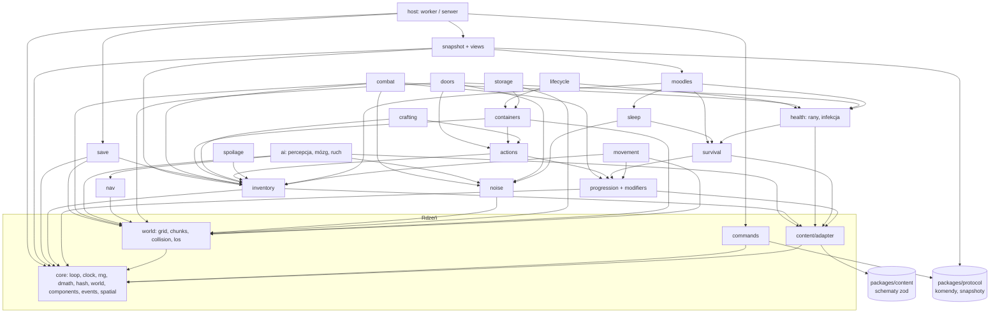

# Architektura `packages/sim`

Status: uzgodniona architektura (Symulacja, 30.09.2026).
Dotyczy: `packages/sim`, a także styku z `packages/content`, `packages/protocol`, `apps/game` i `apps/server`.
Źródła: `docs/PLAN.md` (zasady architektury 1–5, etapy) oraz `docs/TASKS.md`.

Ten dokument opisuje, jak zbudujemy symulację: strukturę kodu, kontrakty między modułami i kolejność prac. Kodu pakietu jeszcze nie ma. Szkielet monorepo (pnpm + Turborepo, TS strict, Vitest) przygotowuje Silnik, a `packages/sim` powstanie na nim w Etapie 1.

---

## 1. Cele i ograniczenia

### 1.1 Cele
1. **Jeden kod symulacji wszędzie.** Ten sam pakiet działa w Web Workerze w przeglądarce, w Node na serwerze (później multiplayer), w testach Vitest i w narzędziach typu replay.
2. **Determinizm.** Stan początkowy (seed, zawartość, opcjonalny zapis) plus ta sama sekwencja komend daje bit w bit ten sam stan po każdym ticku. Na tym opierają się replay, testy regresji, wykrywanie rozjazdów w multiplayerze i powtarzalne błędy.
3. **Zawartość jako dane.** Sim nie zna konkretnych przedmiotów, receptur, cech ani typów zombie. Wszystko przychodzi z `packages/content` (schematy zod od Modules) jako zwalidowany pakiet danych.
4. **Komendy zamiast bezpośrednich zmian stanu.** Z zewnątrz stan zmieniają wyłącznie komendy. Render i UI tylko czytają snapshoty i zdarzenia.
5. **Budżet wydajności.** 200 aktywnych zombie plus gracz mieszczą się w średnio **≤ 4 ms na tick** (p95 ≤ 8 ms) na średnim laptopie. Przy 20 Hz budżet ticku to 50 ms, ale worker dzieli CPU z renderem, więc liczymy z dużym zapasem.

### 1.2 Twarde ograniczenia (egzekwowane narzędziami)
| Zasada | Jak egzekwujemy |
|---|---|
| Brak DOM, Three.js, React | `tsconfig` pakietu ma `"lib": ["ES2022"]` bez `DOM` i `WebWorker`. ESLint `no-restricted-imports` blokuje `three`, `react` i `apps/*`. |
| Brak `Math.random` | ESLint `no-restricted-properties` (`Math.random`). Jedyne źródło losowości to `core/rng`. |
| Brak zegara ściennego | ESLint `no-restricted-globals` / `no-restricted-properties`: `Date`, `performance`, `setTimeout`, `setInterval`, `queueMicrotask`, `requestAnimationFrame`. Czas w sim to wyłącznie numer ticku. |
| Brak niedeterministycznych funkcji matematycznych | `Math.sin`, `cos`, `tan`, `atan2`, `exp`, `log`, `pow` (z niecałkowitym wykładnikiem) i `hypot` zakazane w sim. Używamy `core/dmath` (patrz 1.4). |
| Brak asynchroniczności w ticku | `step()` jest synchroniczne. Żadnych `Promise` ani `await` wewnątrz systemów. I/O (zapis, wczytanie zawartości) robi host poza tickiem. |
| Stały krok | `TICK_MS = 50`, `TICKS_PER_SECOND = 20`. Systemy nie dostają `dt` jako zmiennej: każdy liczy w jednostkach „na tick”, a tempo przelicza się ze stałych. |

### 1.3 Stały krok 50 ms i czas gry
- Tick to niepodzielna jednostka czasu. Stan `N+1 = step(stan N, komendy dla ticku N)`.
- Czas gry: `worldSettings.dayLengthMinutes = 60`, czyli jeden dzień gry trwa jedną godzinę rzeczywistą przy ×1. Przyspieszenie (×2 lub ×4) polega na **wykonaniu większej liczby ticków w tym samym czasie rzeczywistym**, nigdy na wydłużeniu `dt`. Dzięki temu ×1, ×2 i ×4 dają identyczny wynik.
- Zegar gry (`core/clock`) przelicza ticki na minuty, godziny i dni gry zgodnie z `worldSettings.dayLengthMinutes = 60` (wartość zapisana w świecie). Licznik przeżytych dni jest pochodną numeru ticku i ticku narodzin postaci.
- Tempa w danych Modules podaje **w punktach statystyki 0–100 na minutę gry** (np. `worldSettings.survival.needs.hungerPerMin = 0.0175`). Przy `dayLengthMinutes = 60` minuta gry to 50 ticków (2,5 s). Systemy przetrwania nie przeliczają temp na tick: liczą **raz na pełną minutę gry** (`clock` zgłasza, które minuty upłynęły w ticku), więc przyrost jest duży względem precyzji f32 i nie kumuluje błędów zaokrągleń.

### 1.4 Jak unikamy rozjazdów float
Zakładamy ten sam silnik JS po obu stronach tylko w singleplayerze. Serwer w Node (V8) i klienci w Firefox (SpiderMonkey) czy Safari (JSC) muszą dawać ten sam wynik, dlatego:
1. **Dozwolone są tylko operacje, które IEEE 754 zaokrągla poprawnie:** `+ - * /`, `Math.sqrt`, `Math.fround`, `Math.floor/ceil/round/trunc`, `Math.abs/min/max`, `Math.imul`. Te dają identyczne wyniki na każdym silniku.
2. **Trygonometria i inne funkcje przestępne** idą przez `core/dmath`. Kąty trzymamy jako liczby całkowite w „binarnych stopniach” (`u16`, 65536 = 360°). `sin`/`cos` biorą wartości z tablicy 4096 wpisów, generowanej przy starcie wyłącznie operacjami z punktu 1 (szereg Taylora lub CORDIC) albo zapisanej na stałe w źródle. `atan2` liczymy przybliżeniem wielomianowym w tych samych operacjach.
3. **Pozycje i prędkości** trzymamy w komponentach `Float32Array`. Każdy zapis przechodzi przez `Math.fround`, więc wartość jest zawsze poprawnie zaokrągloną liczbą f32. Obliczenia pośrednie idą w f64, a zapis do komponentu je kwantyzuje. To wystarcza, bo rozjazd powstaje tylko wtedy, gdy wynik zależy od silnika, a tu nie zależy.
4. **Zakaz FMA i „sprytnych” optymalizacji** nie dotyczy JS (silniki nie łączą `a*b+c` w FMA), ale zakazujemy **sumowania w niezdefiniowanej kolejności**: suma po encjach zawsze w kolejności `StableId`.
5. **Stan logiczny w liczbach całkowitych, gdzie tylko się da:** kafle, HP ścian i drzwi, ilości, XP (w setnych), zegar. Statystyki przetrwania trzymamy w `f32` **w skali 0–100** (jak w danych; temperatura w °C, waga w kg), z tą samą dyscypliną `fround`.
6. **Porównania z progiem** (np. moodle) robimy na wartościach po `fround`, więc wynik progu jest stabilny.
7. **Test krzyżowy:** ten sam scenariusz uruchamiamy w Node i w przeglądarce (Vitest browser mode lub Playwright w Chromium, Firefox i WebKit) i porównujemy hash stanu (patrz 8.3).

Rezerwa: gdyby test krzyżowy wykazał rozjazd, którego nie da się łatwo usunąć, przechodzimy na liczby stałoprzecinkowe (Q16.16 w `Int32Array`) dla pozycji. API komponentów `Position` się nie zmieni, zmieni się tylko implementacja `dmath` i ruchu.

### 1.5 Stała kolejność iteracji
- **Kolejność systemów** jest zapisana w jednej tablicy w `core/pipeline.ts` (patrz 2.3). Nie ma dynamicznej rejestracji w czasie gry.
- **Kolejność encji:** każda encja dostaje `StableId` (rosnący `u32`, nigdy nie odzyskiwany, zapisywany w save). Id encji bitecs mogą być odzyskiwane i po wczytaniu gry będą inne, dlatego systemy wrażliwe na kolejność (zużywające RNG, rozstrzygające konflikty, sumujące) iterują po wyniku zapytania **posortowanym po `StableId`**. Posortowana tablica jest cache'owana per zapytanie i unieważniana, gdy zmieni się skład zapytania (dodanie lub usunięcie komponentu). Koszt jest znikomy, bo skład zmienia się rzadko.
- **Brak iteracji po kluczach obiektów z danymi.** Rejestr zawartości ma tablice posortowane po `id` (string), a indeksy numeryczne nadaje się w tej kolejności.
- `Map` i `Set` iterują w kolejności wstawiania, co jest deterministyczne, ale w stanie symulacji i tak preferujemy tablice lub mapy z kluczami `StableId` sortowane przy zapisie.
- **Rozstrzyganie remisów** jest zawsze jawne: kolejka priorytetowa A* porównuje `(f, h, indeksKafla)`, wybór celu przez zombie porównuje `(dystans², StableId)`.
- **Komendy w ticku** stosujemy w kolejności `(playerId, seq)` (patrz 2.4).

---

## 2. Struktura `packages/sim/src` i moduły

### 2.1 Drzewo katalogów
```
packages/sim/
  package.json          # zależności: bitecs, @deadzone/content, @deadzone/protocol
  tsconfig.json         # lib: ES2022, bez DOM
  src/
    index.ts            # publiczne API: createSim, loadSim, Sim (step, enqueue, snapshot, serialize, hash)
    core/
      loop.ts           # FixedStepLoop: akumulator (niezależny od hosta, czas podaje host)
      clock.ts          # tick → czas gry, dzień, pora doby, oświetlenie globalne
      rng.ts            # sfc32 + splitmix32, nazwane strumienie, RNG pochodne (chunk, encja)
      dmath.ts          # kąty u16, tablice sin/cos, atan2, isqrt, lerp z fround
      hash.ts           # hash stanu (xxHash32 po kanonicznej serializacji)
      world.ts          # SimWorld: świat bitecs + zasoby (grid, itemStore, rng, eventy)
      components.ts     # rejestr komponentów: nazwa, schemat pól, wersja, serializowalny?
      pipeline.ts       # jedyna lista systemów i ich faz
      events.ts         # bufor zdarzeń ticku (SimEvent[])
      spatial.ts        # spatial hash (komórki 4×4 kafle) z deterministyczną kolejnością
      stableSort.ts     # cache posortowanych zapytań
    content/
      adapter.ts        # ContentBundle (z packages/content) → indeksy numeryczne, stałe per tick
    commands/
      queue.ts          # kolejka per tick, porządkowanie, okno ticków
      validate.ts       # walidacja strukturalna i gameplayowa
      apply.ts          # dispatch komend do intencji w komponentach
    world/
      grid.ts           # siatka kafli: typ, przechodniość, ściany krawędziowe, pomieszczenia
      chunks.ts         # chunki 32×32, wczytywanie, diffy
      collision.ts      # kolizje okrąg–kafel, okrąg–okrąg
      los.ts            # linia wzroku (DDA po kaflach i krawędziach)
    systems/
      movement/         # intencja ruchu → prędkość → kolizje → pozycja
      survival/         # statystyki przetrwania
      moodles/          # progi statystyk → poziomy moodli
      health/           # części ciała, rany, krwawienie, leczenie, infekcja
      sleep/
      inventory/        # ekwipunek, torby, ręce, waga
      containers/       # kontenery, przeszukiwanie, generowanie lootu
      storage/          # schowki stawiane i przenoszone
      spoilage/         # psucie jedzenia (leniwie)
      noise/
      ai/               # percepcja (wzrok, słuch), mózg (FSM), wędrowanie, gonienie
      nav/              # A*, flow field, cache ścieżek
      combat/           # wręcz, palna, rzucanie
      progression/      # umiejętności, XP, cechy (także dynamiczne), modyfikatory
      actions/          # kolejka akcji czasowych + rejestr handlerów
      crafting/
      doors/            # drzwi, okna, barykady
      lifecycle/        # śmierć, spawn, sprzątanie encji
    snapshot/
      render.ts         # pakowanie stanu widocznego do bufora binarnego
      views.ts          # widoki UI (ekwipunek, statystyki) jako delty „na zmianę”
    save/
      serialize.ts
      deserialize.ts
      migrations/       # v1 → v2 → …
    host/               # osobny entry point @deadzone/sim/worker (lib: WebWorker)
      worker.ts         # pętla czasu rzeczywistego + protokół wiadomości
      protocol.ts       # re-export typów z @deadzone/protocol
  test/
    fixtures/           # mini-content i mini-mapy do testów
    determinism/        # testy hash, replay, save/load
  bench/                # vitest bench: 200 zombie, pathfinding
```
Reguła warstw (ESLint `import/no-restricted-paths` albo `eslint-plugin-boundaries`): `core` nie importuje niczego z `systems`; `systems/*` importują `core`, `world`, `content` i tylko jawnie wymienione inne systemy (graf w sekcji 3); `host` może importować wszystko, ale nic nie importuje `host`. Każdy system ma testy w `systems/<nazwa>/*.test.ts`.

Konwencja pakietów: nazwy publicznych pakietów mają postać `@deadzone/*` (np. `@deadzone/sim`, `@deadzone/protocol`, `@deadzone/content`). Monorepo używa `module: "NodeNext"` i `moduleResolution: "NodeNext"`; importy względne w TypeScript mają rozszerzenie `.js`. `packages/sim` nie importuje `three`, `react`, `node` ani DOM; egzekwuje to ESLint oraz `tsconfig` z biblioteką `ES2022` bez `DOM` i `WebWorker`.

### 2.2 Rdzeń

#### Pętla ticku z akumulatorem (`core/loop.ts`)
Sim sam nie zna czasu rzeczywistego. Host (worker, serwer) wywołuje `advance(realDeltaMs)`:
```ts
interface LoopState { accumulatorMs: number; speed: 0 | 1 | 2 | 4; maxTicksPerAdvance: number }
// advance: acc += realDeltaMs * speed; while (acc >= 50 && n < max) { sim.step(); acc -= 50; n++ }
// Jeśli n == max, nadmiar akumulatora jest obcinany (ochrona przed „spiralą śmierci”).
// Zwraca alpha = acc / 50 dla interpolacji renderu.
```
Akumulator i `speed` należą do hosta, nie do stanu symulacji: nie są hashowane ani zapisywane. Stan sim zmienia wyłącznie `step()`. `maxTicksPerAdvance` domyślnie 5 przy x1 i proporcjonalnie więcej przy przyspieszeniu, z limitem budżetu czasu (patrz 5.4).

#### RNG z seedem (`core/rng.ts`)
- Generator **sfc32** (stan 4 × u32, okres ≥ 2¹²⁸, szybki na `Math.imul` i przesunięciach). Seed rozkładamy przez **splitmix32**.
- **Osobne strumienie**, żeby zmiana w jednym systemie nie przesuwała losowości w innych (np. dodanie rzutu w walce nie zmienia lootu):
  | Strumień | Użycie |
  |---|---|
  | `world` | decyzje globalne, spawn hord, pogoda (później) |
  | `ai` | wędrowanie, rozrzut decyzji zombie |
  | `combat` | trafienia, obrażenia, ugryzienia, rozrzut broni palnej |
  | `health` | infekcja, powikłania ran |
  | `survival` | drobne losowe zdarzenia przetrwania i snu |
  | `actions` | sukces akcji, np. rozbiórki |
  | `progression` | losowe elementy XP i cech dynamicznych |
  | `physics` | `gaitSeed` zombie przy spawnie, rzuty zachwiania i przewrócenia, czas leżenia (2 losowania na trafienie), rozrzut obrażeń od naporu tłumu (1 losowanie na impuls naporu), taranowanie autem (1 losowanie na reakcję: czas leżenia) |
- **RNG pochodne** (bezstanowe z punktu widzenia zapisu): `rngFor(seed, 'loot', chunkX, chunkY, containerIndex)`. Loot kontenera zależy tylko od seeda i położenia, a nie od kolejności odwiedzania. Dzięki temu „zapis = seed + diff chunków” działa: nieotwarty kontener nie musi być zapisany.
- Strumień to obiekt `{ s0, s1, s2, s3 }` przechowywany w `SimWorld.rng`. Zapis gry zapisuje cztery u32 każdego strumienia.
- API: `nextU32()`, `nextFloat()` (`[0,1)` z 24 bitów przez `fround`), `int(min, max)`, `chance(p)`, `pickWeighted(table)`. Wagi w tablicach lootu są całkowite.

#### Świat ECS (`core/world.ts`)
```ts
interface SimWorld {
  ecs: World;               // bitecs
  tick: number;             // u32, numer bieżącego ticku
  seed: number;
  options: WorldOptions;    // worldSettings.dayLengthMinutes = 60, opcje sandboxa
  content: ContentIndex;    // tylko do odczytu
  rng: Record<RngStream, Sfc32State>;
  grid: TileGrid;           // world/grid
  items: ItemStore;         // instancje przedmiotów poza ECS (patrz 2.5)
  spatial: SpatialHash;
  noise: NoiseBuffer;       // hałasy bieżącego ticku
  events: SimEvent[];       // zdarzenia dla hosta, czyszczone po odczycie
  nextStableId: number;
}
```
Encje ECS: gracz, zombie, kontener w świecie (szafka, lodówka, skrzynia), stos przedmiotów na ziemi, drzwi, okno, pocisk lub rzucony przedmiot w locie. **Przedmioty w ekwipunku i kontenerach nie są encjami ECS**, tylko rekordami w `ItemStore`. Dom może mieć setki przedmiotów, a ECS służy do rzeczy, które coś robią co tick.

#### Kontrakt contentu (`packages/content` → `packages/sim`)
`ContentBundle` buduje `buildContentBundle(packs)` w `packages/content`: najpierw waliduje dane schematami zod, następnie scala mody w kolejności ładowania i na końcu zamraża wynik. Bundle zawiera pola: `items`, `recipes`, `skills`, `traits`, `professions`, `moodles`, `lootTables`, `zombieTypes`, `worldSettings`. Identyfikator ma format `namespace:nazwa-kebab`, np. `base:canned-beans`; nie dodajemy prefiksu typu. Sim mapuje identyfikatory na indeksy liczbowe wewnętrznie, ale w zapisie zawsze przechowuje stringi.

Jednostki danych są jawne: kg, minuty gry, kafle (1 kafel = 1 m = 1 jednostka świata), statystyki 0–100 i stopnie C. Gdy jednostka nie wynika z kontekstu, jest w nazwie pola, np. `weightKg`, `durationMin`, `rangeTiles`. Modyfikator ma postać `{ stat, op: 'add' | 'mul', value, when? }`; `when` jest opcjonalnym obiektem deklaratywnym (`moodle + minLevel` albo `skill + minLevel`), nigdy kodem. Progi moodli są danymi i zawierają histerezę.

#### Kontrakt mapy i chunków (`world/chunks.ts`)
Mapa demo jest w całości w pamięci, ale sim i render uzyskują do niej dostęp wyłącznie przez API `getChunk` i `getTile`. Chunk ma rozmiar 32×32 i adres `(cx, cy, z)`, gdzie `z` oznacza piętro. Każda warstwa jest płaską tablicą `Uint16Array` długości 1024, indeksowaną `y * 32 + x`; w JSON zapisujemy ją jako RLE lub base64, a w pamięci jako typed array. Budżet mapy wynosi poniżej 15 MB.

Warstwy to `floor` i osobna `roof`; renderer ukrywa `roof` razem ze ścianami na podstawie `buildingId`. Krawędzie północne i zachodnie są zapisane dla każdego kafla wraz z typem (`wall`, `window`, `door`) i id contentu. Stan dynamiczny (otwarte, rozbite, zabite deskami oraz zawartość kontenerów) sim trzyma osobno, poza plikiem chunka. Pokoje mapuje `roomId` na typ i `buildingId`. Od 9.24 `roomId` jest lokalny w chunku (unikalny tylko w nim), a `buildingId` to globalna liczba; mapy contentu zachowują id unikalne na całą mapę (zgodny przypadek szczególny). Obiekt ma id contentu, kafel, rotację `0–3` (co 90°) i opcjonalny offset; światła są obiektami z flagą w content.

Manifest zawiera wersję formatu, rozmiar chunka, wysokość piętra w jednostkach świata i listę chunków. Render pobiera dane przez `getChunk`, a zmiany dostaje jako `chunkChanged` z diffami.

#### Rejestr komponentów (`core/components.ts`)
Komponenty to tablice typowane (SoA) z bitecs. Każdy jest rejestrowany z metadanymi:
```ts
interface ComponentMeta {
  name: string;              // stabilna nazwa w zapisie, np. "Position"
  version: number;           // wersja układu pól (migracje zapisu)
  fields: Record<string, 'f32' | 'i32' | 'u32' | 'u16' | 'u8' | 'i8'>;
  serialize: boolean;        // false dla komponentów pochodnych (cache, np. PathCache)
  hash: boolean;             // czy wchodzi do hasha stanu
}
```
Wspólne komponenty rdzenia: `StableId`, `Position {x, y, floor}`, `Velocity`, `Facing {angle u16}`, `Collider {radius}`, `Kind {kind u8}`, `ContentRef {defIndex}`, `Dead` (tag), `RenderVisible` (tag). Komponenty modułów są opisane przy modułach.

### 2.3 Kolejność systemów (pipeline)
Jedna lista, wykonywana w każdym ticku:

| # | Faza | System | Uwagi |
|---|---|---|---|
| 1 | Wejście | `commands.apply` | komendy ticku N → intencje (`MoveIntent`, `ActionRequest`…) |
| 2 | Czas | `clock` | czas gry, dzień, które minuty gry upłynęły w ticku (systemy 12–14 liczą raz na minutę gry) |
| 3 | Akcje | `actions` | przerwania (ruch, sen, śmierć, zagrożenie), postęp akcji czasowych, zakończenie → efekty (jedzenie, picie, bandaż, przeszukanie, rozpakowanie; później craft) |
| 4 | Ruch | (`movement` od Etapu 4 jest krokiem 10a) | gracz: intencja → prędkość (chód, moodle, w tym `heavy-load`, kara toreb), kolizje z gridem |
| 4a | Ekwipunek | `inventory` | stat `carry-load`, współczynnik prędkości toreb, zamknięcie panelu kontenera poza zasięgiem (co tick, po ruchu) |
| 5 | Świat | `doors` | otwieranie, zamykanie, uderzenia zombie, barykady → aktualizacja gridu |
| 6 | Hałas | `noise.collect` | bufor hałasów: usuwa starsze niż `ai.farThinkEveryTicks` (zombie czytają hałasy z ostatniego okna myślenia) |
| 7–8 | AI | `ai.brain` | percepcja (wzrok, słuch; co 4 ticki według `StableId % 4`, daleko co 20) + FSM: idle ↔ wander, investigate, chase, search |
| 9 | Nawigacja | `nav` | flow field goniących i A* w limicie budżetu |
| 10 | Ruch | `ai.locomotion` | cel → intencja ruchu zombie (pole, prosta, ścieżka), rozpychanie; kolizje liczy wspólny `movement` |
| 10a | Ruch | `movement`, `movement.facing` | gracz i zombie: intencja → prędkość → kolizje z gridem (tu w Etapie 4, bo zombie korzystają z tego samego kroku) |
| 10a° | Pojazdy | `vehicles` | auta (`vehicles/*`): model jazdy, kolizje (ściany, płoty, ciała, auta), taranowanie i przejeżdżanie ciał, drzwi, paliwo, hałas silnika, przypięcie pasażerów do miejsc; auta poza aktywnym oknem chunków są zamrożone |
| 10a′ | Fizyka | `physics` | ciała graczy i zombie (`physics/*`): timery stanów (trafienie, zachwianie, przewrócenie → wstawanie), odrzut z `moveCircle`, idle/walk/run. Ruch czyta ją przez `registerMovementModifier` (obciążenie, wytrzymałość, bezwładność, brak kontroli), a `combat` zgłasza trafienia przez `physicsHit`. Na końcu: wzajemne odpychanie zombie w tłumie (masa, przesunięcie wykonuje ruch w następnym ticku przez `push`) i napór tłumu na zamknięte drzwi / okna / płoty (`physics/crowd.ts`) |
| 10b | Hałas | `noise.footsteps` | kroki graczy, którzy się ruszyli (co `footstepEveryTicks`, promień wg chodu) |
| 10c | AI | `ai.threat` | zagrożenie per gracz (goniące zombie, zombie w promieniu), budzenie hałasem i zombie |
| 11 | Walka | `combat` | ataki gracza i zombie, trafienia, pchnięcia, pociski, rzuty |
| 12 | Zdrowie | `health` | rany, krwawienie, gojenie, zakażenie brudem, wirus, gorączka (przez `sickness`), HP (na minutę gry) |
| 13 | Przetrwanie | `survival` | głód, pragnienie, zmęczenie, wytrzymałość, sytość, waga, nuda, stres, niezadowolenie, przemoczenie, temperatura (na minutę gry) |
| 14 | Sen | `sleep` | zasypianie, regeneracja, budzenie |
| 15 | Rozwój | `progression` | naliczenie XP z bufora, awanse, cechy dynamiczne |
| 16 | Stan | `moodles` | przeliczenie poziomów moodli co tick (na końcu, po wszystkich statystykach) i cache modyfikatorów |
| 17 | Porządek | `lifecycle` | śmierć, zamiana zombie w zwłoki, usuwanie encji, `StableId` |
| 18 | Wyjście | `spatial.rebuild`, `views.diff` | odświeżenie spatial hash i widoków UI; eventy gotowe do odczytu |

Stan po Etapie 4 (PR 1): kolejność w `core/pipeline.ts` to `commands.apply → clock → actions → noise.collect → ai.brain → nav → ai.locomotion → movement → movement.facing → noise.footsteps → ai.threat → inventory → health → survival → sleep → moodles → lifecycle`. Percepcja i decyzje są w jednym kroku `ai.brain` (dla każdego zombie: najpierw percepcja w jego ticku myślenia, potem timery stanu). Spatial hash zombie jest przebudowywany na początku `ai.brain`. `doors`, `combat` i `progression` jeszcze nie istnieją.

`containers`, `storage`, `spoilage` i `crafting` nie mają własnego kroku co tick. Działają przez komendy (1) i handlery akcji (3), a psucie liczy się leniwie. `inventory` (4a) tylko przelicza obciążenie i zasięg panelu; przenoszenie przedmiotów robią komendy. Zmiana kolejności to decyzja architektoniczna: wymaga aktualizacji tego dokumentu i złotych hashy w testach.

### 2.4 System komend
Typy komend i snapshotów leżą w `packages/protocol` (zgodnie z PLAN.md), a sim je importuje. Koperta:
```ts
type PlayerId = number;            // u8/u16 nadawany przez hosta (singleplayer: 0)
interface CommandEnvelope {
  tick: number;                    // tick, w którym komenda ma zostać zastosowana
  playerId: PlayerId;              // w multiplayerze nadaje serwer z połączenia, nie z treści
  seq: number;                     // rosnący numer per gracz (duplikaty, kolejność, ack)
  cmd: Command;
}
type Command =
  | { t: 'move'; dx: -1 | 0 | 1; dy: -1 | 0 | 1; run: boolean; sneak: boolean } // stan „trzymany” do zmiany
  | { t: 'aim'; angle: number /* u16 */ }
  | { t: 'attack'; charge?: boolean }
  | { t: 'shove' }
  | { t: 'interact'; target: StableId }                // drzwi, okno, kontener
  | { t: 'startAction'; action: ActionKind; args: ActionArgs }
  | { t: 'cancelAction' }
  | { t: 'moveItem'; item: ItemId; to: ContainerRef; slot?: number }
  | { t: 'equip'; item: ItemId; hand: 'L' | 'R' | 'both' | 'back' }
  | { t: 'useItem'; item: ItemId }                     // jedz, pij, czytaj → akcja czasowa
  | { t: 'dropItem'; item: ItemId } | { t: 'throwItem'; item: ItemId; angle: number; power: number }
  | { t: 'craft'; recipe: string; count: number }
  | { t: 'placeStorage'; item: ItemId; tile: TileRef; rot: 0 | 1 | 2 | 3 }
  | { t: 'sleep' } | { t: 'wake' }
  | { t: 'reload' } | { t: 'hotbar'; slot: 1 | 2 | 3 | 4 | 5 }
  | { t: 'createCharacter'; profession: string; traits: string[] };
```
- **Stan po Etapie 3** (typy w `protocol/commands.ts`, pole `type` zamiast `t`): `move`, `aim`, `sleep`, `wake`, `bandage {part, itemId?}`, `pickUp {item, count?}`, `drop {item, count?}`, `moveItem {item, to, count?}` (`to` = id kontenera z widoku), `equip {item, slot}` (sloty `EquipSlot` z contentu: `hand_primary` = prawa, `hand_secondary` = lewa, `back`, `belt`, …), `unequip {slot}`, `openContainer {container}`, `closeContainer`, `useItem {item, part?}`, `cancelAction`, `placeStorage {item, x, y}`, `pickUpStorage {container}`, a tylko w trybie dev `debugWound`, `debugStat`, `debugGiveItem {itemId, count?}`. `interact`/`startAction` z listy powyżej zastępują na razie `openContainer` i `useItem`.
- **Stan po Etapie 4 (PR 1):** `move` ma opcjonalne `gait: 'sneak' | 'walk' | 'run'` (domyślnie `walk`; bieg przy wytrzymałości 0 = chód). Dev: `debugSpawnZombie {x, y, z?, count?, zombieType?}` (wolne kafle spiralą wokół punktu) i `debugNoise {x, y, z?, radiusTiles, volume?}`. Zombie na starcie: `createSim({ spawnZombies })` i `init.zombies` w workerze.
- **Kolejka per tick** (`commands/queue.ts`): `Map<tick, CommandEnvelope[]>`. Przed zastosowaniem sortujemy po `(playerId, seq)`. Komenda z `tick < bieżący` jest w singleplayerze przesuwana na bieżący tick (host i tak nadaje tick), a w multiplayerze odrzucana albo przesuwana zgodnie z polityką serwera (6.4). Komendy z tickiem bardziej w przyszłości niż okno (np. 40 ticków) są odrzucane.
- **Walidacja dwustopniowa:** (a) strukturalna, czyli schemat zod z `@deadzone/protocol/schema` na granicy hosta (worker lub serwer), poza tickiem (główne wejście `@deadzone/protocol` ma tylko stałe, typy i kodowanie snapshotu, bez zod, więc nie trafia do bundla wątku głównego gry); (b) gameplayowa w `validate.ts` w ticku, na aktualnym stanie: czy gracz żyje, czy przedmiot jest w jego zasięgu i posiadaniu, czy cel jest w zasięgu interakcji (≤ 1,5 kafla), czy receptura jest znana i spełniona. Odrzucenie nie rzuca wyjątku, tylko emituje zdarzenie `commandRejected { seq, command, reason }` (`command` = typ komendy).
- **Komendy są jedynym wejściem**, więc log `CommandEnvelope[]` plus stan początkowy wystarcza do replaya. Host może go nagrywać (tryb debug, raport błędu).
- Komendy stanowe (`move`, `aim`) ustawiają intencję trwającą do następnej komendy. Nie wysyłamy ruchu co tick, tylko przy zmianie, co zmniejsza ruch sieciowy.

### 2.5 Moduły gameplayu
Format opisu: **Odpowiedzialność / Komponenty i stan / Wejścia / Wyjścia / Zależności / Etap**.

#### Ruch i kolizje (`systems/movement`, `world/*`)
- **Odpowiedzialność:** ruch gracza (chód, bieg, skradanie), obrót do celu myszy, kolizje z kaflami, ścianami krawędziowymi, meblami i innymi encjami, zmiana pięter (schody, później).
- **Komponenty:** `Position`, `Velocity`, `Facing`, `Collider`, `MoveIntent {dx, dy, run, sneak}`, `MoveStats {baseSpeed}`.
- **Wejścia:** komendy `move` i `aim`, modyfikatory z `inventory` (obciążenie), `survival` i `moodles` (zmęczenie, ból), `progression` (sprint, kondycja).
- **Wyjścia:** nowe pozycje, hałas kroków do `noise`, XP „sprint/skradanie” do bufora `progression`, zdarzenie `footstep` dla dźwięków.
- **Zależności:** `core`, `world/grid`, `world/collision`.
- **Etap:** 1 (ruch WASD, celowanie, kolizje).

#### Przetrwanie: statystyki (`systems/survival`)
- **Odpowiedzialność:** głód, pragnienie, zmęczenie, wytrzymałość (stamina), nuda, stres, niezadowolenie, temperatura ciała (od pory doby, odzieży, wysiłku, później pogody), waga ciała w dłuższym okresie (pod cechy otyłość i niedowaga).
- **Komponenty:** `vitals` (SoA f32 w `SurvivalWorld`, klucze = id statystyk z contentu: `health`, `hunger`, `thirst`, `fatigue`, `endurance`, `pain`, `stress`, `panic`, `boredom`, `unhappiness`, `sickness`, `infection`, `wetness`, `bleeding`, `satiety`, `body-temperature-c`, `body-weight-kg`; 0–100 poza °C i kg), `kcal` (bilans energii, z niego `body-weight-kg`).
- **Wejścia:** tempa z contentu, modyfikatory z cech, wysiłek z `movement` i `combat`, efekty jedzenia i picia z handlerów `actions`, sen z `sleep`.
- **Wyjścia:** wartości statystyk, obrażenia z głodu i odwodnienia do `health`, zdarzenia progowe przez `moodles`.
- **Zależności:** `core`, `content`, `progression/modifiers`.
- **Etap:** 2.

#### Moodle (`systems/moodles`)
- **Odpowiedzialność:** zamiana statystyk i stanów na poziomy moodli 0–4 (np. „Głodny 2”, „Ból 3”, „Gorączka”, „Infekcja”, „Obciążony”, „Panika”) według progów z contentu, histereza przy zmianie poziomu, efekty moodli jako modyfikatory (np. ból spowalnia akcje).
- **Komponenty:** `Moodles {level: Uint8Array[MOODLE_COUNT]}`, czyli jeden wpis na zdefiniowany moodle (indeks z `ContentIndex`).
- **Wejścia:** `Stats`, `BodyHealth`, `Inventory.weight`, `Sleep`, stan paniki z `ai` (widoczne zombie).
- **Wyjścia:** poziomy dla `views` (chipy w HUD), modyfikatory dla `movement`, `combat`, `actions`, zdarzenie `moodleChanged {id, from, to}`.
- **Zależności:** `survival`, `health`, `inventory`, `sleep`, `content`.
- **Etap:** 2.

#### Rany i infekcja (`systems/health`)
- **Odpowiedzialność:** ciało podzielone na części (dłonie L/P, przedramiona, ramiona, głowa, szyja, tułów górny i dolny, pachwina, uda, golenie, stopy L/P, łącznie 17 jak w PZ), rany (zadrapanie, rana szarpana, ugryzienie, głęboka rana, złamanie w późniejszym etapie), krwawienie, opatrunki (czyste i brudne), zakażenie rany (brud) oddzielnie od **infekcji zombie** (wirus: nieuleczalny, gorączka, śmierć i przemiana), ból, HP ogólne, śmierć.
- **Komponenty:** HP to `vitals.health`; rany jako lista poza ECS per `StableId` gracza (`Wound {id, part, kind, ageMin, healed f32, bandaged, bandageAgeMin, dirt}`, kilka ran na część ciała), wirus `virus/virusStart/virusIncubation/virusDeath`. Rodzaje ran (`scratch`, `laceration`, `bite`, `deep`) i ich tempa są danymi (`worldSettings.survival.wounds.types`), części ciała to `BODY_PARTS` z `protocol`.
- **Wejścia:** trafienia z `combat` (część ciała, typ, siła), szansa ugryzienia i zadrapania od zombie (RNG `health`, tabele z contentu), akcje `bandage`, `disinfect`, głód i odwodnienie z `survival`.
- **Wyjścia:** HP, ból i gorączka dla `moodles`, zdarzenia `wounded`, `bleeding`, `infected` (ukryte przed graczem do objawów), `died {cause}` dla `lifecycle` i ekranu śmierci.
- **Zależności:** `core`, `content`, `survival`.
- **Etap:** 2 (rany, krwawienie, bandaże, infekcja i gorączka), 4 (ugryzienia i szansa infekcji w walce).

#### Sen (`systems/sleep`)
- **Odpowiedzialność:** zasypianie (warunki: zmęczenie, łóżko lub podłoga, brak widocznych zombie), regeneracja zmęczenia, jakość snu (łóżko, cechy „Insomnia”, „Wakeful”), budzenie przez hałas, ból albo zombie w pobliżu, żądanie przyspieszenia czasu do hosta.
- **Komponenty:** `Sleep {state u8 (awake|falling|asleep), quality f32, startedTick u32}`.
- **Wejścia:** komendy `sleep`/`wake`, `Stats.fatigue`, hałas z `noise`, wykrycie przez `ai`, modyfikatory cech.
- **Wyjścia:** regeneracja w `survival`, zdarzenia `fellAsleep`, `wokeUp {reason}`, **`timeScaleHint {speed}`** dla hosta (singleplayer: host przełącza szybkość; multiplayer: ignorowane albo tylko gdy wszyscy śpią).
- **Zależności:** `survival`, `noise`, `content`.
- **Etap:** 2.
- **Stan obecny:** patrz 9.16 (miejsce snu, limit odpoczynku, zapis po 2 realnych minutach, widok `player.sleep`).

#### Ekwipunek i torby (`systems/inventory`)
- **Odpowiedzialność:** instancje przedmiotów, hierarchia pojemników (postać → założone torby → ich zawartość), waga i obciążenie z **redukcją wagi toreb**, ręce L/P i oburęczne, plecy, szybkie sloty 1–5 (przypisania), podnoszenie, upuszczanie, przenoszenie między pojemnikami.
- **Stan poza ECS (`ItemStore`):**
  ```ts
  interface ItemInstance {
    id: ItemId;               // u32, stabilny, zapisywany
    def: number;              // indeks definicji w ContentIndex
    container: ContainerRef;  // { kind: 'actor'|'bag'|'world'|'ground', id }
    count: number;            // stos
    condition: number;        // trwałość (i16)
    uses: number;             // np. naboje w magazynku, łyki w butelce
    createdTick: number;      // pod psucie
    extra?: Uint8Array | null // rzadkie dane, np. zapisany tekst, lista naboi
  }
  ```
  Komponenty ECS: `Inventory {weightCache f32, capacity f32}`, `Equipped {handL, handR, back}` (ItemId), `Hotbar {slots[5]}`.
- **Wejścia:** komendy `moveItem`, `equip`, `dropItem`, `hotbar`, handlery akcji (zjedzenie zużywa przedmiot), `containers` (przeniesienie z kontenera).
- **Wyjścia:** waga i obciążenie dla `movement` i `moodles`, zdarzenia `inventoryChanged` (dla widoku UI), `itemEquipped`.
- **Zależności:** `core`, `content`.
- **Etap:** 3.
- **Stan po Etapie 3:** `items/store.ts`, `items/inventory.ts`, `systems/inventory.ts`. Przedmiot w ekwipunku to rekord `ItemInstance {id, def, loc, count, condition, uses, ageMin, ageStamp, inner, placed}` (bez `createdTick` i `extra`, patrz 9.6); pojemniki to `ItemContainer` rodzaju `inventory` / `bag` / `world` / `ground`. Założony przedmiot zostaje w głównym ekwipunku, a sloty są osobno (`PlayerItems.slots`), więc waga liczy się raz. Szybkie sloty 1–5 jeszcze nie istnieją.

#### Schowki (`systems/storage`)
- **Odpowiedzialność:** schowki jako kontenery świata z pojemnością (skrzynie, szafki, lodówki, bagażniki później): postawienie skrzyni z przedmiotu (`placeStorage`), podniesienie pustej lub pełnej (waga zawartości wlicza się do przedmiotu), zapis zawartości w diffie chunka, lodówka spowalnia psucie przy zasilaniu (później elektryczność).
- **Komponenty:** `WorldContainer {capacity f32, containerType u8, chunkKey u32, flags}`, `Placeable {sourceDef}`.
- **Wejścia:** komendy `placeStorage`, `interact`, `moveItem`.
- **Wyjścia:** nowe encje kontenerów, zmiany gridu (przeszkoda), zdarzenia `storagePlaced`, `storagePicked`, oznaczenie chunka jako zmienionego (`chunks.markDirty`).
- **Zależności:** `inventory`, `containers`, `world/chunks`.
- **Etap:** 3.
- **Stan po Etapie 3:** schowki z mapy to kontenery `world` tworzone przy starcie z `objects` chunków (typ z `containers/` albo `placeable.containerType`). Postawiona skrzynia to przedmiot na stosie `ground` z flagą `placed` i własnym kontenerem o typie schowka (bez komponentu ECS i bez kolizji). `pickUpStorage` zamienia schowek z mapy z `pickupItem` w przedmiot z zawartością. Diffy chunków i zapis przyjdą z `save`.

#### Kontenery i przeszukiwanie (`systems/containers`)
- **Odpowiedzialność:** kontenery z mapy (meble z definicji chunka), **leniwe generowanie lootu** przy pierwszym otwarciu z tablic dobieranych **po parze pokój + pojemnik** (`lootTable.rooms` i `lootTable.containers`, np. `base:room-kitchen` + `base:kitchen-cabinet`; `chance`, `rolls`, wpisy `item` lub zagnieżdżone `table`), z wagą wpisu skalowaną rzadkością (`rarity` × `worldSettings.loot.rarityWeightPct`: `max(1, floor(weight × pct / 100))`, 0 przy pct = 0, same liczby całkowite) (RNG pochodny od seeda i położenia), akcja „Przeszukaj” z czasem zależnym od umiejętności, zbieractwa i cech, stan „przeszukany”.
- **Komponenty:** `WorldContainer` (wspólny ze schowkami), `LootState {generated u8, searchedBy bitmask}`.
- **Wejścia:** `interact`/`startAction(search)`, loot tables z contentu, typ pomieszczenia z gridu.
- **Wyjścia:** instancje w `ItemStore`, zdarzenia `containerOpened {items}`, `searchComplete`, XP zbieractwa, hałas otwierania (drobny).
- **Zależności:** `inventory`, `actions`, `world/grid`, `content`, `core/rng`.
- **Etap:** 3 (kontenery, przeszukiwanie), 7 (loot tables zależne od pomieszczeń).
- **Stan po Etapie 3:** `items/loot.ts`. Tabela: pierwsza (po id), której `rooms` zawiera typ pomieszczenia schowka, a `containers` jego typ (pusta lista = każdy), inaczej `defaultLootTable` typu. RNG pochodny `deriveSeed(seed, 'loot', x, y, z, typ, ordinal na kaflu)`, generowanie przy pierwszym ukończonym przeszukaniu. Czas przeszukania to `searchMin / search-speed`. Pomieszczenia już działają (warstwa `room` i `rooms` w `SimChunk`).

#### Psucie jedzenia (`systems/spoilage`)
- **Odpowiedzialność:** świeżość jedzenia bez tykania każdego przedmiotu. Świeżość to funkcja `(tick − createdTick) × współczynnik miejsca` z progami „świeże / czerstwe / zepsute” z definicji. Zmiana miejsca (lodówka, gotowanie) zapisuje „wiek efektywny” w `ItemInstance.extra` albo przesuwa `createdTick`.
- **Komponenty:** brak własnych, operuje na `ItemStore`.
- **Wejścia:** definicje (`food.spoilage.freshMin`, `rottenMin` w minutach gry, opcjonalnie `rottenInto`), typ kontenera (`containerType.spoilageMultiplier`: lodówka ×0,3, zamrażarka ×0,05 przy zasilaniu), gotowanie z `crafting`.
- **Wyjścia:** funkcje zapytań `freshness(item, tick)` dla `views`, efektów jedzenia (zatrucie z zepsutego) i hashu (liczone deterministycznie z ticku).
- **Zależności:** `inventory`, `content`, `clock`.
- **Etap:** 3.
- **Stan po Etapie 3:** `items/spoilage.ts`. Zamiast `createdTick` przedmiot ma `ageMin` (wiek efektywny) i `ageStamp` (minuta gry zapisu); wiek teraz = `ageMin + (teraz − ageStamp) × mnożnik kontenera`, a każde przeniesienie najpierw zapisuje wiek. Mnożnik to `spoilageMultiplier` typu schowka (także postawionej skrzyni), przy `requiresPower` tylko z prądem (`ItemStore.powered`, na razie zawsze `true`). Łupy starzeją się od startu świata. `rottenInto` jeszcze nie działa.

#### Hałas (`systems/noise`)
- **Odpowiedzialność:** jeden bufor hałasów na tick: `{x, y, radius, volume, sourceKind, sourceId}`. Źródła: kroki (bieg głośniej, skradanie ciszej), strzał (zależny od broni), rozbicie okna, walenie w drzwi, upadek rzuconego przedmiotu (wabik), akcje (barykadowanie młotkiem), alarmy (później). Tłumienie przez ściany: promień efektywny liczymy prosto, ×0,5 za każdą ścianę na linii (DDA po krawędziach), bez propagacji dźwięku po grafie w demo.
- **Komponenty:** brak (bufor w `SimWorld.noise`), opcjonalnie `NoiseEmitter` dla stałych źródeł.
- **Wejścia:** `movement`, `combat`, `doors`, `actions`.
- **Wyjścia:** bufor dla `ai.perception` i `sleep`, zdarzenia `noise` dla renderu i debug (kręgi hałasu).
- **Zależności:** `core`, `world/los`.
- **Etap:** 4 (w Etapie 1 powstaje sam bufor i hałas kroków).
- **Stan po Etapie 4 (PR 1):** `ai/noise.ts`. `emitNoise(w, x, y, z, radius, volume, source, lingerSec?)` dopisuje do `AiWorld.noises` (stan, w hashu); źródła `NOISE_SOURCES`: `footstep`, `action`, `break`, `attack`, `shot`, `impact`, `lure`, `debug`. Słyszalność: odległość ≤ `radius × hearingRange / noise.referenceHearingTiles × wallMul^ściany` (ściany i okna na prostej, DDA po krawędziach, maks. `maxWalls`); między piętrami dodatkowo × `floorMul^różnica pięter` (patrz 9.17). Kroki co `footstepEveryTicks` (0,5 s): skradanie 1,5 kafla, chód 5, bieg 12 (× stat `footstep-noise`). Start akcji czasowej robi mały hałas (`noise.actions`). Rozbijanie nie istnieje bez `doors`; źródło `break` czeka. W trybie dev każde źródło daje zdarzenie `noise`.

#### AI zombie (`systems/ai`)
- **Odpowiedzialność:** percepcja (wzrok: stożek, zasięg zależny od światła i skradania, LOS po gridzie; słuch: hałasy z bufora w promieniu), pamięć celu (ostatnia znana pozycja z czasem wygaśnięcia), FSM zachowań: `idle` → `wander` → `investigate(noise)` → `chase(target)` → `attack` / `bangDoor` / `lunge`, utrata celu i powrót do wędrowania. Gromadzenie się w hordy wynika z tego, że zombie podążają za hałasem i za innymi goniącymi zombie (odpowiednik „stadnego” zachowania z PZ).
- **Komponenty:** `Zombie {typeIndex}`, `ZombieStats {hp, speed, sightRange, hearingRange, strength}` (z typu, z rozrzutem RNG przy spawnie), `Brain {state u8, stateTick u32, targetId u32, targetX, targetY, memoryUntil u32}`, `Perception {nextThinkTick u32}`.
- **Rozkład obciążenia:** percepcja i decyzje co 4 ticki (5 Hz), rozłożone według `StableId % 4`. Ruch liczony jest co tick. Zombie daleko od graczy (> 2 chunki) przechodzą w tryb uproszczony (wędrówka co 20 ticków, bez LOS).
- **Wejścia:** pozycje graczy, bufor hałasu, `grid` (LOS, światło), typy zombie z contentu, RNG `ai`.
- **Wyjścia:** intencje ruchu dla `ai.locomotion`, żądania ścieżki dla `nav`, żądania ataku dla `combat`, uderzenia w drzwi dla `doors`, zdarzenia `zombieAlerted` (dźwięk, wskaźnik zagrożenia w HUD).
- **Zależności:** `noise`, `nav`, `world/los`, `core/spatial`, `content`.
- **Stan po Etapie 4 (PR 1):** `ai/{state,zombies,brain,locomotion,threat,vision,commands,hash,config}`. Komponent `Zombie {is, type, state, stateTick, targetId, tx, ty, memoryUntil, alert, hp, speedMul, stuck}`, ciało jak gracz (`Position`, `Velocity`, `Facing`, `Collider` 0,3, `MoveIntent`, `AimIntent`, `MoveStats`). Typy z `bundle.zombieTypes` (posortowane po id): prędkości `wander`/`chase` (kafle/s → na tick, rozrzut ±10 % przy spawnie), `sightRangeTiles`, `hearingRangeTiles`, `health`, `spawnWeight` (losowanie typu strumieniem `world`). Stany: `idle` (pauza 2–8 s) → `wander` (cel ≤ 6 kafli), `investigate` (idzie do hałasu, czeka 4–10 s albo `lingerSec` wabika), `chase` (widzi gracza; pamięć 6 s po utracie wzroku), `search` (8 s wokół ostatniej pozycji) → `idle`. Głośniejszy hałas przejmuje badanie; gonienie ze świeżą pamięcią ignoruje hałasy. Wzrok: patrz „Widzenie” niżej. Zdarzenie `zombieAlerted {zombie, reason: 'noise'|'sight', x, y}` przy wejściu w badanie lub gonienie. Zombie przy graczu (`reachTiles`) staje i się obraca; ataki przyjdą z `combat`. Zombie nie zderzają się ze sobą (tylko miękkie rozpychanie) ani z graczem.
- **Widzenie (`ai/vision.ts`, ten sam model dla gracza i zombie, dane `worldSettings.vision`):** zasięg = zasięg bazowy (gracz `dayRangeTiles`, zombie `sightRangeTiles` typu) × czynnik światła przy celu. Czynnik: 1 w dzień, `nightFactor` w nocy (liniowo o świcie 5–7 i zmierzchu 19–21, stałe w `ai/config.ts`), w świetle + `lightBonus × intensity`, najwyżej 1. Światła: obiekty mapy z blokiem `light` (`requiresPower` tylko przy zasilaniu) i światło w ręce (`tool.light`, np. `base:flashlight`, albo placeable z `light` bez zasilania). Stożek latarki i bateria nie są jeszcze symulowane (świeci, gdy jest w ręce). Strefa mapy z `role: 'dark'` liczy się jak noc; gracz w niej bez światła jest dla zombie niewidoczny (ale słyszalny), światło go zdradza. `enabled: false` wyłącza model (pełna widoczność). Skradanie × `sneakVisibilityMul`. Zombie widzą w stożku ±70° od kierunku patrzenia, bliżej niż 2,5 kafla dookoła; linia wzroku po krawędziach (`world/los.ts`): ściany blokują, okna (i drzwi, na razie otwarte) nie. Hook kar gracza `sightPenaltyMul` (ból > 40, gorączka > 37,5 °C, mnożone, min. 0,4) i `playerSightRange()` pod UI i walkę.
- **Etap:** 4.

#### Pathfinding i flow field (`systems/nav`)
- **Odpowiedzialność:** A* na siatce kafli (8 kierunków, koszty całkowite 10/14, zakaz ścinania rogów przy ścianach, drzwi zamknięte jako koszt „do rozbicia” dla zombie, nieprzechodnie dla ścieżki gracza), **flow field** (Dijkstra od kafla celu w oknie 64×64 kafle wokół gracza), aktualizowany, gdy gracz zmieni kafel, najczęściej co 5 ticków. Zombie w trybie `chase` w zasięgu pola czytają kierunek z pola (koszt O(1) na zombie, co daje hordy). Pojedyncze zombie idące do hałasu poza polem używają A* z cache.
- **Budżet:** maks. 2000 rozwinięć węzłów A* na tick, kolejka żądań FIFO po `(tickŻądania, StableId)`. Niedokończone żądania czekają na następny tick. Brak ścieżki w limicie oznacza ruch „na wprost” z omijaniem.
- **Komponenty:** `PathRequest {goalX, goalY, requestedTick}`, `PathCache` (nie serializowany, odtwarzany po wczytaniu), `FlowFollower` (tag).
- **Stan po Etapie 4 (PR 1):** `nav/{grid-nav,astar,flow,system}`. Maska kroków per kafel (8 bitów, cache per chunk, liczona leniwie) zamiast sprawdzania krawędzi w pętli. A* w oknie bbox + 24 kafle (ponowienie z 64, gdy okno się wyczerpie), limit 1500 rozwinięć na żądanie i 2000 na tick, kolejka FIFO. Ścieżka zombie trzymana w `AiWorld.paths` (w hashu: cel, długość, kursor). Flow field (Dial, okno 64 × 64) per gracz gonionego przez zombie, który nie idzie prosto; przebudowa przy zmianie kafla gracza, najczęściej co 5 ticków. Zombie idzie prosto, gdy odcinek do celu nie przecina krawędzi ani pustki (`walkableLine`, sprawdzane w ticku myślenia). Zablokowany ponad 20 ticków liczy ścieżkę od nowa.
- **Wejścia:** `grid` (przechodniość, drzwi, okna), żądania z `ai`.
- **Wyjścia:** kierunki ruchu, `path` dla debug renderu.
- **Zależności:** `world/grid`, `core`.
- **Etap:** 4.

#### Walka (`systems/combat`)
- **Odpowiedzialność:** walka wręcz (łuk ataku i zasięg z definicji broni, czas zamachu w tickach, koszt wytrzymałości, pchnięcie powalające zombie, dobijanie leżących, szansa trafienia i krytyka ze skilla, obrażenia, trwałość broni, pęknięcie broni), broń palna (hitscan z rozrzutem zależnym od skilla, ruchu i moodli, amunicja i magazynki w `ItemInstance.uses`, pudełka amunicji jako osobny rodzaj przedmiotu `ammo_box` (`ammoBox {ammo, count}`, rozpakowanie to akcja), strzelba w danych bazowych to `base:pump-shotgun` (i `base:double-barrel-shotgun`), przeładowanie jako akcja czasowa, hałas strzału, zacięcia przy niskiej trwałości), rzucanie przedmiotami (encja w locie, lot paraboliczny liczony w 2D + wysokość, lądowanie = hałas-wabik, obrażenia przy trafieniu), ataki zombie (zasięg, czas, szansa przebicia odzieży, ugryzienie / zadrapanie / rana szarpana w wylosowaną część ciała).
- **Komponenty:** `Attacker {cooldownUntil u32, swingStart u32, weapon ItemId}`, `Health {hp}` (zombie), `Knockdown {untilTick}`, `Projectile {vx, vy, vz, ownerId, item}`.
- **Wejścia:** komendy `attack`, `shove`, `reload`, `throwItem`, żądania ataku z `ai`, statystyki broni z contentu, modyfikatory `progression`, `moodles`, RNG `combat`.
- **Wyjścia:** obrażenia zombie, trafienia gracza do `health`, hałas do `noise`, XP do `progression`, zdarzenia `hit {attacker, target, part, damage}`, `shot`, `weaponBroke`, `zombieKilled` (licznik zabitych na ekranie śmierci).
- **Zależności:** `inventory`, `health`, `noise`, `world/los`, `core/spatial`, `progression/modifiers`, `content`.
- **Etap:** 4.

#### Umiejętności i cechy (`systems/progression`)
- **Odpowiedzialność:** umiejętności 0–10 w kategoriach (walka, przetrwanie, rzemiosło, ruch), XP za akcje (bufor XP wypełniany przez inne systemy, naliczany w jednym miejscu), mnożniki XP (zawód, cechy, książki: czytanie książki poziomu N daje mnożnik dla poziomów N..N+1), odblokowanie receptur (magazyny), tworzenie postaci z bilansem punktów, **cechy dynamiczne** (zdobywane i tracone z warunkami z danych, np. otyłość z `Nutrition.weightKg`, „Wytrzymały” za długotrwały wysiłek).
- **Warstwa modyfikatorów:** cechy, zawody, moodle i przedmioty produkują modyfikatory `{stat: 'hungerRate', op: 'mul'|'add', value}` z danych. `progression/modifiers` agreguje je per encja do `ModifierCache` (odświeżanym przy zmianie źródeł), a inne systemy tylko go czytają. To główny punkt rozszerzalności pod „setki sposobów rozwoju” i mody.
- **Komponenty:** `Skills {level: Uint8Array[SKILL_COUNT], xp: Uint32Array[SKILL_COUNT]}`, `Traits` (bitset / lista indeksów), `Profession {index}`, `KnownRecipes` (bitset), `ReadProgress` (poza ECS: mapa książka → strony), `ModifierCache` (pochodny, nieserializowany).
- **Wejścia:** bufor XP, `createCharacter`, handlery czytania, warunki cech dynamicznych.
- **Wyjścia:** poziomy i mnożniki dla wszystkich systemów, zdarzenia `xpGained {skill, amount}` (toasty „+3”), `levelUp`, `traitGained/Lost`.
- **Zależności:** `core`, `content` (tu nie zależy od systemów gameplayu; to one zależą od niego).
- **Etap:** 5 (modyfikatory w wersji minimalnej powstają już w Etapie 2, bo potrzebuje ich `survival`).

#### Kolejka akcji czasowych i crafting (`systems/actions`, `systems/crafting`)
- **Odpowiedzialność `actions`:** per gracz kolejka akcji czasowych (przeszukaj, zjedz, wypij, zabandażuj, czytaj, przeładuj, craftuj, zabarykaduj, rozbierz mebel, gotuj). Akcja ma czas w tickach wyliczany przy starcie (bazowy z danych × modyfikatory skilla i moodli), postęp i warunki przerwania (ruch, atak, obrażenia, utrata celu). Po zakończeniu handler z rejestru stosuje efekt. Handlery to jedyne miejsce „zmiany świata” przez akcje.
  ```ts
  interface ActionHandler<A> {
    kind: ActionKind;
    validate(w: SimWorld, actor: Eid, args: A): RejectReason | null;
    duration(w: SimWorld, actor: Eid, args: A): number;   // ticki
    onTick?(w: SimWorld, actor: Eid, args: A, progress: number): void; // np. hałas młotka
    complete(w: SimWorld, actor: Eid, args: A): void;
    interruptOn: InterruptFlags;
  }
  ```
- **Odpowiedzialność `crafting`:** receptury z danych (składniki z ilościami i tagami, np. „dowolna tkanina”, narzędzia nieniszczone, wymagany poziom skilla, stacja: ognisko lub kuchenka, czas, produkty, XP). Wybór konkretnych instancji składników jest deterministyczny (najpierw najbardziej zużyte, remis po `ItemId`). Składniki są rezerwowane przy starcie i zużywane przy zakończeniu. Gotowanie zmienia definicję lub stan przedmiotu, barykadowanie i rozbiórka korzystają z `doors` i gridu.
- **Komponenty:** `ActionQueue {currentKind u8, startTick u32, endTick u32, argsRef u32}` (argumenty w tablicy obok), `ActionReservations` (poza ECS).
- **Wejścia:** komendy `startAction`, `cancelAction`, `craft`, `useItem`, receptury z contentu.
- **Wyjścia:** efekty w innych modułach, zdarzenia `actionStarted {kind, durationTicks}`, `actionProgress` (UI liczy pasek lokalnie z `startTick` i `endTick`, bez eventu co tick), `actionCompleted`, `actionInterrupted`.
- **Stan po Etapie 3:** `actions/queue.ts` (kolejka: bieżąca akcja + do 8 w kolejce, czas liczony przy starcie w minutach gry × ticki na minutę) i handlery w `items/actions.ts`: `search`, `eat`, `drink`, `bandage`, `unpack`. Przerywa: intencja ruchu, sen, śmierć, hook zagrożenia (`threatNearby`), `cancelAction`; przy końcu handler waliduje ponownie (`target-lost`). Zdarzenia `actionStarted {endTick}`, `actionCompleted`, `actionInterrupted {reason}`, widok `action`. Rezerwacje składników przyjdą z craftingiem.
- **Zależności:** `inventory`, `progression`, `content`. Handlery rejestrują moduły docelowe (`health` → bandaż, `containers` → przeszukaj, `doors` → barykada), więc `actions` nie zależy od nich w kodzie.
- **Etap:** `actions` minimalnie w Etapie 3 (przeszukiwanie, jedzenie), pełne w Etapie 6 z craftingiem.

#### Drzwi i okna (`systems/doors`)
- **Odpowiedzialność:** stany drzwi (otwarte, zamknięte, zamknięte na klucz, wyważone) i okien (zamknięte, otwarte, rozbite, z odłamkami szkła, zabarykadowane 1–4 deskami, zasłony), HP drzwi i barykad, uderzenia zombie, rozbicie okna (hałas, ryzyko skaleczenia przy przechodzeniu), wchodzenie przez okno jako akcja czasowa. Aktualizacja gridu (przechodniość, LOS, tłumienie hałasu) przy każdej zmianie stanu.
- **Komponenty:** `Door {state u8, hp i16, lockKey u16}`, `Window {state u8, barricade u8, barricadeHp i16, curtains u8}`, `EdgeRef {tileIndex, side}`.
- **Wejścia:** `interact`, akcje (barykaduj, przejdź przez okno), `ai` (walenie), `combat` (rozbicie bronią lub rzutem).
- **Wyjścia:** zmiany gridu, hałas, rany (szkło) do `health`, zdarzenia `doorChanged`, `windowBroken`.
- **Zależności:** `world/grid`, `noise`, `health`, `actions` (rejestracja handlerów).
- **Etap:** 6 (barykadowanie), 7 (pełne drzwi i okna). Proste otwieranie drzwi potrzebne jest już w Etapie 1 (budynek z wnętrzem), więc wtedy powstaje minimalny `Door`.

#### Zapis gry (`save/*`)
- **Odpowiedzialność:** serializacja i deserializacja całego stanu symulacji, migracje formatu (szczegóły w sekcji 7).
- **Wejścia/wyjścia:** `serialize(world): SaveBlob`, `deserialize(blob, content): SimWorld`. I/O (IndexedDB, chmura) należy do hosta.
- **Zależności:** `core/components` (rejestr), `world/chunks`, `ItemStore`.
- **Etap:** 7 (lokalnie, IndexedDB), 8 (chmura przez API Serwera). Szkielet serializacji i hash powstaje już w Etapie 1, bo używają go testy determinizmu.

#### Pozostałe drobne moduły
- `lifecycle`: śmierć gracza (`died`, zwłoki jako kontener z ekwipunkiem, później przemiana w zombie przy infekcji), śmierć zombie (zwłoki, loot z typu), spawn zombie przy wczytaniu chunka (gęstość z danych mapy i typu strefy), usuwanie encji na końcu ticku (nigdy w trakcie iteracji innego systemu).
- `clock`: licznik dni i pora doby (dla renderu dzień/noc i dla percepcji: światło wpływa na zasięg wzroku zombie).
- Cele i zadania z Etapu 7 („Znajdź benzynę…”): osobny moduł `objectives` na później. Warunki czytane z danych, śledzone przez zdarzenia sim. Opiszę go osobno przed Etapem 7.

---

## 3. Graf zależności modułów

Strzałka `A --> B` oznacza, że A importuje B lub czyta jego stan. Nie ma cykli. Tam, gdzie efekt musi płynąć „pod prąd” (np. `health` bandażuje przez `actions`), stosujemy rejestrację handlerów lub bufory (XP, hałas) w `core`.



---

## 4. Granica z renderem

Render (`apps/game`, Silnik) **nigdy nie czyta stanu ECS bezpośrednio** i nie importuje `systems/*`. Dostaje trzy rodzaje danych:

### 4.1 Snapshot renderu (co tick)
Kompaktowy bufor binarny tylko z tym, co widać (encje z `RenderVisible` w promieniu widoku kamery i w chunkach wczytanych przez klienta):
```ts
interface RenderSnapshotHeader {
  tick: number;
  gameTimeMinutes: number;     // dla oświetlenia dzień/noc
  entityCount: number;
}
// Rekord encji (stały rozmiar 28 B, little-endian):
// u32 stableId | u8 kind | u8 animState | u16 facing | f32 x | f32 y | f32 z
// u16 defIndex (model) | u8 flags (teleport, knockdown, dead, highlighted) | u8 reserved | u32 animStartTick
```
- `animState` to stan logiczny (idle, walk, run, attack, hit, fall, dead, eat, search…), a `animStartTick` pozwala renderowi odtworzyć fazę animacji. Sim nie zna klatek ani animacji Three.js.
- Flaga `teleport` oznacza, że renderer nie ma interpolować tej encji (np. wczytanie, przejście piętra).
- Stan statyczny świata (kafle, ściany) render bierze z danych mapy. Zmiany (drzwi, okna, rozbite szyby, postawione skrzynie) przychodzą jako zdarzenia `tileChanged` / `doorChanged`.

Stan po Etapie 4 (PR 1, `PROTOCOL_VERSION = 5`): bez nagłówka, `SNAPSHOT_ENTITY_STRIDE = 7` floatów f32 na encję: `stableId, x, y, z, facingRad, kind, anim`. Pierwszy rekord to lokalny gracz, potem pozostali gracze i zombie w kolejności `StableId`. `kind` = `SnapshotEntityKind` (`1` gracz, `2` zombie, `0` nieznany, np. dane mock), `anim` = `SnapshotAnim` (`0` idle, `1` walk, `2` run, `3` attack (zarezerwowane), `4` dead). Zombie: `run` w gonieniu, `walk` w pozostałych stanach ruchu. Gracz: `run` przy chodzie `run`, `dead` po śmierci.

Od `PROTOCOL_VERSION = 6` stride wynosi 8: na końcu rekordu jest `hpPct` (f32, 0–1). Dla gracza to zdrowie / 100 (1 bez contentu), dla zombie HP / `health` jego typu, a martwa encja ma 0 (`SnapshotField.hpPct = 7`).

### 4.2 Widoki UI (przy zmianie)
HUD i UI (DOM z `packages/ui`) potrzebują danych bogatszych, ale rzadziej zmiennych: ekwipunek, statystyki, moodle, umiejętności, aktualna akcja, lista przedmiotów otwartego kontenera. `snapshot/views.ts` utrzymuje wersję każdego widoku i wysyła **deltę tylko przy zmianie**, maksymalnie raz na tick:
```ts
type ViewPatch =
  | { v: 'player'; stats: {...}; moodles: [id, level][] }
  | { v: 'inventory'; containers: ContainerView[] }        // pełny widok zmienionego pojemnika
  | { v: 'action'; kind; startTick; endTick } | { v: 'skills'; ... };
```
Stan po Etapie 2: zaimplementowany jest widok gracza i zegara jako `SimViewPatch { clock?, player? }` w `protocol/views.ts` (wiadomość `{ kind: 'view', tick, view }`). Każde pole jest opcjonalne i oznacza zmianę: `stats` zawiera tylko zmienione statystyki (zaokrąglone do 0,1), `moodles` tylko zmienione poziomy (`{ id, level }`, 0 = zniknął), `wounds` pełną listę po każdej zmianie ran. Pierwszy widok po `init` jest pełny (patrz 9.5).

Stan po Etapie 3: `SimViewPatch` ma też `inventory` (nagłówek `{container, loadKg, capacityKg, hardLimitKg, carryLoad, equipped}` przy każdej zmianie plus `containers` z pełnym widokiem tylko zmienionych pojemników: główny ekwipunek i kontenery noszonych toreb, oraz `removed`), `container` (otwarty kontener w pełni albo `null`), `nearby` (schowki i stosy na ziemi w zasięgu, `searched`) i `action` (`{kind, startTick, endTick, item?, container?, part?, queued}` albo `null`). `ItemView` ma `def` (id contentu), `count`, `weightKg`, `condition?`, `uses?`, `freshness?`, `container?` (torba), `equipped?`, `placed?`.

Stan po Etapie 4 (PR 1): `SimViewPatch.threat` to poziom zagrożenia 0–100 dla HUD (25 za każde zombie goniące gracza, 10 za każde inne w promieniu `survival.sleep.wakeOnZombieTiles`, maks. 100); `clock.fastForwardBlocked` jest teraz prawdziwe.

### 4.3 Zdarzenia (co tick, lista)
`SimEvent` to unia dyskryminowana z `packages/protocol`: `footstep`, `noise`, `hit`, `shot`, `zombieAlerted`, `windowBroken`, `doorChanged`, `tileChanged`, `chunkChanged`, `xpGained`, `levelUp`, `moodleChanged`, `wounded`, `actionStarted/Completed/Interrupted`, `commandRejected`, `died`, `dayPassed`, `timeScaleHint`. Render używa ich do dźwięków, efektów cząsteczkowych, toastów i ekranu śmierci. Zdarzenia **nie są źródłem prawdy**: pominięcie zdarzenia nie może zepsuć stanu klienta, bo stan odtwarzamy ze snapshotu i widoków.

### 4.4 Interpolacja renderu między tickami
- Klient trzyma dwa ostatnie snapshoty `prev` (tick N−1) i `curr` (tick N). Rysuje stan `lerp(prev, curr, alpha)`, gdzie `alpha = czasOdOdbioruCurr / 50 ms` obcięte do [0, 1]. Przy braku nowego snapshotu klatka zostaje na `curr` (bez ekstrapolacji w singleplayerze).
- Kąt interpolujemy po najkrótszym łuku (`u16` różnica ze znakiem). Encje obecne tylko w `curr` pojawiają się bez interpolacji, a tylko w `prev` znikają (albo gra animacja śmierci ze zdarzenia).
- Efektywne opóźnienie obrazu to ~50 ms. Żeby celowanie było responsywne, **renderer obraca model gracza bezpośrednio z myszy** (kosmetycznie), a sim dostaje `aim` tylko przy zmianie kąta o ≥ 1° lub co 2 ticki. Ruch gracza w singleplayerze nie wymaga predykcji. Jeśli testy pokażą, że 50 ms przeszkadza, dodamy lokalną predykcję ruchu (patrz 6.2), bo `movement` jest czystą funkcją.
- Przy przyspieszeniu gry (×2/×4) render nadal interpoluje dwa ostatnie snapshoty, a worker wysyła tylko ostatni snapshot z paczki ticków wykonanych w jednej klatce.

---

## 5. Działanie w Web Workerze

### 5.1 Podział
- **Main thread** (`apps/game`): Three.js, HUD w DOM (`packages/ui`), wejście (klawiatura, mysz) → komendy, dźwięk, IndexedDB (albo worker, patrz 7.4).
- **Worker** (`@deadzone/sim/worker`): trzyma `SimWorld`, prowadzi pętlę czasu rzeczywistego i wysyła snapshoty. To jedyne miejsce z `performance.now()` i `setTimeout`, ale poza pakietem rdzenia (`src/host`).

### 5.2 Protokół wiadomości
Typy leżą w `packages/protocol`. Każda wiadomość ma pole `type`.

**Main → worker (w górę):**
```ts
type ToWorker =
  | { type: 'init'; content: ContentBundle; newGame?: { seed: number; options: WorldOptions }; save?: ArrayBuffer }
  | { type: 'commands'; batch: Omit<CommandEnvelope, 'tick'>[] }  // tick nadaje worker przy odbiorze
  | { type: 'setSpeed'; speed: 0 | 1 | 2 | 4 }                 // 0 = pauza, tylko singleplayer
  | { type: 'requestSave'; reqId: number }
  | { type: 'returnBuffer'; buffer: ArrayBuffer }                   // oddanie bufora snapshotu do puli
  | { type: 'debug'; op: 'hash' | 'dumpEntity' | 'toggleOverlay'; arg?: unknown };
```
**Worker → main (w dół):**
```ts
type FromWorker =
  | { type: 'ready'; tick: number; contentHash: string }
  | { type: 'frame'; tick: number; snapshot: ArrayBuffer /* transferable */; views: ViewPatch[]; events: SimEvent[] }
  | { type: 'saveData'; reqId: number; blob: ArrayBuffer /* transferable */; meta: SaveMeta }
  | { type: 'perf'; tickMsAvg: number; tickMsP95: number; ticksBehind: number; entities: number }
  | { type: 'error'; message: string; fatal: boolean };
```
- **Transferable z pulą buforów:** worker pakuje snapshot do `ArrayBuffer` i przekazuje go w `postMessage(msg, [buffer])` bez kopiowania. Main po odczycie (albo po odrzuceniu `prev`) odsyła bufor przez `returnBuffer`. Pula 3–4 buforów usuwa presję na GC. Przy 200 zombie i 28 B/rekord to ~6 KB/tick, więc nawet kopiowanie byłoby tanie, ale pula to zero kosztu i gotowość na więcej encji.
- **`views` i `events`** idą strukturalnym klonem, bo są małe i rzadkie.
- **Opcja SharedArrayBuffer:** potrójny bufor snapshotu w SAB z licznikiem `Atomics` (worker pisze do wolnego slotu, podmienia indeks, main czyta najnowszy) usuwa `postMessage` na ścieżce renderu. Wymaga **cross-origin isolation** (nagłówki `COOP: same-origin` i `COEP: require-corp`), co wpływa na hosting, osadzanie zasobów z innych domen i popupy logowania Google (Supabase OAuth). Dlatego domyślnie transferable, a SAB tylko za flagą, jeśli profilowanie pokaże potrzebę. Protokół się nie zmienia: `frame.snapshot` staje się indeksem slotu.

### 5.3 Pauza i prędkość gry
- Pauza (`setSpeed 0`) jest dostępna wyłącznie w singleplayerze. Symulacja stoi i nic się nie wykonuje, ale gracz może otworzyć menu, ekwipunek, umiejętności i mapę oraz układać kolejkę akcji. Komendy menu są przyjmowane bez upływu czasu; kolejka akcji wykona się dopiero po wznowieniu.
- Prędkości singleplayera: ×1, ×2 i ×4 (sterowane `timeScaleHint`). Przy zagrożeniu w pobliżu przyspieszenie jest zablokowane i host wymusza ×1. Worker wykonuje `speed × realDelta / 50` ticków w klatce, z limitem budżetu 12 ms CPU na klatkę workera.
- Karta w tle (`visibilitychange`): main wysyła `setSpeed 0` (singleplayer: automatyczna pauza).

### 5.4 Pętla workera
Pętla opiera się na `setTimeout` lub `MessageChannel` co ~4 ms. Tempo liczymy z `performance.now()`, nie z liczby wywołań. Po wykonaniu ≥ 1 ticku worker wysyła jedną wiadomość `frame` z ostatnim snapshotem, zebranymi zdarzeniami wszystkich ticków i scalonymi widokami. Worker nie zależy od `requestAnimationFrame`.

---

## 6. Później na serwerze (multiplayer)

### 6.1 Ten sam pakiet w Node
`apps/server` importuje `@deadzone/sim` (rdzeń) i ma własnego hosta: pętla `setInterval`/`setImmediate` z akumulatorem, WebSocket (Colyseus albo własny), zapis do Supabase Storage. Rdzeń nie wymaga zmian, bo nie korzysta z DOM ani API przeglądarki. CI od Etapu 1 uruchamia testy determinizmu w Node, więc zgodność jest pilnowana od początku.

### 6.2 Kontrakt multiplayera
Multiplayer działa jako **serwer autorytatywny ze snapshotami/deltami** i predykcją klienta dla ruchu własnej postaci. Klient rekoncyliuje stan: przewija predykcję do ticku z serwera i ponownie stosuje niepotwierdzone komendy. Serwer ukrywa dane poza obszarem zainteresowania i zarządza snapshotami chunków; alternatywny model blokujący nie jest obsługiwany ani planowany.

### 6.3 Co musi zostać deterministyczne mimo snapshotów
- Cały `step()` na serwerze: replay sesji z logu komend (debug, antycheat, odtwarzanie błędów), testy, zgodność zapisów.
- `movement` + `collision` + modyfikatory, które wpływają na ruch po stronie klienta: predykcja musi dać to samo co serwer, inaczej postać „szarpie” przy każdej korekcie.
- Hash stanu jako narzędzie diagnostyczne: serwer może okresowo wysyłać hash stanu gracza, a klient porównuje go z predykcją.

### 6.4 Walidacja komend na serwerze
1. `playerId` z sesji połączenia (Supabase JWT → gracz), nigdy z treści komendy.
2. Schemat zod z `protocol` (typy, zakresy: `dx ∈ {-1,0,1}`, `angle ∈ [0, 65535]`, długości list).
3. Okno ticków: komenda dla ticku z przeszłości dostaje najbliższy przyszły tick (ruch) albo jest odrzucana (akcje z efektem); komendy za daleko w przyszłości są odrzucane.
4. Limity częstotliwości per typ (np. ≤ 1 `craft` na tick, ≤ 30 komend na sekundę łącznie) i `seq` rosnący.
5. Walidacja gameplayowa w `commands/validate.ts` (ta sama co w singleplayerze): własność przedmiotu, zasięg interakcji, możliwość akcji. Serwer nie ufa niczemu, co klient „wie”, tylko sprawdza na swoim stanie.

---

## 7. Zapis gry

### 7.1 Zawartość zapisu
```ts
interface SaveBlobV1 {
  format: 'deadzone-save';
  version: 1;                      // wersja formatu zapisu
  simVersion: string;              // wersja pakietu sim (semver) – diagnostyka
  content: { bundleHash: string; mods: { id: string; version: string }[] };
  seed: number;
  tick: number;
  options: WorldOptions;
  rng: Record<RngStream, [number, number, number, number]>;
  nextStableId: number; nextItemId: number;
  entities: {                      // kolumnowo, posortowane po StableId
    stableIds: Uint32Array;
    components: Record<string /*nazwa*/, { version: number; mask: Uint8Array; fields: Record<string, TypedArray> }>;
  };
  items: { /* kolumny ItemInstance posortowane po ItemId */ };
  chunks: Record<ChunkKey, ChunkDiff>;  // tylko zmienione chunki (kafle, meble, kontenery z wygenerowanym lootem)
  players: PlayerMeta[];               // nazwa postaci, dzień narodzin, statystyki na ekran śmierci
  pendingCommands: CommandEnvelope[];  // komendy już przyjęte na przyszłe ticki
}
```
- **Nie zapisujemy** stanu pochodnego (`PathCache`, `ModifierCache`, spatial hash, flow field, cache sortowań). Odtwarzamy go po wczytaniu, a test 8.3 sprawdza, że odtworzenie nie zmienia przebiegu.
- **Identyfikatory zawartości w zapisie to stringi** (np. `"base:canned-beans"`), a nie indeksy numeryczne. Indeksy zależą od zestawu modów, więc przy zapisie mapujemy indeks → id, a przy wczytaniu id → indeks. Brakujące id (usunięty mod) obsługuje polityka: przedmiot jest usuwany z ostrzeżeniem.
- **Świat = seed + diff chunków** (PLAN.md, zasada 5): chunk nigdy niezmieniony nie trafia do zapisu, bo generuje się ponownie z mapy i RNG pochodnego. Stan wdrożony (LOD, nagłówek `world`, delta komórek i chunków, kody błędów): 9.24.

### 7.2 Kodowanie
Sam obiekt jest „strukturalnie klonowalny”. Lokalnie trafia do IndexedDB bez dodatkowego kodowania (IDB przechowuje TypedArray natywnie). Do chmury i eksportu pakujemy go do binarki: nagłówek JSON z długością plus sekcje TypedArray (albo MessagePack), skompresowane `CompressionStream('gzip')` (dostępne w przeglądarce i Node ≥ 18). Hash SHA-256 bloba jest w metadanych do wykrywania uszkodzeń.

### 7.3 Wersjonowanie i migracje
- `version` formatu rośnie przy każdej niekompatybilnej zmianie. `save/migrations/v1_to_v2.ts` itd. to czyste funkcje `(blob) => blob`, stosowane łańcuchowo przy wczytaniu. Każda ma test na zapisie-fiksturze z poprzedniej wersji (fiksturę commitujemy w `test/fixtures/saves/`).
- Komponent ma własny `version` w rejestrze. Drobne zmiany (nowe pole z wartością domyślną) obsługuje deserializator bez podnoszenia wersji formatu.
- Zapis z nowszej wersji niż obsługiwana jest odrzucany z czytelnym błędem.

### 7.4 Gdzie i kiedy
- **Etap 7:** IndexedDB (`deadzone` → store `saves`: `{id, meta, blob}` plus `saveMeta` do listy). Można utworzyć dowolną liczbę światów; każdy świat ma jedną żywą postać, a śmierć jest permadeath. Po śmierci tworzy się nową postać w tym samym świecie. Autozapis wykonujemy po każdym dniu gry i przy wyjściu. Worker serializuje (to trwa kilka ms) na granicy ticku, a zapis do IDB robi worker albo main (IDB działa w workerze). Zapis nie zatrzymuje renderu.
- **Etap 8:** ten sam blob wysyłany przez API Serwera do Supabase Storage (walidacja rozmiaru, wersji i RLS po stronie Serwera). Metadane w Postgres.

---

## 8. Strategia testów

### 8.1 Narzędzia
Vitest (unit + `vitest bench`), testy w Node w CI. Test krzyżowy przeglądarek przez Vitest browser mode (Playwright: Chromium, Firefox, WebKit) w osobnym jobie CI uruchamianym nocą i przy zmianach w `core/` lub `dmath`.

### 8.2 Testy per system
- Każdy system ma `*.test.ts` obok kodu. Budujemy mini-świat przez `createTestWorld({ seed, content: fixtureContent, map: fixtureMap })` z helperami `spawnPlayer`, `spawnZombie`, `runTicks(n)`, `enqueue(cmd)`.
- Content do testów to małe fikstury (kilka przedmiotów, 1 typ zombie, kilka moodli) zgodne ze schematami z `packages/content`. Testy nie zależą od prawdziwej zawartości gry, więc balans nie psuje testów.
- Przykłady: „bez jedzenia i picia postać umiera w oczekiwanym zakresie ticków” (kryterium Etapu 2), „rana nieopatrzona krwawi, bandaż zatrzymuje krwawienie”, „przeszukanie trwa X ticków i daje loot zgodny z tablicą i seedem”, „zombie słyszy strzał w promieniu R, nie słyszy za dwiema ścianami poza R/4”, „A* znajduje ścieżkę przez otwarte drzwi i nie przez zamknięte”, „crafting zużywa składniki dopiero przy zakończeniu, przerwanie zwalnia rezerwację”.

### 8.3 Testy determinizmu
1. **Ten sam seed + komendy → ten sam hash.** Scenariusz (gracz, 200 zombie, skrypt komend na 6000 ticków) uruchamiamy dwa razy i porównujemy `hash()` co 100 ticków.
2. **Złote hashe:** oczekiwane hashe scenariuszy są zapisane w repo. Zmiana logiki gry zmienia hash świadomie: aktualizacja przez `pnpm test -u` z opisem w PR. Nieoczekiwana zmiana to regresja.
3. **Save/load:** przebieg 2000 ticków ciągiem ma ten sam hash co 1000 ticków → `serialize` → `deserialize` → 1000 ticków. Test łapie niezapisany stan i zależność od kolejności id bitecs.
4. **Niezależność od prędkości:** ten sam log komend przy symulowanym ×1, ×2 i ×4 (inna liczba `advance`, te same ticki) daje ten sam hash.
5. **Krzyżowo:** Node i trzy silniki przeglądarek dają identyczne hashe (8.1).
6. **Niezależność strumieni RNG:** dodatkowy rzut w strumieniu `combat` nie zmienia wygenerowanego lootu.
7. **Statyczne:** reguły ESLint z 1.2 plus test, że pakiet buduje się z `lib: ES2022` (brak typów DOM oznacza błąd kompilacji przy użyciu `window`).

Hash: xxHash32 po kanonicznej serializacji (to samo co zapis, bez pól `hash: false`) plus `tick` i stany RNG. W trybie debug hash co tick pozwala wskazać pierwszy rozbieżny tick i komponent (bisekcja po komponentach).

### 8.4 Testy wydajności
- `bench/zombies200.bench.ts`: mapa 128×128, budynki, 200 zombie w trybie `chase` wokół gracza, flow field aktywny. Mierzymy średni i p95 czas `step()`. Próg w CI: średnio ≤ 4 ms na runnerze GitHub (z tolerancją). Regresja > 20% względem baseline oznacza ostrzeżenie w PR.
- `bench/pathfinding.bench.ts`: 100 żądań A* na mapie miasteczka, pomiar rozwinięć i czasu.
- Alokacje: bench sprawdza, że w stanie ustalonym `step()` nie alokuje (lub prawie nie) nowych obiektów. Bufory są reużywane, a w gorących pętlach nie ma domknięć.
- Kryterium Etapu 4 („200 zombie przy 60 fps”) mierzy Silnik w przeglądarce. Nasz bench pilnuje, żeby sim zmieścił się w swoim budżecie.

---

## 9. Kolejność implementacji i decyzje

### 9.1 Kolejność (zgodna z TASKS.md)
| Etap | Zadanie z TASKS.md | Co powstaje w `packages/sim` |
|---|---|---|
| 0 | (Silnik: monorepo, CI) | czekamy na szkielet; w międzyczasie ten dokument, uzgodnienia z Modules co do `protocol` i `content` |
| 1 | ECS (bitecs), RNG z seedem, system komend | `core/*` (rng, dmath, world, components, pipeline, events, hash), `commands/*`, szkielet `save/serialize` pod hash, `test/determinism` z pierwszymi złotymi hashami, reguły ESLint |
| 1 | Pętla 20 Hz w Web Workerze + interpolacja | `core/loop`, `host/worker`, protokół `ToWorker`/`FromWorker`, `snapshot/render`; interpolację po stronie klienta robimy razem z Silnikiem |
| 1 | Ruch WASD, celowanie, kolizje | `world/grid`, `world/collision`, `systems/movement`, minimalny `Door` (budynek z wnętrzem) |
| 2 | Statystyki, moodle, rany, infekcja, sen | `progression/modifiers` (minimalnie), `survival`, `health`, `moodles`, `sleep`, `lifecycle` (śmierć), `views` dla HUD |
| 3 | Ekwipunek, torby, schowki, kontenery, psucie | `ItemStore`, `inventory`, `containers` (leniwy loot z prostą tablicą), `storage`, `spoilage`, minimalne `actions` (przeszukaj, zjedz, wypij) |
| 4 | AI, hałas, pathfinding, walka, broń palna, rzuty, ugryzienia | `noise` (pełny), `nav` (A* + flow field), `ai`, `combat`, połączenie ugryzień z `health`; bench 200 zombie |
| 5 | Cechy dynamiczne, umiejętności, książki | `progression` (pełny: XP, poziomy, tworzenie postaci, cechy dynamiczne, czytanie) |
| 6 | Kolejka akcji, gotowanie, bandaże, barykady, rozbiórka | `actions` (pełny), `crafting`, handlery barykad i rozbiórki w `doors` i `world` |
| 7 | Drzwi i okna, cele, zapis IndexedDB | `doors` (pełny: okna, rozbijanie, wchodzenie), `objectives`, `save` (pełny + migracje), `world/chunks` z diffami, loot tables z pomieszczeniami |
| 8 | (Serwer: API zapisów) | eksport i import bloba, kompresja, walidacja wersji po stronie serwera (wspólna funkcja z sim) |

### 9.2 Decyzje i kontrakty
- **Czas:** `worldSettings.dayLengthMinutes = 60`; jeden dzień gry trwa godzinę rzeczywistą przy ×1. W singleplayerze dostępne są ×1, ×2 i ×4; przy pobliskim zagrożeniu przyspieszenie jest zablokowane.
- **Pauza:** tylko w singleplayerze. Sim stoi, ale można używać menu, ekwipunku, umiejętności i mapy oraz układać kolejkę akcji; nic nie wykonuje się do wznowienia.
- **Zapisy:** dowolna liczba światów, jedna żywa postać na świat, permadeath. Po śmierci tworzy się nową postać w tym samym świecie. Autozapis jest po każdym dniu gry i przy wyjściu.
- **Mapa:** demo jest w pamięci, lecz dostęp do niej odbywa się wyłącznie przez `getChunk` i `getTile`. Format: chunki 32×32, adres `(cx, cy, z)`, warstwy `Uint16Array[1024]`, krawędzie N/W, osobny `roof`, dynamiczne diffy poza plikiem chunka i budżet poniżej 15 MB.
- **Multiplayer:** serwer autorytatywny, snapshoty/delty i predykcja własnej postaci klienta.
- **Własność pakietów:** `packages/protocol` prowadzi Symulacja. Publiczne pakiety mają nazwy `@deadzone/*`, a kod używa NodeNext i importów względnych z `.js`.
- **Content:** `buildContentBundle(packs)` w `packages/content` waliduje zod, scala mody w kolejności ładowania i zamraża bundle. Identyfikatory mają format `namespace:nazwa-kebab`; sim używa indeksów wewnętrznych, a zapis stringów. Jednostki i deklaratywne modyfikatory są opisane w sekcji 2.2.

### 9.3 Decyzje techniczne (bez blokowania)
- Wersja bitecs: celujemy w aktualną stabilną (0.4.x, komponenty jako dowolne SoA). Jeśli okaże się niestabilna, zostaje 0.3.x (`defineComponent` + `Types`). Rejestr komponentów (2.2) izoluje resztę kodu od tej różnicy.
- Float32 + `dmath` zamiast fixed-point (z planem awaryjnym w 1.4).
- Przedmioty poza ECS (`ItemStore`).

### 9.4 Stan po pierwszym PR Etapu 1 (odstępstwa od powyższego)
Zaimplementowane: `core/{loop,rng,dmath,hash,world,components,pipeline}`, `commands/queue`, `world/{grid,collision}`, `systems/{input,movement}`, `snapshot/render`, `host/{worker-host,worker-entry,client}`. Świadome uproszczenia względem sekcji 2.4, 4.1 i 5.2 (do ujednolicenia w kolejnych PR):
- **Komendy** mają płaską postać `{ tick, playerId, seq, type: 'move', dx, dy } | { …, type: 'aim', x, y }` zamiast koperty `{ …, cmd: { t } }`. `move` przyjmuje wektor analogowy (`dx, dy ∈ [-1, 1]`, długość obcinana do 1), bez `run`/`sneak`; `aim` to punkt świata, a kąt `u16` liczy sim.
- **Protokół workera** używa pola `kind` i wiadomości `init | cmd | pause | resume | speed | release` → `ready | snapshot`. `init.map` to serializowalne `SimMapData` (lista chunków), bo funkcji `getChunk` nie da się przesłać przez `postMessage`. `release` oddaje bufor do puli. Brak jeszcze `views`, `events`, `perf`, `error` i zapisu.
- **Snapshot** to na razie `Float32Array` bez nagłówka: rekordy `[stableId, x, y, z, facingRad]`, gracz pierwszy, liczba encji = `długość / 5` (zamiast 28-bajtowego rekordu z 4.1). Pula buforów używa ponownie tylko buforów o dokładnie pasującym rozmiarze.
- **Kolizje:** okrąg r = 0,3 (kapsuła w rzucie 2D) z kaflami bez podłogi i krawędziami `edgeN`/`edgeW` (każde id ≠ 0 blokuje; adapter `apps/game` przepuszcza na razie krawędzie typu `door` jako otwarte, bo nie ma jeszcze stanu drzwi). Ruch rozdzielony po osiach (najpierw x, potem y) z analitycznym „sweepem”, więc nie ma przenikania przy dowolnej prędkości.
- **Facing** liczy własny `datan2` z `core/dmath` (szereg z redukcją zakresu, tylko `+ - * /`), a nie `Math.atan2`.

### 9.5 Stan po Etapie 2 (Przetrwanie) — kontrakt z danymi i odstępstwa
Dane Modules mają pierwszeństwo przed wcześniejszymi założeniami tego dokumentu. Zaimplementowane: `content/adapter`, `core/clock`, `survival/{state,wounds,commands}`, `systems/{clock,health,survival,sleep,moodles,lifecycle}`, `snapshot/views`.
- **Kontrakt z danymi:** statystyki 0–100 (°C i kg osobno), tempa w punktach na **minutę gry**, wszystkie wartości z `worldSettings.survival` (nazwy pól ze schematów `packages/content/src/schemas/survival`), `dayLengthMinutes = 60`. Rodzaje ran: `scratch`, `laceration`, `bite`, `deep` (złamania później). Psucie: `freshMin`/`rottenMin`, lodówka `spoilageMultiplier = 0.3`. Loot: `rarity` z `worldSettings.loot.rarityWeightPct`, tablice po parze pokój + pojemnik, pudełka amunicji `ammo_box`, strzelba `base:pump-shotgun`.
- **Content w workerze:** `init.content = { packs: [{ dir, files: [{ path, json }] }] }` (surowe pliki JSON paczek w kolejności wczytywania). Worker waliduje je i buduje `ContentBundle` (`buildContentBundle`), więc zod zostaje w workerze. Bez `content` sim działa jak w Etapie 1 (sam ruch), a `getSurvival()` zwraca `undefined`. `createSim({ content })` przyjmuje `ContentBundle` (albo obiekt z `worldSettings`, `moodles`, `items`).
- **Zegar:** start domyślnie dzień 1, 09:00 (jak tryb `base:survival`). `gameTime()` i widok `clock` pokazują czas ostatniego wykonanego ticku. Blokada przyspieszenia to hook `threatNearby()` (na razie zawsze `false`); worker wymusza ×1, gdy `fastForwardBlocked()`.
- **Aktywność:** na razie tylko `idle`, `walking` (niezerowa intencja ruchu) i `sleeping`; bieg, skradanie i walka przyjdą z komendą ruchu z `run`/`sneak` i z walką. Temperatura otoczenia jest stała (20 °C, opcja `ambientTemperatureC`), a schnięcie ma tempo „na zewnątrz”, bo sim nie zna jeszcze dachów.
- **Moodle:** progi i histereza z danych, tylko modyfikatory poziomu bieżącego (nie kumulują się). Na razie działają modyfikatory temp (`hunger-rate`, `thirst-rate`, `fatigue-rate`, `endurance-regen`, `healing-rate`, `move-speed`); pozostałe (np. `aim-accuracy`) przejmą walka i akcje. Moodle na statystykach, których sim jeszcze nie liczy (`carry-load`, `drunkenness`, `comfort`), pozostają ukryte. `injury` = 100 − `health`.
- **Rany:** krwawienie rany = `bleeding × (1 − healed)`, 0 po `clotsAfterMin` (0 = nie krzepnie), bandaż mnoży przez `bleedingMul` (brudny po `dirtyAfterMin`: `dirtyBleedingMul`). Zakażenie brudem losowane co minutę strumieniem `health`. Wirus losowany przy ranie od zombie (`zombieInfectionChance`), `infection` rośnie liniowo do śmierci, `sickness` i gorączka po inkubacji. Od Etapu 3 bandaż jest akcją czasową (`medical.durationMin`) z przedmiotem z ekwipunku, zużywanym na końcu (patrz 9.6).
- **Sen:** komendy `sleep` / `wake`, powierzchnia na razie zawsze `floor` (łóżka z meblami później). Zdarzenia `fellAsleep`, `wokeUp {reason}` i `timeScaleHint` (host decyduje o prędkości).
- **Protokół:** `PROTOCOL_VERSION = 3`. Nowe komendy `sleep`, `wake`, `bandage {part, itemId?}`, tylko w trybie dev (`init.dev`) `debugWound {part, wound, zombie?}` i `debugStat {stat, value}`. Worker → main: `view` (delta `SimViewPatch`: `clock`, `player {alive, sleeping, stats, moodles, wounds}`, tylko przy zmianie), `events` (lista `SimEvent`, m.in. `died`, `wounded`, `moodleChanged`, `dayPassed`) i `error`. Zamiast jednej wiadomości `frame` z 5.2 są osobne `snapshot`, `view` i `events`.
- **Determinizm:** stan przetrwania wchodzi do `hash()` (sekcja dopisywana tylko przy contencie, więc złote hashe samego ruchu się nie zmieniły). Nowy złoty hash scenariusza przetrwania jest w `test/survival-determinism.test.ts`.

### 9.6 Stan po Etapie 3 (Przedmioty i ekwipunek) — kontrakt z danymi i odstępstwa
Zaimplementowane: `items/{store,inventory,loot,spoilage,actions,commands,views,hash}`, `actions/queue`, `systems/inventory`. Content w sim to teraz `worldSettings`, `moodles`, `items`, `containers` i `lootTables`.
- **Mapa:** `SimChunk` ma opcjonalne `room` (warstwa), `rooms` (id → typ pomieszczenia) i `objects` (`{contentId, x, y}` w kaflach lokalnych), a `SimMap.listChunks?()` wylicza chunki. Z tych danych przy starcie powstają schowki świata (ids w kolejności chunków `z, cy, cx` i obiektów). Adapter mapy w `apps/game` musi je przekazać (zadanie Silnika); bez nich sim nie ma schowków.
- **Waga i obciążenie:** udźwig = `carry.baseCapacityKg` (× / + modyfikatory `carry-capacity-kg`; cechy przyjdą z postacią), limit twardy = udźwig × `hardLimitMultiplier` (podnoszenie ponad limit: `no-space`). `carry-load` = ładunek / udźwig × 100, więc moodle `base:heavy-load` (progi 100–175) spowalnia ruch z danych. `overloadSlowdownPerKg` nie jest używane, bo liczyłoby tę samą karę drugi raz (do decyzji Modules). Obciążenie nie zmienia zmęczenia, bo dane nie mają takiego efektu. Torba założona w swoim slocie (`bag.slots`) odejmuje `weightReductionPct` od wagi zawartości, a pełna spowalnia o `movementPenalty × zapełnienie`. `acceptsTags` ogranicza zawartość.
- **Ręce:** `hand_primary` = prawa, `hand_secondary` = lewa; broń `twoHanded` zajmuje obie. Torby tylko w swoich slotach, odzież w swoim slocie, reszta w rękach. Odzież nie daje jeszcze izolacji ani ochrony.
- **Jedzenie i picie:** `nutrition` przedmiotu dotyczy całości i dzieli się na `portions`; napój ma `perUse` na łyk. Głód poniżej 0 zamienia się w sytość (`satiety.perKcalWhenFull`), kalorie idą do bilansu. `openWith` wymaga noszonego narzędzia z tagiem, `emptyInto` zostaje po ostatniej porcji. Czasy akcji nie są jeszcze w danych, więc sim ma stałe (`EAT_PORTION_MIN = 1`, `DRINK_USE_MIN = 0,5`, `UNPACK_MIN = 0,5` minuty gry); propozycja dla Modules: `food.eatMin`, `drink.drinkMin`, `ammoBox.unpackMin`. Makroskładniki, `sicknessChance`, alkohol i efekty zepsutego jedzenia czekają na dane i system zatrucia.
- **Amunicja:** pudełko `ammo_box` rozpakowuje się akcją `unpack` na `ammoBox.count` naboi (stosy po `maxStack`). Broń palna i magazynki mają `uses` = naboje (startowo 0); ładowanie przyjdzie z walką.
- **Stosy:** przedmioty z `maxStack > 1` łączą się tylko przy identycznym stanie; przedmioty z własnym kontenerem (torby, skrzynie) nigdy się nie stackują.
- **Protokół:** `PROTOCOL_VERSION = 4`. Komendy w 2.4, widoki w 4.2. Nowe powody `commandRejected`: `no-item`, `out-of-range`, `no-space`, `missing-tool`, `busy`. Nowe zdarzenia: `actionStarted`, `actionCompleted`, `actionInterrupted`, `containerOpened {firstSearch}`, `itemUsed {action, itemId, freshness?}`. Komenda `bandage` nie jest już natychmiastowa: bierze bandaż z ekwipunku.
- **Determinizm:** cały `ItemStore` (kontenery, przedmioty, sloty, akcje) wchodzi do `hash()`. Złoty hash scenariusza przetrwania zmienił się (nowa sekcja i czasowy bandaż); nowy scenariusz przedmiotów jest w `test/items-determinism.test.ts`. Złoty hash samego ruchu bez zmian.

### 9.7 Stan po Etapie 4, PR 1 (hałas, widzenie, AI zombie, NPC w snapshocie) — kontrakt z danymi i odstępstwa
Zaimplementowane: `ai/*`, `nav/*`, `world/los.ts`, `core/spatial.ts` (opis w 2.5 „Hałas”, „AI zombie”, „Pathfinding”). Content w sim: dodatkowo `zombieTypes` (opcjonalne w `SimContent`).
- **Mapa:** `SimMap`/`SimMapData` mają opcjonalne `zones` (strefy z manifestu `{id, role, z, rects[], tags?}`; sim czyta `role: 'dark'`) i `edgeKinds` (paleta krawędzi: id → `wall` | `window` | `door`). Bez palety każda krawędź blokuje wzrok. Adapter w `apps/game` musi przekazać strefy, paletę krawędzi i obiekty z blokiem `light` (zadanie Silnika).
- **Zagrożenie:** `threatNearby` = zombie goni gracza albo jest bliżej niż `survival.sleep.wakeOnZombieTiles` (6). Blokuje przyspieszenie (`fastForwardBlocked`), zasypianie i przerywa akcje czasowe (`threat`). Śpiącego budzi zombie w promieniu (`wokeUp {reason: 'zombie'}`) albo hałas o głośności ≥ `sleep.wakeOnNoiseVolume`, który do niego dociera (`noise`).
- **Chód:** `move.gait`: bieg × 2,5 (od 9.23; wcześniej × 1,6), skradanie × 0,5 prędkości; potrzeby z `survival.activity.running` / `sneaking`; bieg wymaga wytrzymałości > 0.
- **Konfiguracja bez danych:** stałe Etapu 4 leżą w jednym module `ai/config.ts` (`DEFAULT_STAGE4_CONFIG`, nadpisywalne przez `createSim({ aiConfig })`). Z danych: `worldSettings.vision {enabled, dayRangeTiles, nightFactor, lightBonus}` i `tool.light`. Proponowane dalsze pola dla Modules: `worldSettings.vision {dawnStartMin 300, dawnEndMin 420, duskStartMin 1140, duskEndMin 1260, sneakVisibilityMul 0.6, fovHalfAngleDeg 70, nearSenseTiles 2.5, penalties {painFrom 40, painMulAt100 0.7, feverFromC 37.5, feverFullC 40, feverMul 0.7, minMul 0.4}}`, `worldSettings.noise {footsteps {sneak, walk, run: {radiusTiles, volume}}, footstepEveryTicks, actions {search, eat, drink, bandage, unpack}, wallMul 0.5, maxWalls 4, referenceHearingTiles 30}`, `worldSettings.ai {memorySec 6 (od 9.18: `lostTrackSec` 10 + `lostTrackDistM` 25, w danych), searchSec 8, investigateLingerSec {4, 10}, wanderRadiusTiles 6, wanderPauseSec {2, 8}, speedSpread 0.1}`, `worldSettings.movement {walkSpeedMps 1.5, runSpeedMul 2.5, sneakSpeedMul 0.5}` (w danych od 9.23).
- **Wydajność (`test/ai-perf.test.ts`, Node 22, miasteczko 128 × 128 z budynkami, horda goni gracza):** 200 zombie ≈ 2,1–2,5 ms średnio na tick (p95 ≈ 3–4 ms), 300 zombie ≈ 3,1 ms (p95 ≈ 4 ms). Budżet testu: 4 ms dla 200 i 6 ms dla 300, na CI × `PERF_TOLERANCE` (1,5).
- **Determinizm:** sekcja AI w `hash()` (chód graczy, bufor hałasów, mózgi zombie, postęp ścieżek) tylko przy contencie. Nowy scenariusz hordy (200 zombie, 1500 ticków) w `test/ai-determinism.test.ts`. Złote hashe przetrwania i przedmiotów zmieniły się (nowa sekcja, hałas akcji); hash samego ruchu bez zmian.
- **Odstępstwa:** percepcja i mózg to jeden krok `ai.brain`; `movement` wykonuje się po AI (krok 10a). Brak trybu uproszczonego poza LOS dla dalekich zombie poza rzadszym myśleniem. Zombie nie mają jeszcze kolizji z graczem ani ze sobą (rozpychanie miękkie). Drzwi są otwarte (adapter mapy je usuwa), więc nie ma walenia w drzwi. Brak rozbijania okien (źródło hałasu `break` czeka na `doors`).

### 9.8 Stan po PR „zapis gry + sen” — kontrakt i odstępstwa od rozdz. 7
- **Format (`save/save.ts`, `save/codec.ts`):** `Uint8Array` = nagłówek `{format: 'deadzone-save', version: 1, seed, tick, day, content}` plus stan świata w JSON (TypedArray jako base64 bajtów, `Map`/`Set`, RNG). To odstępstwo od 7.1: zapisujemy cały stan kolumn ECS w kolejności eid zamiast diffu chunków, bo mapa jest stała, a kontenery i loot żyją w `items`. Pomijamy content, konfigurację AI i stan pochodny (spatial hash, cache). `contentFingerprint` (lista paczek i wersji) jest w nagłówku, a obcy format lub wersja daje czytelny błąd. Test `save/save.test.ts`: zapis → odczyt → ten sam `hash()` po N tickach (zombie, walka, loot).
- **API:** `sim.save()` i `createSim({ load })`. Worker: `{kind:'save', requestId, reason?}` → `{kind:'saved', requestId, reason, tick, day, buf}`, `init.save` wczytuje zapis. Klient: `client.save(reason)` (Promise<SavedGame>), `client.onSaved(cb)`, `init({ save })`. IndexedDB: `createSaveStore(indexedDB)` → `put/get/remove/slots` (baza `deadzone`, store `saves`), bez UI.
- **Autozapis (worker):** po `dayPassed` (reason `autosave`), po `sleepSaved` (reason `sleep`). Zapis przy wyjściu robi host: `client.save('exit')`.
- **Sen:** miejsce wykrywane przy zasypianiu (obiekt mapy z `placeable.sleepSurface` w promieniu 1,5 kafla, inaczej podłoga). Limit odpoczynku na jeden sen: `sleep.surfaces.*.maxRecoveryPerSleep` (łóżko 50, kanapa 35, podłoga 25). Po osiągnięciu limitu następuje `wokeUp {reason:'rested'}`. Po `sleep.saveAfterRealSec` (120 s) nieprzerwanego snu w czasie rzeczywistym leci raz `sleepSaved` (od 9.16 liczone z przyspieszeniem hosta, nie z samych ticków). Sen przerwany wcześniej nie daje zapisu, a odpoczynek zostaje częściowy. Budzą: zombie, hałas, ból ≥ `sleep.wakeOnPainAbove` (`'pain'`) i gorączka ≥ `sleep.wakeOnFeverC` (`'fever'`). Zagrożenie blokuje zaśnięcie. Nowe meble: `base:bed`, `base:sofa`.

### 9.9 Stan po PR „drzwi i okna” — kontrakt
- **Stan (`openings/state.ts`, `w.openings`):** krawędzie `door` / `window` z palety `SimMap.edgeKinds` mają stan `open | closed | locked | barricaded | broken` (`OPENING_STATES` w protocol) i hp. Domyślnie z mapy `closed` z pełnym hp. Zapisywane są tylko różnice (klucz: strona, tx, ty, z). Stan wchodzi do hasha (tylko gdy niepusty) i do zapisu gry.
- **Skutki (`TileGrid.flagsN/W`):**
  - drzwi zamknięte, na klucz lub zabite deskami: blokują ruch i wzrok, tłumią dźwięk;
  - drzwi otwarte lub rozbite: nie blokują;
  - okno zamknięte: blokuje ruch, nie wzrok;
  - okno otwarte lub rozbite: przejście z prędkością × `windowSpeedMul` (0,3);
  - okno zabite deskami: blokuje ruch i wzrok.
  - Nawigacja (A*, flow field) zawsze traktuje drzwi i okna jako przejście, więc cache masek nie zależy od stanu.
- **Zombie (`ai.locomotion`):** w stanie pościgu, sprawdzania hałasu lub szukania zombie dochodzi do zamkniętej krawędzi na swojej trasie i uderza co `attackCooldownSec`. Obrażenia typu są mnożone przez `zombieBashMul`, a uderzenie daje hałas `impact` (`bashNoise`). Przy 0 hp: deski → drzwi `closed` albo okno `broken`; drzwi lub okno → `broken` (okno z hałasem `break`). Zamknięte drzwi blokują też atak przez linię wzroku.
- **Komendy:**
  - `toggleDoor {tx, ty, side, lock?}`: zasięg `reachTiles` od środka krawędzi; `locked` → odrzucenie `locked`;
  - `breakWindow {tx, ty, side}`: hałas `break` (`breakNoise`);
  - dev `debugOpening {tx, ty, z?, side, state}`.
- **Dla rendera:** zdarzenie `openingChanged {tx, ty, z, side, kind, state, hp, maxHp, by}` przy każdej zmianie i każdym uderzeniu. Widok `openings` to pełna lista krawędzi różnych od domyślnego stanu, wysyłana przy każdej zmianie i po wczytaniu.
- **Płot (`fence`):** niski płot z palety `edgeKinds` (na razie tylko w sim; schemat mapy w content go jeszcze nie zna). `closed` = stoi (blokuje ruch, nie wzrok ani dźwięk), `broken` = przewrócony (przejście jak przez wybite okno, wolniej). Hp `FENCE_HP` 40, pojedynczy zombie bije go z siłą × `crowd.fenceBashMul` (0.25). `toggleDoor` / `breakWindow` → `invalid-target`.
- **Napór tłumu (`physics/crowd.ts`):** zombie, które uderzają w zamkniętą krawędź, zgłaszają ją (`physicsPress`). Co `crowd.pulseTicks` (0.5 s): napór = Σ masa / refMass × waga szeregu (zombie w promieniu `reachTiles` po tej samej stronie, idące w stronę krawędzi); opór = gracz trzymający od środka (`holdForce`) + deski (`barricadeResist`). Nadwyżka ponad `freeUnits` (jeden zombie: zero, jego uderzenia bez zmian) zadaje obrażenia jak `bashesPerUnit` dodatkowych zombie na jednostkę (`by: 'crowd'`); okno pęka od razu przy `windowBreakUnits`. Zmiana poziomu naporu → zdarzenie `openingPressure {tx, ty, z, side, kind, level 0..3, units, pushers}`. Stałe w `physics/constants.ts` (`crowd`).
- **Dane:** `worldSettings.openings` (`world-settings/openings.json`): `doorHp` 60, `windowHp` 6, `barricadeHp` 150, `zombieBashMul`, `bashNoise`, `breakNoise`, `toggleNoise`, `windowSpeedMul`, `reachTiles`.
- **Zadanie Silnika:** adapter `apps/game/src/world/sim-map.ts` nadal usuwa krawędzie drzwi (są przejściem). Żeby drzwi działały w grze, trzeba przekazać je do sim z `edgeKinds` i rysować stan z `openings` / `openingChanged`. Zabijanie deskami przez gracza przyjdzie z craftingiem (na razie tylko `debugOpening`).

### 9.10 Stan po PR „kary z ran”
- **Dane:** `worldSettings.survival.woundPenalties` (`survival/penalties.ts`, krok pipeline'u `penalties` po `moodles`, co tick, tylko gracze).
  - W grupie ciała (`bodyGroups`) liczy się najcięższa rana; opatrzona daje × `bandagedFactor`. Grupy się sumują.
  - Ból, gorączka i krwawienie od progu `conditions.*.from` dodają utratę widzenia i rozmycie. Poziom gorączki = (temperatura − `bodyBaseC`) / `infection.feverMaxC` × 100.
  - Każda suma jest ucinana do `maxPenalty`, rozmycie do 1.
- **Skutki:**
  - `moveSpeed`: prędkość ruchu gracza;
  - `attackPower`: obrażenia wręcz;
  - `actionSpeed`: czas akcji czasowych (÷ (1 − kara));
  - `visionRange`: zasięg wzroku gracza (`sightPenaltyMul`). Zastępuje wcześniejszy hook `vision.penalties` z `ai/config.ts`, który usunięto.
- **Widok:** `player.penalties {moveSpeed, attackPower, actionSpeed, visionRange, blur}` przy zmianie (nie wysyłamy, dopóki wszystko jest 0). Kary są w stanie (`SurvivalWorld.penalties`), w hashu i w zapisie.

### 9.11 Stan po PR „wabiki i rzucanie”
- **Dane:** przedmioty `kind: 'lure'` (`base:lure-electronic`, `base:lure-running`, pilot `base:lure-remote`, bateria `base:battery`) i blok `throwable` innych przedmiotów. Kod: `lures/lures.ts`, krok pipeline'u `lures` po `actions`.
- **Stan:** `ItemStore.lures` (id przedmiotu → faza, pozycja, timer, kierunek, dystans, następny impuls, linger). Wabik to zwykły przedmiot w kupce na ziemi; podniesienie go zatrzymuje (`lureChanged {phase:'removed'}`). Stan jest w hashu (gdy niepusty) i w zapisie.
- **Elektroniczny:** `placeLure` kładzie go przy graczu i wkłada baterię z ekwipunku (`uses` = `activationsPerBattery`, czyli 3). `triggerLure` działa z pilotem z tagiem `remoteTag` w zasięgu `rangeTiles` (60). Daje hałas `lure.noise` (40 kafli) przez `durationSec` (30 s) impulsami co 1 s. Zombie zostają `lingerSec` (20–40 s, losowane raz na aktywację). Potem wabik wraca do `idle`.
- **Biegający:** `placeLure {delaySec, dirX, dirY}`, opóźnienie przycięte do `trigger.delaySec` (3–30 s). Po opóźnieniu biegnie `runner.distanceTiles` (15) z `speedTilesPerSec` w zadanym kierunku (domyślnie celownik lub ruch gracza); ściany go zatrzymują. Hałasuje przez `durationSec` (20 s, 30 kafli), potem znika (`consumedOnUse`, `lureChanged 'spent'`).
- **`throw {item, x, y, delaySec?, dirX?, dirY?}`:** zasięg `throwable.rangeTiles` (wabik bez bloku: 8). Lot zatrzymuje się na ścianie. Hałas uderzenia z `throwable.impactNoise` (inaczej cichy stuk). Przedmiot z `breaksOnImpact` rozbija się (`brokenInto`), a rzucony wabik ląduje położony lub uzbrojony. Zdarzenie `thrown`. Obrażeń od rzutu jeszcze nie ma.
- **Widok:** `lures` to pełna lista położonych wabików (faza, pozycja, `untilTick`, `charges`) przy każdej zmianie. Zdarzenie `lureChanged` niesie dodatkowo `toX/toY` dla biegu (do tweenowania).

### 9.12 Stan po PR „broń palna”
- **Dane:** przedmioty `weapon_ranged` (`ranged`: amunicja, `feed` wewnętrzny lub magazynek, obrażenia, `rangeTiles`, `accuracy`, `shotsPerSec`, `reloadSec`, opcjonalne `loadSecPerRound`, `projectiles`, `jamChance`, `shotNoise`), `magazine`, `ammo` (`damageMultiplier`), `ammo_box` (rozpakowanie to istniejąca akcja `unpack`). Strojenie trafień jest w `worldSettings.firearms` (`world-settings/firearms.json`): `hitFalloffAtRange` 0,6, rozrzut wg kategorii, `spreadModifiers` (mnożniki rozrzutu: `moving` 0,8, `running` 1, `exhaustion` 0,6, `fatigue` 0,4, `panic` 0,6, `max` 4), `projectileRadiusTiles`, `magazineLoadSecPerRound` 0,4. Kod: `combat/firearms.ts`.
- **Stan:** naboje w broni i magazynku to `item.uses` (nowe są puste). `ItemStore.magOf` (broń → definicja włożonego magazynka), `ItemStore.jammed`, `CombatWorld.reloadUntil/reloadItem/reloadStart/reloadKind`. Wszystko jest w hashu (gdy niepuste) i w zapisie.
- **Strzał:** `attack` z bronią palną w `hand_primary`. Odrzucenie: `no-ammo` (pusta), `busy` (kadencja `1/shotsPerSec` albo przeładowanie), `invalid-state` (zacięta). Hałas `shotNoise` (źródło `'shot'`). Każdy z `projectiles` promieni ma rozrzut i kończy się na ścianie lub `rangeTiles`. Pierwszy zombie na promieniu losuje trafienie z szansą `accuracy × (1 − hitFalloffAtRange·d/range) × kara attack` (rana ręki). Obrażenia `damage × ammo.damageMultiplier` dostaje przez `hit {source:'shot'}`. Zdarzenie `shot {weapon, x, y, rays[{toX,toY,hit}], ammo, jammed}`; `hit` to stableId trafionego (0 = pudło).
- **Przeładowanie:** `reload {}` trwa `reloadSec` ÷ kara action. Feed wewnętrzny ładuje naboje z ekwipunku do pojemności. Magazynek wymienny wkłada najpełniejszy noszony magazynek, a stary wypada do ekwipunku z resztą nabojów. Przeładowanie usuwa zacięcie. `loadMagazine {item}` napełnia noszony magazynek (0,4 s/nabój). Zdarzenie `reload {item, def, phase: started|round|done|cancelled, untilTick, ammo, kind}` (`kind`: magazine | single | unjam | loadMagazine). Zmiana broni w ręce w trakcie daje `cancelled`.
- **Ładowanie po jednym naboju:** feed wewnętrzny z `ranged.loadSecPerRound` (pompka 0,8 s, sztucer 0,9 s) ładuje nabój po naboju: każdy to osobny krok (`loadSecPerRound` × skill `base:reloading` ÷ kara action), `ammo++` i zdarzenie `round` po każdym, potem `done` (pełna albo brak nabojów). `attack` przerywa (`cancelled`, załadowane zostają) i od razu strzela tym, co jest. Zacięta broń: `reload` tylko usuwa zacięcie (`unjam`, `reloadSec`).
- **Rozrzut:** efektywny = `spread[kategoria]` × min(`max`, 1 + `moving`·ruch + `running`·bieg + `exhaustion`·(1 − endurance/100) + `fatigue`·fatigue/100 + `panic`·panic/100); ruch = |prędkość| / prędkość chodu (0..1), bieg = to samo przy chodzie `run`. Ten sam rozrzut (`effectiveSpread`) idzie do strzału (RNG `combat` jak dotąd) i do widoku.
- **Widok:** `combat` dla broni palnej: `weapon`, `ammo`, `capacity`, `jammed`, `spread` (rad, efektywny), a gdy trwa przeładowanie: `reloadUntil`, `reloadStartTick`, `reloadKind`, `reloadProgress` 0..1 (`single`: postęp bieżącego naboju).
- **Odłożone:** XP i umiejętność `aiming` nie wpływają jeszcze na celność. Brak trybu ognia ciągłego (każdy strzał to osobny `attack`).

### 9.13 Stan po PR „okno schowka i ruch”
- Komendy `takeItem {container, item, count?}`, `takeAll {container}` (bierze, co się mieści w limicie udźwigu, reszta zostaje; `no-space` tylko gdy nic), `putItem {container, item, count?}`.
- `nearby[].fillPct` i nowy widok `storages` (schowki świata w promieniu `STORAGE_MARKER_TILES` = 24: `fillPct` 0..1 co 0,05, `searched`). Przed przeszukaniem `fillPct` to waga lootu, który wygeneruje przeszukanie (ten sam pochodny RNG, bez zmiany stanu).
- Ruch (`systems/movement.ts`): gracz rozpędza się w `ACCEL_TICKS` = 4 (0,2 s), hamuje w `DECEL_TICKS` = 3; `Velocity` to bieżąca prędkość (kafle/tick). Obrót gracza najwyżej `TURN_BAM_PER_TICK` (720°/s) do celowania / kierunku ruchu, więc kierunek ruchu i `facingRad` w snapshocie mogą się różnić (animacje przodem / tyłem / bokiem). Zombie: tempo × `zombieWobble` (±20%, gładko co 12 ticków, z seeda i StableId, bez strumienia RNG). Hook `registerMovementModifier({ speedMul, accelMul })` dla fizyki.
- Widok `characters` (na razie gracz lokalny): `{stableId, equippedPrimary, equippedBack, weaponKind, twoHanded}`. Pola equipped to id contentu albo null. `weaponKind` przyjmuje wartości unarmed / blunt / blade / spear / firearm-short / firearm-long / item i jest liczony z `melee.category` / `ranged.category`.

### 9.14 Stan po PR „crafting, łączenie, warsztaty, umiejętności”
- **Dane (z PR #32):** `recipes` (`kind: craft | combine`, combine najwyżej 4 części — walidator `check-recipe-kinds`), `stations` (4 stacje, poziomy 1–3, receptury budowy i ulepszeń), `skills`, `placeable.station`, `literature.unlocksRecipes` / `skillBook`. Dopisane pola `worldSettings.crafting`: `timeReductionPerSkillLevel` (0,05) i `minTimeMultiplier` (0,5), plik `world-settings/crafting.json`. Do `worldSettings.firearms` doszły: `accuracyPerSkillLevel`, `reloadTimeReductionPerLevel`, `xpPerHit`, `xpPerReload`.
- **Umiejętności:** `ItemStore.progress` (StableId → poziomy, XP, mnożniki XP, poznane receptury), w zapisie. Hasz liczy się tylko wtedy, gdy coś odbiega od wartości startowych. `addXp` przechodzi przez `xpPerLevel` i wysyła zdarzenie `skillLevelUp`. Broń palna: celność × (1 + 0,04 × poziom `ranged.skill`), XP za trafienie, przeładowanie szybsze z `base:reloading` (+XP).
- **Źródła:** ekwipunek (z torbami), potem przeszukane schowki i kupki na ziemi w promieniu `nearbyRadiusTiles` (3, środek kafla, to samo piętro). Stacje to przedmioty stacji leżące na kupce (można je ulepszać) albo obiekty mapy (nie można). Pełne torby nie są zużywane.
- **Komendy:**
  - `craft {recipe, count?}`: akcje czasowe `craft` w kolejce.
  - `combine {items[1..4], recipe?}`: pierwsza receptura combine pokrywająca zaznaczenie; zaznaczone przedmioty idą na pierwszy ogień.
  - `upgradeStation {x, y}`: receptura następnego poziomu, nowa stacja trafia na ten sam kafel.
  - Dev: `debugSkill`, `debugLearnRecipe`.
  - `useItem` na `literature` uruchamia akcję `read`: uczy `unlocksRecipes`, ustawia mnożnik XP książki, zmniejsza nudę i stres (od 9.16 także odpoczynek, `leisure.read`).
  - Odrzucenia: `not-learned`, `skill-too-low`, `no-station`, `missing-parts`, `missing-tool`.
- **Wykonanie:**
  - Czas = `durationMin` × `craftTimeMultiplier` poziomu stacji × max(0,5; 1 − 0,05 × poziomy ponad wymagany), ÷ kara action.
  - Po zakończeniu: zużycie składników, utrata trwałości narzędzi (`durabilityLoss`, przy 0 narzędzie się psuje), naprawa (`repair.restorePct`), wyniki, XP.
  - Stacje i rzeczy, które się nie mieszczą, lądują na kupce (`crafted.container`). Zdarzenia `crafted`, `recipeLearned`.
- **Widok:**
  - `crafting {recipes[], stations[]}` przy każdej zmianie. Receptura ma `state: available | notLearned | skillLocked | stationLevelLocked | missingParts`, a także `parts`/`tools` (have/need), `skills`, `station {minLevel, level}`, `durationMin`. Stacje mają `upgrade` (id receptury albo null).
  - `skills[]` (`level`, `xp`, `next`).
  - `ItemView.combine {recipes, ready}` dla noszonych przedmiotów będących częścią poznanej receptury combine.
  - `ActionView.recipe`.
  - Widok jest cache'owany po `ItemStore.version` i pozycji (pół kafla).
- **Odłożone:** zawody i cechy (`knownRecipes`, mnożniki XP) przychodzą z kreatorem postaci. XP z wysiłku dla umiejętności pasywnych. Hałas `craft` jest stały (6 kafli), niezależny od kategorii.

### 9.15 Stan po PR „kreator postaci”
- **Dane (PR #37):** `worldSettings.characterCreation` (`startPoints`, `maxSkillLevelAtStart`, `skillPointCost`, `name`, `skinPalette`, `defaultAppearance`), `appearanceParts`, `palettes`, `professions`, `traits`. Kod: `character/character.ts`.
- **Komenda `newCharacter {character}`:** wykonuje się raz na gracza. Ta sama walidacja działa przy `init.character` (worker) i przy `createSim({ character })` (nieprawidłowa postać rzuca wyjątek). `character` to `{firstName, lastName, appearance {skin, parts{slot: {part, colors}}}, profession, traits[], skills{id: kupione poziomy}}`.
- **Walidacja (`checkCharacter`, eksport pakietu dla podglądu w UI):**
  - imię i nazwisko (długość po przycięciu);
  - skóra z `skinPalette`;
  - wymagane sloty: klucze `defaultAppearance.parts`, a bez nich wszystkie sloty części oprócz `beard`;
  - slot musi istnieć w danych, część musi pasować do slotu, kolor musi być w palecie kanału, a kanał w `tints` części. Brakujące kolory uzupełnia domyślny wygląd, a w ostateczności pierwszy kolor palety;
  - cechy: wybieralne, bez duplikatów i konfliktów (także z `freeTraits` zawodu);
  - umiejętności: nie pasywne, najwyżej `maxSkillLevelAtStart`.
  - Budżet: `startPoints + profession.points − Σ trait.cost − Σ koszt poziomów ≥ 0` (koszt poziomu N to `skillPointCost[N-1]`, ostatnia wartość się powtarza). Wady (koszt < 0) dodają punkty.
  - Odrzucenie: `invalid-character`; `commandRejected.detail` to pierwszy błąd, np. `over-budget:-2`, `trait-conflict:a/b`, `missing-slot:shoes`, `color:head.primary`.
- **Efekt:**
  - Poziomy = `startingLevel` + bonusy zawodu i cech + kupione (0–10).
  - Mnożniki XP z cech, `knownRecipes` zawodu i cech, `startingItems` do ekwipunku.
  - Modyfikatory statystyk (tylko MOD_STATS) liczone po moodlach. Warunki `skill` i `trait` są już obsługiwane w `conditionHolds`.
- **Stan i widok:** `ItemStore.characters` (w zapisie; hasz tylko gdy postać istnieje). Zdarzenie `characterCreated {character}`, widok `characterProfile` (wygląd z rozwiązanymi kolorami, zawód, cechy, kupione umiejętności, `pointsLeft`).
- **PR #38 (głowa jako jeden slot):** sloty i wymagane sloty biorą się z danych, więc `head` zadziała bez zmian w sim. Migracja starych postaci (`character/character.ts` `migrateLegacyHead`): `face` + `hair` (+ `beard`) → `head` przy wczytaniu zapisu (`loadWorld` → `migrateCharacters`) i w `checkCharacter`, gdy treść nie ma już slotów `face` / `hair` (np. wygląd zapisany w chmurze przed #38). Para kreatora `face-c` + `hair-buzz` → `head-short-beard`, broda → `head-short-beard`, `hair-X` → `head-X` (nieznane → `head-short`), kolor włosów zostaje jako `primary` głowy (łysa bez kanałów). `SAVE_VERSION` zostaje 3, `saveSummary` i walidator Serwera nie czytają wyglądu.
- **Odłożone:** modyfikatory spoza MOD_STATS (np. `melee-damage`, `aim-accuracy`, `crafting-speed`) jeszcze nie działają. Cechy zdobywane w grze (`gainedWhen`/`lostWhen`) też jeszcze nie działają.

### 9.16 Stan po PR „sen, odpoczynek, czytanie / TV / VHS” — kontrakt dla klienta
- **Sen — komendy:** `sleep` (zaśnięcie na miejscu; potrzeba `fatigue ≥ sleep.minFatigueToSleep` i brak zombie w promieniu `sleep.wakeOnZombieTiles` = 6 albo goniącego, inaczej `commandRejected {reason:'invalid-state'}`), `wake`. Budzą: zombie w promieniu (`'zombie'`), hałas o głośności ≥ `sleep.wakeOnNoiseVolume` docierający do gracza (`'noise'`), ból ≥ `sleep.wakeOnPainAbove` (`'pain'`), gorączka ≥ `sleep.wakeOnFeverC` (`'fever'`), a także `'rested'` (`wakeAtFatigue` albo limit miejsca), `'max-duration'`, `'command'`, `'died'`.
- **Limit odpoczynku na jeden sen (dane):** miejsce = najlepszy obiekt mapy z `placeable.sleepSurface` w promieniu 1,5 kafla (`bed` > `sofa`), inaczej `floor`; `worldSettings.survival.sleep.surfaces.{bed,sofa,floor}.maxRecoveryPerSleep` = 50 / 35 / 25 pkt zmęczenia (tempo `fatigueRecoveryPerMin` 0,1 / 0,075 / 0,05 na minutę gry). Po osiągnięciu limitu `wokeUp {reason:'rested'}`. Przerwany sen zostawia odpoczynek proporcjonalny do przespanych minut (`restGained`).
- **Zapis po 2 realnych minutach (SP):** sim nie robi IO. Liczy czas rzeczywisty snu w ćwierćtickach (`SurvivalWorld.sleepRealQ`): tick przy przyspieszeniu ×s dodaje 1 / (20 · s) s. Przyspieszenie zna z komendy **`setTimeScale {speed: 1|2|4}`** (stan świata `timeScale`, w zapisie i hashu tylko gdy ≠ 1). Długość ticka się nie zmienia; ustawienie świata `dayLengthMinutes` 60 (1 dzień gry = 1 h realna) daje 120 s = 2400 ticków = 48 min gry przy ×1 i 9600 ticków = 192 min gry przy ×4. Po `sleep.saveAfterRealSec` nieprzerwanego snu leci raz **`sleepSaved {fatigueRecovered, realSec}`**, a w widoku `player.sleep.saveReady = true`. Przerwany wcześniej sen = brak `sleepSaved` (i `wokeUp.saved = false`); nowy sen liczy od zera. Zagrożenie (`clock.fastForwardBlocked`) zeruje `timeScale` do 1 tą samą regułą co blokada prędkości workera.
- **Kontrakt hosta / klienta:**
  - `SimWorkerClient.setSpeed(x)` wysyła `speed` (pętla workera) i komendę `setTimeScale` (sim) — klient nie musi robić nic więcej. Inny host (serwer, testy) wysyła `setTimeScale` sam, gdy zmienia tempo pętli.
  - Worker po `sleepSaved` zapisuje grę (`saved {reason:'sleep'}`); własny host robi to samo: na `sleepSaved` → `sim.save()`.
  - Po wczytaniu zapisu z `timeScale ≠ 1` worker startuje pętlę z tą prędkością; aktualna wartość jest w `clock.timeScale`.
  - `timeScaleHint {speed}` (zaśnięcie: `sleep.timeScaleHint`, pobudka: 1) to tylko podpowiedź.
- **Widok:** `clock.timeScale`; `player.sleeping` (bool) i **`player.sleep`**: `{sleeping: true, sleepStartTick, surface: 'floor'|'sofa'|'bed', restCap, restGained, realSec, saveAfterRealSec, saveReady}` przy zmianie, `null` po pobudce (świeży tracker nic nie wysyła, gdy gracz nie śpi). `sleepStartTick` = pierwszy tick snu (z `sleepTicks`, bez nowego pola w stanie).
- **Zdarzenia:** `fellAsleep`, **`wokeUp {reason, restGained, restCap, saved}`**, `sleepSaved {fatigueRecovered, realSec}`, `timeScaleHint`. Nowe pola w protocol są opcjonalne w typie (zgodność ze starymi testami gry), ale sim zawsze je wypełnia.
- **Wypoczynek (`worldSettings.survival.leisure`, plik `world-settings/survival-mind.json`):** `read`, `tv`, `vhs` → `{fatigueRest, boredomReduction, stressReduction}` (bazowo 5/10/8, 6/25/12, 8/30/15), `tv.sessionMin` (30 min gry), `tvTag` (`base:station-tv`), `tvRadiusTiles` (1,5). Każda ukończona sesja odejmuje zmęczenie, nudę i stres i wysyła **`leisureCompleted {activity: 'read'|'tv'|'vhs', fatigue, boredom, stress}`** (faktycznie odjęte punkty). Czytanie: `leisure.read` + własne `literature.boredomReduction` / `stressReduction` przedmiotu.
- **TV i VHS:** akcja czasowa **`watch`** (nowy `ActionKind`). Komenda **`watchTv {vhs?}`** (klient: `client.watchTv(vhs?)`) albo `useItem` na kasecie `vhs`. Telewizor = obiekt mapy albo przedmiot na kupce na ziemi, `placeable` z `power` i tagiem (`vhs.tvTag` kasety albo `leisure.tvTag`), w promieniu `tvRadiusTiles`. Prąd = sieć `ItemStore.powered` (generatorów sim jeszcze nie liczy). Odrzucenia: `no-station` (brak TV), **`no-power`** (nowy powód), `no-item` (to nie kaseta), `out-of-range`. Czas: sesja TV `tv.sessionMin` minut gry; kaseta `vhs.watchSec` (30) sekund rzeczywistych przy ×1 = 600 ticków (przeliczone na minuty gry tego świata). Hałas akcji `watch`: 4 kafle, 0,2. Ruch, zagrożenie i sen przerywają (bez efektu).
- **XP z kaset:** po obejrzeniu XP z `vhs.skills` (1–3 umiejętności) raz na postać (`oncePerCharacter`). Pamięć: `ItemStore.vhsWatched` (StableId → posortowane id kaset), w zapisie; hash tylko gdy niepusta. Zdarzenie **`vhsWatched {vhs, xp: [{skill, xp}], repeat}`**; powtórka daje `repeat: true`, `xp: []` i tylko efekt wypoczynku.
- **Determinizm:** wszystko z komend (`setTimeScale` też), bez czasu ściennego. Złote hashe bez zmian (nowe sekcje hasha tylko przy wartościach różnych od domyślnych). Testy: `systems/sleep-real-time.test.ts`, `leisure/leisure.test.ts`, `host/worker.test.ts` (zapis po 2 min przy ×4 przez worker).

### 9.17 Stan po PR „piętra: hałas, wzrok, spawn”
- **Piętro encji:** `Position.z` to indeks piętra (0 parter, −1 piwnica); na schodach może być ułamkowe, więc nowy kod porównuje piętra przez `Math.floor(z)` (`floorOf` w `ai/floors.ts`). Istniejące porównania `Position.z` zamieni PR fizyki na helper `floorZ` z `world/`; ten PR ich nie rusza.
- **Hałas między piętrami (`ai/noise.ts`, dane `worldSettings.noise`, plik `world-settings/noise.json`):** `Noise.z` to piętro źródła (`Math.floor` w `emitNoise`, także w zdarzeniu `noise`). Efektywny promień = `radius × hearing / referenceHearingTiles × floorMul^|Δpiętro| × wallMul^ściany`; ściany liczymy na piętrze słuchacza, dystans w płaszczyźnie. Różnica większa niż `maxFloors` = nie słychać. Domyślnie `floorMul` 0,5, `maxFloors` 2 (`floorMul` 0 = stropy dźwiękoszczelne). Dotyczy zombie (`ai.brain`) i budzenia śpiącego gracza hałasem (`ai.threat`).
- **Cel na innym piętrze:** nowe pole `Zombie.tz` (Int16, piętro celu `tx`/`ty`). Ustawiane przy wzroku (piętro gracza), hałasie (piętro źródła), celu wędrówki i porzuceniu celu (własne piętro), trafieniu (piętro atakującego) i spawnie. `crossFloorWaypoint` w `ai.locomotion` podmienia cel, gdy `tz ≠ floorOf(z)`. Bez schodów w zasięgu zombie idzie do rzutu źródła na swoim piętrze (pod / nad hałasem) i tam bada (jak przed schodami).
- **Schody w AI (PR „piętra: AI po schodach”):** `nearestPassage(grid, z, x, y, toZ)` (`ai/floors.ts`) wybiera najbliższe schody o jedno piętro w stronę `toZ`: w górę bieg z bazą `z` (kafel przed wejściem, `stairs` z `SimChunk`), w dół bieg z bazą `z − 1` (kafel podestu na końcu biegu, wejście od góry). Szukanie w chunkach w promieniu `PASSAGE_SEARCH_CHUNKS` = 2 (5×5 chunków) wokół zombie, odległość w linii prostej do środka kafla podejścia, remis: `ty`, `tx`, id biegu. Kandydaci są cache'owani per (chunk, piętro, kierunek) w `WeakMap` po `TileGrid` (dane pochodne, poza hashem i zapisem); kafel podejścia bez podłogi odpada. Różnica > 1 piętra: piętro po piętrze (po zejściu z biegu kolejne `nearestPassage`). Ruch: A* na własnym piętrze do kafla podejścia, z niego prosto w bieg (`physicsLevelMove` fizyki przejmuje ciało), na biegu prosto do jego końca w stronę piętra celu (w górę, gdy `tz` > baza biegu, inaczej w dół) — AI nie przesuwa ciała po schodach, robi to fizyka. Goniący z pamięcią na innym piętrze nie używa pola przepływu (jest na piętrze gracza; pole jest brane tylko przy zgodnym `f.z`). Przyjście do celu (`arrived` w `ai.brain`) liczy się dopiero na piętrze celu, chyba że schodów brak (wtedy jak dotąd rzut). Gubienie tropu bez zmian: nieosiągalne schody = nieosiągalny cel (A* `failed` + `stuckTicks` → porzucenie, gonitwa wygasa z pamięcią).
- **Nawigacja przy schodach:** `stairStepAllowed` (`world/levels.ts`) używane w maskach A* / pola przepływu (`nav/grid-nav.ts`) i w prostej linii `walkableLine` (`world/los.ts`): na kafel biegu (na jego piętrze bazowym) wchodzi się tylko wzdłuż biegu przez wejście albo z sąsiedniego kafla tego samego biegu, schodzi tylko dołem; z boku i „pod szczytem” nie (tak jak blokuje fizyka). Wędrówka nie losuje celu na kaflu biegu. Mapy bez schodów: bez zmian (szybka ścieżka `grid.stairs.length === 0`), złote hashe bez zmian. `TileGrid.stairAt` ma klucz liczbowy zamiast stringa (gorąca ścieżka).
- **Gracz:** sim nie ma pathfindingu gracza (klik-do-ruchu / kolejka ruchu), więc gracz chodzi po schodach tylko ręcznie (fizyka); NPC poza zombie nie istnieją.
- **Treść:** `packages/content` `MapChunkSchema.stairs?` (`schemas/map/stairs.ts`: `tx`, `ty` lokalne, `dir` N|E|S|W, `len` 1..16; walidacja: pierwszy kafel na podłodze, biegi w chunku się nie nakładają). Klient przekazuje `stairs` dalej (`content-map.ts` → `ChunkData.stairs` → `sim-map.ts` → `SimChunk.stairs`). Mapa demo bez budynku piętrowego (klient renderuje tylko `z = 0`); fixture'y w testach (`ai/stairs-ai.test.ts`, `test/map-stairs.test.ts`).
- **Ograniczenia:** wybór schodów po odległości w linii prostej, nie po długości ścieżki (schody za ścianą mogą wygrać z dalszymi osiągalnymi); jedno wejście naraz na biegu (fizyka: `stairs.spacing`), więc tłum przy wejściu stoi w kolejce. Zombie, który przypadkiem wejdzie na bieg z podestu, zawraca w stronę piętra celu.
- **Wzrok:** tylko na tym samym piętrze (gracz jako cel zombie, światła, strefy `dark`, LOS po krawędziach piętra). Zombie nie widzą przez stropy (test). Widoki UI (`storages`, `groundPiles`, `nearby`) filtrują po piętrze gracza. Snapshot renderu wysyła wszystkie encje z `z`; o tym, co pokazać (piętro gracza i niższe), decyduje klient — bez zmian.
- **Spawn i loot:** `spawnZombies` / `debugSpawnZombie` używają podanego `z` (wolne kafle `freeSpotsAround` na tym piętrze), schowki z obiektów mapy i `floorLoot` powstają na każdym piętrze z `listChunks` — sim nie zakładał `z = 0`, dodane testy. Uwaga dla Silnika: `apps/game/src/world/zombie-spawns.ts` losuje start tylko z chunków `z = 0` i tylko na zewnątrz (pokój 0).
- **Determinizm:** złote hashe bez zmian. `Zombie.tz` trafia do hasha tylko, gdy różni się od piętra zombie (znacznik `0x7f100001`); w zapisie jest jak każde pole komponentu (stary zapis bez pola = 0).

### 9.18 Stan po PR „piętra: schody, upadki, tłum na schodach” — kontrakt (fizyka)

- **Poziomy:** `Position.z` to f32 w poziomach (piętrach), całkowite na podłodze, ułamkowe tylko na schodach (poziom bazowy + postęp biegu) i w trakcie upadku. Wszystko, co porównuje poziomy lub czyta mapę, używa `floorZ(w, eid)` = `Math.floor(Position.z)` (`world/levels.ts`; zamienione we wszystkich systemach). Podłoga to warstwa `floor` chunka (0 = brak), `hasFloor(grid, tx, ty, z)`. Brak podłogi dalej blokuje ruch; tylko odrzut (pchnięcie, uderzenie) może wypchnąć ciało nad brak podłogi, a wtedy spada.
- **Schody:** opcjonalne `SimChunk.stairs?: {tx, ty, dir: N|E|S|W, len}[]` (kafle lokalne chunka, poziom chunka → z + 1; schemat i serializacja w protocol). `stairsAt(grid, tx, ty, z)`. Na biegu ciało porusza się w korytarzu o szerokości kafla, z = z + along / len. Wejście tylko od dołu (krawędź pierwszego kafla od strony przeciwnej do `dir`) albo z góry (kafel wyjścia na z + 1, ruch w dół). Z boku blokada. W górę wolniej (`stairs.upMul`, u graczy dodatkowo obciążenie i zmęczenie), zombie wolno (`zombieUpMul`). Odstęp `stairs.spacing` daje jedno ciało naraz. Stan `climb`.
- **Upadek:** stan `fall` (czas √(2h/g), h = poziomy × 3 m). Przy lądowaniu są 3 losowania `rng.physics`. 1 poziom: 30 % szans na 5–15. 2 poziomy: 30–55 i głęboka rana nogi. 3 poziomy: 60–95. Od 4 poziomów śmierć (przyczyna `fall`). Potem knockdown. Zdarzenia: physics `startedFalling` i `landed` oraz `fellFromHeight {entity, levels, damage, killed}`.
- **Tłum na schodach:** domino, czyli pchnięcie w dół biegu (stagger lub knockdown) przewraca ciała poniżej (`dominoChance`, × `dominoDecay`, łańcuch kończy się na pierwszym, który ustoi). Zombie goniące gracza stojącego na biegu napierają od dołu (co `crowd.pulseTicks`) i nadwyżka ponad `holdForce` zamienia się w pchnięcie gracza w górę.
- **Po stronie Symulacji:** dane pięter, LOS i dźwięk przez stropy, ścieżki AI między piętrami, widok i spawn na piętrach.

### 9.19 Stan po PR „zwierzęta” — kontrakt dla klienta
- **Dane (`content/src/schemas/animal-type.ts`, nowy typ treści `animalType`, folder `animal-types/`, klucz paczki `animalTypes`):** `health`, `speed.{wanderTilesPerSec, fleeTilesPerSec}`, `radiusTiles`, `sightRangeTiles`, `hearingRangeTiles`, `fleeDistanceTiles` (gracz bliżej = ucieczka), `safeDistanceTiles` (dalej = uspokojenie), `fleeMinSec`, `fearsZombies`, `fliesAway` + `despawnAfterFleeSec` (ptaki), `fleeNoise?` (hałas przy ucieczce, np. szczekanie psa), `huntable`, `habitat: 'town'|'wild'|'any'`, `spawnWeight`, `wanderRadiusTiles`, `grazeSec.{min,max}`, `loot: [{item, count:{min,max}, chance}]`, `model?`. Paczka bazowa: `base:rabbit` (polowanie, poza miastem, loot `base:rabbit-carcass`), `base:deer` (polowanie, poza miastem, `base:venison` 3–5 + `base:deer-hide`), `base:bird` (odlatuje i znika, `base:small-game-meat` 50%), `base:squirrel` (`base:small-game-meat`), `base:cat` i `base:dog` (miasto; pies przy ucieczce szczeka — hałas 25 kafli / 0,7). Nowe przedmioty w `items/food-game.json`: `base:venison` (→ `base:venison-steak` po upieczeniu), `base:venison-steak`, `base:small-game-meat`, `base:deer-hide` (ikony do dorobienia po stronie klienta).
- **Sim (`sim/src/animals/`):** komponent `Animal {type, state, stateTick, tx, ty, fromX, fromY, homeX, homeY, hp}`; stany `graze 0 / wander 1 / flee 2 / dead 3 / gone 4` (`AnimalState`, `ANIMAL_STATE_NAMES`). Krok pipeline’u **`animals`** po `ai.locomotion`, przed `movement` (ruch i kolizje ścian jak u zombie, bez ciała fizyki i bez separacji). Myślenie co `ANIMAL_CONFIG.thinkEveryTicks` = 4 ticki (dalej niż 48 kafli od gracza co 20), rozłożone po `eid`. Wędrówka: pasienie `grazeSec`, potem krok do losowego kafla w `wanderRadiusTiles` od „domu” (sprawdzany `walkableLine`).
- **Wykrywanie i ucieczka:** gracz w zasięgu `min(sightRangeTiles, fleeDistanceTiles) × widoczność gracza` (skradanie i noc zmniejszają tę samą miarą co u zombie) z LOS na tym samym piętrze albo bliżej niż 1,5 kafla; zombie (`fearsZombies`) w `min(sightRangeTiles, fleeDistanceTiles)` z LOS; hałas (dowolne źródło poza `'animal'`) słyszalny w `hearingRangeTiles` regułą `ai/noise.ts`; trafienie. Cel ucieczki: punkt 5 kafli od zagrożenia ze stałej tablicy kierunków (pierwszy przejezdny). Uspokojenie po `fleeMinSec`, gdy zagrożenie dalej niż `safeDistanceTiles` (nowy dom = bieżąca pozycja). Ptaki po `despawnAfterFleeSec` ucieczki znikają (`animalDespawned`, stan `gone`, encja zostaje bez `Position` — znika ze snapshotu). `fleeNoise` → `emitNoise` ze źródłem **`'animal'`** (zombie go słyszą; zwierzęta ignorują hałas zwierząt).
- **Zombie ignorują zwierzęta** (`TODO(animals)` w `animals/system.ts`: polowanie zombie na zwierzęta).
- **Polowanie:** zamach bronią białą (`targetsInArc` z flagą zwierząt; pchnięcie ich nie dotyczy) i strzał (`firearms` — zwierzęta są celami promieni) zadają obrażenia `damageAnimal` (zdarzenie `hit` z celem zwierzęciem; ocalałe ucieka z `reason:'hit'`). Śmierć: stan `dead`, loot losowany strumieniem `animals` trafia do kupki na ziemi (`groundPile`, stosy dzielone po `stackLimit`) — zbieranie istniejącym `takeItem`/`takeAll`; zdarzenie `animalKilled {container, loot}`. Zwłoki zostają w snapshocie z anim `dead`. Licznik zabitych zombie bez zmian.
- **Spawn:** opcje `createSim` / init workera **`animals: [{x, y, z?, type?}]`** (`spawnAnimals`) i **`populateAnimals: n`** (losowe kafle na zewnątrz, pokój 0, ≥ 12 kafli od graczy; chunk z pokojami = miasto → `habitat 'town'|'any'`, inaczej dzicz → `'wild'|'any'`; typ ważony `spawnWeight`). Komenda dev **`debugSpawnAnimal {x, y, z?, count?, animalType?}`** (klient: `client.debugSpawnAnimal(x, y, count?, animalType?)`; odrzucenia `dev-only` poza dev, `invalid-state` bez typów zwierząt, `unknown-item` dla złego typu, `invalid-target`). Wszystko z RNG **`animals`** (nowy strumień).
- **Snapshot (PROTOCOL_VERSION 9):** `SNAPSHOT_ENTITY_STRIDE` 16 → 17, nowe pole **`SnapshotField.variant` (16)**: dla zwierząt indeks typu w posortowanej liście id (`animalTypeIds(...)` = `Object.keys(bundle.animalTypes).sort()`), dla zombie indeks typu zombie, gracz 0. **`SnapshotEntityKind.animal = 3`**; anim `idle` (pasienie), `walk` (wędrówka), nowe **`SnapshotAnim.flee = 5`**, `dead`; `hpPct` jak u zombie; pola fizyki 0. `sim.getAnimals()` → `AnimalInfo[]` (debug/testy).
- **Zdarzenia:** `animalSpawned {animal, animalType, x, y, z}`, `animalFled {animal, animalType, reason: 'player'|'zombie'|'noise'|'hit', x, y, fromX, fromY, noise}`, `animalKilled {animal, animalType, playerId, x, y, z, container, loot}`, `animalDespawned {animal, animalType, reason: 'fled'}`; `NOISE_SOURCES` + `'animal'` (dopisane na końcu — indeksy źródeł są w hashu).
- **Determinizm i wydajność:** strumień `animals` i sekcja zwierząt w hashu tylko, gdy jakieś zwierzę powstało (`animalsSpawned > 0`) — złote hashe bez zmian. Zapis: komponent `Animal` jak każdy inny, despawn nie usuwa encji (stabilne `eid`). Test perf `ai-perf.test.ts`: 200 zombie + 50 zwierząt w budżecie 4 ms/tick (lokalnie ~3,1 ms vs 2,75 ms samych zombie). Testy: `animals/animals.test.ts`, `content/src/test/animals.test.ts`.

### 9.20 Stan po PR „przeszukiwanie, loot na mapie, zwłoki, gubienie tropu” — kontrakt dla klienta
- **Gubienie tropu (`ai/brain.ts`, dane `worldSettings.ai {lostTrackSec 10, lostTrackDistM 25}`, plik `world-settings/ai.json`):** goniący zombie odświeża pamięć celu, gdy widzi gracza albo słyszy hałas w promieniu 2 kafli od niego (`HEAR_TARGET_TILES`). Trop gubi dopiero, gdy przez `lostTrackSec` nie widział i nie słyszał celu **i** cel jest dalej niż `lostTrackDistM` (1 kafel = 1 m). Bliżej — idzie za nim dalej (po dojściu do ostatniego znanego miejsca bierze bieżącą pozycję gracza). Po zgubieniu: stan `search` — idzie do ostatniego znanego miejsca, tam (albo gdy utknie) rozgląda się `ai.searchSec` (8 s) i wraca do `idle` / `wander`. `ai/config.ts`: `memorySec` zastąpione przez `lostTrackSec` + `lostTrackDistTiles` (nadpisywane danymi). Trafienie od gracza też odświeża pamięć na `lostTrackSec`.
- **Akcja `search` — komenda `search {container}` albo `search {x, y}`** (klient: `client.search({container})` / `client.search({x, y})`; dokładnie jeden cel, inaczej `invalid-target`). Cel: schowek świata (`world`) albo zwłoki (`corpse`); inne pojemniki → `invalid-target`, poza zasięgiem / inne piętro → `out-of-range`. `openContainer` na nieprzeszukanym schowku dalej sam startuje to samo przeszukanie. Czas: `containerType.searchMin` (minuty gry), jeśli typ go ma (pole teraz opcjonalne, bez domyślnej), w pozostałych przypadkach `worldSettings.loot.search.searchSec` = 3,5 s rzeczywistych przy ×1 (70 ticków; przeliczone na minuty gry świata, dzielone przez mnożnik szybkości przeszukiwania). Ruch przerywa (`actionInterrupted {reason:'moved'}`), atak też (**nowy powód `'attack'`**, przyjęta komenda `attack` / `shove`), do tego sen i śmierć. **Zombie nigdy nie przerywają przeszukiwania** (decyzja Pawła, 04.10.2026): wykrycie, alarm / zagrożenie, bliskość ani trafienie nie dają `actionInterrupted` dla `search` — przerywa tylko ruch lub atak gracza (`reason:'threat'` zostaje dla pozostałych akcji czasowych). Po ukończeniu: `containerOpened {firstSearch:true}` + `actionCompleted`, `searched = true` dla tej postaci, zawartość generowana leniwie i widoczna. **Zawartość nieprzeszukanego schowka / zwłok jest niedostępna:** `getContainer().items = []`, w widoku brak `container`, `takeItem` / `takeAll` / `moveItem` odrzucone (bez zmian względem PR #57, teraz także dla zwłok).
- **Widok:** `action.progress` (0..1, krok 0,05 — zmiana widoku co 5% zamiast co tick) dla każdej akcji czasowej; `action.spot {x, y, z}` dla przeszukania miejsca. `nearby[]`: nowy `kind: 'corpse'` z `corpse` = StableId zabitego zombie (bez `type`; `fillPct` 0 przed przeszukaniem). `ContainerKind` ma `'corpse'`.
- **Zwłoki zombie jako pojemnik:** `killZombie` tworzy kontener `corpse` na kaflu śmierci (`ItemStore.corpses`: StableId → id). Łup z `zombieType.lootTable` (base: `base:zombie-walker` w `loot-tables/zombies.json`), generowany przy pierwszym przeszukaniu RNG z `deriveSeed(seed, 'corpse', StableId)` — to samo zabójstwo daje zawsze ten sam łup. Pojemność bez limitu (można odłożyć), `takeItem` / `takeAll` jak w schowku.
- **Loot porozrzucany (`items/search.ts: scatterLoot`, przy `floorLoot`):** tabela z polem `scatter {terrain, zones, outdoor=true, perChunk {min,max}, hiddenChance=0}`. Na każdy chunk (kolejność z, cy, cx) i tabelę (wg id) osobny RNG z `deriveSeed(seed, 'scatter', cx, cy, z, tableId)`: `perChunk` losowań, każde = losowy pasujący kafel podłogi + jeden przedmiot z tabeli. `terrain`: id kafla albo tag kafla (przez nowe `SimMap.floorTiles` — paleta: wartość `floor` → id kafla; bez niej tabele z `terrain` nic nie dają); `zones`: rola / id / tag strefy mapy (`SimMap.zones`); `outdoor`: tylko pokój 0. Gdy content ma tabele `scatter`, stary losowy loot „na zewnątrz” z `scatterFloorLoot` jest pomijany (loot pomieszczeń bez zmian). Base: `base:scatter-street` (asfalt), `base:scatter-grass` (trawa, część ukryta), `base:scatter-bushes` (strefa `bushes`, głównie ukryte), `base:scatter-ditch` (strefa `ditch`). `apps/game/src/world/sim-map.ts` podaje `floorTiles = source.tilePalette`; strefy `bushes` / `ditch` musi dodać generator mapy (zadanie Silnika).
- **Przedmioty ukryte (model):** z `hiddenChance` przedmiot trafia do ukrytej skrytki na kaflu (`ItemStore.hidden`: klucz kafla → kontener rodzaju wewnętrznego `hidden`). Skrytka nigdy nie jest w widoku (`nearby`, `groundPiles`, `getContainer`) i nie da się z niej brać (`canReach` = false). **`search {x, y}`** na kaflu w zasięgu (3,5 s) odkrywa wszystkie skrytki w promieniu `worldSettings.loot.search.spotRadiusTiles` (1,5 kafla, środek–środek, to samo piętro): przedmioty przechodzą na zwykłe kupki na ziemi na swoich kaflach, skrytka znika (wspólne dla wszystkich graczy). Zdarzenie **`spotSearched {playerId, x, y, z, found: [{itemId, defId, count, container}]}`** (puste `found` = nic nie ma).
- **Zdarzenia przedmiotów:** **`itemPicked {playerId, itemId, defId, count, source: ContainerKind, container}`** i **`itemDropped {playerId, itemId, defId, count, target: ContainerKind, container}`** przy każdym przejściu przedmiotu przez granicę ekwipunku gracza (główny + torby / sloty): `pickUp`, `takeItem`, `takeAll` (po jednym na stos), `equip` z zewnątrz, `pickUpStorage`, `drop`, `putItem`, `moveItem` na zewnątrz, `placeStorage`. Przesunięcia wewnątrz ekwipunku nic nie wysyłają. Log klienta: `+ Bandaż` / `- Puszka fasoli` (`defId` → nazwa; `itemId` po przeniesieniu części stosu = id nowego stosu).
- **Protokół:** zmiany addytywne (nowa komenda, zdarzenia, opcjonalne pola), `PROTOCOL_VERSION` bez zmian. `SimMapData.floorTiles` opcjonalne.
- **Determinizm i hash:** hash `items` ma nowe sekcje `corpses` / `hidden` tylko, gdy niepuste, rodzaje `corpse` / `hidden`, `lootTable` zwłok i `spot` akcji. Złote hashe przedmiotów, przetrwania i ruchu bez zmian. **Zmienił się złoty hash AI (`test/ai-determinism.test.ts`: `331227a1` → `e80669c3`)** — nieuniknione: zmiana reguły gubienia tropu (dystans + słyszenie) zmienia zachowanie hordy. Zapis: nowe pola przechodzą przez ogólny koder `ItemStore` (test zapisu w trakcie przeszukania miejsca). Testy: `ai/lost-track.test.ts`, `items/search.test.ts`, `items/storage.test.ts`.

### 9.21 Stan po PR „przeskok przez płot i okno, odrzut broni palnej” — kontrakt (fizyka)

- **Przeskok:** komenda `vault` (bez pól, klawisz kontekstowy, domyślnie Spacja). Sim wybiera najbliższą krawędź kafla gracza w zasięgu `vault.reachTiles`: stojący niski płot (`closed`) albo otwarte / wybite okno. Przewrócony płot się przechodzi (wolno, `EF.slow`), a nie przeskakuje.
  - Stan `vault` trwa `fenceTicks` (1 s) albo `windowTicks` (1,5 s). Ciało jedzie po prostej do punktu `landTiles` za krawędzią, bez kolizji. Trafienia są zapisywane bez reakcji.
  - Lądowanie zawsze robi 3 losowania `rng.physics`. Potknięcie (szansa ustalona na starcie: baza + bieg + obciążenie + zmęczenie, × (1 − Nimble × 0,06 − Fitness × 0,03), nie mniej niż × 0,25, maks. 0,9) daje `tripped` + `fellDown`, potem `knockdown` → `getup`. Bez potknięcia jest `vaulted` i `idle`.
  - Wybite okno tnie z szansą `glassChance` (laceration na przedramieniu, dłoni albo udzie). Szkła nie da się jeszcze uprzątnąć (TODO w openings).
  - Odrzucenia: `invalid-target` (nic do przeskoczenia albo brak miejsca po drugiej stronie), `invalid-state` (brak kontroli, sen, schody).
  - Zombie nie przeskakują. Stojący płot przewracają naporem (`crowd.ts`), przez przewrócony idą wolno.
- **Odrzut broni palnej:** każdy trafiony zombie dostaje po strzale jedno `physicsHit` rodzaju `shot` (2 losowania `rng.physics`, kolejność pierwszych trafień). Siła pochodzi z `physics.firearms[kategoria]` (bez siły strzelca), pełna do `closeTiles`, potem liniowo spada do × `minMul`. Śruciny dzielą siłę, a wszystkie razem dają pełną. `maxReaction`: pistolety i rewolwery tylko stagger. Karabin daje średni odrzut i rzadko przewraca. Strzelba z bliska często przewraca. Zabity strzałem padnie odrzucony od strzelca. Zwierzęta nie mają ciała, więc nie mają odrzutu.
- **Protokół 10:** stan `vault` (indeks 12) na końcu `ENTITY_PHYS_STATES`, zdarzenia physics `vaulted` i `tripped`, komenda `vault`.

### 9.22 Stan po PR „fizyka tylko w aktywnych chunkach” — kontrakt (fizyka)

- **Okno aktywnych chunków (`physics/active.ts`):** fizyka (stany i ich czasy, poślizg odrzutu, separacja, napór tłumu, schody, upadki, przeskoki) działa tylko dla ciał w oknie (2R + 1) × (2R + 1) chunków wokół chunka każdego gracza, na wszystkich poziomach. R bierze się z promienia symulacji AI: `ceil(ai.farTiles / 32)` = 2 dla `farTiles` 64, więc każde ciało bliżej niż `farTiles` od gracza jest zawsze symulowane. `physics.activeChunkRadius` nadpisuje R. Bez graczy aktywne jest wszystko.
- **Zamrożone ciała:** poza oknem ciało się nie rusza. `physicsCanMove` zwraca false, więc `ai.locomotion` zeruje intencję i nie planuje ścieżki, a modyfikator ruchu daje prędkość × 0. Ciało nie pcha, nie jest pchane i nie naciska na drzwi ani płoty. Synchronizowana jest tylko śmierć. AI dalej myśli (rzadko, tryb dalekiego zombie), a po rozmrożeniu planuje od nowa.
- **Czas (wybór):** stany liczą tylko aktywne ticki. Pole ciała `frozenAt` (tick zamrożenia, −1 = aktywne) jest zapisywane, a hashowane tylko w czasie zamrożenia, więc małe mapy mają te same złote hashe. Przy powrocie do okna `stateStartTick += tick − frozenAt` (gdy stan ma czas albo to `fall`), więc knockdown, getup, upadek czy przeskok trwa dalej z czasem, który mu został. Nie ma skoku o ticki zamrożenia.
- **Wydajność:** test `physics/active.perf.test.ts` używa mapy 8 × 8 km (250 × 250 chunków), 200 zombie przy graczu i 1800 rozrzuconych po mapie. Tick wynosi ok. 1,6 × wartości dla samych 200 (lokalnie 4,5 ms wobec 2,8 ms, wcześniej 22,6 ms). Resztę kosztu daje myślenie AI dalekich zombie (Symulacja).
- **Protokół:** bez zmian (format snapshotu, stany i zdarzenia jak w 9.21). Klient: zamrożone ciała mają zwykły stan i stoją w miejscu.

### 9.23 Stan po PR „tempo chodu pod mapę 8 × 8 km”

- **Prędkości gracza:** chód 1,5 m/s (było 3), bieg × 2,5 = 3,75 m/s (było × 1,6 = 4,8 m/s), skradanie × 0,5 = 0,75 m/s. Mapa 8192 m przy 1,5 m/s to 8192 / 1,5 ≈ 5461 s ≈ **91 min** marszu (biegiem ok. 36 min, ale bieg zużywa wytrzymałość). 1 kafel = 1 m.
- **Dane:** `worldSettings.movement {walkSpeedMps, runSpeedMul, sneakSpeedMul}` (`data/base/world-settings/movement.json`). Sim bierze chód z danych (`createSim({ walkSpeedTilesPerSecond })` nadal nadpisuje), mnożniki trafiają do `AiConfig.gait`. Stała `WALK_SPEED_TILES_PER_SECOND` (1,5) to domyślna wartość bez danych i podstawa animacji w kliencie (`phys-adapter`).
- **Fizyka:** `speed.walk` / `speed.run` = chód / chód × `runSpeedMul` (przy innych danych liczone w `createSim`). `runStateAtWalkMul` zostaje 1,2: stan `run` od 1,8 m/s, więc chód (≤ 1,5) i skradanie to `walk`, bieg (3,75) to `run`.
- **Zombie bez zmian (tempo bezwzględne):** prędkości zombie są w typach zombie w m/s (`speed.wanderTilesPerSec` / `chaseTilesPerSec`), nie względem chodu gracza. Walker: błądzenie 0,4 m/s, pościg 1,1 m/s (× wahanie 0,8–1,2, więc szczyt ok. 1,32 m/s) — wolniejszy od chodzącego gracza (1,5), więc marszem da się odejść, a biegiem wyraźnie uciec. Zachowanie tempa bezwzględnego zamiast proporcji: proporcja (× 0,5) zrobiłaby walkera prawie nieruchomym (0,55 m/s), a hordy przestałyby doganiać kogoś, kto stoi lub szuka łupu. Wytyczna dla przyszłego typu „sprinter”: pościg między chodem a biegiem gracza, np. 2,5–3 m/s (szybszy od marszu, do przebiegnięcia biegiem 3,75 m/s).
- **Schody:** przy wolniejszym chodzie tłum dochodził do wejścia biegu schodów, zanim gracz wszedł na górę, i dwa zombie obok siebie wchodziły jednocześnie (odstęp 0). Wejście dołem jest teraz blokowane, gdy inne ciało na biegu jest bliżej niż `stairs.spacing` od wejścia (`entranceBlocked`).
- **Złote hashe:** zmieniły się `determinism`, `ai-determinism`, `items-determinism`, `survival-determinism` (inna prędkość chodu = inne pozycje). Testy ruchu liczą odległości z `WALK_SPEED_TILES_PER_SECOND`.

### 9.24 Stan po PR „LOD symulacji dużej mapy + zapis świata jako delta” — kontrakt dla Silnika 2, Serwera i klienta
- **Cel:** świat ok. 8×8 km (250×250 chunków po 32×32 kafle). Szczegółowo (encje zombie, schowki i łup) liczy się tylko obszar wokół graczy; dalej zombie są licznikami w komórkach, a łup chunka nie istnieje, dopóki ktoś nie podejdzie. **Na małej mapie, która cała mieści się w oknie aktywnym (`2 × (activeRadiusChunks + hysteresisChunks) + 1` chunków w każdą stronę — mapy demo), LOD się nie włącza:** zachowanie i wszystkie złote hashe bez zmian.
- **Dane `worldSettings.simLod`** (plik `world-settings/sim-lod.json`, schemat `content/src/schemas/sim-lod-settings.ts`, nadpisanie w testach: `createSim({ lod })`): `enabled` (true), `activeRadiusChunks` 3 (okno 7×7 chunków ≈ 224×224 m), `hysteresisChunks` 1 (zwijanie dopiero od odległości 5), `cellSizeChunks` 1 (komórka = chunk; 250×250 komórek), `coarseTickEvery` 100 ticków (pełny przebieg komórek co 5 s, praca rozłożona po równo na ticki), `maxActiveZombies` 300, `maxSpawnPerTick` 16, `minSpawnDistTiles` 24, `keepDamagedPerCell` 32, `drift {chance 0,05, fraction 0,25}`, `noise {minRadiusTiles 40, radiusMul 4, memorySec 60, pullFraction 0,5}`, `zombiesPerChunk` wg typu strefy (`centrum` 4, `uslugi` 3, `bloki` 4, `domy` 2, `przemysl` 1,5, `wojsko` 3, `ruiny` 1, `wies` 0,8, `farma` 0,4, `pola` 0,05, `las` 0,03, `woda` 0), `defaultZombiesPerChunk` 0,1. Kalibracja na układzie z `dz-html/worldmap/world-map.json` (`test/world-map-fixture.ts`): ok. 10 400 zombie na całej mapie, 193 w oknie startowym (centrum Lipowca).
- **Interfejs dla generatora (Silnik 2) — `@deadzone/protocol` `world.ts`:** `WorldSource { seed, generatorVersion, bounds {cx0, cy0, cx1, cy1, z0, z1}, getChunk(cx, cy, z): SimChunk | undefined, chunkKind?(cx, cy): string | undefined, acceptsGeneratorVersion?(v): boolean, zones?, edgeKinds?, floorTiles? }`. `getChunk` musi być czystą funkcją `(seed, generatorVersion, cx, cy, z)` (te same warstwy, pokoje, obiekty w tej samej kolejności, schody); każda zmiana wyniku generatora = nowy `generatorVersion`. `chunkKind` = typ strefy z tabeli w `deadzone-buildings-spec.md` §7 (klucze ASCII jak wyżej). Adaptery: `worldSourceFromMap(map, {seed, generatorVersion?, chunkKind?})` (mapa demo w pamięci, wersja 0) i `simMapFromWorldSource(src, cacheChunks = 1024)` (leniwa `SimMap` z cache dwupokoleniowym, bez `listChunks`). Użycie: `createSim({ map: simMapFromWorldSource(src), world: src, … })`.
- **Zombie (`lod/state.ts`, `lod/system.ts`, krok pipeline `lod` zaraz po `clock`):** obszar aktywny = suma okien wszystkich graczy (Chebyshev w chunkach). Komórka wchodzi do obszaru, gdy jest w promieniu R, wychodzi dopiero za R + H. Licznik komórki `counts[cell × typy + typ]` (Uint16) to zombie zgrubne, a w aktywnej komórce — czekające na rozwinięcie: co tick do `maxSpawnPerTick` (i do `maxActiveZombies`) pojawia się na losowym chodliwym kaflu z = 0 komórki, nie bliżej gracza niż `minSpawnDistTiles`. RNG per komórka: `deriveSeed(world seed, 'lod-cell', cell, epoch)`, `epoch` rośnie przy każdej aktywacji. Zombie stojący w nieaktywnej komórce (sprawdzane co 5 ticków) jest zwijany do licznika swojego typu; ranny zapamiętuje HP (do `keepDamagedPerCell`, odtwarzane przy rozwinięciu tego typu). Encja traci wszystkie komponenty, a jej `eid` trafia do `SimWorld.freeEids` (LIFO, używane przez `spawnEntity`; w zapisie). Start świata: `populateLod` — suma gęstości chunków komórki, ułamek losowany RNG per komórka, typy wg `spawnWeight`. Przebieg zgrubny (własny strumień `lod.rng`, strumienie świata nietknięte): komórka w zasięgu głośnego hałasu (promień ≥ `minRadiusTiles`; zasięg zgrubny = promień × `radiusMul`, pamięć `memorySec`) wysyła `pullFraction` populacji o jedną komórkę w stronę hałasu. Inaczej z szansą `drift.chance` część `drift.fraction` przechodzi do losowego sąsiada. Zombie wchodzące do aktywnej komórki czekają w niej jako rozwinięcia, a przyciągnięte hałasem rozwijają się w stanie `investigate` z celem w miejscu hałasu.
- **Łup leniwy (`lod/chunks.ts`):** chunk (wszystkie poziomy) wchodzący w promień R dostaje schowki z mapy (`createChunkContainers`), łup na podłodze (`scatterFloorLootChunk`) i łup porozrzucany (`scatterLootChunk`) z #91. To te same funkcje co przy starcie małej mapy, wyciągnięte per chunk, z tym samym ziarnem pochodnym od pozycji. Zawartość schowków generuje się dalej przy pierwszym przeszukaniu. Psucie: przedmioty mają `ageStamp` = minuta startu świata, wiek liczy się przy odczycie, więc rozwinięcie po godzinach gry od razu daje właściwą świeżość (catch-up bez pracy co tick). Przy wyjściu za R + H: chunk niezmieniony (sygnatura xxHash schowków i przedmiotów taka jak po wygenerowaniu) jest usuwany ze sklepu (`ChunkLoot.none`) i przy powrocie generuje się identycznie. Zmieniony (przeszukany, zabrany lub położony przedmiot, zwłoki, kupka) dostaje `ChunkLoot.dirty` i zostaje na zawsze — to jest delta.
- **Schody leniwego świata:** `TileGrid.addChunkStairs(cx, cy, z)` rejestruje biegi chunków z okna aktywnego. Kolejność rejestracji (od niej zależą id biegów, a `body.stair` jest stanem) jest zapisana w `lod.stairChunks` i odtwarzana po wczytaniu. Świat z `z1 > z0` ma `multiLevel = true`.
- **Zapis świata (Serwer) — format `deadzone-save` v2 (`save/save.ts`, `save/delta.ts`):** rozszerzony istniejący zapis (v1 dalej się wczytuje). Nowe pola: `world {seed, generatorVersion, contentVersion}`, `lod {cellsW, cellsH, types, counts, active, epoch, chunks, sig, cellRng, damaged, lures, noises, stairs?, cursor, rng}`, `freeEids?`. `counts` / `active` / `epoch` / `chunks` są kodowane jako varint LEB128 ze zwiniętymi seriami zer (`0, długość`), w base64 (`encodeZeroRle` / `decodeZeroRle`). Sklep przedmiotów i encje aktywne zapisują się jak dotąd, ale zawierają tylko chunki `live` (w oknie) i `dirty`. Drzwi i okna zapisują się jak dotąd tylko po zmianie. Odczyt = generator(seed, version) + delta; test: zapis → odczyt daje ten sam hash, ten sam ciąg bajtów ponownego zapisu i tę samą przyszłość. **Rozmiar (test `lod/lod-save.test.ts`): 250×250 komórek (~10 000 zombie zgrubnych) + 189 aktywnych + 300 przeszukanych chunków po 12 schowków (10 700 przedmiotów, 4 200 kontenerów) = 2,4 MiB JSON, 231 KiB gzip** (budżet 2–3 MiB z dużym zapasem).
- **Błędy wczytania (bez crasha):** `SaveError {code}` z kodami `not-a-save`, `unsupported-version`, `content`, `capacity`, `generator-version`, `world-seed`, `corrupt`. `checkSave(bytes, world?)` sprawdza zapis bez wczytywania i nigdy nie rzuca (`{ok:false, code, message}`). Ścieżka migracji: `WorldSource.acceptsGeneratorVersion(v)`. Worker łapie błąd `createSim` i wysyła `{kind:'error', message, code}`. **`PROTOCOL_VERSION` 10 → 11** (nowe typy świata, `code` w błędzie workera, nagłówek zapisu, `setInterest`, `chunkChanged`, `roomBuildings`).
- **API dla klienta:** `Sim.lodStats()` → `{activeZombies, coarseZombies, activeCells, liveChunks, dirtyChunks}` albo `undefined` (LOD wyłączony). Opcje `SimOptions.world` i `SimOptions.lod`. Eksporty: `checkSave`, `SaveError`, `addCoarseZombies`, `despawnZombie`, `encodeZeroRle`. Snapshot i widoki bez zmian; zwinięte zombie po prostu znikają ze snapshotu (są poza zasięgiem widzenia), a rozwinięte pojawiają się jak nowe encje (nowy StableId).
- **Wydajność (`test/lod-perf.test.ts`):** świat 250×250 chunków, 50 000 zombie zgrubnych + 200 aktywnych (limit), hałas co 5 s, gracz w ruchu: średnio ~2,6–3,0 ms/tick na obciążonym boxie (budżet 4 ms). Sam LOD przy 0 zombie kosztuje ~0,06 ms/tick.
- **Determinizm i hash:** sekcja LOD w hashu (liczniki, flagi, sygnatury, RNG komórek, hałasy, `freeEids`) jest dopisywana tylko wtedy, gdy LOD działa. Złote hashe małych map bez zmian. Testy: `lod/lod.test.ts` (okno, histereza, zwijanie i rozwijanie deterministyczne z HP, zachowanie liczby zombie przy dryfie, hałas zgrubny, łup leniwy, kalibracja), `lod/lod-save.test.ts` (codec, round trip, schody, kody błędów, zapis v1, budżet rozmiaru), `test/lod-perf.test.ts`.
- **Pokoje lokalne w chunku + globalny budynek (propozycja Silnika, docs/streaming.md p. 5):** `SimChunk.room` (Uint16) to id pokoju **unikalne tylko w obrębie chunka**; ten sam pokój na kilku chunkach może mieć różne id. Nowe opcjonalne `SimChunk.roomBuildings: Record<roomId, buildingId>` (globalna liczba > 0, dowolna bezpieczna liczba całkowita, nie Uint16). Sim nigdy nie porównuje `roomId` między chunkami: typ pokoju (`rooms`, tablice łupu) czyta z chunka kafla, a „ten sam budynek” to `TileGrid.buildingAt(tx, ty, z)` / `buildingIdAt(chunk, i)` z protokołu (0 = na zewnątrz lub brak id). Adapter mapy demo: `chunkSourceToSimMap` (apps/game) przepisuje `RoomInfo.buildingId` do `roomBuildings`; mapy contentu mają id unikalne na całą mapę, co jest szczególnym przypadkiem kontraktu (walidator contentu dalej tego pilnuje dla map ręcznych). Generator (Silnik 2) może numerować pokoje od 1 w każdym chunku.
- **Obszar zainteresowania — komenda `setInterest {cx, cy, radiusChunks}` (dla klienta i Serwera):** na gracza (`playerId` z nagłówka komendy); dodatkowo do okna wokół pozycji gracza (to działa zawsze, więc w SP komenda nie jest potrzebna) sim liczy szczegółowo kwadrat chunków w promieniu `radiusChunks` (Chebyshev, 1..16; 0 = usuń) wokół (cx, cy): rozwija zombie, generuje łup, rejestruje schody; ta sama histereza `hysteresisChunks` przy zwijaniu. Typowe użycie: streamer wysyła pierścień near + 1 wokół celu kamery, serwer — obszar widzów. Komenda przechodzi także po śmierci postaci. Stan: `SimWorld.interest` (w hashu, gdy niepusty; w zapisie `interest: [playerId, cx, cy, r][]`). Bez LOD (małe mapy) nie ma efektu. Klient: `client.setInterest(cx, cy, radiusChunks)`. Okna fizyki z 9.22 obejmują też te obszary (promień = max(R fizyki, `radiusChunks`)). Uwaga: okno LOD (R = 3) jest szersze od okna fizyki (R = 2), więc zombie rozwinięte w pierścieniu 3 stoją zamrożone, dopóki gracz nie podejdzie.
- **Event `chunkChanged {tick, cx, cy, z, reason}` (dla streamera):** `reason` ∈ `opening` (drzwi, okno, płot zmieniły stan lub dostały obrażenia), `object` (położony / podniesiony schowek na ziemi, podniesiony mebel z mapy), `loot` (zostaje w typie dla zgodności, ale od 9.34 nie jest emitowany: kupki na ziemi przychodzą w view `nearby`). Najwyżej jeden event na (chunk, poziom, powód) na tick, emitowane na końcu ticka w kolejności (z, cy, cx, powód). Chunki ładowane i zwalniane przez LOD w tym ticku nie dają eventów (to stan wygenerowany). Implementacja: `world/chunk-events.ts` — otwory znakują chunk bezpośrednio, kupki na ziemi są porównywane z poprzednim tickiem (sygnatury), tylko gdy zmienił się `ItemStore.version`. Nie jest stanem (nie w zapisie ani w hashu). Klient: na `chunkChanged` wołać `streamer.invalidate(cx, cy)` (lub przebudować tylko warstwę stanu).
- **Ograniczenia:** zombie rozwijają się tylko na z = 0 (zwinięty zombie z piętra wraca na parter). Zwłoki zabitych zombie zostają encjami (bez puli), a ich chunk staje się `dirty`. Światła z obiektów mapy, zwierzęta (`populateAnimals`) i strefy przy starcie czytają `listChunks`, więc w leniwym świecie ich nie ma, dopóki generator nie poda ich inaczej (na razie bez obsługi). Cache `nearestPassage` z #92 jest per chunk, a schody rejestrowane później nie unieważniają starych wpisów w sąsiednich chunkach (okno rejestruje schody, zanim pojawią się tam zombie). MP: obszar to suma graczy z `w.players`; sim ma dziś jednego gracza (`spawnPlayer` tylko dla 0), więc test MP czeka na komendę dołączenia.

### 9.25 Stan po PR „okna, barykady, wyważanie, brama” — kontrakt dla klienta

- **Stan krawędzi (`openings/state.ts`):** wpis ma teraz `planks` (0..`barricade.maxPlanks` = 4), `bhp` (hp wszystkich desek razem; wierzchnia deska ma `bhp − (planks − 1) × plankHp`) i `cleared` (zbite okno bez odłamków). Deski są osobnym licznikiem nałożonym na stan (`open` / `closed` / `locked` / `broken`), więc sim nie produkuje już stanu `barricaded`. `debugOpening {state:'barricaded'}` daje `closed` + 4 deski. Wpis domyślny (closed, pełne hp, 0 desek) nie jest zapisywany. Hash: pola desek i szkła dopisywane tylko, gdy niezerowe, więc złote hashe bez zmian.
- **Flagi (`openingFlags`):** każda deska blokuje ruch i tłumi dźwięk. Wzrok blokują drzwi zawsze, a okna i bramy od `barricade.sightBlockPlanks` (2) desek. Zabite deskami otwarte lub zbite okno nie jest „wolnym przejściem”: nie da się przez nie przeskoczyć ani przejść.
- **Brama (`gate`, nowy `SimEdgeKind`, `EDGE_TYPES` i `TILE_CATEGORIES` w content, kafel `base:metal-gate`):** to otwierany fragment ogrodzenia kompleksów. `toggleDoor` (także `lock`) działa jak przy drzwiach, `forceDoor` też. Zombie walą w bramę, a napór tłumu działa jak na drzwi (bez mnożnika płotu). Zamknięta brama blokuje ruch, ale nie wzrok ani dźwięk. Można ją zabarykadować; płotu nie (`invalid-target`). Hp: `gateHp` 80.
- **Obrażenia (`damageOpening`):** najpierw deski, po kolei. Cios mniejszy niż hp wierzchniej deski ją uszkadza. Większy zbija deskę, a reszta ciosu przepada. Przy 0 desek obrażenia idą w samą krawędź (przy 0 hp: `broken`). Każda zmiana daje `openingChanged`. Okno przy rozbiciu (gracz, zombie albo tłum) daje **`windowSmashed {tx, ty, z, side, by, playerId?, withHand?}`** i hałas `break`. Napór tłumu: opór desek = `crowd.barricadeResist` × deski / 4. Zabite deskami okno nie pęka od razu przy `windowBreakUnits`.
- **Akcje czasowe (`openings/timed.ts`, kolejka akcji):** każda ma widok `action` z `progress` i nowym polem **`edge {tx, ty, z, side}`** oraz zdarzenia `actionStarted` / `actionCompleted` / `actionInterrupted`. Przerywa je ruch (oprócz `climbThrough`), sen i śmierć. Zombie w pobliżu nie przerywają (`ActionHandler.ignore`), bo w PZ barykaduje się, gdy one walą w drzwi. Czasy są w sekundach przy ×1 i rosną z karami z ran.
  - `smashWindow` (także dawne `breakWindow`, teraz czasowe): okno `closed` / `open` bez desek, `window.smashSec` 1,5 s. Wynik: `broken` z odłamkami. Gołą ręką (pusty `hand_primary`) z szansą `handCutChance` 0,5 daje `laceration` na `hand_r` (1 losowanie `rng.actions`).
  - `climbThrough`: okno `open` / `broken` bez desek. Akcja startuje fizyczny `vault` przez tę krawędź (`ActionHandler.begin`, czas = `vault.windowTicks`, 1,5 s; trzymany kierunek nie przerywa). Przy odłamkach rana z szansą `vault.glassChance`: `laceration` w części `window.climbLacerationShare` (0,4), w pozostałych przypadkach `scratch`. `vault` (Spacja) też omija odłamki usunięte i deski.
  - `removeGlass`: zbite okno z odłamkami, `removeGlassSec` 6 s. Wynik: `glass: false` i `window.glassPieces` × `window.glassItem` (`base:glass-shards`) do ekwipunku (za ciężkie trafia na ziemię).
  - `barricade`: drzwi i brama `closed` / `locked` albo okno w dowolnym stanie, poniżej 4 desek. Wymaga młotka (tag `hammerTag`), 1 × `plankItem` i `nailsPerPlank` (2) × `nailsItem` w ekwipunku i torbach; braki dają `missing-tool` / `missing-parts`. Czas `addSec` (8 s) × max(`minTimeMul`, 1 − Carpentry × `carpentryTimePerLevel`). Hałas młotka (`barricade.noise`, r 15) na starcie. Wynik: +1 deska (+`plankHp` 40) i `xpPerPlank` XP Carpentry.
  - `removeBarricade`: młotek albo łom (`pryTag`), `removeSec` 5 s × mnożnik Carpentry. Zdejmuje wierzchnią deskę, oddaje ją, a każdy gwóźdź wraca z szansą `nailReturnChance` (`rng.actions`). Daje `xpPerRemove` XP.
  - `forceDoor`: drzwi lub brama `locked` bez desek. Z łomem w ekwipunku: `pry` (`prySec` 6 s, `pryChance` 0,4, hałas r 10). Bez łomu: `kick` (`kickSec` 4 s na próbę, `kickChance` 0,15, hałas r 16). Szansa rośnie o + Strength × `chancePerStrength`. Sukces daje `broken`. Porażka zadaje `failDamage` (8) drzwiom (przy 0 hp też `broken`). Zdarzenie **`doorForced {playerId, tx, ty, z, side, method, success}`**. **Klucze do budynków i wytrych: TODO** (`toggleDoor lock` dalej zamyka i otwiera bez klucza).
  - Odrzucenia: `out-of-range` (`reachTiles` od środka krawędzi, inne piętro), `invalid-target` (zły rodzaj krawędzi), `invalid-state`, `missing-tool`, `missing-parts`, `busy`.
- **Protokół (addytywnie, `PROTOCOL_VERSION` bez zmian):** komendy `smashWindow` / `climbThrough` / `removeGlass` / `barricade` / `removeBarricade` / `forceDoor {tx, ty, side}` (`OPENING_ACTION_COMMANDS`, schematy zod), `ActionKind` z tymi nazwami, `OpeningView` i `openingChanged` z `barricade` (0..4) i `glass` (bool). `hp` / `maxHp` liczą krawędź razem z deskami. `OpeningEdgeKind` obejmuje `gate`. Klient: `client.smashWindow / climbThrough / removeGlass / barricade / removeBarricade / forceDoor(tx, ty, side)`, a `client.breakWindow` wysyła teraz `smashWindow`.
- **Dane (`worldSettings.openings`):** `gateHp`, `barricade {maxPlanks, plankHp, plankItem, nailsItem, nailsPerPlank, hammerTag, pryTag, addSec, removeSec, carpentryTimePerLevel, minTimeMul, skill, xpPerPlank, xpPerRemove, nailReturnChance, sightBlockPlanks, noise}`, `window {smashSec, handCutChance, removeGlassSec, glassItem, glassPieces, climbLacerationShare}` i `force {prySec, pryChance, pryNoise, kickSec, kickChance, kickNoise, chancePerStrength, strengthSkill, failDamage}`. Usunięte: `barricadeHp`, zastąpione przez `barricade.plankHp`. Przedmiot `base:glass-shards` pochodzi z #107 (Modules).
- **Streaming (#104):** każda zmiana krawędzi (deski, szkło, rozbicie, wyważenie, brama) przechodzi przez `emitOpeningChanged`, więc emituje też `chunkChanged {reason: 'opening'}` dla chunka krawędzi.
- **Zapis:** nowe pola wpisu i `ActionState.edge` przechodzą przez ogólny koder (test: zapis w trakcie barykadowania oraz z deskami i usuniętym szkłem daje ten sam hash).
- **Zadania Silnika:** rysowanie desek (`barricade`) i pustej ramy (`glass: false`). Brama `gate` jest w rendererze na razie statyczną krawędzią (`EdgeKind` ma `gate`, kolor szary), więc trzeba ją narysować w `world/openings.ts` ze stanem. Do tego klawisze lub menu kontekstowe dla nowych akcji i narzędzie mapy (pędzel bramy w `tools/map`; preview zna już glif `g`).

### 9.26 Stan po PR „fizyka auta: jazda, poślizg, zderzenia, taranowanie” — kontrakt (fizyka)

- **Encja pojazdu (`vehicles/types.ts`):** zwykłe dane w `w.physics.vehicles` (StableId → `Vehicle`), bez encji ECS. Pola: `id` (StableId z licznika świata), `type` (indeks typu = `variant`), `x, y, z`, kierunek nosa jako wektor jednostkowy `hx, hy` (stan całkowania) i `heading` (BAM u16, liczony co tick), `vx, vy` (m/s), `angVel` (rad/s), `speed` (m/s wzdłuż nosa, ze znakiem), sterowanie `throttle` / `brake` 0..1, `steerInput` / `steer` −1..1, `handbrake`, `headlights`, `engineOn`, `doorsOpen` (bit i = drzwi miejsca i) + `doorTicks`, `occupants` (StableId na miejsce, 0 = wolne, miejsce 0 = kierowca), `fuel` / `fuelMax` (litry), `containers: StableId[]` (puste, hak dla Symulacji: bagażnik / schowek), `slip`, `wheelSpin`, `susp[4]`, `zones[4]` (hp stref 0..100, w tym PR zawsze 100), `contacts` (ciała dotykane w poprzednim ticku), `cx, cy` (chunk), `frozenAt`.
- **Model (`vehicles/drive.ts`, 20 Hz, tylko + − × ÷ i `dsincos` / `datan2`):** rower z poślizgiem opon. Silnik: moc / max(v, `minPowerSpeed`) × `drivetrainEff`, ograniczona przyczepnością; hamulec `brakeDecel` 9 m/s², na postoju hamulec = wsteczny (`reverseAccel`, do `reverseMaxSpeed`). Przyczepność μ·g = 8,8 m/s² × 1 / (1 + v / `gripFalloffMs`). Opony zbierają prędkość boczną do limitu przyczepności; ręczny mnoży przyczepność tyłu × 0,12 i odchylenie × 1,6 (tył ucieka, auto się obraca). Kąt skrętu maleje z prędkością (`steerFalloffMs`). Opory toczenia i powietrza. Stałe w m/s w `vehicles/config.ts` (`physics.vehicle`), nie względem chodu gracza (1,5 m/s).
- **Liczby sedana (`base:sedan`, 1200 kg, 90 kW, 4,6 × 1,8 m):** 0–50 km/h ok. 3,3 s (25 m), hamowanie 50–0 ok. 10 m, prędkość maks. 45 m/s.
- **Kolizje (`vehicles/collide.ts`):** prostokąt auta (SAT). Ściany, zamknięte drzwi / okna i stojące płoty: wypchnięcie i odbicie (`restitution` 0,2). Płot uderzony szybciej niż `fenceBreakSpeed` (2,5 m/s) przewraca się (`openingChanged` z `by: 'vehicle'`) i tylko spowalnia (× `fenceSlow`). Ciała (gracze, zombie, zwierzęta): stojące są wypychane (własna kolizja ze ścianami), auto traci pęd wg stosunku mas; ciało dotykane od poprzedniego ticku jest już tylko pchane (`plowDecel`), bez nowego uderzenia. Leżące (knockdown, getup, martwe, zwłoki) nie są wypychane: auto po nich przejeżdża, traci `underWheelDecel` na ciało, najbliższe koło podskakuje. Auta między sobą: rozsunięcie i wymiana pędu wg mas. Uderzenia od `minImpactJ` (150 J) → zdarzenie `vehicleImpact`.
- **Taranowanie (`vehicles/ram.ts`):** prędkość zbliżenia w punkcie styku (m/s): < 1,5 tylko pchnięcie, od 1,5 zachwianie, od 4 przewrócenie, od 9 zombie ginie od razu (gracz: przewrócenie). Leżący zombie przejechany z prędkością od `crushSpeed` (7 m/s) ginie. Śmierć zombie przez `damageZombie` ze źródłem `hit.source = 'vehicle'` i zabójstwem kierowcy (bez kierowcy `killZombieByWorld`). Reakcja przez `physicsVehicleHit` (rodzaj `PhysicsHit.kind = 'vehicle'`, 1 losowanie `rng.physics`), ciało odlatuje od auta. Ponowne taranowanie tego samego ciała po `ramCooldownTicks`.
- **Wsiadanie / wysiadanie (stub, `vehicles/commands.ts`):** natychmiastowe. `enterVehicle {vehicleId, seat}`: gracz w zasięgu `enterRange` (1,5 m) od punktu drzwi miejsca, miejsce wolne, auto ≤ 1 m/s; odrzuty `invalid-target`, `out-of-range`, `invalid-state`. Gracz dostaje stan `driving` (ostatni w `ENTITY_PHYS_STATES`, indeks 13), pozycja przypięta do miejsca co tick, `PhysicsBody.vehicle` / `seat` i `player.vehicle {vehicleId, seat}` w widoku. Kierowca odpala silnik (`engineStart`), gdy jest paliwo. `exitVehicle`: auto ≤ 1,5 m/s, wolna ścieżka od miejsca do punktu drzwi i wolne miejsce (bez ściany i innego auta), inaczej `no-space`; wysiadający kierowca gasi silnik i zaciąga ręczny. `drive {throttle, brake, steer, handbrake, headlights?}` tylko kierowca. Zombie nie mogą zranić gracza w aucie (bije w karoserię). Symulacja owinie wsiadanie w akcję czasową.
- **Paliwo:** spalanie `consumption` l/s przy pełnym gazie, 10 % na biegu jałowym; puste = silnik gaśnie (`engineStop {reason: 'no-fuel'}`), brak napędu. Tankowanie robi Symulacja (pole `fuel`).
- **Hałas silnika:** co `noiseEveryTicks` `emitNoise` ze źródłem `vehicle` (nowe na końcu `NOISE_SOURCES`), promień 10 → 35 kafli wg gazu.
- **Okno aktywne, zapis, hash:** auta poza oknem aktywnych chunków (#98, razem z oknami `setInterest` z #104) są zamrożone (nic się nie liczy, `frozenAt`); auto w oknie zainteresowania działa, nawet daleko od gracza. Auto zna swój chunk (`cx, cy`), ale nie jest częścią delty chunków LOD: zapisuje się w całości w stanie fizyki. Zapis przez ogólny koder `w.physics` (save → load = ten sam hash). Hash aut tylko, gdy są auta (złote hashe bez zmian).
- **Protokół 12** (po v11 z #104): osobny blok `vehicles` w wiadomości `snapshot` (stride 19, `VehicleField`, `protocol/src/vehicles.ts`), stan `driving`, komendy `enterVehicle` / `exitVehicle` / `drive`, zdarzenia `vehicleImpact {vehicleId, energy, speed, targetKind, target, x, y, nx, ny}`, `vehicleEnter` / `vehicleExit {vehicleId, playerId, entity, seat}`, `engineStart`, `engineStop {reason}`, `HitSource` + `vehicle`, `openingChanged.by` + `vehicle`, `player.vehicle` w widoku, spawn `vehicles` w `init`.
- **Testy:** `vehicles/drive.test.ts`, `collide.test.ts`, `ram.test.ts`, `seats.test.ts`, `state.test.ts` (determinizm, zapis, snapshot, zamrażanie), `vehicles.perf.test.ts` (1 auto + 200 zombie), `debug-render.test.ts` (PNG z góry, `DZ_SHOTS=katalog`).


### 9.27 Stan po PR „fizyka ruchu postaci: profile chodu, bezwład skrętu, ślizg po ścianach” — kontrakt (fizyka)

- **Profile chodu (`physics/constants.ts`, m/s):** skradanie 0,75 (½ chodu), chód 1,5 (`movement.walkSpeedMps`, #99), bieg 3,75 (× 2,5, `movement.runSpeedMul`), sprint 4,875 (bieg × `SPRINT_SPEED_MUL` 1,3). `GAITS` dostał `sprint` (indeks 3). Sprint wymaga wytrzymałości ≥ `SPRINT_MIN_ENDURANCE` (25), inaczej postać biegnie; w wyczerpaniu (poziom 4) tylko chód. Wytrzymałość schodzi przy sprincie × `SPRINT_ENDURANCE_MUL` (2) względem biegu (`survival.activity.running`). Kroki przy sprincie słychać dalej: promień biegu × `SPRINT_NOISE_MUL` (1,3).
- **Przyspieszanie i hamowanie (`physics/locomotion.ts`, tylko gracze):** prędkość w postaci biegunowej (kierunek + szybkość) i stan przyspieszenia `MoveStats.accel` (m/s², zapisywany i w hashu). Krzywa S z ograniczonym jerkiem: przyspieszenie rośnie z `jerk`, ma limit `accel` / `brake` i maleje jak √(2·jerk·Δv) przy celu, więc szybkość trafia w cel bez przestrzelenia (krytycznie tłumione). Profile `GAIT_PROFILES` (accel / brake / jerk): skradanie 4 / 6 / 60, chód 6 / 8 / 60, bieg 7 / 9 / 45, sprint 5 / 8 / 30. Zmierzone: do v max 0,20 / 0,30 / 0,65 / 1,10 s, droga hamowania 0,05 / 0,17 / 0,96 / 1,89 m. Mnożniki fizyki (obciążenie, zmęczenie, masa: `accelMul`) skalują accel, brake, jerk i tempo skrętu; 0 = brak kontroli. Inna `walkSpeedMps` skaluje profile proporcjonalnie (te same czasy).
- **Skręt i bezwład:** kierunek ruchu skręca najwyżej z `TURN_RATE_MAX` / (1 + (v / `TURN_SPEED_REF`)²) rad/s (15 i 2,5 m/s): chód ≈ 630°/s, bieg ≈ 265°/s, sprint ≈ 180°/s; w zakręcie cel szybkości × (0,6 + 0,4 × cos pozostałego kąta). Wejście dalej niż 120° od kierunku (`REVERSE_COS`) to zawrót: najpierw hamowanie do `PIVOT_SPEED_MPS` (0,35 m/s), potem obrót w miejscu (180° zawsze przez hamowanie). Patrzenie (`Facing`, 720°/s do celownika) zostaje osobne.
- **Ściany (`world/collision.ts` `slideCircle`, gracze; zombie i zwierzęta dalej `moveCircle`):** ruch dzielony na subkroki ≤ r/2 (krawędź ściany nie ma grubości, więc środek nie przeskoczy jej niezauważony: brak tunelowania), po każdym wypchnięcie z najgłębszego nachodzenia wzdłuż normalnej od najbliższego punktu przeszkody (do 4 razy). Na prostej ścianie część styczna zostaje bez zmian, na końcu ściany i rogu pustego kafla normalna jest promieniowa, więc postać obchodzi róg po łuku. `circleContacts` daje normalne styków (w `CONTACT_EPS`; prawie równoległe normalne, np. łączenia segmentów, liczą się jako jeden styk), a `projectOnContacts` rzutuje na nie cel i prędkość: ślizg bez utraty prędkości stycznej, w rogu wewnętrznym zero (ta sama pozycja co tick, wariancja 0). Na schodach i przy zmianie poziomów ruch dalej robi `physicsLevelMove`, ale też ze `slideCircle` dla graczy.
- **Snapshot (protokół 13, stride 17 → 20):** `speed` (m/s, faktyczna po kolizjach i ślizgu), `accel` (m/s², podłużne: + przyspiesza, − hamuje), `gait` (indeks w `GAITS` profilu z tego ticku; zombie: walk albo run w pościgu; zwierzęta walk). Anim `run` dla biegu i sprintu.
- **Złote hashe:** zmienione świadomie (`vitest -u`): ruch gracza jest inny, a hash obejmuje `MoveStats.accel`. Testy oparte na starym przyspieszeniu w 4 ticki (pozycje po N tickach) mierzą teraz prędkość ustaloną.
- **Testy:** `physics/locomotion.test.ts` (czas do v max i droga hamowania na każdy chód, jerk, skręt 90° chód vs bieg vs sprint, zawrót 180° przez hamowanie, ślizg równoległy i pod 30° bez straty prędkości stycznej, róg wewnętrzny 200 ticków bez zmian, obejście końca ściany, brak drgań, brak tunelowania, sprint i wytrzymałość, pola snapshotu, determinizm i zapis/odczyt), `physics/locomotion.perf.test.ts` (gracz w ruchu + 200 zombie), `physics/locomotion-render.test.ts` (PNG, `DZ_SHOTS=katalog`: `fiz-move-profiles.png`, `fiz-move-turns.png`, `fiz-move-walls.png`).
- **Klient:** klawisz sprintu wysyła dziś `run`; prawdziwy `sprint` (np. drugi poziom klawisza) jest do podpięcia w `input/player-input.ts` (Silnik 2).

### 9.28 Stan po PR „uszkodzenia auta: części, energia uderzeń, silnik, opony, szyby” — kontrakt (fizyka)

- **Części (`vehicles/types.ts`, hp 0..100, f32):** `engine`, `tires[4]` (FL, FR, RL, RR), `zones[4]` (karoseria: przód, tył, lewo, prawo; od #114), `windows[4]` (szyby: przód = przednia szyba, tył, lewo, prawo). Nazwy części w protokole: `VEHICLE_PARTS` / `VehiclePart` (`engine`, `tireFL`…`tireRR`, `bodyFront`…`bodyRight`, `windowFront`…`windowRight`). Zapis przez koder `w.physics`, starszy zapis bez części dostaje 100 (`ensureVehicleParts`). Części są w hashu aut.
- **Uderzenia (`vehicles/damage.ts` `applyImpactDamage`, po taranowaniu w `vehicleSystem`):** każdy styk z `collide.ts` (ściana, płot, ciało, auto) zabiera strefie w punkcie styku (`zoneAt`, to samo x, y, nx, ny co `vehicleImpact`) (energia − `damageMinJ` 300 J) / 1 kJ × `zoneDmgPerKJ` (1) hp. Miękkie cele (zombie, gracze, zwierzęta) × `softDmgMul` (0,6). Szyba tej strefy × `windowDmgMul` (1,5), opony × `tireDmgMul` (0,3): przy uderzeniu w przód / tył po połowie na obie opony osi, w bok najbliższa opona po tej stronie. Uderzenie w przód rani też silnik × `engineDmgShare` (0,5), a gdy przód < `engineExposedBelow` (30), w pełni. Skala: ściana przy 6 m/s ≈ 20 hp, 8 m/s ≈ 37 hp przodu; 10 zombie przy 40 km/h ≈ 26 hp przodu i 33 hp przedniej szyby. Przejeżdżanie po leżących ciałach (`applyRollDamage`, co tick na ciało pod kołami): najbliższa opona `rollTireDmg` (0,4) × v / 10 m/s, strefa nad nią × `rollBodyDmg` (0,25).
- **Skutki (`driveMods` → `DriveMods {powerMul, pull, gripMul}`):** silnik poniżej `engineThreshold` (50) daje moc × hp / 50 (min. `engineMinPower` 0,3); na 0 gaśnie (`engineStop {reason: 'broken'}`) i nie odpala przy wsiadaniu. Opona poniżej `tireFlatBelow` (40) flaczeje (flak 0..1 = (40 − hp) / 40): ściąga kierownicę na swoją stronę o `tirePull` (0,015) × flak (tył × 0,5; ok. 2,3 m zjazdu na 45 m przy 30 km/h z flakiem z przodu), przyczepność × (1 − `flatGripLoss` 0,35 × średni flak). Bez uszkodzeń `NO_MODS` (jazda identyczna jak w #114). Przy okazji: hamulec działa też przy toczeniu się do tyłu ze zgaszonym silnikiem (wcześniej tylko powyżej `reverseMaxSpeed`).
- **Zdarzenie `vehiclePartBroken {vehicleId, part, x, y}`:** część spadła do 0 (szyba pęka, opona flak, silnik padł, strefa zniszczona). Pęknięta szyba to hak na przyszłość: zombie sięgające do środka.
- **API dla Symulacji (`Sim`):** `getPartHp(vehicleId, part)` → hp lub `undefined`; `setPartHp(vehicleId, part, hp)` → `true` / `false` (zły pojazd / część), hp przycinane do 0..100. Silnik naprawiony z 0 przy kierowcy i paliwie odpala (`engineStart`); ustawiony na 0 gaśnie (`broken`). Wywoływać z właściciela kroku (stan w hashu). `getVehicles()` ma `engine`, `tires`, `windows`.
- **Protokół 14 (zmiana układu bloku `vehicles`, stride 19 → 21):** pole 18 `damage` bez zmian (4 × u8 strefy), nowe 19 `tires` (u32, 4 × u8: FL, FR, RL, RR, 0..255 = 0..100 %, `unpackVehicleTires`), 20 `engine` (u32: bity 0–7 hp silnika, bity 8–11 maska pękniętych szyb przód / tył / lewo / prawo, `unpackVehicleEngine`). `SnapshotVehicle` ma `tires`, `engine`, `windowsBroken` (opcjonalne przy kodowaniu, domyślnie całe). Encje i reszta snapshotu bez zmian.
- **Testy:** `vehicles/damage.test.ts` (kalibracja, strefa wg kierunku: przód, tył, bok prawy / lewy w T-bone, spadek mocy, śmierć silnika od ścian i brak ponownego odpalenia, ściąganie opony FR / FL / RR, 10 zombie zużywa przód, `setPartHp` / `getPartHp`, snapshot, determinizm i zapis / odczyt), `debug-render.test.ts` → `fiz-car-damage.png`.

### 9.29 Stan po PR „mapa świata gracza: mgła, ślad, znaczniki” — kontrakt dla Silnika i Serwera

Mapa należy do **postaci** (klucz = StableId gracza), jest w zapisie, a nowa postać (`newCharacter` / `applyCharacter` po śmierci) dostaje pustą mapę. Nie wchodzi do hasha stanu (nic z niej nie wraca do symulacji); mgła i ślad są mimo to deterministyczne.

**Parametry** (`worldSettings`, `data/base/world-settings/map.json`):

- `playerMap {discoverEverySec 1, trailSpacingM 16, trailMaxPoints 20000}`,
- `mapMarkers {icons [base:marker-food, -danger, -zombies, -loot, -base, -car, -water, -note], colors [red, yellow, green, blue, white], maxMarkers 200, maxTextLength 40}`.

**Mgła.** Co `discoverEverySec` system `playerMap` (po `lifecycle`) oznacza jako odkryte chunki, których prostokąt przecina koło zasięgu wzroku gracza (`playerSightRange`, czyli noc i pogoda go skracają; bez LOS per kafel). Wymiar bitmapy to `WorldSource.bounds` (chunk bounds włącznie), 1 bit na chunk: bit `i = (cy − cy0) × width + (cx − cx0)`, bajt `i >> 3`, maska `1 << (i & 7)`. Przy 250 × 250 chunkach to 7813 B, przy domyślnym świecie 512 × 512 (`MAP_CHUNKS`) 32 KiB (`EXPLORED_BITMAP_BYTES`). Obszar startowy jest odkryty już przy tworzeniu sima, bez eventu.

**Ślad.** Punkt `[x, y]` (całe metry) dopisywany, gdy gracz jest ≥ `trailSpacingM` od ostatniego punktu. Po przekroczeniu `trailMaxPoints` usuwanych jest 10% najstarszych punktów, a view wysyła wtedy cały ślad od nowa.

**Znaczniki.** `{id, x, y, icon, color, text, showOnMinimap}` (`showOnMinimap` domyślnie `true`, patrz 9.34). Komendy są systemowe (jak `setTimeScale`): bez kontroli `seq`, wykonywane od razu w `enqueue`, także w pauzie (worker wysyła view i eventy zaraz po komendzie).

- `addMarker {x, y, icon, color, text?, showOnMinimap?}`,
- `editMarker {id, x?, y?, icon?, color?, text?, showOnMinimap?}`,
- `removeMarker {id}`.

`text` jest przycinany do `maxTextLength` punktów kodowych (schema przyjmuje maks. 400). Odrzucenia przez `commandRejected`:

- `invalid-target`: ikona spoza listy, kolor spoza enum albo punkt poza światem,
- `marker-limit`: postać ma już `maxMarkers` znaczników,
- `unknown-marker`: nie ma znacznika o tym id.

Klient: `client.addMarker(x, y, icon, color, text?)`, `client.editMarker(id, patch)`, `client.removeMarker(id)`.

**API dla Silnika (duża mapa i minimapa):**

- `SimViewPatch.worldMap: WorldMapView`; brak pola = bez zmian:
  - `bounds` + `discovered` (base64 bitmapy): w pierwszym view, po wczytaniu zapisu i po resecie (nowa postać),
  - `trail` (cały ślad `[x0, y0, x1, y1, …]`, od najstarszego): w tych samych sytuacjach i po obcięciu,
  - `trailAdd`: punkty dopisane od poprzedniego view,
  - `markers`: cała lista, gdy się zmieni.
- Eventy:
  - `chunksDiscovered {tick, playerId, cells: [[cx, cy], …]}`: tylko przyrosty, pełnej bitmapy nie ma co tick,
  - `markersChanged {tick, playerId, change: 'added' | 'edited' | 'removed', changed, markers}`.
- Silnik trzyma własną kopię bitmapy: nadpisuje ją z `discovered`, a potem ustawia bity z `chunksDiscovered`.

**Protokół 15** (po 14 z #128): addytywnie komendy znaczników, eventy `markersChanged` / `chunksDiscovered`, `SimViewPatch.worldMap`.

**Zapis (dla Serwera).** `SAVE_VERSION` = **3**: to ostateczny format na start na żywo. Wersje 1 i 2 dalej się wczytują, a brakujące sekcje dostają wartości domyślne. Pole `playerMaps`, per gracz:

- mgła: zero-RLE varint, base64,
- ślad: delty kwantyzowane do 1 m, zigzag varint, base64,
- znaczniki: JSON, krotki `[id, x, y, icon, color, text]` plus 7. element `false`, gdy znacznik jest ukryty na minimapie,
- `nextId`.

Rozmiary z testu `map/player-map.test.ts`:

- najgorszy przypadek (losowa bitmapa 250 × 250, 20 000 punktów błądzenia losowego, 200 znaczników po 40 znaków): **88,3 KiB JSON / 37,2 KiB gzip**, w tym mgła ok. 12,7 KB base64 i ślad ok. 53 KB base64.

**Świat 16 × 16 km (512 × 512 chunków).** Rozmiar świata jest parametrem: sim czyta tylko `WorldSource.bounds`. Domyślne wartości są w `packages/protocol` (`map.ts`, `api.ts`) i używa ich Serwer:

- `MAP_CHUNKS = 512`, `CHUNK_SIZE_M = 32`, `MAP_SIZE_M = 16384` (#122),
- ikony znaczników `MAP_MARKER_ICONS`; `worldSettings.mapMarkers.icons` domyślnie bierze tę listę.

Pomiary z `src/test/big-world.perf.test.ts` (Node):

| Co | Wynik |
| --- | --- |
| Pamięć dalekiej symulacji | ok. 1,5 MiB tablic LOD przy jednym typie zombie (`counts` u16 per komórka i typ, `active`, `epoch`, `chunkLoot`); każdy kolejny typ dodaje 512 KiB. Bitmapa mgły: 32 KiB na postać. |
| Tick 20 Hz | 200 zombie aktywnych + 210 000 zgrubnych: średnio 2,2 ms/tick, p95 ok. 8 ms (przy 250 × 250 było ok. 2 ms) |
| Zapis po ok. 50 h, 1000 zmienionych chunków | 7,2 MiB JSON / **0,75 MiB gzip** |
| Zapis po ok. 50 h, 3000 zmienionych chunków | 20,5 MiB JSON / **1,96 MiB gzip** |

Przyjęty scenariusz zapisu:

- w każdym zmienionym chunku 12 przeszukanych schowków, razem ok. 98 000 przedmiotów,
- liczniki komórek rozjechane dryfem,
- mapa postaci w najgorszym przypadku.

Mieści się w budżecie 2–3 MiB na postać. 20 postaci × 2 MiB < 50 MiB na konto, a surowy JSON jest poniżej `maxStateBytes` Serwera (64 MiB).

Nie trzeba było zmieniać algorytmu. Przemiatanie zgrubne już działa round-robin: wszystkie komórki raz na `coarseTickEvery` = 100 ticków (5 s), czyli 2622 komórki na tick. Gdyby było za drogo, wystarczy podnieść `simLod.cellSizeChunks` (np. 4 → regiony 4 × 4 chunki, 16 × mniej komórek) albo `coarseTickEvery`.

### 9.30 Stan po PR „napór tłumu na barykady, płoty i bramy” — kontrakt (fizyka)

- **Bez nowego typu krawędzi:** `gate` jest od #106 (`OpeningEdgeKind`, `SIM_EDGE_KINDS` w protokole = `EDGE_TYPES` w content; test pilnuje, że to jedna lista). Deski i hp z #106: deska 40 hp, `hp` / `maxHp` w `openingChanged` liczą krawędź plus deski.
- **Jedna ścieżka obrażeń:** napór tłumu (`physics/crowd.ts`) zadaje obrażenia przez `damageOpening` (`openings/actions.ts`), tę samą funkcję co ciosy pojedynczych zombie: najpierw deski od zewnętrznej, po jednej (reszta ciosu, który zrywa deskę, przepada), potem krawędź. Każda zmiana to `openingChanged {by: 'crowd' | 'zombie', hp, maxHp, barricade}` i `chunkChanged {reason: 'opening'}`. Pojedynczy zombie tylko wali w swoim tempie (`freeUnits`), tłum rośnie z masą; deski dodają opór (`barricadeResist` × deski / max).
- **Liczby (drzwi z 4 deskami, zombie testowy):** jeden zombie ok. 6000 ticków (5 min), 8 zombie ok. 590 ticków (30 s), ok. 10×; deska schodzi co ok. 100 ticków przy tłumie.
- **Brama przewraca się pod dużym naporem:** zamknięta brama bez desek przy naporze netto ≥ `crowd.gateFallUnits` (5 jednostek, ok. 5 zombie) pada od razu (`broken`, całe hp przez `damageOpening`, głośny hałas `break` jak przy płocie). Zamknięta na klucz (`locked` = zaryglowana) dopiero od `gateFallUnits` × `gateBarMul` (1,8; ok. 12 zombie); poniżej progu tłum tylko ją uszkadza jak drzwi. Deski usztywniają bramę: nie przewraca się, deski schodzą po kolei. Upadek bramy po zerowym hp (zwykłe ciosy) też daje hałas `break`.
- **Testy (`physics/crowd.test.ts`):** 1 vs 8 zombie na 4 deskach (czasy w zakresie, deski po jednej, 2 deski krócej niż 4), brama: 3 zombie tylko uszkadzają, 8 przewraca od razu, 1 jak bez naporu; zaryglowana: 8 nie przewraca (≥ 2× dłużej), 12 tak; brama z deskami się nie przewraca; determinizm; wydajność 200 zombie (istniejący test).

### 9.31 Stan po PR „zombie przez wybite szyby auta” — kontrakt (fizyka)

- **Tylko mechanika, bez zmian w AI zombie** (cel „szyba auta” podepnie Symulacja). Kod: `vehicles/windows.ts`.
- **`sim.vehicleOpenings(vehicleId)`** → wybite szyby (`windows[i]` = 0): `{window: 'front' | 'rear' | 'left' | 'right', part, x, y, nx, ny, halfLen, seats}`. Środek otworu leży na obrysie auta, normalna wskazuje na zewnątrz, odcinek to środek ± `halfLen`, a `seats` to miejsca za szybą: przód = przedni rząd, tył = tylny, bok = miejsca z drzwiami po tej stronie. `undefined` dla nieznanego auta. Typ `VehicleOpening` w indeksie sim.
- **Atak przez szybę (`combat/system.ts` `zombieAttacks`):** gracz w aucie jest dalej poza zasięgiem, chyba że `windowAccess` znajdzie wybitą szybę za jego miejscem, przy której stoi zombie: na zewnątrz, krawędź ciała ≤ `windowReachTiles` (0,5) od otworu, miejsce ≤ `seatReachTiles` od odcinka otworu (od § 9.62: 2,4, mierzone do odcinka), auto ≤ `shakeOffSpeed` (3 m/s). Wtedy działa zwykły cios zombie bez ochrony auta: obrażenia typu, rany, `hit` / `physics`. Całe szyby i szyba po drugiej stronie chronią.
- **Wyciągnięcie (`windowGrabStep` co tick w `vehicleSystem`):** zombie w pościgu za osobą na tym miejscu, które sięga do niego przez otwór, nalicza kontakt w `Vehicle.grab[seat]` / `grabBy[seat]` (StableId zombie; zapis i hash). Od `pullTicks` (60 = 3 s) co tick jest szansa `pullChancePerTick` (0,05, `rng.physics`) na `pullOutDriver`. Zmiana zombie zeruje licznik.
- **`pullOutDriver(w, grid, vehicleId, seat = 0, window?)` / `sim.pullOutOfVehicle(vehicleId, seat?, window?)`:**
  - wymuszone wyjście przez stronę szyby: bok = punkt drzwi po stronie szyby, przód / tył = tuż przed lub za autem, w razie braku miejsca punkt drzwi miejsca;
  - przewrócenie od auta (`physicsVehicleHit` knockdown, `pullImpulse`);
  - `vehicleExit {reason: 'pulled'}`; kierowca gasi silnik (`engineStop driver-left`);
  - `false` przy pustym miejscu albo braku wolnego miejsca.
- **Strząśnięcie:** auto szybsze niż `shakeOffSpeed` nie daje dostępu, a trzymające zombie dostają zachwianie od auta (`staggered`), licznik się zeruje. Zombie nigdy nie wchodzą do środka (kolizja auta z ciałami bez zmian).
- **Protokół 16:** `vehicleExit` dostał `reason: 'exit' | 'pulled'`. Snapshot bez zmian (maska wybitych szyb jest od v14 w polu `engine`). `getVehicles()` ma `grab`.
- **Testy (`vehicles/windows.test.ts`):** całe szyby chronią, szyba po drugiej stronie chroni, atak przez wybitą szybę (zwykłe obrażenia), wyciągnięcie po `pullTicks` z przewróceniem i zgaszeniem silnika, determinizm, zombie nie wchodzą do środka, strząśnięcie przy prędkości, `vehicleOpenings`, `pullOutOfVehicle` przez przednią szybę, zapis / odczyt w trakcie trzymania.

### 9.32 Stan po PR „zdarzenie playerNoise” — kontrakt dla klienta (okrąg hałasu)

- **Zdarzenie (też w buildach produkcyjnych):** `{ type: 'playerNoise', tick, playerId, x, y, z, radius, loudness, kind }`. Wysyła je `emitNoise` (to samo wywołanie, które słyszy AI, więc jedno źródło prawdy) z opcjonalnym argumentem `by = { eid, kind }`, tylko gdy hałas zrobiła postać gracza. `radius` to promień bazowy w m (1 kafel = 1 m) na otwartej przestrzeni, przed tłumieniem ścianami i piętrami. `loudness` = `volume` 0..1, `z` = indeks piętra. Hałasy zombie, zwierząt, wabików i `debugNoise` nie dają `playerNoise`. Dev-only `noise` zostaje bez zmian.
- **`PLAYER_NOISE_KINDS`:** `sneak` 1,5 / `step` 5 / `run` 12 / `sprint` 15,6 (× stat `footstep-noise`), `search` 4, `eat` / `drink` 1,5, `bandage` / `unpack` 2, `craft` 6, `watch` 4 (`noise.actions`, przy starcie akcji), `door` 3 (`toggleDoor`, `toggleNoise`), `window` 20 (`smashWindow`, `breakNoise`), `board` 15 (każda deska), `pry` 10 / `kick` 16 (`forceDoor`), `smash` 20 (płot lub brama przewrócone przez gracza lub jego auto), `melee` (broń `noise`), `shot` 40–90 (`ranged.shotNoise`), `throw` (upadek rzuconego przedmiotu, pozycja = miejsce upadku), `vehicle` 10–35 (silnik auta, które gracz prowadzi, zależnie od gazu).
- **Throttle:** rodzaje ciągłe (`PLAYER_NOISE_CONTINUOUS`: `sneak`, `step`, `run`, `sprint`, `vehicle`) najwyżej raz na `PLAYER_NOISE_MIN_TICKS` = 10 ticków (0,5 s) na gracza i rodzaj. Przy domyślnych ustawieniach kroki i silnik i tak powstają co 10 ticków, więc event = każdy hałas AI. Throttle (`AiWorld.playerNoiseTick`) nie jest stanem: nie trafia do hasha ani zapisu i nigdy nie blokuje hałasu dla AI.
- **Protokół:** zmiana addytywna, `PROTOCOL_VERSION` bez zmian (16 po #130). Złote hashe bez zmian.

### 9.33 Stan po PR „AI: cel szyba auta” — kontrakt (Symulacja)

- **Cel `vehicle window` (`ai/vehicle-window.ts`, wołane na końcu `ai.brain`):** zombie w `chase`, którego cel siedzi w aucie jadącym ≤ `physics.vehicle.shakeOffSpeed` (3 m/s) z wybitą szybą sięgającą jego miejsca (`VehicleOpening.seats`), idzie do punktu stania tuż za otworem (promień zombie + 0,1 na zewnątrz, wzdłuż otworu najbliżej miejsca, miejsce ≤ `seatReachTiles` − 0,05, wolny od ścian i innych aut) i tam stoi zwrócony do miejsca. Atak i wyciąganie robi mechanika (§ 9.31: `windowAccess`, `windowGrabStep`) — AI tylko steruje.
- **Dojście:** z daleka zwykły pościg (pole przepływu gracza); blisko auta (≤ 4 kafle od obrysu, linia przechodnia) prosto do celu, a gdy auto zasłania drogę — najkrótsza droga po narożnikach obrysu (Dijkstra na 6 węzłach w układzie auta), np. obejście z drugiej strony.
- **Rozkład:** kandydaci w kolejności (odległość od auta, StableId); każdy bierze otwór z najmniejszą liczbą przypisanych, remis — najbliższy punkt stania. Kolejni przy tym samym otworze stają ±0,6 wzdłuż niego (jeśli sięgają miejsca).
- **Bez celu okna = jak dotąd:** całe szyby albo tylko szyby, które nie sięgają miejsca → zombie podchodzi do gracza i wali w auto. Od § 9.62 ciosy zbijają szybę po stronie zombie (`zombieWindowDmg`), a przednia / tylna szyba sedana sięga przedniego / tylnego rzędu (miejsce mierzone do odcinka otworu, `segDist2`). Po wyciągnięciu albo gdy auto odjedzie > 3 m/s cel znika — zwykły pościg / gubienie tropu.
- **LOD i determinizm:** tylko aktywne zombie (encje) w promieniu `ai.farTiles` od auta, na piętrze auta. `ai.windowGoals` to dane pochodne liczone co tick ze stanu (poza zapisem i hashem), więc zapis / odczyt nic nie zmienia. Bez nowych zdarzeń i bez zmian protokołu.
- **Testy (`ai/vehicle-window.test.ts`):** obejście auta do szyby kierowcy i `vehicleExit {reason: 'pulled'}`, potem zwykły pościg; 2 zombie na 2 otworach (krótkie auto: przednia i lewa szyba); brak szyby / szyba po drugiej stronie = stare zachowanie; odjazd > 3 m/s = brak celu; determinizm.

### 9.34 Stan po PR „poprawki API dla klienta” (commandRejected, showOnMinimap, chunkChanged)

- **`commandRejected.command`:** każde odrzucenie (tick w `systems/input.ts` i komendy systemowe w `Sim.enqueue`, np. znaczniki w pauzie) ma typ komendy, np. `addMarker`. `seq` był już wcześniej i zostaje, jak przyszedł.
- **`showOnMinimap`:** opcjonalne w `addMarker` / `editMarker` (patch), w `MapMarkerView` sim zawsze je ustawia (domyślnie `true`). W zapisie jest 7. element krotki znacznika, ale tylko `false`; brak = `true`. Zapisy bez pola wczytują się bez zmian, a `saveMarkersSchema` (`@deadzone/protocol/schema`, używa go Serwer) przyjmuje opcjonalny boolean. **`SAVE_VERSION` zostaje 3**, bo zmiana jest wstecznie zgodna.
- **`chunkChanged {reason: 'loot'}` nie jest już emitowany.** `world/chunk-events.ts` porównuje tylko położone schowki (`object`). Delta zapisu nie zależy od tych eventów: zmieniony chunk staje się `dirty` przy zwolnieniu (`releaseChunks`, sygnatura). Test: `lod/interest.test.ts`.
- **Protokół:** zmiany addytywne, `PROTOCOL_VERSION` bez zmian. Złote hashe bez zmian (znaczniki i eventy są poza hashem).

### 9.35 Pojazdy — rozgrywka (A): wsiadanie czasowe, zamki i kluczyki, bagażnik i schowek, kable, klakson — kontrakt dla klienta i Serwera

Ustawienia: `worldSettings.vehicles` (`VehiclesSettingsSchema`, `data/base/world-settings/vehicles.json`; domyślne w sim: `vehicles/settings.ts`, test pilnuje równości ze schematem).

- **Wsiadanie i wysiadanie to akcje czasowe** (`vehicles/actions.ts`, kolejka akcji): `enterVehicle` `enterSec` = 1,5 s, `exitVehicle` `exitSec` = 1 s. Warunki jak dotąd (`enterBlock` / `exitBlock`: ≤ 1,5 m od drzwi, auto ≤ 1 m/s, wolne miejsce) są sprawdzane przy komendzie i jeszcze raz na końcu; ostatnim krokiem są stuby Fizyki (`enterNow` / `exitNow`, zdarzenia `vehicleEnter` / `vehicleExit` bez zmian). Ruch przerywa akcję, zombie nie (wsiadanie to ucieczka). `actionStarted.vehicleId`, `ActionView.vehicle {vehicleId, seat}`. `enterSec` / `exitSec` = 0 (albo świat bez magazynu przedmiotów) = natychmiast, jak przed tym PR — tak działają testy fizyki (`test/vehicle-fixtures.ts`).
- **Zamki:** `Vehicle.locked`. Wsiadanie do zamkniętego auta: odmowa `locked`, chyba że gracz niesie kluczyk tego auta (otwiera: `vehicleLocked {by: 'key'}`) albo szyba po stronie tych drzwi jest wybita (ręka sięga zamka: `by: 'window'`). Komenda `lockVehicle {vehicleId, locked}`: z miejsca w aucie zawsze (`by: 'inside'`), z zewnątrz przy dowolnych drzwiach tylko z kluczykiem (`no-key`, `out-of-range`); ten sam stan = `invalid-state`.
- **Kluczyki:** przedmiot `vehicles.keyItem` (`base:car-key`, „Kluczyk do auta”) z polem `ItemInstance.vehicle` = StableId jedynego auta, do którego pasuje (`ItemView.vehicle`). Kluczyk w stacyjce jest wirtualny (`Vehicle.keyIn`), dopóki kierowca go nie wyjmie: `takeVehicleKey` tworzy przedmiot w ekwipunku (`vehicleKeyTaken {itemId}`) i gasi silnik (`engineStop {reason: 'key'}`), chyba że auto jest na kablach. Silnik pali z kluczykiem w stacyjce, z kluczykiem niesionym przez kierowcę albo na kablach (`startBlock`: `invalid-state` zepsuty silnik, `no-fuel`, `no-key`). Kierowca odpala przy wsiadaniu, jak dotąd, a komendą `vehicleEngine {on}` gasi / odpala ręcznie (`engineStop {reason: 'driver'}`). Auto-odpalenie naprawionego silnika (#128) też wymaga kluczyka. Spawn (`init.vehicles[]` / `spawnVehicles`): `locked?` (domyślnie false), `key?: 'ignition' | 'glovebox' | 'none'` (domyślnie `ignition`; `glovebox` kładzie przedmiot do schowka). Narzędzie: `sim.giveVehicleKey(vehicleId, playerId?)`.
- **Kable (`hotwire`, akcja czasowa 6 s):** kierowca, silnik zgaszony, bez kluczyka w stacyjce i w ekwipunku, Electrical ≥ `minElectrical` 1 (inaczej `skill-too-low`), Mechanics ≥ `minMechanics` 0. Przy starcie hałas `playerNoise {kind: 'hotwire'}` (6 m). Na końcu rzut `w.rng.actions`: szansa = 0,2 + 0,1 × Electrical + 0,05 × Mechanics (max 0,95); XP Electrical +4 zawsze. Sukces: `Vehicle.hotwired = true` na stałe, silnik pali (`engineStart`); zdarzenie `hotwired {success}`. Porażkę można powtarzać.
- **Klakson (`horn`):** kierowca; hałas dla AI 45 m, głośność 1 (`noise source 'vehicle'`), `playerNoise {kind: 'horn'}` i `vehicleHorn {vehicleId, playerId, x, y}`. Najwyżej raz na `horn.cooldownSec` 0,5 s; kolejne naciśnięcia w tym czasie są po cichu ignorowane (bez odrzucenia).
- **Bagażnik i schowek (`vehicles/containers.ts`):** każde auto ma kontenery `vehicle-trunk` (typ `base:car-trunk`, pojemność `vehicleType.trunkCapacity`) i `vehicle-glovebox` (`base:car-glovebox`, `gloveboxCapacity`), `owner` = StableId auta, `Vehicle.containers` = ich id. Łupy losowane leniwie przy pierwszym przeszukaniu (#91, `search`, czas z `searchMin` typu: 1,5 / 0,5 min) z `defaultLootTable` typu (`base:car-trunk`, `base:car-glovebox`). Bagażnik: pieszo, to samo piętro, ≤ `trunkReachTiles` 1,5 m od punktu 0,3 m za tylnym zderzakiem, auto otwarte (`locked`). Schowek: tylko z przedniego rzędu tego auta. Inaczej `out-of-range`. `nearby` pokazuje dostępne kontenery aut z polem `vehicle` (x/y = kafel punktu dostępu), `ContainerView.vehicle`. Auta z zapisów sprzed tego PR dostają kontenery przy wczytaniu.
- **View `SimViewPatch.vehicles`:** `VehicleStateView[]` aut w promieniu `VEHICLE_VIEW_TILES` = 24 m i auta gracza: `{vehicleId, type, locked, keyInIgnition, hasKey, hotwired, engineOn, fuel (0,1 l), fuelMax, trunk?, glovebox?}`; wysyłane przy zmianie (cała lista).
- **Komendy (protokół 17):** `lockVehicle`, `hotwire`, `takeVehicleKey`, `vehicleEngine`, `horn` (plus nowe znaczenie `enterVehicle` / `exitVehicle`). Nowe powody odrzuceń: `no-key`, `no-fuel`. Zdarzenia: `vehicleLocked`, `hotwired`, `vehicleKeyTaken`, `vehicleHorn`. Host: `lockVehicle`, `hotwire`, `takeVehicleKey`, `vehicleEngine`, `horn`. `ActionKind` + `enterVehicle`, `exitVehicle`, `hotwire`; `PLAYER_NOISE_KINDS` + `horn`, `hotwire`.
- **Zapis:** pola addytywne (`Vehicle.locked/keyIn/hotwired/hornTick`, `ItemInstance.vehicle`, nowe rodzaje kontenerów) idą ogólnym `encodeFields`; brak pól = otwarte auto z kluczykiem w stacyjce (`ensureVehicleGameplay`). **`SAVE_VERSION` zostaje 3**; walidacja Serwera nie sprawdza struktury aut i przedmiotów (tylko rozmiar), więc bez zmian po jego stronie.
- **Hash i determinizm:** stan zamków i kluczyków wchodzi do hasha fizyki tylko poza domyślnymi wartościami, `ItemInstance.vehicle` i `ActionState.vehicle/seat` — tylko gdy są; nowe rodzaje kontenerów dopisane na końcu `KINDS`. Złote hashe bez zmian (żaden nie ma aut). Auta mają teraz 2 kontenery (wcześniej puste `containers`), więc hash świata z autami różni się od sprzed PR — testy porównują tylko przebiegi między sobą.
- **Testy:** `vehicles/gameplay.test.ts` (czas wsiadania / wysiadania, przerwanie ruchem, zamek / kluczyk / szyba, `lockVehicle`, `takeVehicleKey`, `no-key`, kluczyk w schowku, kable: umiejętność, czas, hałas, szansa, klakson z cooldownem, bagażnik z tyłu / zamknięty, schowek z przodu, view, zapis, determinizm).
- **Ograniczenia (A):** brak paliwa w kanistrach, napraw i spawnu aut z chunków (PR B). Kluczyk nie ma kopii ani zgubienia; zamek nie blokuje wybijania szyb (ciosy zombie i tak nie niszczą aut).

### 9.36 Pojazdy — rozgrywka (B): paliwo i kanister, naprawy, auta z danych chunka — kontrakt dla klienta, Silnika 2 i Serwera

Ustawienia: `worldSettings.vehicles.fuel`, `.repair`, `.spawn` (`vehicles-repair-settings.ts`, `vehicles-spawn-settings.ts`).

- **Kanister:** przedmiot `fuel.canItem` (`base:gas-can`), poziom w litrach na egzemplarzu (`ItemInstance.fuelL`, brak = pusty), pojemność `fuel.canCapacityL` 10 l. `ItemView.fuelL` (0,1 l) i `fuelMaxL`.
- **Akcje paliwa (czasowe, czas = litry / wydajność, przerwana akcja przelewa tyle, ile zdążyła — hook `interrupted` w kolejce akcji):**
  - `refuelVehicle {vehicleId, item}` → akcja `refuel`, 1 l/s, kanister → bak; pieszo ≤ `fuel.reachTiles` 1,5 m od obrysu auta. Odrzucenia: `no-item`, `invalid-target`, `out-of-range`, `no-fuel` (pusty kanister), `no-space` (pełny bak).
  - `fillFuelCan {item, x, y}` → akcja `fillFuel`, dystrybutor = obiekt mapy `fuel.pumpItem` (`base:fuel-pump`, placeable z `power`) na kaflu (x, y) piętra gracza, zasięg 1,5 m od środka kafla. **Z prądem** (`items.powered`) 1,5 l/s, **bez prądu** ręczna korba 0,3 l/s — paliwo na stacjach zostaje dostępne po odcięciu prądu, tylko wolniej (dziś prąd jest zawsze włączony; korba zadziała, gdy pojawi się system elektryczności). Zapas dystrybutora losowany przy pierwszym użyciu z `pumpReserveL` 200–1000 l (`rngFor(seed, 'fuel-pump', x, y, z)`), potem w `ItemStore.pumps` (zapis, hash). Odrzucenia: `no-item`, `no-station`, `out-of-range`, `no-space`, `no-fuel` (stacja pusta).
  - `siphonFuel {vehicleId, item}` → akcja `siphonFuel`, wąż = niesiony przedmiot z tagiem `fuel.hoseTag` (`base:rubber-hose`), 0,25 l/s, bak → kanister. Odrzucenia jak wyżej + `missing-tool`.
  - Zdarzenie `refueled {playerId, kind: 'refuel'|'fill'|'siphon', item, litres, canL, vehicleId?, fuel?}`.
- **Naprawy:** `repairVehicle {vehicleId, part}` (`VEHICLE_PARTS`) → akcja `repairVehicle`, pieszo przy aucie (`repair.reachTiles` 1,5 m). Grupy: `engine` (20 s, narzędzie `base:tool-wrench`, 1× `base:engine-parts`, Mechanics ≥ 2, +20 + 8/poziom hp, XP 10), `tire*` (10 s, `base:tool-wrench`, 1× `base:car-tire`, wymiana na 100, XP 4), `window*` (12 s, 1× `base:car-window`, Mechanics ≥ 1, wymiana na 100, XP 4), `body*` (15 s, `base:tool-hammer`, 2× `base:scrap-metal`, Mechanics ≥ 1, +15 + 6/poziom, XP 6). Narzędzia się nie zużywają, części tak (przy zakończeniu). Hp przez `setVehiclePartHp` (#128): naprawiony silnik sam pali tylko z kierowcą i kluczykiem / kablami. Odrzucenia: `invalid-target` (brak auta / część cała), `out-of-range`, `skill-too-low`, `missing-tool`, `missing-parts`. Zdarzenie `partRepaired {vehicleId, playerId, part, hp}`. `ActionView.vehicle.part` dla naprawy.
- **Auta z danych chunka (dla Silnika 2):** `SimChunk.vehicles?: {x, y, heading?, type?}[]` — środek auta w **lokalnych kaflach chunka** (float, 0 ≤ x, y < 32), `heading` w radianach (0 = +x / wschód, π/2 = +y; domyślnie 0), `type` = id typu pojazdu (domyślnie `spawn.defaultType` = `base:sedan`); najwyżej 64 na chunk (`simMapDataSchema`), lista na poziomie `z` chunka. Generator ma zapewnić wolne miejsce (ulica / parking, bez ścian pod obrysem 4,6 × 1,8 m). Lista musi być czystą funkcją `(seed, generatorVersion, cx, cy, z)` w stałej kolejności (indeks wchodzi do ziarna), a jej zmiana wymaga podbicia `generatorVersion`. Sim nie zmienia generatora.
  - **Kiedy:** z LOD — raz, gdy chunk pierwszy raz staje się żywy (`spawnChunkLoot`, po schowkach); bez LOD — przy starcie po `spawnVehicles`.
  - **Rzuty** (`rngFor(seed, 'chunk-vehicle', cx, cy, z, i)`): zamknięte z szansą `lockedChance` 0,6; kluczyk wg wag `key`: stacyjka 10, schowek 15, schowek budynku w tym samym chunku 20 (losowy `world` z `roomType`; brak — schowek auta), zombie 15 (`Vehicle.keyZombie`: kluczyk trafia do zwłok pierwszego zombie zabitego ≤ `keyZombieTiles` 40 m od auta — najbliższe auto, potem najmniejszy id), brak 40 (zostają kable); paliwo `fuel` 0–60 % baku.
  - **Zwalnianie (LOD):** auto pamięta chunk (`Vehicle.home`) i sygnaturę stanu (`Vehicle.sig`: pozycja, kurs, paliwo, hp części, drzwi, miejsca, zamek, kluczyki, zawartość bagażnika / schowka). Przy opuszczeniu chunka: łupy i wszystkie jego auta bez zmian → usuwane razem i generowane identycznie przy powrocie (nowe StableId); jakakolwiek zmiana auta albo łupów → chunk `dirty`, zostają oba (delta zapisu).
- **Zapis (dla Serwera):** pola addytywne (`ItemInstance.fuelL`, `ItemStore.pumps`, `Vehicle.home/sig/keyZombie`), ogólny `encodeFields`; **`SAVE_VERSION` zostaje 3**, zapisy v1–v3 wczytują się bez zmian, `apps/server` bez zmian (nie waliduje struktury aut i przedmiotów). Auta z chunków `dirty` (zmienione) siedzą w zapisie jak łupy — rząd wielkości: kilkaset B na auto po kompresji.
- **Protokół 18** (addytywnie): komendy `refuelVehicle`, `fillFuelCan`, `siphonFuel`, `repairVehicle`; `ActionKind` + `refuel`, `fillFuel`, `siphonFuel`, `repairVehicle`; zdarzenia `refueled`, `partRepaired`; `SimChunk.vehicles` (+ `simMapToData` / `simMapFromData` / schemat).
- **Hash:** nowe pola tylko gdy są (kanistry z paliwem, dystrybutory użyte, auta z chunków); złote hashe bez zmian.
- **Treść:** przedmioty `base:engine-parts`, `base:car-tire`, `base:car-window`, `base:rubber-hose`, `base:fuel-pump` (+ pl.json), w tabelach łupów bagażnika, garażu i stacji.
- **Testy:** `vehicles/fuel-repair.test.ts` (kanister w widoku, dystrybutor z prądem / bez, `no-station`, tankowanie, przerwane tankowanie, `no-fuel` / `no-space` / `out-of-range`, wąż, zapis; naprawa opony / silnika / szyby z odrzuceniami; auta z chunka: rzuty, determinizm, kluczyk na zombie, LOD zwalnianie i powrót).
- **Ograniczenia:** paliwo z dystrybutora i kanistra nie wpływa na wagę kanistra; brak wymontowywania części z wraków; zasięg naprawy to obrys auta (bez wymogu stania przy konkretnym kole / masce); kluczyk na zombie nie jest widoczny przed zabiciem; LOD zwalnia tylko auta, które nie odjechały ze swojego chunka.

### 9.37 Pojazdy — poprawki API dla klienta (protokół 19): przeszukanie, `drive`, `missing`, dystrybutor, miejsca, akumulator i bak

- **Klient workera:** `SimSnapshotMessage.vehicles?: ArrayBuffer` — blok aut z każdego `snapshot` (`decodeVehicleSnapshot`) idzie dalej przez `createSimWorkerClient().onSnapshot` (wcześniej ginął). Bufor aut nie wraca do puli (`release` tylko dla `buf`).
- **`nearby[].searched`:** prawdziwy stan per gracz dla wszystkiego, co trzeba przeszukać (`world`, `corpse`, `vehicle-trunk`, `vehicle-glovebox`): false do zakończenia `search` tego gracza, `openContainer` na nieprzeszukanym zaczyna `search`; kupki na ziemi zawsze true. Sim już tak liczył — dopisany test i dokumentacja komend (`search` przyjmuje bagażnik / schowek).
- **`drive`:** niezerowy gaz lub hamulec (`throttle` / `brake` ≠ 0) przerywa bieżącą akcję czasową jak chodzenie (`actionInterrupted` `moved`, np. `hotwire`); sama kierownica nie. Kolejka: `interruptOnMove`.
- **`commandRejected.missing?: RejectMissing`** `{tools?: string[], parts?: {item, qty}[], skill?: {skill, level, have}, items?: string[]}` — `qty` = ile jeszcze brakuje. `repairVehicle`: wszystko, czego brakuje naraz (powód = pierwszy z: skill, narzędzia, części); `hotwire`: pierwszy skill poniżej progu; `siphonFuel`: `tools: [hoseTag]`; akcje z kanistrem bez kanistra (`no-item`): `items: [canItem]`. Mechanizm: walidator woła `noteReject`, `inputSystem` dokleja notatkę do odrzucenia bieżącej komendy (nie stan, nie hash).
- **Dystrybutor:** `SimViewPatch.pumps?: PumpView[]` — dystrybutory ≤ `PUMP_VIEW_TILES` 16 na piętrze gracza: `{x, y, z, stockL, source: 'power'|'crank', lps}`. Zapas przed pierwszym użyciem = deterministyczny rzut, od którego zacznie pierwsze użycie (nigdy „nieznany”), 0,1 l. `ActionView.fuel?: {source: 'power'|'crank'|'can'|'hose', lps, pump?: {x, y}}` dla `refuel`, `fillFuel`, `siphonFuel`.
- **Tankowanie z dystrybutora:** `refuelVehicle {vehicleId, pump: {x, y}}` (bez `item`; dokładnie jedno z `item` / `pump`, inaczej `invalid-target`) → akcja `refuel` z `pump`: gracz pieszo ≤ `fuel.reachTiles` od kafla dystrybutora, obrys auta ≤ `fuel.pumpHoseTiles` 4 m od środka kafla (inaczej `out-of-range` z `detail: 'hose'`), wydajność pompy (1,5 / 0,3 l/s), zapas stacji maleje. Zdarzenie `refueled {kind: 'pump', item: 0, canL: 0, vehicleId, fuel, pumpL}`; `pumpL` (zapas po) także przy `fill`.
- **`VehicleStateView`:** `seats: (PlayerId | null)[]` (indeks = `seat` typu), `driverId` (= `seats[0]`), `parts: {battery, fuelTank}` (hp 0..100). Pola opcjonalne w typie, sim ustawia zawsze.
- **Części `battery` i `fuelTank`** (dopisane na końcu `VEHICLE_PARTS`, teraz 15; tylko rozgrywka, poza blokiem snapshotu): `Vehicle.battery?` / `fuelTank?` (brak = 100, więc zapisy i hashe nieuszkodzonych aut bez zmian; hash bloku `0x7f20_00b3` tylko gdy ustawione). Akumulator 0 → silnik nie odpala (`vehicleEngine` / auto-start: `no-power`), pracującego nie gasi. Bak < 100 cieknie `fuel.tankLeakLps` 0,02 l/s × (1 − hp/100) (aktywne auta). Naprawa: grupy `repair.battery` (8 s, 1× `base:car-battery`, wymiana na 100, XP 3) i `repair.fuelTank` (18 s, `base:tool-wrench`, 1× `base:fuel-tank`, Mechanics ≥ 1, wymiana, XP 6). Przedmioty `base:car-battery`, `base:fuel-tank` (+ pl.json, łupy stacji benzynowej). `getPartHp` / `setPartHp` / `vehiclePartBroken` działają też dla nich.
- **`debugDamageVehicle {vehicleId, part, hp}`** — tylko `init.dev` (`dev-only`), ustawia hp części jak `setPartHp` (0..100); `invalid-target` bez auta.
- **Mapa testowa (dev, `apps/game/src/world/test-map.ts`):** 2 dystrybutory `base:fuel-pump` (kafle (14, −16), (18, −16), plac na północ od startu) i 4 sedany przez `ChunkData.vehicles` → `SimChunk.vehicles` (dwa przy dystrybutorach w zasięgu węża, dwa na drogach przy starcie). Generator miasta i mapy z treści bez zmian.
- **Protokół 19**, `SAVE_VERSION` 3; złote hashe bez zmian. Testy: `vehicles/api.test.ts`, `host/worker.test.ts` (blok aut przez klienta), `apps/game` test-map / sim-map.

### 9.38 Podsumowanie zapisu dla Serwera (`@deadzone/sim/save-summary`)

- **Wejście:** `import { saveSummary } from '@deadzone/sim/save-summary'` (też z `@deadzone/sim`). Lekki moduł: importuje tylko `save/format.ts`, `save/codec.ts` (base64, UTF-8), `core/clock.ts` — bez bitecs, workera, DOM-u i treści (test grafu importów w `save/summary.test.ts`), więc działa w Edge Functions.
- **`saveSummary(save, opts?) → SaveSummary {x, y, z, place, day}`:** `save` = sparsowany JSON zapisu v1–v3 (tak jak trzyma go Serwer) albo jego bajty / tekst (`saveWorld`). `x`, `y` = pozycja gracza `opts.playerId` (domyślnie 0) w kaflach = metrach (f32 z zapisu), `z` = poziom (całkowity), `day` = dzień gry z `tick` (zegar nie jest w zapisie: `opts.dayLengthMinutes` domyślnie 60 = `worldSettings.dayLengthMinutes` bazy, `opts.clockStart` domyślnie dzień 1, 09:00), `place` = nazwa najbliższej z `opts.places: {name, x, y}[]` (np. `planWorld(...).settlements` generatora Silnika 2) albo null bez miejsc. Błędy: `SaveError` z kodem `not-a-save`, `unsupported-version`, `corrupt` (brak gracza / pozycji).
- `SAVE_FORMAT`, `SAVE_VERSION`, `SAVE_READABLE_VERSIONS`, `SaveError` przeniesione do `save/format.ts` (reeksport z `save.ts` i `@deadzone/sim` bez zmian).

### 9.39 LOD symulacji na piętrach (budynki 4–11 kondygnacji) — kontrakt dla Silnika 2 i Serwera

Daleka symulacja (9.24) liczy teraz zombie osobno dla każdego poziomu `z` z `WorldSource.bounds` (`z0..z1`, także piwnice). Format `SimChunk` się nie zmienia: sim czyta tylko istniejące warstwy `floor` i `stairs` chunków. `SAVE_VERSION` zostaje 3, `PROTOCOL_VERSION` bez zmian.

- **Liczniki.** Parter (`z = 0`) ma jak dotąd `LodWorld.counts[cell * types + type]`. Pozostałe poziomy trzymamy rzadko w `LodWorld.floors: Map<cell, Uint16Array>` w układzie `[(z − z0) * types + type]`, gdzie slot `z = 0` jest pusty. Wpis istnieje tylko wtedy, gdy komórka ma zombie poza parterem. Na świecie jednopoziomowym (`levels === 1`) nic się nie zmienia: ten sam przebieg RNG, ten sam hash i te same goldeny.
- **Podział populacji startowej.** Populacja startowa (`populateLod`) czeka na parterze. Przy pierwszej aktywacji komórki (oraz przy zwinięciu do niej zombie z piętra) `resolveCell` czyta jej chunki na wszystkich poziomach. Następnie dzieli licznik parteru na poziomy wg liczby kafli z podłogą: kafel parteru waży 1, kafel innego poziomu waży `worldSettings.simLod.floors.weight` (domyślnie 0.5). Podział korzysta z własnego strumienia RNG `deriveSeed(seed, 'lod-floors', cell)`, więc jest czystą funkcją świata. Liczba zombie w komórce zostaje ta sama. Przy okazji zapisujemy maskę schodów komórki w `LodWorld.links: Map<cell, mask>`, gdzie bit `z − z0` oznacza, że komórka ma schody z `z` na `z + 1`.
- **Spawn i zwijanie.** Zombie z licznika poziomu `z` rozwija się na tym poziomie (`Position.z = z`). Spot musi mieć podłogę i nie może leżeć na biegu schodów `z` ani `z − 1`. Poza parterem są 4× więcej prób. `minSpawnDistTiles` liczy tylko graczy na tym samym poziomie. Zwijanie (`collapseFar`) wkłada zombie do licznika jego `floorZ`.
- **Dryf.** Dryf poziomy między komórkami odbywa się jak dotąd, tylko na parterze. Dryf pionowy działa wyłącznie wzdłuż schodów komórki (`links`). Gdy głośny hałas jest w zasięgu, każdy poziom wysyła `noise.pullFraction` o jeden poziom w stronę parteru. W pozostałych przypadkach z szansą `drift.chance` jeden zajęty poziom wysyła `drift.fraction` w górę (z prawdopodobieństwem `floors.upShare`, domyślnie 0.3) albo w dół. Budynek bez schodów ma maskę 0, więc jego piętra są zamknięte.
- **Content.** Nowe pole `worldSettings.simLod.floors = { weight, upShare }` ma wartości domyślne (`prefault`), więc starsze paczki działają bez zmian.
- **Zapis (`LodSave`, wersja 3, wstecznie zgodny).** Dochodzą dwa opcjonalne pola: `floors?: [cell, number[]][]` (cały wektor `levels × types`) i `links?: [cell, mask][]`. Pomijamy je, gdy są puste, więc zapis świata jednopoziomowego wygląda dokładnie jak wcześniej. Zapis sprzed tej zmiany wczytuje się bez problemu. Jego komórki, także te już aktywne, dzielą się na poziomy przy najbliższej aktualizacji obszaru. Serwer (`apps/server/src/save/state.ts`) sprawdza, czy `cell < cellsW × cellsH` i czy długość wektora jest wielokrotnością `types`. Hash stanu obejmuje `floors` i `links` tylko na światach wielopoziomowych.
- **Poprawka przy okazji (AI pięter).** Cache przejść schodowych (`ai/floors.ts`, `passagesOf`) był liczony raz na siatkę. Na leniwym świecie LOD schody dochodzą chunk po chunku, więc przebieg i jego wczytany zapis widziały różne przejścia, a stan rozjeżdżał się po wczytaniu. Teraz cache przebudowuje się, gdy `grid.stairs` urośnie.
- **Wydajność** (`src/test/lod-floors.perf.test.ts`): pełna mapa 512 × 512 chunków, 11 poziomów, co drugi chunk to blok ze schodami, a każda komórka bloku jest już podzielona. To około 210 000 zombie zgrubnych, z czego około 52 000 poza parterem; liczniki pięter zajmują około 1,1 MiB. Średni tick samego LOD (bez encji zombie) wynosi około 0,5 ms przy budżecie 2 ms. Z 200 aktywnymi zombie tick trwa około 1,5 ms przy budżecie 4 ms, tak jak w `big-world`.

### 9.40 Karta celu w HUD (protokół 20) — kontrakt dla Silnika i Designera

Sim wystawia, w co gracz celuje. Kartę rysuje Silnik. To czysto UI: nic z tego nie wpływa na symulację (atak trafia jak dotąd, w łuk przed postacią albo wzdłuż strzału), stan nie wchodzi do hasha ani zapisu (`CombatWorld.targets`, `combat/target.ts`).

- **Źródło celu, po kolei:**
  1. `lock`: blokada komendą `setTarget {id}`,
  2. `aim`: żywy zombie, zwierzę albo inny gracz najbliżej punktu `aim` (w promieniu ciała + `TARGET_PICK_TILES` 0,6), a gdy nikogo nie ma, auto, nad którego obrysem (+ 0,6) jest kursor,
  3. `hit`: ostatnia encja trafiona przez gracza (cios, pchnięcie, strzał, polowanie) w ciągu `TARGET_LAST_HIT_SEC` = 4 s, także martwa (`state: 'dead'`, `hpPct` 0).

  Klient wysyła `aim` z kursorem cały czas, więc karta pokazuje to, nad czym jest kursor; przytrzymany PPM nic tu nie zmienia (sim go nie zna). Warunek dla `lock` i `aim`: to samo piętro, ≤ `TARGET_MAX_TILES` 40 m, linia wzroku.
- **Komenda `setTarget {id: number | null}`** (`client.setTarget(id)`): `id` = StableId zombie / zwierzęcia / gracza albo id auta; `null` zdejmuje blokadę. Odrzucenia: `invalid-target` (nieznane id, sam gracz, martwe ciało), `out-of-range` (inne piętro, > 40 m, brak linii wzroku). Blokada znika sama, gdy cel zginie, zniknie, zmieni piętro, oddali się albo zniknie z oczu.
- **View `SimViewPatch.target?: TargetView | null`** (przy zmianie; `null` = brak celu; świeży tracker nie wysyła nic, dopóki celu nie ma):

  ```ts
  interface TargetView {
    id: number;                    // StableId albo id auta
    kind: 'zombie' | 'animal' | 'npc' | 'vehicle' | 'player'; // npc zarezerwowane (brak NPC w simie)
    typeId: string;                // 'base:walker', 'base:deer', 'base:sedan'; gracz: ''
    name: string;                  // polska nazwa (ENTITY_NAMES_PL), gracz: imię i nazwisko
    hpPct: number;                 // 0..100 całkowite; auto: średnie hp stref nadwozia
    distanceM: number;             // 0,1 m, środek–środek
    state?: 'idle' | 'wander' | 'chasing' | 'attacking' | 'fleeing' | 'downed' | 'dead';
    hitChancePct?: number;         // brak dla aut i martwych
    weapon?: { id: string; conditionPct: number }; // broń w hand_primary; nazwa z pl.json klienta
    source: 'lock' | 'aim' | 'hit';
  }
  ```

  Stany: zombie `chasing`, a w zasięgu ciosu (`zombieReady`) `attacking`; `wander`, reszta (`investigate`, `search`, `idle`) to `idle`. Przewrócony albo wstający (fizyka `knockdown` / `getup` / `fall`) to `downed`. Zwierzę: `idle` (pasie się), `wander`, `fleeing`, `dead`. Gracz: `downed` albo `dead`. Auto: bez stanu.
- **`hitChancePct`:** broń palna liczona tym samym wzorem co strzał: `accuracy × (1 − hitFalloffAtRange × d / range) × kara z ran × (1 + accuracyPerSkillLevel × poziom)`, 0 poza zasięgiem; rozrzut się nie liczy. Wręcz / gołe ręce: 100 w zasięgu (`rangeTiles` + promień celu), inaczej 0 (cios wręcz nie ma rzutu na trafienie). 0 bez linii wzroku albo na innym piętrze.
- **Nazwy:** `@deadzone/content` `ENTITY_NAMES_PL` / `entityNamePl(kind, typeId)` (zombie, zwierzęta, auta paczki bazowej; test pilnuje kompletności). Nieznane id: id bez przestrzeni nazw.
- **Protokół 20:** komenda `setTarget` (+ schemat), `SimViewPatch.target`, stałe `TARGET_KINDS`, `TARGET_STATES`, `TARGET_MAX_TILES`, `TARGET_LAST_HIT_SEC`, `TARGET_PICK_TILES`. `SAVE_VERSION` 3 bez zmian, złote hashe bez zmian.
- **Testy (`combat/target.test.ts`):** najechanie i `null`; 100 % w zasięgu; ostatnie trafienie przez 4 s i martwe ciało; blokada, odrzucenia, `null`; karta zwierzęcia i auta; ten sam hash z blokadą i bez, zapis / odczyt; schemat.

### 9.41 Improwizowana broń biała: każdy przedmiot w ręku (protokół 21) — kontrakt dla Silnika, Designera i Modules

Atak wręcz (`attack` bez broni palnej) używa tego, co leży w `hand_primary`, jak w Project Zomboid.

- **Statystyki (`meleeOf`).** Broń biała z katalogu (`weapon_melee`) ma swój blok `melee`, tak jak dotąd. Każdy inny przedmiot bierze `meleeStatsFor(item)` z `@deadzone/content`: blok `improvisedWeapon` albo słabe wartości domyślne z wagi. Obrażenia, zasięg (`rangeTiles`), tempo (`attackSpeed` → `attacksPerSec`), koszt staminy, szansa krytyka i dwuręczność wchodzą do zamachu. Odrzut to `combat.improvisedKnockback` (0,3), cel jest jeden, hałas to `attackNoise`. Puste ręce mają `unarmed`. Broń palna bije jak pałka tylko wtedy, gdy `fire` nie przejmie ataku.
- **Wytrzymałość.** Zamach, który trafi, z szansą `breakChancePct / 100` zabiera 1 punkt. Przedmioty z własną wytrzymałością (broń, narzędzia, ubrania) tracą `condition`. Pozostałe liczą zużycie w nowym polu `ItemInstance.wear` (0 = nowy) względem `meleeStatsFor(item).durability`. Na zerze przedmiot się łamie (`weaponBroke`): ze stosu znika jedna sztuka (reszta zostaje w ręku jako nowa), a pojedynczy przedmiot znika. Pojemniki i przedmioty z zawartością się nie zużywają.
- **XP.** Każdy zamach, który trafi, daje `combat.meleeXpPerHit` (1) XP do `skill` broni. Dotyczy to też broni z katalogu. Nieznane umiejętności są pomijane.
- **Dwuręczność.** `twoHanded()` (inventory) bierze dla zwykłych przedmiotów `meleeStatsFor`, więc ≥ 5 kg oznacza oburącz. Pojemniki i ubrania są zawsze jednoręczne. `CharacterView.twoHanded` liczy to tak samo.
- **Widok.** `CombatView.melee?: MeleeWeaponView` = `{ source: 'weapon'|'improvised'|'default'|'unarmed', damage:{min,max}, rangeTiles, attacksPerSec, staminaCost, critChance, twoHanded, skill?, breakChancePct (0–100), conditionPct? (0–100) }`. Nie ma go, gdy w ręku jest broń palna. `weapon` to id dowolnego przedmiotu w ręku. `condition`/`maxCondition` dla improwizowanej broni to `durability − wear` / `durability`.
- **Hash i zapis.** `wear` wchodzi do hasha przedmiotów (sekcja dopisywana tylko wtedy, gdy któryś przedmiot ma `wear`, więc stare złote hashe się nie zmieniają). Trafia też do sygnatury chunka i do zapisu (ogólne pola przedmiotu, `SAVE_VERSION` 3, wstecznie zgodny). Serwer nie musi nic robić.

### 9.42 Mapa gracza: wiedza o pomieszczeniach, piętra znaczników, wyczute zombie (protokół 22) — kontrakt dla Silnika (docs/floors-ui.md) i Serwera

Klient sam składa rzut pięter z chunków mapy (`floors/building-plan.ts`). Sim podaje tylko to, co wie postać, czyli interfejs `FloorIntel` z docs/floors-ui.md.

- **Pomieszczenia (`RoomIntelView {cx, cy, z, room, state: 'seen'|'searched'}`).** Identyfikator jest taki jak w danych mapy: chunk, poziom i lokalny `RoomId` z warstwy `room`. Pomieszczenie na kilku chunkach to kilka wpisów.
  - `seen`: co `discoverEverySec` (system `playerMap`) każdy kafel pomieszczenia na piętrze gracza w zasięgu wzroku (`playerSightRange`, maks. 30 kafli) z linią wzroku do środka kafla (`lineOfSight`: ściany zasłaniają, okna nie). Stanie w pomieszczeniu też się liczy.
  - `searched`: gracz przeszukał każdy pojemnik świata (`kind 'world'`) tej części pomieszczenia (`items/actions.ts` → `noteContainerSearched`). Pomieszczenie bez pojemników dostaje `searched`, gdy gracz w nim stanie.
  - Stan tylko rośnie, per postać. Limit to `MAX_MAP_ROOMS` (20 000).
  - Koszt: najgorszy przypadek (każdy kafel osobnym, niewidocznym pokojem w promieniu 30) to około 2 ms raz na sekundę gry przy obciążonej maszynie. Pokoje już znane są pomijane.
- **View.** `WorldMapView.rooms?: RoomIntelView[]` to pełna lista (pierwszy view, po wczytaniu, po resecie). `roomsAdd?: RoomIntelView[]` to nowe albo zmienione (`seen` → `searched`) od ostatniego view, jak `trailAdd`. Stałe: `ROOM_INTEL_STATES`.
- **Znaczniki.** `MapMarkerView.z: number` (wymagane). `AddMarkerCommand.z?` (domyślnie 0), `EditMarkerCommand.z?`. `z` spoza pięter świata (`bounds.z0..z1`) daje `invalid-target`. Klient: `addMarker(x, y, icon, color, text?, showOnMinimap?, z?)`, `editMarker(id, {z})`.
- **Zombie.** `SimViewPatch.sensedZombies?: number[]` to stableId zombie, które gracz teraz wyczuwa (rosnąco, pełna lista przy zmianie, liczone co `senseEveryTicks` = 5):
  - widzi: to samo piętro, zasięg wzroku, linia wzroku;
  - słyszy: ≤ `hearTiles` (6) kafli, najwyżej jedno piętro różnicy, także przez ściany.

  `WorldMapView.zombieSightings?: ZombieSightingView[] {x, y, z, tick}` to ostatnia obserwacja każdego wyczutego zombie, aktualizowana raz na sekundę. Najwyżej `MAX_ZOMBIE_SIGHTINGS` (64), najnowsze pierwsze, pełna lista przy zmianie. Obserwacje nie idą do zapisu.
- **Zapis (`SAVE_VERSION` 3, wstecznie zgodny).** Znacznik z `z ≠ 0` ma 8 elementów `[id, x, y, icon, color, text, showOnMinimap, z]`; stare 6- i 7-elementowe oznaczają `z = 0` (`saveMarkerSchema` przyjmuje opcjonalny 8. element). Pokoje trafiają do opcjonalnego `PlayerMapSave.rooms`: base64 z rekordów zigzag-varint (Δcx, Δcy, Δz, room, stan), około 5 B na pokój. W teście `big-world` jest 5000 pokoi. Stary zapis bez `rooms` oznacza pustą wiedzę. `saveSummary` się nie zmienia.
- **Serwer.** `playerMapSchema` w `apps/server` jest `looseObject`, więc `rooms` przechodzi bez zmian. Zalecamy dopisać `rooms: saveMapRoomsSchema.optional()` (`@deadzone/protocol/schema`, base64 do `MAX_MAP_ROOMS_CHARS`). Znaczniki są walidowane `saveMarkersSchema`, więc `z` działa automatycznie.

### 9.43 Skradanie (protokół 23) — kontrakt dla Silnika i Designera

- **Komenda `setSneak {on}`** (klient: `client.setSneak(on)`, klawisz `C` po stronie Silnika). Przełącznik w `MoveIntent.sneak` (komponent, idzie do zapisu; stary zapis = wyłączony). Gdy włączony, `move` z `walk` albo bez `gait` daje chód `sneak`. `move` z `run` / `sprint` wyłącza skradanie, jak w PZ. Stary sposób (`move {gait: 'sneak'}`) działa dalej, ale nie włącza przełącznika.
- **Efekt:** prędkość × `movement.sneakSpeedMul` (0,5 chodu = 0,75 m/s), krok `noise.footsteps.sneak` 1,5 m zamiast 5 m (chód) i 12 m (bieg), widoczność dla zombie × `vision.sneakVisibilityMul` (0,6), a do tego potrzeby `survival.activity.sneaking`.
- **Umiejętności (`ai/sneak.ts`, stałe `SNEAK`):** `base:sneaking` zmniejsza promień kroku skradania × (1 − 0,06 × poziom), więc poziom 10 daje 0,6 m, i widoczność przy skradaniu × (1 − 0,04 × poziom), więc poziom 10 daje 0,36. `base:lightfoot` zmniejsza każdy krok × (1 − 0,03 × poziom). Do tego cechy przez stat `footstep-noise`. XP: każdy krok skradania (co 0,5 s), gdy żywy zombie jest najbliżej 10 kafli na tym samym piętrze, daje 0,5 XP `base:sneaking` i 0,2 XP `base:lightfoot`.
- **Widok:** `CharacterView.sneaking` (bool) i `CharacterView.stepNoiseTiles`, czyli promień kroku w bieżącym chodzie z umiejętnościami i cechami. Gdy postać stoi albo siedzi w aucie, wynosi 0. To ten sam promień co w `playerNoise`.
- **Protokół 23:** nowa komenda (`setSneakCommandSchema` w `@deadzone/protocol/schema`) i opcjonalne pola widoku. `SAVE_VERSION` zostaje 3.
### 9.44 Gubienie tropu, wersja 2 — wartości do sprawdzenia w grze

Paweł zgłosił, że zombie goni za długo. Były dwie przyczyny. Po pierwsze, zombie nigdy nie gubił tropu bliżej niż 25 m. Po drugie, pole przepływu prowadziło goniącego do bieżącej pozycji gracza także wtedy, gdy go nie widział, więc znał drogę za róg.

- **Dane `worldSettings.ai` (`world-settings/ai.json`):** `lostTrackSec` 12 (było 10). `lostTrackSpread` 0,2, czyli każde odświeżenie tropu daje 9,6–14,4 s, losowane hashem `StableId` i ticku, bez strumienia RNG. `lostTrackDistM` 3 (było 25): tylko tuż obok zombie czuje gracza bez wzroku i słuchu. `lostTrackCoverMul` 0,6. `searchSec {min 2, max 5}` (było stałe 8 s).
- **Osłona:** przy pierwszym myśleniu bez wzroku i bez słuchu, gdy cel jest poza linią wzroku (za rogiem, w budynku, na innym piętrze) albo w strefie mapy `bushes` / `cover` (`COVER_ZONES`, rola, id albo tag), pozostała pamięć jest mnożona przez `lostTrackCoverMul`. Dzieje się to raz na odświeżenie, a znacznikiem jest `Zombie.alert` = 1 w stanie `chase`.
- **Bez wszechwiedzy:** goniący idzie po polu przepływu gracza tylko wtedy, gdy gracz jest najwyżej `ai.flowTrackTiles` (2) od ostatniego znanego miejsca. W przeciwnym razie idzie A* do ostatniego znanego miejsca. Gdy tam dojdzie i gracza nie widzi, przechodzi w `search`: rozgląda się 2–5 s i wraca do `idle` / `wander`.
- **`stateTick` w `chase`** to tick ostatniego odświeżenia tropu (`refreshTrack`). Trafienie przez gracza też odświeża trop, a ostatnim znanym miejscem staje się pozycja atakującego.
- **Zmysły (bez zmian, do sprawdzenia):** `base:walker` widzi na 18 kafli w dzień, na 7,2 w nocy (× `nightFactor` 0,4) i na 10,8 przy skradaniu w dzień (× 0,6). Słyszy na 30. Stożek ±70°, dookoła na 2,5 kafla. Kroki są słyszalne na: skradanie 1,5 m, chód 5 m, bieg 12 m, sprint 15,6 m. Każda ściana na linii daje × 0,5. Pościg idzie z prędkością 1,1 kafla/s, gracz chodzi 1,5 m/s, a biega 3,75 m/s.
- **Testy:** `ai/lost-track.test.ts` (czasy, rozrzut, osłona, 2–5 s) oraz `ai/lose-track-escape.test.ts` (ucieczka w otwartym polu, za róg, krzaki). Złoty hash AI zmienił się na `fb360a2f`, co jest nieuniknione, bo zmieniły się reguły.

### 9.45 Światło, cień i krycie się (protokół 24) — kontrakt dla Silnika i Designera

- **Słońce:** wspólna funkcja `sunAt(godzina, dzień roku)` z `@deadzone/protocol` (Silnik, #203). Dzień gry przelicza `dayOfYearForGameDay(dayOf(minuta))`. Sim (`ai/sky.ts`) bierze z niej wektor `direction`, zaokrąglony do 1e-4. Niebo: przy elewacji poniżej −6° jest księżyc `LIGHT.moon` 0,05, powyżej +6° wartość 1, a pomiędzy liniowo po sinusie elewacji. Zastępuje to dawne przejście świt / zmierzch liczone z zegara (`currentDaylight` liczy teraz według słońca; `daylight()` i pola `dawnStartMin`… zostają tylko dla zgodności). Czynnik zasięgu wzroku `sightFactor(light)` wynosi `nightFactor` (0,4) przy księżycu i 1 w pełnym świetle.
- **`lightLevelAt(w, ai, grid, x, y, z)` (`ai/light.ts`), wynik 0..1:** niebo × `LIGHT.shadowMul` (0,45) w cieniu budynku, × `LIGHT.indoorMul` (0,35) w pomieszczeniu (kafel z `room`) i 0 w strefie `dark`. Wynik to większa z tych wartości i najjaśniejszego światła sztucznego (`lightAt`: lampy i latarnie z `placeable.light`, gdy mają zasilanie, oraz latarka w ręce). Cień liczy promień z kafla w stronę słońca po siatce kafli, do 48 kafli. Blokuje go budynek wyższy niż promień: wysokość to liczba poziomów kafla z `room` na parterze × 3 m, a promień startuje 1 m nad ziemią. Maska cienia jest cache'owana per chunk i per kwadrans gry, wysokości per chunk (WeakMap po `TileGrid`, poza stanem).
- **Krok pipeline'u `light`** (przed `ai.brain`): poziom światła graczy co `LIGHT.everyTicks` = 5 ticków. Trafia do `AiWorld.lightLevel` (stan, w zapisie; −1 = jeszcze niepoliczony).
- **Widoczność (`playerVisibility`)** = `sightFactor(światło)` × ruch × skradanie, najwyżej 1. Ruch: stojąc w ciemności × `stillDarkMul` 0,1, co rośnie do × 1 przy świetle 0,6 (`stillFullLight`); bieg × 1,15, sprint × 1,3; skradanie × `sneakVisibilityMul` z umiejętnością (9.43). Zasięg wzroku zombie to `sightRangeTiles` × widoczność. Przykład dla `base:walker`, 18 kafli: w dzień na otwartym 18; nocą w ruchu 7,2; nocą stojąc 0,7, więc praktycznie niewidoczny (zostaje słuch i bliskość 2,5 kafla w stożku); w dzień stojąc w cieniu ≈ 9,1; w budynku w dzień stojąc ≈ 6,9.
- **Widok:** `SimViewPatch.visibility` (0..1, krok 0,05), `stealth: 'lit'|'dim'|'hidden'` oraz `lightLevel` (0..1, krok 0,05), wysyłane przy zmianie. Progi to stałe w protokole: `STEALTH_HIDDEN_MAX` 0,1 i `STEALTH_DIM_MAX` 0,55 (`STEALTH_LEVELS`).
- **Do zrobienia później:** światło w oknach z prądem jako osobne źródła (dziś tylko obiekty z blokiem `light`), stożek latarki i bateria. Zapalone światło w nocy wabiące zombie: 9.53.

### 9.46 Meble i czynności — audyt (origin/main 354ace2) i prąd/woda (protokół 25)

**Audyt** (stan przed zadaniem F; ✓ działa, ◐ częściowo, ✗ brak):

| Czynność | Stan | Gdzie / czego brak |
|---|---|---|
| Sen (łóżko > kanapa > podłoga) | ◐ | `systems/sleep.ts`: `sleepSurface` placeable (`bed`/`sofa`) w 1,5 kratki, `survival.sleep.surfaces` (limit regeneracji 50/35/25). Brak materaca i śpiwora; sen nie jest akcją przy meblu. |
| Odpoczynek (kanapa/krzesło) | ✗ | Brak akcji i pola „siedzisko” w placeable. |
| Gotowanie (kuchenka/piekarnik) | ◐ | Receptury `recipes/cooking.json` przy stacji `base:station-fire` (ognisko, piec, `base:kitchen-oven`). Brak wymogu prądu/gazu, brak przypalania, brak kuchenki elektrycznej. |
| Lodówka / zamrażarka | ◐ | `base:fridge` ×0,3, `base:freezer` ×0,05 (`requiresPower`) w psuciu leniwym. Prąd był zawsze włączony; przy zmianie prądu brak przestemplowania wieku. |
| TV + VHS | ✓ | `leisure/leisure.ts`: akcja `watch`, komenda `watchTv {vhs?}`, tag `base:station-tv`, `no-power`, VHS raz na postać (XP). Brak osobnego magnetowidu (TV gra kasety). |
| Radio | ✗ | `base:radio` to tylko złom. |
| Zlew / kran | ✗ | Brak modelu wody. |
| Wanna / prysznic, toaleta | ✗ | Opcjonalne, poza zakresem F. |
| Prąd | ◐ | `ItemStore.powered` zawsze `true` („No electricity system yet”). |
| Woda | ✗ | — |

**Prąd i woda (PR F1).** `worldSettings.utilities = { power, water }`, każde `{ enabled (true), offAfterDays: { min, max } }` (domyślnie 7–30 dni, jak PZ). Przy tworzeniu świata (`initUtilities`, `deriveSeed(seed, 'utilities')`) losowany jest bezwzględny dzień wyłączenia `ItemStore.powerOffDay` / `waterOffDay` = dzień startu + `int(min..max)`; 0 = nigdy (`enabled: false`). Krok potoku `utilities` (po `clock`) w dniu wyłączenia: najpierw przestemplowuje wiek jedzenia w pojemnikach `requiresPower` (czas dotąd liczy się ×0,3 / ×0,05, od teraz ×1, czyli rozmrażanie i normalne psucie), potem `powered = false` / `water = false`, zdarzenie `utilityChanged { utility: 'power' | 'water', on }`. Prąd i woda już nie wracają (generatory później). Prąd wyłącza też TV (`no-power`), światła `requiresPower` i szybkie pompy.

- View: `SimViewPatch.utilities?: { power: boolean; water: boolean }` — w pierwszym view i przy zmianie. Dzień wyłączenia nie jest ujawniany.
- Zapis: pola `water`, `powerOffDay`, `waterOffDay` w magazynie przedmiotów (zapis v3, pola opcjonalne; stare zapisy dostają dni wylosowane przy wczytaniu z ziarna świata). Hasz: `water` tylko gdy wyłączona (stare złote hasze bez zmian).

**Lodówka z zamrażarką, mrożenie (PR F1).**
- Przegrody (`compartments`, typ schowka od Modules): obiekt mapy dostaje schowek swojego typu i po jednym na każdą przegrodę, każdy z własnym `lootKey`, tabelą i psuciem. `base:fridge-freezer` (×0,3) + przegroda `base:freezer` (×0,05). Tabela łupów schowka z `lootTableForContainer` (`@deadzone/content`).
- Schowek kategorii `freezer` z prądem zamraża jedzenie po `utilities.freezer.freezeAfterMin` (360 min).
- Zamrożone jedzenie, gdy zostanie wyjęte albo zabraknie prądu, dostaje `ItemInstance.thawUntil` (+`thawMin` 720 min). Do tego czasu psuje się ×`frozenSpoilageMultiplier` (0,05), potem normalnie.
- View: `ItemView.frozen?`, `ItemView.thawMin?` (minuty do rozmrożenia).
- `UtilitiesView.powerSource: 'grid' | 'generator' | null` (generator przewidziany, jeszcze nie symulowany).
- Schematy zapisu dla Serwera: `saveUtilitiesSchema`, `saveItemThawSchema` w `@deadzone/protocol/schema`.

### 9.47 Drzwi, okna, klucze i wytrych w menu mebli (protokół 26) — kontrakt dla Silnika, Designera, Serwera i Silnika 2

**Menu (`SimViewPatch.furnitureActions?: FurnitureView[]`).** Lista mebli i krawędzi (drzwi, okna, bramy, schowki, TV) w zasięgu gracza, najbliższe pierwsze, najwyżej `MAX_FURNITURE_ENTRIES` (8). Liczona co 4 ticki (200 ms), wysyłana w całości przy zmianie.

- `FurnitureView {furnitureId, typeId, contentId?, x, y, z, actions}`. `x`, `y`, `z` to środek krawędzi albo kafla w metrach świata.
  - `typeId`: `door`, `gate`, `window`, a dla obiektów kategoria schowka (`fridge`, `freezer`, `cabinet`, …) albo `tv`. Polskie nazwy: `furnitureTypePl` (`@deadzone/content`).
  - `furnitureId` jest stabilny. Krawędź ma `openingKey(side, tx, ty, z)` (< 2^42). Obiekt ma `2^42 + (((z+128)·2^16 + (y+2^15))·2^16 + (x+2^15))·16 + n`, gdzie `n` to indeks obiektu na kaflu (`objectFurnitureId` / `unpackObjectId` w sim).
- `FurnitureActionView {id, labelPl, enabled, reason?, reasonPl?, durationMin?, durationSec?, chancePct?, breakChancePct?, injuryChancePct?, noiseTiles?, item?: {id, def}}`.
  - `durationMin` to minuty **gry**, a `durationSec` to ten sam czas w sekundach **rzeczywistych** przy ×1 (0,1 s, bez spowolnienia od ran). Przy `dayLengthMinutes` 60 minuta gry trwa 2,5 s, więc `durationMin` × 60 daje sekundy gry, 24 razy więcej niż rzeczywiste (rozbicie szyby 1,5 s = 0,6 min gry = 36 s gry). Krótkie czynności UI pokazuje z `durationSec`. Pole jest addytywne, bez zmiany `PROTOCOL_VERSION`.
  - `reason` pochodzi z `FURNITURE_REASONS`: `no-power`, `no-water`, `no-gas`, `threat`, `too-heavy`, `locked`, `no-key`, `missing-tool`, `missing-item`, `missing-parts`, `invalid-state`, `blocked`, `out-of-range`, `tired`, `not-tired`.
  - Polskie teksty są w `FURNITURE_REASONS_PL` / `FURNITURE_ACTIONS_PL` (`@deadzone/content`). `reasonPl` bywa dokładniejszy (np. „Brak łomu”, „Brak młotka”).
  - `threat` oznacza, że zombie przerwałby czynność (`previewAction`).
- **Komenda `useFurniture {furnitureId, actionId}`** (`client.useFurniture`, `useFurnitureCommandSchema`). Sim buduje wpis tym samym kodem co view. Wyłączony wpis daje `commandRejected` z jego `reason`. Nieznany mebel daje `out-of-range`, a nieznana akcja `invalid-target`. Akcje z przedmiotem mają postać `<akcja>:<itemId>`. Stare komendy (`toggleOpening`, `smashWindow`, `barricade`, `forceDoor`, `climbThrough`, `openContainer`, `watchTv`, …) zostają.

**Id akcji.**
- **Drzwi i brama:** `open` / `close`, `lock` / `unlock` (od środka, bez klucza), `unlock-key` / `lock-key` (z zewnątrz, klucz do budynku), `lockpick:<itemId>` (albo wyłączone `lockpick`: `missing-item`), `force-pry` (łom, `chancePct`), `force-kick` (`chancePct`, `noiseTiles`), `knock`, `barricade` / `unbarricade`.
- **Okno:** `open` / `close`, `smash` (`noiseTiles`, `injuryChancePct` gołą ręką), `clear-glass` (bez rękawic `injuryChancePct` = `window.clearGlassCutChance`, 30 %), `climb-through` (otwarte albo zbite okno; z odłamkami `injuryChancePct`; zamknięte: wyłączone, `invalid-state`, „Okno zamknięte”, z deskami „Okno zabite deskami”), `barricade` / `unbarricade`.
- **Schowek:** `open-storage` (główny) i `open-storage:<containerId>` (przegroda `compartments`, np. zamrażarka). Gdy gracz jeszcze nie przeszukał schowka, ten sam wpis ma etykietę „Przeszukaj” i `durationMin`, a uruchamia przeszukanie.
- **TV:** `watch`, `insert-tape:<itemId>`.

**Zamki i klucze (`openings.locks` w `worldSettings`).**
- Drzwi zamknięte na klucz na starcie nie są zapisywane: `SimChunk.lockedDoors?: number[]` (`tileIndex(x, y) * 2 + side`, `side` 0 = N, 1 = W) od Silnika 2. Gdy pola nie ma, sim losuje z ziarnem `deriveSeed(seed, 'door-lock', tx, ty, z, side)` i szansą `exteriorLockedChanceFor(locks, rodzaj)` (`@deadzone/content`, #224). Drzwi zewnętrzne (pokój po jednej stronie, ulica po drugiej) biorą rodzaj budynku z `buildingKindFromRooms` na typach wszystkich pokojów tego budynku (`SimChunk.rooms` zebrane po `roomBuildings` z całej mapy, `listChunks`; mapa bez `listChunks`: chunk drzwi i 8 sąsiednich na tym samym poziomie; pokój bez id budynku liczy się sam). Brama (`gate`) to osobny rodzaj `gate` (paczka bazowa 0,1), losowana bez warunku pokoju. Rodzaj spoza `exteriorLockedChanceByBuilding` albo nieznany dostaje `exteriorLockedChance` (paczka bazowa 0,4; schemat domyślnie 0). Zbiór pokojów budynku (`OpeningsWorld.buildingRooms`) i wynik losowania (`lockCache`) to cache wyliczany z mapy i ziarna, nie trafiają do zapisu. Zapis trzyma tylko stany różne od bazowego (otwarte albo odryglowane drzwi).
- Od środka (gracz w pokoju tego budynku) zamek obraca się bez klucza. Z zewnątrz potrzebny jest klucz: przedmiot z tagiem `keyTag` (`base:building-key`) i `ItemInstance.buildingId` = id budynku drzwi (`SimChunk.roomBuildings`). Czas `keySec` (2 s).
- **Klucze w łupach:** tabela z `buildingKey` (Modules) z tą szansą dokłada pierwszy przedmiot z tagiem `base:building-key`. Dostaje on `buildingId` budynku schowka, a w zwłokach zombie najbliższego budynku w promieniu `corpseKeyRadiusTiles` (24) od miejsca śmierci. RNG jest osobny (`deriveSeed(lootKey, 'building-key')`), więc reszta łupów się nie zmienia. **W treści nie ma jeszcze przedmiotu `base:building-key`**: działa to tylko na fixture w testach.
- **Wytrych:** `lockpick` {tag `base:lockpick`, 8 s, szansa 0,25 + 0,06 × poziom `skill` (`base:nimble`), `breakChance` 0,35 przy porażce (przedmiot znika), XP 2, hałas 2 kafle}. Zdarzenie `lockPicked {tx, ty, z, side, item, success, broke}`. Przedmiotu z tagiem `base:lockpick` też jeszcze nie ma w treści.
- **Pukanie:** `knock` daje hałas `knockNoise` (6 kafli) i zdarzenie `knocked`. Hałas gracza ma rodzaj `knock`, a wytrych `lockpick`.
- **Rękawice:** dowolny założony przedmiot z tagiem `window.gloveTag` (`base:gloves`) usuwa ryzyko skaleczenia dłoni przy `clear-glass`. Bez rękawic z szansą `clearGlassCutChance` pojawia się rana `hand_r`. Przedmiotu z tagiem `base:gloves` jeszcze nie ma w treści.
- `force-pry` bez łomu daje `missing-tool` (wcześniej był to po cichu kopniak).

**Zapis (`SAVE_VERSION` 3).** Jedyne nowe pole to `ItemInstance.buildingId` (opcjonalne, zapisywane tylko gdy jest). Serwer: `saveItemBuildingSchema` w `@deadzone/protocol/schema`. Stan zamków to już istniejąca mapa stanów krawędzi.

**Dla Silnika 2 (`SimChunk`).** `roomBuildings` (pokój → budynek) jest potrzebne do kluczy i do rozróżnienia środek/zewnątrz. `lockedDoors` jest opcjonalne. Lampy i włączniki światła przyjdą w etapie 7 (propozycja: obiekty z `contentId` `base:light-switch` i `room`, lampy jako placeable `requiresPower`).

**Testy:** `furniture/menu.test.ts` (menu drzwi i okna, zamki domyślne i `lockedDoors`, klucz z łupów, wytrych, pukanie, rękawice, schowki z przegrodą, odrzucenia, kody powodów vs teksty PL) oraz `content/src/i18n/furniture-labels.test.ts`.

### 9.48 Opatrywanie ran: odkażanie i szycie (protokół 27) — kontrakt dla Silnika, Designera i Serwera

- **Komenda `treatWound {part, treatment: 'disinfect' | 'stitch', item?}`** (`client.treatWound(part, treatment, item?)`, `treatWoundCommandSchema`, stałe `WOUND_TREATMENTS`). Uruchamia czynności z czasem `disinfect` / `stitch` (nowe `ActionKind`). Przerywa je zombie, jak inne czynności. Na koniec przychodzi zdarzenie `woundTreated {part, treatment, item, success}`.
- **Odkażanie (`worldSettings.survival.wounds.disinfect`):**
  - Środki:
    - przedmiot `medical` z efektem `disinfect` (woda utleniona) — działa też `useItem {item, part}`, gdy przedmiot nie tamuje krwi;
    - płyn z tagiem `liquidTag` (`base:disinfectant-liquid`, np. wódka; siła `liquidPotency` 0,5).

    Zużywa jedno użycie.
  - Działanie na wszystkie rany części ciała:
    - zakażenie brudem znika;
    - przez `protectMin` (720 min) rana nie zakaża się na nowo (`Wound.cleanUntilAge`);
    - gojenie skacze o `healBonus` × siła (0,1 × 0,8 dla wody utlenionej): rana „się zmniejsza”;
    - chwilowy ból `painAdd` (10).
  - Czas `min` (1 min gry), XP `skill` (`base:first-aid`).
  - Jałowy opatrunek (`stop_bleeding` + `disinfect`) przy `bandage` / `useItem` też odkaża.
- **Szycie (`wounds.stitch`):**
  - Wymaga noszonej igły (tag `needleTag` `base:tool-needle`, czyli `base:sewing-needle`) i nici (`threadTag` `base:thread`; `item` = która nić). Nić zużywa się zawsze.
  - Dotyczy ran z `kinds` (`laceration`, `bite`, `deep`; zadrapań nie).
  - Szansa powodzenia: `chance` 0,6 + `chancePerLevel` 0,05 × poziom pierwszej pomocy (najwyżej 0,95).
  - Sukces: `Wound.stitched`, krwawienie × `bleedingMul` (0,1), gojenie × `healMul` (2).
  - Porażka: ból `failPain` (20).
  - Czas `min` (8 min gry), XP 3.
- **Odrzucenia:**
  - `invalid-target`: brak rany na tej części albo nic do zszycia;
  - `missing-item`: brak środka odkażającego albo nici;
  - `missing-tool`: brak igły.
- **Widok:** `WoundView.stitched?` i `WoundView.disinfected?` (ochrona przed zakażeniem trwa). `infected` jak dotąd.
- **Zapis (`SAVE_VERSION` 3):** opcjonalne pola rany `stitched`, `cleanUntilAge` (wiek rany w minutach) w sekcji przetrwania. Serwer: `saveWoundCareSchema` w `@deadzone/protocol/schema`. Hasz dopisuje je tylko wtedy, gdy są ustawione.
- **Treść:**
  - Wody utlenionej nie ma jeszcze w `base` (#213 Modules: `medical`, `effects: ['disinfect']`, np. `potency` 0,8, `uses` 3); testy używają fikstur.
  - Igła i nić już są. Jałowe opatrunki (`base:sterilized-*`) zaczynają teraz naprawdę odkażać.
- **Testy:** `survival/wound-care.test.ts`.

### 9.49 Footprint mebli (protokół 28) — kontrakt dla Silnika, Silnika 2 i Fizyki

Za flagą **`worldSettings.furnitureFootprint`** (domyślnie `false`, plik `world-settings/furniture.json`; obok `furnitureTall` i `furnitureLongSideAccess`), bo obecne mapy mają nachodzące meble. Wyłączona = zachowanie bit w bit jak dotąd (`w.furniture` undefined, złote hashe bez zmian).

- **Protokół 28:** `SimMapObject.rot?: 0–3` (jak `objects[].rot` w contencie; brak = 0). **Silnik:** `apps/game/src/world/sim-map.ts` musi przekazać `rot` do simu (dziś zostawia tylko `contentId, x, y`), inaczej obrócone meble zajmą kafle jak przy rot 0.
- **Co jest meblem:** typ schowka (`containers/`) albo `placeable` z `containerType`, `sleepSurface`, `station` lub `footprint`. Lampy, radia, magnetowidy itp. (sam `light` / `power`) nie blokują niczego. Rozmiar: `footprintOf` z `@deadzone/content/footprint`, kotwica = kafel NW, `rotatedFootprint` przy rot 1/3.
- **Blokowanie (`world/furniture.ts`, `FurnitureIndex`, maska per chunk liczona leniwie z obiektów chunku i sąsiadów W/N/NW, nic nie trafia do zapisu ani hasha):** zajęte kafle blokują kolizję (`slideCircle`/`moveCircle`/`circleOverlaps`: kafel jak pustka, także gdy `voidBlocks = false`), ścieżki (`canStep`, A*, flow field), `walkableLine`, losowanie celów wędrówki i spawnów. `TileGrid.isBlocked` = brak podłogi albo mebel; `isVoid` dalej znaczy tylko „brak podłogi” (spadanie, piętra).
- **Wzrok:** meble z `worldSettings.furnitureTall` (domyślnie szafa, regały, lodówki, zamrażarka, szafki metalowe) zasłaniają LOS (`lineOfSight`); niskie (kanapa, łóżko, lada, wanna) nie. Dźwięk bez zmian.
- **Lada (`furnitureLongSideAccess`, domyślnie `base:shop-counter`):** tylko z boku wzdłuż dłuższej krawędzi — klient po +z, sprzedawca od ściany (−z); po obrocie rot 1/3 są to boki W/E. Z końców i narożników nie.
- **Zasięg:** schowek (jeden na mebel, przegródki jak dotąd), menu mebli (`furnitureActions`), łóżko/kanapa do snu i stanowiska craftingu — z każdego kafla obok mebla, także po skosie: odległość do najbliższego środka zajętego kafla ≤ 1,5. `FurnitureView.x/y/z` mebla = środek footprintu (`footprintCenter`, to też origin modelu), `furnitureId` bez zmian (kafel kotwicy + indeks).
- **Fizyka:** przesuwanie mebli zmienia kafle — po zmianie pozycji obiektu wołać `w.furniture.invalidate(cx, cy, z)` (chunk kotwicy) i `invalidateNavArea(grid, z, x0, y0, x1, y1)` (`nav/grid-nav.ts`, stary i nowy prostokąt); flow fieldy odświeżą się przy następnym przeliczeniu. Schowki postawione przez gracza (`placeStorage`) nie blokują.

### 9.50 Sen z budzikiem, odpoczynek, nauka tylko wypoczętym (protokół 29) — kontrakt dla Silnika, Designera i Serwera

- **`sleep {until?}`** (`sleepCommandSchema`). `until: 'morning'` oznacza najbliższą `sleep.morningHour` (7:00), a liczba 1–24 tyle godzin (najwyżej `sleep.untilMaxHours`, 16).
  - Z budzikiem sim nie budzi po wyspaniu ani po `maxDurationMin`. Budzi o czasie zdarzeniem `wokeUp {reason: 'alarm'}`. Zmęczenie nie spada poniżej limitu posłania.
  - Zagrożenie, ból, gorączka i hałas budzą jak dotąd.
  - `SleepView.wakeAtTick?` to tick pobudki.
  - Odrzucenia są teraz dokładne: `not-tired` (zmęczenie < `minFatigueToSleep`) i `threat` (zombie blisko). Wcześniej oba dawały `invalid-state`.
- **Odpoczynek `rest {}`** (`restCommandSchema`, nowy `ActionKind` `rest`) to czynność z czasem `leisure.rest.sessionMin` (30 min gry). Wymaga zmęczenia ≥ `leisure.rest.minFatigue` (10), inaczej `not-tired`.
  - Efekt: zmęczenie −`fatigueRest` (6), stres −4, zdarzenie `leisureCompleted {activity: 'rest'}`.
  - Na siedzisku, kanapie albo łóżku w promieniu 1,5 kratki działa w pełni, na podłodze × `floorMul` (0,5).
  - Nowe pole treści: `placeable.seat` (krzesło, fotel). Modules: dopisać je krzesłom i fotelom.
- **Nauka tylko wypoczętym:** książka z `skillBook` albo `unlocksRecipes` i kaseta VHS z `skills` dają `tired`, gdy zmęczenie ≥ `leisure.learning.maxFatigue` (60). Sprawdzane jest to tylko na starcie. Zwykłe czytanie i TV działają zawsze. Radio dojdzie w etapie 5.
- **Menu (`furnitureActions`):** łóżko i kanapa (`typeId` `bed` / `sofa`) mają `sleep`, `sleep-until:morning` i `rest`. Siedzisko (`seat`) ma `rest`. `useFurniture` przyjmuje też `sleep-until:<1..24>`, z etykietą „Śpij N godz.” (`furnitureActionPl`).
- **Zapis (`SAVE_VERSION` 3):** tablica `sleepUntil` w sekcji przetrwania (minuta gry, 0 = bez budzika). Stary zapis nie ma budzika. Hasz dopisuje ją tylko wtedy, gdy jest ustawiona. Serwer: bez zmian w schemacie (sekcja przetrwania jest generyczna).
- **Testy:** `systems/sleep-until.test.ts`.

### 9.51 Radio, VHS przez magnetowid, czytanie na meblu (protokół 30) — kontrakt dla Silnika, Designera i Modules

- **Radio:** komenda `listenRadio {}` (`client.listenRadio`, `listenRadioCommandSchema`, nowy `ActionKind` `listen`). Wymaga stacji z tagiem `leisure.radioTag` (`base:station-radio`, np. `base:radio-set`) w promieniu `tvRadiusTiles`.
  - Stacja z `power` potrzebuje prądu (`no-power`). Bez stacji w pobliżu: `no-station`.
  - Sesja trwa `leisure.radio.sessionMin` (30 min): zmęczenie −3, nuda −15, stres −10, zdarzenie `leisureCompleted {activity: 'radio'}`.
  - Radio nie uczy.
- **VHS przez magnetowid:** gdy `leisure.requireVcr` (domyślnie `true`), kaseta wymaga telewizora (`tvTag`) i magnetowidu (`vcrTag` `base:station-vcr`, z prądem) w zasięgu. Bez magnetowidu: `no-station`. Samo TV bez kasety działa jak dotąd.
  - **Silnik 2 / Modules:** postawić `base:vcr` obok `base:tv` w salonach (`ROOM_KITS`). Do tego czasu kasety na mapach nie zadziałają. Można też ustawić `requireVcr: false` w `world-settings`.
- **Menu:**
  - radio (`typeId` `radio`): `listen-radio`;
  - magnetowid (`vcr`): `watch-vhs:<itemId>` (to samo co `insert-tape:<itemId>` przy TV);
  - łóżko, kanapa, siedzisko: `read:<itemId>`, jedna pozycja na każdy rodzaj noszonej książki. Nauka nadal tylko wypoczętym (9.50).

  Etykiety są w `FURNITURE_ACTIONS_PL` / `FURNITURE_TYPES_PL`.
- **Zapis:** bez nowych pól (`SAVE_VERSION` 3).
- **Testy:** `leisure/radio-vcr.test.ts`.

### 9.52 Gotowanie: kuchenki gaz/prąd, przypalanie (protokół 31) — kontrakt dla Silnika, Designera, Serwera i Modules

- **Kuchenka:** nowe pole `placeable.cooking {burners?, oven?}` (`'gas' | 'electric'`, `@deadzone/content` `CookingApplianceSchema`).
  - Gaz grzeje zawsze (bez sieci gazowej; kod `no-gas` zarezerwowany).
  - Część elektryczna grzeje tylko z prądem (`items.powered`).
  - `base:range`: palniki gazowe + piekarnik elektryczny.
  - Stacja bez `cooking` (ognisko, piec, `base:kitchen-oven`) działa zawsze, jak dotąd.
- **Receptury:** `station.appliance?: 'burners' | 'oven'`. Kuchenka liczy się jako stacja tylko wtedy, gdy ta część grzeje (bez `appliance`: dowolna). Dane: pieczony ziemniak = `oven`, gulasz i ryba z grilla = `burners`.
  - Gdy jest kuchenka o dobrym poziomie, ale potrzebna część nie ma prądu: stan `stationLevelLocked`, powód `no-power` (zamiast `no-station`).
  - Widok: `RecipeStatusView.station.appliance` / `noPower` oraz `StationNearbyView.cooking {burners?, oven?: {heat, on}}`.
- **Menu kuchenki** (`typeId` `stove`, chyba że schowek nadał inny): `cook:<recipeId>`, jedna pozycja na znaną recepturę jej stacji, którą ta kuchenka obsługuje (poziom, część).
  - Bez prądu w potrzebnej części: wyłączona z powodem `no-power`.
  - Uruchamia zwykły `craft`. Etykieta „Gotuj”; nazwę receptury UI bierze z `recipeId`.
- **Przypalanie:** `worldSettings.crafting.burn`:
  - domyślnie stacja `base:station-fire`, szansa 0,25 − 0,05 × poziom `base:cooking` (od poziomu 5 nic się nie przypala);
  - dotyczy tylko wyników-jedzenia;
  - przypalone (`ItemInstance.burnt`, `ItemView.burnt`, `crafted.burnt`) daje 50 % wartości odżywczej i +10 smutku na całą porcję;
  - nie łączy się w stos z nieprzypalonym.

  `RecipeStatusView.burnChance` podaje szansę dla UI. Paczki bez `burn` nigdy nie przypalają (fixtures, stare goldeny).
- **Zapis:** pole przedmiotu `burnt: true` tylko gdy ustawione (`saveItemBurntSchema` w `@deadzone/protocol/schema`). `SAVE_VERSION` 3. Hash tylko przy `burnt`.
- **Modules:**
  - `base:gas-stove` istnieje dziś tylko jako typ schowka. Żeby się na nim gotowało, potrzebny jest przedmiot `placeable` ze `station` fire i `cooking: {burners: 'gas', oven: 'gas'}`, z ikoną.
  - `base:kitchen-oven` można oznaczyć `cooking`, jeśli ma być elektryczny.
- **Testy:** `crafting/cooking.test.ts`.

### 9.53 Światło w pokojach, zasłony, zapalone okno wabi zombie (protokół 32) — kontrakt dla Silnika, Designera, Serwera, Silnika 2 i Modules

- **Włącznik:** obiekt mapy z tagiem `worldSettings.lighting.switchTag` (`base:light-switch`) na kaflu pokoju. Steruje lampami `placeable.light` z `requiresPower`, które stoją w tym samym pokoju: ten sam `room`, budynek (`roomBuildings`) i piętro; bez budynku liczy się ten sam chunk. Pierwszy włącznik pokoju (kolejność chunków) jest właścicielem lamp.
  - Domyślnie zgaszone.
  - Lampa świeci, gdy włącznik jest włączony i jest prąd.
  - Lampy w pokojach bez włącznika działają jak dotąd (świecą przy prądzie).
  - Menu włącznika (`typeId` `light-switch`): `light-on` / `light-off`, natychmiast.
- **Zasłony:** każde okno ma w menu `close-curtains` / `open-curtains`, natychmiast, w zasięgu krawędzi. Pokazuje to `OpeningView.curtains` (okna z zasłonami są też na liście `openings`).
- **Widok:** `SimViewPatch.lightsOn: {x, y, z}[]`, czyli włączone włączniki, pełna lista przy zmianie. Renderer gasi lampy pokoju z włącznikiem, którego nie ma na liście (ta sama reguła pokoju).
- **Wabienie (`lighting.lure`):** gdy niebo ≤ `maxSky` (0,3: noc i zmierzch), raz na cykl myślenia zombie (`ai.farThinkEveryTicks`) każde okno pokoju z zapaloną lampą z włącznika daje bodziec `emitNoise` ze źródłem `light` (nowe, ostatnie w `NOISE_SOURCES`). Okno musi mieć odsłonięte zasłony i mniej desek niż `barricade.maxPlanks`.
  - Bodziec leży na kaflu na zewnątrz okna: promień `radiusTiles` 25, siła `volume` 0,3, zombie zostaje `lingerSec` 20 s.
  - Zombie przychodzi zbadać (`investigate`) jak przy hałasie (ściany tłumią jak hałas).
  - `light` nie budzi śpiących i nie płoszy zwierząt.
  - Paczki bez `lighting` (fixtures) nie wabią.
- **Zapis:** sekcja `openings` dostaje `curtains` i `lightsOn` (zbiory; `saveLightingSchema` w `@deadzone/protocol/schema`). `SAVE_VERSION` 3; starsze zapisy mają puste. Hash tylko gdy niepuste.
- **Modules / Silnik 2:**
  - Brak przedmiotu włącznika w `base`. Potrzebny placeable z tagiem `base:light-switch` (z ikoną), który Silnik 2 stawia po jednym w pokoju z lampą sufitową (`ROOM_KITS`).
  - Do tego czasu lampy działają jak dotąd i nic nie wabi.
- **Testy:** `furniture/lighting.test.ts`.

### 9.54 Łazienka i woda z sieci: brud, mycie, prysznic, wanna, picie z kranu (protokół 33) — kontrakt dla Silnika, Designera, Serwera i Modules

- **Brud** (`SurvivalWorld.dirt`, 0–100): rośnie co minutę gry o `survival.hygiene.dirtPerHour` / 60. Domyślnie w schemacie jest 0 (fixtures i stare goldeny bez zmian), baza ustawia 1,5/h (`world-settings/survival-mind.json`).
  - Powyżej `unhappyFromDirt` (50) brud dokłada smutku, liniowo do `unhappinessPerHourAtMax` (3/h) przy 100.
  - Widok: `PlayerView.dirt` (całe punkty, przy zmianie; brak, póki 0).
- **Komenda `useWater {use: 'drink' | 'wash' | 'shower' | 'bath'}`** (`useWaterCommandSchema`, `client.useWater`). To akcje czasowe `drinkTap` / `wash` / `shower` / `bath`, dopisane na końcu `ActionKind`.
  - Wymagany obiekt z tagiem w zasięgu `reachTiles` 1,5:
    - `tapTag` `base:water-tap` dla `drink` i `wash` (typy schowków `base:kitchen-sink`, `base:bathroom-sink`; tagi typu schowka też się liczą);
    - `showerTag` `base:shower` (`base:shower`);
    - `bathTag` `base:bath` (`base:bathtub`).

    Bez obiektu: `no-station`. Bez wody w sieci (`items.water`, wyłącza się po 7–30 dniach, 9.46): `no-water`.
  - Efekty (dane):

    | Akcja | Czas | Brud | Smutek | Stres | Pragnienie |
    |---|---|---|---|---|---|
    | `wash` | 5 min | −30 | — | — | — |
    | `shower` | 10 min | −100 | −5 | −5 | — |
    | `bath` | 30 min | −100 | −15 | −15 | — |
    | `drink` | 1 min | — | — | — | −30 |

    Po myciu przychodzi zdarzenie `washed {use, dirt}`.
- **Menu:** zlew / umywalka (`typeId` `sink`): `drink-tap`, `wash`, obok schowka pod zlewem. Prysznic (`shower`): `shower`. Wanna (`bath`): `bath`. Wyłączone mają powód `no-water`. Etykiety są w `FURNITURE_ACTIONS_PL` / `FURNITURE_TYPES_PL`.
- **Zapis:** `dirt` w sekcji przetrwania (Float32Array jak reszta; `saveHygieneSchema`). `SAVE_VERSION` 3; starsze zapisy mają 0. Hash tylko przy brudzie > 0.
- **Modules:** dodane tagi `base:water-tap` (typy schowków zlewów), `base:shower`, `base:bath` (placeable). Nowe meble wodne wystarczy otagować.
- **Testy:** `survival/hygiene.test.ts`.

### 9.55 Dane dla UI Silnika (#247, protokół 34) — kontrakt dla Silnika, Modules i Serwera

- **Gotowanie:** akcja `cook:<recipeId>` ma `labelPl` = nazwa dania (pierwszy wynik receptury, polska nazwa z `i18n/pl.json` paczki; bez niej id bez przestrzeni nazw) i nowe pole `FurnitureActionView.recipe` (id receptury). Nagłówek podmenu to „Gotuj”. Nazwy: `SimOptions.namesPl` (worker czyta je sam z surowych paczek, `namesPlOf`).
- **Budzik:** łóżko i kanapa ogłaszają `sleep-until:morning` oraz `sleep-until:<h>` dla `SLEEP_UNTIL_HOURS` = 6, 7, 8, 9, 12 (do `sleep.untilMaxHours`), z etykietą „Śpij N godz.”. Inne `sleep-until:<1..24>` wysłane przez klienta dalej działają.
- **Moodle `base:dirty`:** gdy content ma moodle `base:dirty` (stat `dirt`), sim liczy go jak inne moodle (progi i histereza z danych; `statValue('dirt')`). Bez definicji sim używa domyślnych progów `DIRTY_LEVELS` 25/50/75/90 (poziomy 1–4, bez histerezy), wysyła `moodleChanged` i `MoodleView` jak zwykle. Modules: dopisać `moodles/dirty.json` i teksty, a do `CORE_STATS` stat `dirt` (bez tego walidacja contentu go nie przepuści).
- **Zapalone okna:** `SimViewPatch.litWindows?: LitWindowView[]` (`{ edge, x, y, z }`, `x, y` = środek krawędzi okna w kaflach, `edge` = `openingKey`), liczone przez sim (`litWindows`: pokój z zapalonym włącznikiem lampą i prądem, zasłony odsłonięte, okno nie całkiem zabite). Tylko w promieniu `LIT_WINDOWS_RANGE_TILES` (48) od gracza, co 10 ticków, pełna lista przy zmianie. Lista jest niezależna od pory dnia; zombie wabi tylko w nocy.
- **Zapis:** bez zmian (`SAVE_VERSION` 3). Poziom `base:dirty` z progów domyślnych jest pochodną `dirt` (nie w zapisie ani w haszu).
- **Testy:** `furniture/ui-247.test.ts`.

### 9.56 Zamki na starcie z `SimChunk.buildingKinds` (#249) — kontrakt dla Silnika 2 i Modules

- Drzwi zewnętrzne biorą rodzaj budynku z `SimChunk.buildingKinds[buildingId]` (chunk kafla po stronie budynku, potem 3 × 3 chunki wokół). Dopiero gdy go brak albo jest nieznany, sim liczy rodzaj jak dotąd z pomieszczeń (`buildingKindFromRooms`). `lockedDoors` dalej wygrywa z losowaniem.
- Mapowanie (`lockKindOf`): rodzaje z `BUILDING_KINDS` (hospital, school, police, pharmacy, shop, fuel, gym, house, office, industrial, garage, ruin) przechodzą 1:1 na klucze `exteriorLockedChanceByBuilding`; aliasy generatora `block`/`kostka` → `house`, `station` → `shop`, `fire-station` → `office`, `shed` → `garage`; reszta (np. `church`) → rodzaj z pomieszczeń, a bez niego `exteriorLockedChance`.
- Protokół i zapis bez zmian (zamki startowe są pochodną mapy i ziarna).
### 9.57 Footprint mebli domyślnie włączony (#249 bez nakładania mebli)

- `worldSettings.furnitureFootprint` = `true` w paczce bazowej (`world-settings/furniture.json`, czyta to też klient przez `footprintFlag`) i domyślnie w schemacie oraz adapterze simu. Zachowanie jak w 9.49 z włączoną flagą.
- Paczka testowa simu (`fixturePack`) zostawia flagę wyłączoną, o ile test jej nie ustawi (ręczne mapy testowe mają meble na drodze).
- Mapy demo: `apps/game/src/world/footprint.e2e.test.ts` (test-town, demo-house: start wolny, każdy mebel dostępny z wolnego kafla obok).
- Protokół i zapis bez zmian; hash stanu na mapach z meblami może się różnić (inne ruchy/ścieżki).

### 9.58 Strefy i blokery z chunków (protokół 35) — kontrakt dla Silnika 2 i Serwera

- **`SimChunk.zones?: SimZone[]`** — strefy chunka w tym samym kształcie co `SimMap.zones`, prostokąty w kaflach globalnych, przycięte do chunka. Na leniwym świecie (LOD, bez `listChunks`) sim dopisuje strefy wszystkich poziomów kolumny, gdy chunk staje się żywy (`liveChunks`), i usuwa je przy zwolnieniu. `darkZones` i `coverZones` (`bushes`/`cover`) są przebudowywane deterministycznie: najpierw strefy mapy, potem strefy chunków rosnąco po indeksie kolumny. Na mapach z `listChunks` strefy wszystkich chunków są brane przy starcie. Rozrzut łupów (`scatter.zones`) widzi strefy własnego chunka. Strefy nie trafiają do zapisu, bo po wczytaniu LOD odbudowuje je z `liveChunks`.
- **`SimChunk.blockers?: {x0,y0,x1,y1}[]`** — statyczne prostokąty kolizji w kaflach lokalnych chunka (metry, 0..32, `x0<x1`, `y0<y1`), na poziomie chunka. Zatrzymują graczy, zombie, zwierzęta i ciała fizyki tak jak ściana (`moveCircle`, `slideCircle`, `circleOverlaps`, `circleContacts`). Widzenie, dźwięk i ścieżki je ignorują, bo stopy są cienkie i okrąg się po nich ześlizguje. Blokerem jest obrys stopy po obrocie (AABB).
- Silnik 2 emituje blokery dla stóp słupów wysokiego napięcia (`hv110-*`, `hv220`, `hv400-portal`) i masztów trakcji. **Rogatek nie emituje**, bo zostają bez kolizji.
- `SAVE_VERSION` bez zmian (3).

### 9.59 Zbiorniki wody w meblach (`placeable.waterTank`, #259, protokół 36) — kontrakt dla Silnika, Modules i Serwera

- Mebel z `placeable.waterTank { capacityL, quality, refillFromMains }` (np. spłuczka `base:toilet`, 10 l, `tainted`) ma w menu `drink-tank` („Napij się ze zbiornika”, akcja `drinkTank`) i `fill-water` („Napełnij butelkę”, akcja `fillWater`). `fill-water` jest też przy kranie bez zbiornika (`hygiene.tapTag`), wtedy działa na wodzie z sieci. `drink-tap` zostaje przy kranie bez zbiornika.
- Wartości z contentu (#262), `worldSettings.water`: picie bierze `tankDrinkL` litrów (0,25) i daje `hygiene.drinkTap.thirst` (proporcjonalnie mniej, gdy zostało mniej). Napełnianie trwa `fillMin` minut gry (0,5) i działa na butelkach `bottles.{empty,clean,tainted}`: pusta (`base:bottle`) staje się czystą (`base:water-bottle`) albo brudną (`base:dirty-water-bottle`). Można też dopełnić niepełną butelkę z wodą: czystą tylko czystą wodą, brudną każdą. Pojemność butelki to `waterContainer.capacityL` napełnianego przedmiotu, potem pustej butelki (0,5 l), podzielona na `drink.uses` łyków. Gdy contentu brak (starsze paczki), sim bierze te same wartości domyślne (`TANK_DRINK_L`, `FILL_MIN`, `WATER_ITEMS`, `BOTTLE_L` w `furniture/water.ts`).
- Woda z sieci + `refillFromMains`: zbiornik dopełnia się od razu (zawsze pełny). Po odcięciu wody (`utilities`) albo bez `refillFromMains` tylko ubywa.
- Pusty zbiornik: akcje wyszarzone z `reason: 'no-water'` i `reasonPl: 'Pusty zbiornik'`. Kran bez wody w sieci: `no-water` / „Brak wody w sieci”. Bez butelki: `missing-item`.
- `tainted`: sim nie ma jeszcze ryzyka choroby od brudnej wody (`drink.sicknessChance` nie jest liczony). Picie prosto ze zbiornika `tainted` gasi tylko pragnienie, a napełniona butelka to `base:dirty-water-bottle`, która dostanie ryzyko razem z `sicknessChance`.
- API: `FurnitureView.waterTank?: { litres, capacityL, quality }` (litry teraz, zaokrąglone do 0,01). `ActionKind` + `drinkTank`, `fillWater`.
- Zapis (`SAVE_VERSION` bez zmian, 3): sekcja items, opcjonalne pole `waterTanks` = Map `"x,y,z,n"` (kafel obiektu mapy i jego indeks na kaflu) → litry. Wpisane są tylko zbiorniki niepełne, a pole znika, gdy wszystkie są pełne. Stare zapisy = pełne zbiorniki. Na dysku Map leży w kodowaniu zapisu jako `{ "$m": [["x,y,z,n", litry], …] }`. `saveWaterTanksSchema` opisuje odkodowaną listę wpisów, a `saveWaterTanksRawSchema` to pole tak, jak leży na dysku. `apps/server` waliduje to samo inline przez `{ $m: saveWaterTanksSchema.shape.waterTanks.unwrap() }`. Akcja w toku zapisuje `fixture: [x, y, z, n]`.

### 9.60 Zatrucie brudną wodą (`drink.sicknessChance`, protokół bez zmian) — kontrakt dla Modules i Serwera

- Losowanie: picie przedmiotu z `drink.perUse.sicknessChance` > 0 (`base:dirty-water-bottle`, 0,4) i picie wody `tainted` prosto ze zbiornika (`drink-tank`). Zbiornik bierze szansę butelki `worldSettings.water.bottles.tainted`, przeskalowaną przez wypitą ilość. Szansa × modyfikator `food-sickness-chance` (cechy z `metabolism.json`, teraz w `MOD_STATS`), rzut `w.rng.health`, deterministycznie.
- Trafienie dodaje `dose` (35) do zaległej dawki `poisonLoad`. Co minutę gry do `risePerHour` / 60 (20/h) przechodzi do `poison`, a po wchłonięciu dawki `poison` spada o `recoverPerHour` / 60 (4/h). Jedno zatrucie to około 2 h narastania i ponad 8 h zdrowienia. Kolejne dawki się sumują (maks. 100).
- Statystyka `sickness` (moodle `base:sick`) = max(choroba od wirusa, `poison`). Od `nauseaFrom` (20) mdłości: nieszczęście +`unhappinessPerHour` (4/h). Od `healthLossFrom` (70) traci się zdrowie, `healthLossPerMin` (0,02), ale samo zatrucie nie zbije go poniżej `minHealth` (10). W protokole nie ma przyczyny śmierci od zatrucia.
- Oczyszczanie: gotowanie, czyli istniejący przepis `base:boil-water` (brudna butelka → czysta). Woda z kranu i zbiorniki `clean` są bezpieczne. Tabletek ani odkażania wody w contencie nie ma.
- Wartości: `worldSettings.water.poisoning` (`PoisoningSettings`: `taintedChance`, `dose`, `risePerHour`, `recoverPerHour`, `nauseaFrom`, `unhappinessPerHour`, `healthLossFrom`, `healthLossPerMin`, `minHealth`), jeśli content je ma. Inaczej `POISONING` w `survival/poisoning.ts` (wartości wyżej, w stylu PZ).
- Zapis (`SAVE_VERSION` 3): dwie tablice w sekcji przetrwania, `poison` i `poisonLoad` (Float32 per encja, jak `dirt`). Stare zapisy nie mają ich, czyli brak zatrucia. Hasz dopisuje je tylko wtedy, gdy są niezerowe. Widok bez zmian (`sickness` i moodle już są), więc protokół zostaje 36.
- Jedzenie z `sicknessChance` jeszcze nie losuje: to jedna linia w akcji `eat`, gdy Modules i Paweł zdecydują.

### 9.61 Przesuwanie mebli (pchanie / ciągnięcie / obrót, protokół 37, poprawki 38) — kontrakt dla Symulacji, Silnika i Serwera

Fizyka (`physics/furniture.ts`, `physics/furniture-overlay.ts`, ustawienia `physics.furniture`, `FurnitureConfig`). Działa tylko z footprintem mebli (`worldSettings.furnitureFootprint`, domyślnie włączony od #255); mebel = to, co rozpoznaje `FurnitureIndex` (typy storage i placeable z `containerType` / `sleepSurface` / `station` / `footprint`).

- **API sima** (dla Symulacji: menu / UI; wołać z właściciela kroku, jak komendę): `sim.pushFurniture(furnitureId, playerId?)`, `sim.pullFurniture(...)`, `sim.rotateFurniture(...)` → `undefined` = akcja ruszyła (lub w kolejce), inaczej powód: `fixed` (armatura, „Przymocowane”), `wrong-side` (gracz nie stoi przy boku mebla, „Stań przy boku mebla”), `too-heavy`, `no-space` („Brak miejsca”), `wall` („Ściana na drodze”), `out-of-range`, `busy`, `invalid-target` (brak mebla pod id). `invalid-state` zostaje tylko dla nietypowych stanów (wyłączone `physics.furniture`, postać martwa / śpi / w aucie). Kolejność sprawdzania: `fixed` → `invalid-target` → `out-of-range` → `too-heavy` → `wrong-side` → `wall` / `no-space`. Teksty PL: `FURNITURE_REASONS_PL` (protokół 38: `FURNITURE_REASONS` + `fixed`, `wrong-side`, `no-space`, `wall`). `sim.canMoveFurniture(furnitureId, 'push' | 'pull' | 'rotate', playerId?)` → `{ ok, reason?, weightKg, strengthKg, ticks, dx, dy }` (czyste zapytanie, do podpowiedzi „Za ciężki” itp.). `furnitureId` = id z `furnitureActions` / `useFurniture` (`objectFurnitureId`, kotwica NW + indeks na kafelku).
- **Armatura** (`worldSettings.furnitureFixed`, domyślnie `base:toilet`, `base:bathtub`, `base:shower`, `base:bathroom-sink`, `base:kitchen-sink`; `FURNITURE_FIXED_DEFAULT`): pchanie, ciągnięcie i obrót zawsze dają `fixed`, także dla obiektu bez footprintu (prysznic).
- **Strona** (`sideOf`, `sideSlackTiles` 0,25): pchanie / ciągnięcie wymaga stania przy boku mebla, czyli poza meblem na jednej osi i nad jego rozpiętością na drugiej (z luzem 0,25 kafelka). Przy rogu (po skosie) albo na footprincie mebla → `wrong-side`. Obrót działa z każdej strony.
- **Akcja czasowa** `moveFurniture` (nowy `ActionKind`): kierunek z boku, z którego stoi gracz (kardynalny, ustalony na starcie): pchanie = o 1 kafelek od gracza, ciągnięcie = o 1 kafelek do gracza (gracz cofa się o kafelek razem z meblem), obrót = `rot + 1` (90° w prawo) wokół kafelka NW. Czas `moveTicks` 1 s / `rotateTicks` 1,5 s × (1 + `slowPerLoad` × ciężar / siła), 20 Hz, deterministycznie. Ruch gracza / zagrożenie przerywa jak każdą akcję; walidacja ponownie przy końcu.
- **Kolizje** (wszystkie kafelki po ruchu / obrocie): `wall` = ściana / zamknięty otwór na krawędziach przekraczanych w kierunku ruchu albo mebel stałby okrakiem na krawędzi (ściana, framuga drzwi / okna wewnątrz prostokąta). `no-space` = brak podłogi na tym poziomie, schody, inny mebel (`FF.blocks`), ciało (gracz, zombie, zwierzę — collider na kafelku), zwłoki (kontenery `corpse`), auto (OBB); przy ciągnięciu także brak miejsca za graczem (ściana lub ciało na kafelku, na który się cofa).
- **Siła**: ciężar = `weightKg` placeable z contentu, inaczej kafelki × `kgPerTile` 35 (`kgPerTileTall` 45 dla wysokich) + zawartość storage (`countContents`). Siła = `basePushKg` 70 × (1 + 0,1 × poziom `base:strength`) × (1 − 0,4 × zmęczenie / 100) × kara ran (`Pen.action`) × `loadMul[poziom obciążenia]` × `enduranceMul[poziom wytrzymałości]`; ciągnięcie × `pullMul` 0,7, obrót × `rotateMul` 0,9. Ciężar > siła → `too-heavy` (etykieta contentu `furnitureReasonPl('too-heavy')`).
  - **Przeciętna postać** (paczka bazowa: `base:strength` `startingLevel` 5, wypoczęta, bez ran i obciążenia): pchanie 70 × 1,5 = **105 kg**, ciągnięcie 70 × 1,5 × 0,7 = **73,5 kg**, obrót 70 × 1,5 × 0,9 = **94,5 kg**. Wartość 49 kg (70 × 0,7) to poziom siły 0 (paczki testowe bez umiejętności), nie przeciętna postać. Siła 10 (maks.): pchanie 140, ciągnięcie 98 kg; słaba postać (cecha −2, poziom 3): ciągnięcie 63,7 kg.
  - **Regał metalowy** (`base:metal-shelf`, wysoki 2×1): 2 × 45 = 90 kg pusty, do 90 + 40 (`capacityKg`) = 130 kg pełny. Przeciętna postać pcha pusty, pełnego nie pcha ani nie ciągnie, a pustego też nie ciągnie (90 > 73,5). Komoda (35 + do 30 kg) się ciągnie. Test: `physics/furniture.test.ts` „pull limit”.
- **Koszt** przy zakończeniu: wytrzymałość − (`enduranceBase` + `endurancePerKg` × kg), zmęczenie + `fatiguePerKg` × kg, hałas `emitNoise(..., 'action')` o promieniu `noiseRadiusTiles` + `noisePerKg` × kg.
- **Drzwi a tłum (#66 / #129)**: przesunięty mebel na kafelku tuż za zamkniętymi drzwiami / oknem / bramą (po stronie przeciwnej do tłumu) dodaje opór kg / `refMassKg` × `doorResistPerUnit` 1,5 jednostki zombie w `edgePressure` (pole `EdgePressure.furniture`) — ta sama kalkulacja co deski i trzymający gracz, więc drzwi zastawione ciężkim meblem trzymają dłużej (test: 4 zombie, 150 kg komoda: ~720 zamiast ~340 ticków). Gdy nacisk netto ≥ `pushBackUnits` 2,5, tłum odpycha mebel o kafelek w głąb pokoju (`furnitureMoved {cause: 'crowd'}`, te same kolizje), po czym przestaje on trzymać drzwi. Meble nieprzesunięte (z mapy) nie liczą się — istniejące mapy zachowują zachowanie i hashe.
- **Stan / zapis / hash**: `physics.furnitureMoves` (klucz pochodzenia `cx,cy,z,i` = chunk i indeks w `objects` mapy → `{contentId, x, y, z, rot}`) — w zapisie (`encodeFields`) i w hashu (tylko gdy niepusty). `furnitureOverlay` owija `w.map`: `getChunk` zwraca chunk z meblem wyjętym ze źródła i dopisanym do chunka nowej kotwicy, więc menu, sen, loot, woda, crafting widzą nowe miejsce; nietknięte chunki bez kopii. Powrót na miejsce z mapy usuwa wpis. Storage mebla (kontenery `world`, `worldByTile`) i stan zbiorników (`waterTanks`) przechodzą razem z nim; po ruchu `FurnitureIndex.invalidate` obu chunków i `invalidateNavArea`. Tylko w obrębie poziomu.
- **Rzeczy na blacie** (protokół 38): małe obiekty mapy z `placeable.onSurface` (telewizor, magnetowid, radio, lampka biurkowa), które nie są meblem i stoją na kafelku mebla, jadą razem z nim (ten sam przesuw; przy obrocie obracają się z nim zgodnie z ruchem wskazówek wokół kafelka NW: lokalne (ox, oy) mebla w × h → (h − 1 − oy, ox), `rot + 1`). Każdy dostaje własny wpis w `physics.furnitureMoves` (zapis, hash). Nie liczą się do ciężaru ani do oporu przy drzwiach.
- **Zdarzenia**: `furnitureMoved { cause: 'push' | 'pull' | 'rotate' | 'crowd', playerId?, contentId, fromId, toId, fromX, fromY, x, y, z, rot, w, h, carried }` + `chunkChanged { reason: 'object' }` każdego dotkniętego chunka. `carried: { fromId, toId }[]` (protokół 38) = rzeczy z blatu, które pojechały z meblem (`[]` = nic). Id mebla zależy od kotwicy, więc klient podmienia `fromId` → `toId` (także w `carried`); Silnik przesuwa model mebla na (x, y) z `rot`.
- **Widok akcji** (protokół 38): `ActionView.furniture = { furnitureId, mode: 'push' | 'pull' | 'rotate', dirX, dirY }` dla `moveFurniture`. `furnitureId` = id mebla na starcie akcji, `dirX` / `dirY` = kierunek ruchu mebla w kafelkach (−1..1, kardynalny; pchanie od gracza, ciągnięcie do gracza; obrót 0, 0).
- **Po wczytaniu zapisu** (protokół 38): klient ładuje chunki z danych mapy, więc sim wysyła `SimViewPatch.furnitureMoves: FurnitureMoveView[]` — wszystkie obiekty stojące gdzie indziej niż w mapie (`{ contentId, fromX, fromY, fromRot, x, y, z, rot, w, h, id }`, `from*` = miejsce w danych mapy, `id` = obecny `furnitureId`), w pierwszym widoku, gdy lista nie jest pusta, i potem pełna lista przy każdym ruchu (także `[]`, gdy wszystko wróciło na miejsce). Klient nakłada ją na wczytane chunki tak jak `openings`.
- **Testy**: `physics/furniture.test.ts` (ruch, kolizje 2×1 z obrotem, za ciężki, drzwi vs tłum, zapis / odczyt, determinizm; od protokołu 38: armatura `fixed` z paczką bazową, `wrong-side` / `no-space` / `wall`, bok regału metalowego bez `invalid-state`, limit ciągnięcia przeciętnej postaci, rzeczy na blacie przy pchaniu i obrocie, `ActionView.furniture`, `furnitureMoves` po wczytaniu), czas tylko w `physics/furniture.perf.test.ts`.

### 9.62 Ciosy zombie zbijają szyby auta (protokół bez zmian) — kontrakt (fizyka)

- **Ciosy w szybę (`combat/system.ts` `zombieAttacks` → `vehicles/windows.ts` `carContact` / `zombieHitsWindow`):** zombie w pościgu za graczem w aucie jest w zasięgu, gdy jego krawędź jest ≤ `combat.zombie.reachTiles` (0,9) od obrysu auta (OBB) na piętrze auta i auto jedzie ≤ `shakeOffSpeed` (3 m/s); nie liczy się odległość do miejsca. Cios (po zwykłym zamachu i cooldownie typu, bez rzutu RNG) bez dostępu przez wybitą szybę zabiera szybie po stronie zombie (`zoneAt`: przód / tył / lewo / prawo) `physics.vehicle.zombieWindowDmg` hp (domyślnie 10, czyli 10 ciosów; 0 = szyby nie pękają od ciosów). Ta sama ścieżka co uderzenia (`damageVehiclePart` → `hurt`): przy 0 hp `vehiclePartBroken {part: 'windowLeft' | …, x, y}` w miejscu zombie. Szyba już wybita po tej stronie, która nie sięga miejsca celu = cios w karoserię, nic się nie dzieje. Gdy szyba sięga miejsca (`windowAccess`), działa zwykły cios zombie (§ 9.31).
- **Zasięg miejsca do odcinka otworu:** `seatReachTiles` (domyślnie 2,4, było 1,6 od zombie do miejsca) liczy się od miejsca do odcinka otworu (`seatInReach` / `segDist2`, wspólne z punktami stania AI w `ai/vehicle-window.ts`). Sedan: przednia szyba sięga przedniego rzędu (2,2), tylna tylnego (1,5), boczne miejsc po swojej stronie (0,5). Zombie nadal musi stać ≤ `windowReachTiles` od otworu.
- **Stan / zapis / hash:** hp szyb (`Vehicle.windows`) jak dotąd w zapisie i hashu. Protokół bez zmian (zdarzenie `vehiclePartBroken` i maska szyb w snapshocie istnieją od v14).
- **Testy (`vehicles/windows.test.ts`):** ciosy zbijają szybę po stronie ataku, potem trafiają; hp spada o `zombieWindowDmg` na cios; zombie z tyłu / z przodu bije tylną / przednią szybę; sedan: wyciągnięcie kierowcy przez przednią szybę; szybkie auto bez uszkodzeń; determinizm i zapis / odczyt. Testy z „całymi szybami” używają `zombieWindowDmg: 0`.

### 9.63 Ściany skośne (`SimChunk.wallSegments`, #197) i stopy słupów dla aut, protokół bez zmian

- Kolizja: odcinki to dodatkowe przeszkody obok rastra kafli. Raster jest konserwatywny i leży tuż wewnątrz linii (docs/osm.md), więc zewnętrzna ściana jest dokładna. Gdy chunk nie ma `wallSegments`, działa tylko kolizja kaflowa (fallback bez zmian).
  - `moveCircle`: okrąg r kontra kapsuła odcinka na osi ruchu.
  - `circleOverlaps`, `slideCircle`, `circleContacts`: najbliższy punkt odcinka, ślizg wzdłuż skosu.
  - Klucze odcinków w `ignored` < −2^46, poniżej kluczy blockerów.
- Linia wzroku: `lineOfSight` (Sight) i `walkableLine` (Walk) odrzucają linię, która przecina albo dotyka odcinka (`world/los.ts`, `crossesSegment`). Dźwięk (Sound), pokoje i pathfinding zostają na kaflach. Otwory drzwi i okien są już przerwami w odcinkach (~1,2 m), więc przez nie widać i da się przejść.
- Auta (`vehicles/collide.ts`): box kontra odcinek (SAT: oś odcinka, jego normalna, osie auta; `obbVsSegment`) i kontra stopy słupów `SimChunk.blockers`. Oba typy dają uderzenie `targetKind: 'wall'`. Wcześniej auta przejeżdżały przez słupy. `zones` i `blockers` dla pieszych były już w #256.
- Odcinki pocięte na chunki mogą się powtarzać, co nie przeszkadza (min/max, bez sumowania). Kolejność to chunki po y, potem po x, potem indeks na liście. Matematyka jest czysta, bez RNG, więc wynik jest deterministyczny.
- Wydajność: LOS sprawdza odcinki dopiero wtedy, gdy grid wczytał chunk z odcinkami (`segmentsSeen`). Kolizja dokłada jedno `chunkAt` na chunk w boxie ruchu i odrzucenie po bboxie.
- `simMapFromData`/`simMapToData` kopiują `wallSegments`, a schemat chunka przyjmuje je jako opcjonalne. Widok się nie zmienia, więc protokół zostaje 37 (bez podbicia). Zapis bez zmian (`SAVE_VERSION` 3).

### 9.64 Menu mebli: pchanie, ciągnięcie, obrót (`push` / `pull` / `rotate`, protokół 39) — kontrakt dla Silnika i Serwera

- `furnitureActions`: każdy mebel, który `sim.canMoveFurniture` może ruszyć, ma trzy nowe wpisy: `push` („Pchnij”), `pull` („Ciągnij”) i `rotate` („Obróć”). Etykiety są w `FURNITURE_ACTIONS_PL` (`@deadzone/content`). `durationMin` / `durationSec` biorą się z `ticks` sprawdzenia.
- Wyszarzenie: `reason` to powód z `canMoveFurniture`, bez zamiany: `fixed`, `too-heavy`, `wrong-side`, `no-space`, `wall`, `out-of-range` (#286). Do tego `busy`, gdy kolejka akcji jest pełna. `invalid-state` pojawia się tylko wtedy, gdy sam sim go zwraca (np. gracz w aucie). `reasonPl` to domyślny tekst z `FURNITURE_REASONS_PL`. Test pilnuje, że każdy z tych powodów jest w `FURNITURE_REASONS` i ma polski tekst.
- Bez wpisów: zbiorniki wody (stan na kaflu, docs 9.59), obiekty, które nie są meblem (`invalid-target`), oraz wszystko, gdy `physicsConfig.furniture.enabled` jest wyłączone. Armatura (`fixed`) ma wpisy wyszarzone „Przymocowane”.
- `useFurniture {furnitureId, actionId: 'push' | 'pull' | 'rotate'}` startuje tę samą akcję co `sim.pushFurniture` / `pullFurniture` / `rotateFurniture`, tylko przez kolejkę komend (deterministycznie, hasz). Mebel bez innych akcji dostaje `typeId: 'other'`.
- Nowe id akcji w menu, więc protokół 39 (38 to #286). Zapis bez zmian (`SAVE_VERSION` 3).

### 9.65 Atak zombie tylko przy kontakcie, widoczny zamach, bez trafień przez ściany i okna (protokół bez zmian)

- **Zasięg mierzony od krawędzi ciał** (odległość środków minus oba promienie, po 0,3): `combat.zombie.reachTiles` 0,9 → **0,3**. Teraz to pole typu zombie `attackReachM` (#287), a domyślnie `DEFAULT_ZOMBIE_ATTACK_REACH_M` 0,3 z `@deadzone/content`. Przy samochodzie bez zmian: kontakt z boxem auta to `carReachTiles` 0,9.
- **Zatrzymanie pościgu** (`ai.reachTiles`) też od krawędzi: 0,15. Wcześniej było 0,75 od środka gracza, czyli szczelina 0,45 m, a atak ruszał już przy 0,9 m. Przy graczu w aucie zostaje stara odległość od siedzenia (`ai.carReachTiles` 0,75).
- **Zamach:** zaczyna się od razu przy kontakcie, gdy minie cooldown poprzedniego ciosu (`attackCooldownSec`). Od początku zamachu jest `anim = attack` / `attackStart`. Cios ląduje po czasie zamachu: wcześniej stałe 0,5 s bez animacji, teraz pole typu `windupMs` {min, max} (#287), losowane `rng.combat` przy każdym zamachu. Domyślnie `DEFAULT_ZOMBIE_WINDUP_MS` **500–800 ms** (10–16 ticków). Cios ląduje tylko wtedy, gdy cel nadal jest w kontakcie. Inaczej to pudło, więc można uciec.
  - Wcześniej zamach liczył się bez animacji, a każdy kolejny cios lądował w tym samym ticku co animacja.
  - Zachwianie zombie (stagger itp.) przerywa zamach.
- **Linia ciosu** (`meleeLine`, `world/los.ts`): blokują ściany, zamknięte drzwi, płoty, barykady, okna w każdym stanie (także otwarte i rozbite) oraz `wallSegments`. Blokuje też przejście przez narożnik w dowolnej kolejności. Otwarte drzwi przepuszczają. Wcześniej był to `lineOfSight`, więc cios przechodził przez okna.
- **Stan:** `CombatWorld.zombieHitAt` (koniec zamachu) i `zombieNext` (najwcześniejszy następny zamach) są w haszu. `zombieReady` = tick wejścia w kontakt (dla karty celu „attacking”). Goldeny hasza zaktualizowane świadomie. Zapis bez zmian (`SAVE_VERSION` 3), widok bez zmian, protokół zostaje 39.
- **Content:** zasięg i zamach są w `zombieTypes` (#287). Bez zmian w simie zostają `combat.zombie.hitChance` 0,7 i `carReachTiles` 0,9 oraz `ai.reachTiles` (luka zatrzymania) 0,15. Jeśli mają iść do contentu, Modules musi dodać `worldSettings.combat.zombie` {`hitChance`, `carReachM`} i `worldSettings.ai.stopGapM`.

### 9.66 Leki na chorobę i zepsute jedzenie (protokół i SAVE_VERSION bez zmian)

- **Lek** (`useItem` na przedmiocie `medical` z samym `reduce_sickness`, np. `base:antibiotics`, `base:vitamins`): bierze się od razu, bez części ciała, zużywa jedno użycie. `takeMedicine` (`survival/poisoning.ts`) dodaje `reduceSickness` rozłożone na `durationMin` minut; dawki się sumują.
  - Wartości: `medicine {reduceSickness, durationMin}` z contentu (#291, antybiotyki i witaminy: 30 na 60 min). Fallback `DEFAULT_MEDICINE_*` z @deadzone/content: `MEDICINE_REDUCE_SICKNESS` 30 × `potency / 0,5` i `MEDICINE_DURATION_MIN` 60 (`medical.durationMin` to czas czynności, nie działania).
  - Co minutę (`poisonMinute`) lek zmniejsza najpierw `poisonLoad`, potem `poison`. Nie leczy wirusa zombie.
- **Zepsute jedzenie:** po zjedzeniu porcji `rotten` rzut `w.rng.health` z `food.spoiledSicknessChance` (fallback 0,25) × modyfikator `food-sickness-chance`; trafienie dodaje `food.spoiledPoisonLoad` (fallback 15) do `poisonLoad`. Każde jedzenie rzuca też `nutrition.sicknessChance` z pełną dawką (`POISONING.dose`), jak picie.
- **Stan:** `SurvivalWorld.medicine` i `medicineRate` są w zapisie (sekcja survival, stare zapisy = 0) i w haszu tylko gdy niezerowe.

### 9.67 Event `itemUsed` przy braniu tabletki (protokół 40)

- `useItem` na leku z samym `reduce_sickness` (9.66) wysyła teraz `itemUsed` z `action: 'pill'`, np. pod dźwięk połykania w kliencie.
- Kształt: `{ type: 'itemUsed', tick, playerId, action: 'pill', itemId }`, gdzie `itemId` to id z contentu, np. `base:antibiotics`. Pola `freshness` brak.
- `pill` nie jest czynnością czasową: rozszerza tylko typ pola `action` w evencie (`ActionKind | 'pill'`). `ACTION_KINDS`, zapis i hasz bez zmian.
### 9.68 Walka zombie i odstęp zatrzymania z contentu (protokół i zapis bez zmian)

- `worldSettings.combat.zombie {hitChance, carReachM}` (#298) nadpisuje `CombatConfig.zombie` (`hitChance`, `carReachTiles`). `worldSettings.ai.stopGapM` (#295) nadpisuje `ai.reachTiles`.
- Brak pola = `DEFAULT_ZOMBIE_HIT_CHANCE` 0,7, `DEFAULT_ZOMBIE_CAR_REACH_M` 0,9, `DEFAULT_AI_STOP_GAP_M` 0,15 z @deadzone/content. Wartości bez zmian, więc goldeny hasza też.

### 9.64 Przejście przez każde okno (25.10)

- `startVault` przez okno ląduje tylko tam, gdzie ciało się mieści: podłoga, brak mebla (footprint), ściany kafla, dokładnego segmentu ściany (`wallSegments`) i blokera w promieniu. Gdy prosty punkt lądowania nie pasuje (luka w skośnej ścianie lekko obok rastrowego okna), sim szuka w stałej kolejności głębiej (+0,15 / +0,3) i w bok (±0,15 / ±0,3); prosta droga nie może przeciąć segmentu. Bez miejsca: `invalid-target` (wcześniej gracz lądował w meblu albo za ścianą).
- `windowPassIssue(w, grid, side, ex, ey, z, fromLow)` (eksport) sprawdza jedną stronę okna; `apps/game/src/world/gen/window-pass.test.ts` przechodzi wszystkie okna osm-okulickiego (osm-stw z `WINDOW_SCAN_STW=1`, raport JSON z `WINDOW_REPORT=<prefiks>`). Okna na piętrach bez podłogi na zewnątrz to skok, nie przejście, i są pomijane. Zablokowane przez meble / luki segmentów to sprawa generatora (tools/map); test trzyma ich liczbę jako górny limit, każda inna przyczyna musi być 0.

### 9.69 Looting nie przez ściany (protokół i zapis bez zmian)

Każdy dostęp do schowka świata, kupki na ziemi i zwłok (`openContainer`, `search` kontenera i kafla,
`takeItem`, `takeAll`, `putItem`/`moveItem`, `pickUp`, `placeStorage`, trwająca akcja `search`,
zamykanie panelu w `inventorySystem`) wymaga zasięgu (1,5 kafla, footprint mebla jak w 9.49) **oraz**
czystej linii od pozycji gracza do najbliższego punktu celu (prostokąt kafla / footprintu, margines
0,01). Linia to `reachLine` (`world/los.ts`, wariant `meleeLine` z 9.65): ściany, zamknięte okna,
zamknięte drzwi, płoty, barykady, rogi i `wallSegments` blokują; otwarte / wybite okna i otwarte
drzwi przepuszczają (jak w PZ, decyzja Szefa sztabu). Walka zombie zostaje na `meleeLine`.
Cel w tym samym kaflu zawsze przechodzi. Kontenery pojazdów bez zmian (`vehicleContainerBlock`).

Powód odrzucenia: istniejący `wall` (za ścianą), `out-of-range` (za daleko / inne piętro / nie
przeszukany) — bez nowego kodu, więc `PROTOCOL_VERSION` zostaje 40, `SAVE_VERSION` 3.

Dla klienta (ukrycie podpowiedzi): `@deadzone/sim` eksportuje czyste funkcje
`reachTarget(world, eid, { container } | { x, y, z }): 'out-of-range' | 'wall' | undefined` i
`canReachTarget(...)`: boolean. Test: `items/loot-los.test.ts`.

### 9.70 Tłum łamie cienkie ściany (krawędź `partition`, protokół 43)

- Nowy rodzaj krawędzi `partition` (`SIM_EDGE_KINDS`, content `EDGE_TYPES` / kategoria kafla `partition`, kafel `base:plywood-wall`): cienka, słaba ściana (sklejka, ścianka działowa, ściana z desek). Stoi = jak ściana (blokuje ruch, wzrok, tłumi dźwięk); `broken` = dziura z gruzem (`slow`). Drzwiowe komendy na niej: `invalid-target`.
- Sim: `OpeningKind.partition` (5), hp `PARTITION_HP` 120, ta sama ścieżka `damageOpening` co drzwi, więc `openingChanged` (`kind: 'partition'`, `by: 'crowd'`) i `chunkChanged` (`opening`) jak dotąd. Szum `break` przy rozbiciu.
- Tylko tłum: pojedyncze ciosy zombie × `physics.crowd.partitionBashMul` (0: tylko hałas), tłum dopiero przy nacisku netto ≥ `partitionMinUnits` (3), obrażenia × `partitionDamageMul` (1). Ściany `wall` (cegła, nośne) i dokładne `wallSegments` są niezniszczalne jak wcześniej.
- Klient (Silnik 2): rysować `partition` jak ścianę, a w stanie `broken` jako dziurę; `OpeningView.kind` może być `'partition'`. Auta traktują ją dziś jak ścianę.
- Test: `physics/crowd.test.ts` (1 / 8 / 30 zombie, ściana z cegły stoi, płot pada, determinizm, zapis/odczyt).
### 9.71 Obrażenia pasażerów przy zderzeniu (bez pasów)

Uderzenie pojazdu w ścianę, płot lub inny pojazd (`vehicleImpact.targetKind` ∈ wall/fence/vehicle) rani każdego pasażera wg prędkości uderzenia (`VehicleConfig`): `crashInjurySpeed` 6 m/s → scratch, `crashLacerationSpeed` 11 → laceration, `crashDeepSpeed` 17 → deep + laceration; maks. `crashMaxWounds` (2) ran na osobę. Część ciała losowana z `rng.health` (głowa, szyja, tułów, przedramiona, uda) — deterministycznie. Taranowanie zombie nie rani pasażerów.

Klient (Silnik 2): brak zmian protokołu — używa istniejących zdarzeń `wounded` (po `vehicleImpact`).

### 9.72 Samochód przebija cienką ścianę (`partition`)

Stojąca krawędź `partition` uderzona szybciej niż `VehicleConfig.partitionBreakSpeed` (5 m/s, prędkość normalna) pęka (`damageOpening` → `openingChanged` by 'vehicle', `chunkChanged`), auto traci `partitionSlow` (40%) prędkości normalnej i jedzie dalej. Wolniej — zatrzymuje się jak na murze. Mur/ściany nośne nadal niezniszczalne.

Klient (Silnik 2): brak zmian protokołu; `vehicleImpact.targetKind` = 'wall' przy przebiciu ścianki działowej (rozpoznaj po `openingChanged.kind === 'partition'`).

### 9.73 Samochód kontra meble (protokół 44)

Footprinty mebli (`w.furniture`: meble z mapy i przesunięte, `furnitureMoves` #279) blokują teraz auto (`vehicles/furniture-hit.ts`). Lekki ruchomy mebel (≤ `VehicleConfig.furnitureLightKg` 80 kg z zawartością, nie `furnitureFixed`) uderzony szybciej niż `furnitureKnockSpeed` (3 m/s) zostaje odepchnięty o 1 kratkę (`furnitureMoved` cause `'vehicle'`), auto traci `furnitureSlow` (35%) prędkości normalnej. Ciężki, przytwierdzony, wolne uderzenie albo brak miejsca na odepchnięcie — auto staje jak na murze. Oba przypadki: `vehicleImpact` targetKind `'furniture'` (twarde uszkodzenia karoserii; obrażenia pasażerów #324 wg prędkości straconej). Drzewa / propy: brak takich obiektów w contencie (nic do kolizji).

Klient (Silnik 2), protokół 44: `VehicleImpactTarget` += `'furniture'`; `furnitureMoved.cause` += `'vehicle'` (bez `playerId`).
### 9.74 Zombie niszczą karoserię auta (nie tylko szyby)

Każdy cios zombie w auto z graczem w środku (ta sama ścieżka co `zombieWindowDmg` #281, `zombieHitsWindow`) odejmuje też `physics.vehicle.zombieBodyDmg` (domyślnie 1 hp, 0 = wył.) ze strefy karoserii po stronie zombie (`bodyFront/Rear/Left/Right`, #128) przez `damageVehiclePart` → `vehiclePartBroken` przy 0. Wybór: gdy przód jest na 0, ciosy z przodu idą w silnik (gaśnie przy 0, `stopBroken`); zniszczony bok/tył dalej nic nie traci. Opony nigdy od ciosów.

Klient (Silnik 2): brak zmian protokołu — istniejące `vehiclePartBroken` i hp stref w snapshocie pojazdu.
### 9.75 Okno zastawione meblem (protokół 45)

Zasada: okno zastawione szafą / skrzynią / szafką zostaje zablokowane, dopóki mebla nie przesuniesz (#279). Mebel, którego footprint zajmuje kratkę po którejkolwiek stronie okna (mebel z mapy lub przesunięty), blokuje `climbThrough` z nowym powodem `blocked-by-furniture` (sprawdzane przed geometrią wspinaczki). `sim.windowBlocker(edge, playerId?)` (`openings/window-blocker.ts`, edge = `openingKey` lub {tx, ty, side, z?}) zwraca `{furnitureId, contentId, side: 'near'|'far', canMove, reason?: 'fixed'|'too-heavy', weightKg, strengthKg}` (najpierw strona gracza) albo undefined. `canMove` = nie `furnitureFixed` i waga ≤ siła pchania gracza. Po `pushFurniture` / `pullFurniture` okno jest znowu przejezdne.

Klient (Silnik 2), protokół 45: `CommandRejectReason` += `'blocked-by-furniture'`; menu okna pyta `windowBlocker(edge)` i oferuje „Przesuń mebel” (push/pull z `furnitureId`) gdy `canMove`, inaczej pokazuje powód (`fixed` / `too-heavy`).

### 9.76 Hałas silnika zależy też od prędkości

Promień hałasu pracującego silnika (`emitNoise`, źródło `vehicle`, co `noiseEveryTicks`) rośnie od `noiseIdleTiles` do `noiseFullTiles` wg większej z wartości: |gaz| albo prędkość / `noiseFullSpeed` (15 m/s). Auto toczące się szybko bez gazu nadal wabi zombie; wsteczny bieg jest tak głośny jak jazda w przód. Bez zmiany protokołu.

### 9.77 Debug: odsłonięcie mapy gracza (protokół 46)

Komenda `debugRevealMap { radiusChunks? }` (przy `init.dev` albo `init.allowRevealMap`; inaczej `dev-only`)
odkrywa chunki w mgle wojny gracza (`PlayerMap.bits`, 9.29): bez `radiusChunks` cały świat w
granicach źródła (`bounds`), z nim kwadrat ±`radiusChunks` chunków wokół chunka gracza (przycięty do
granic). Pokoje (plan pięter) nie są odkrywane. Widok `worldMap` wysyła wtedy całość (`sendAll`:
`bounds`, `discovered` …), bez zdarzenia `chunksDiscovered` (cała mapa to za dużo komórek). Bity są
już w zapisie, `SAVE_VERSION` bez zmian. Klient: `SimClient.debugRevealMap(radiusChunks?)`.
Flaga `allowRevealMap` (domyślnie `false`, poza stanem/zapisem) wpuszcza poza dev wyłącznie tę komendę;
pozostałe `debug*` zostają dev-only. Ustawia ją tylko klient jednoosobowy (np. gh-pages, gdzie
`dev=false`); serwer/multiplayer jej nie ustawia, więc tam komenda jest odrzucana (`dev-only`).
Do porównań mapy ze Stalową Wolą w czasie testów. Test: `map/reveal.test.ts`.

### 9.78 Zasłanianie okien (protokół 47)

Przedmiot z polem contentu `windowCover { blocksSight = true, lightPass = 0, setupSec = 10 }`
(`DEFAULT_WINDOW_COVER_*`; w bazie `base:sheet`, `hoodie`, `curtain`, `jacket`, `blanket`, `tarp`)
można zawiesić na oknie.

- Komendy: `coverWindow { tx, ty, side, item }` (`item` = id instancji niesionej w ekwipunku) i
  `uncoverWindow { tx, ty, side }`; krawędź okna jak w innych komendach okien (`side` `n` / `w`,
  piętro gracza). Akcje czasowe `coverWindow` / `uncoverWindow` (czas `setupSec` przedmiotu, zombie
  nie przerywają). Zasięg: `reachTarget` do kafla okna po stronie gracza (ściana / zamknięte drzwi
  między = `wall`, daleko = `out-of-range`), potem zwykły `reachTiles` krawędzi.
- Zawieszenie zabiera sztukę z ekwipunku; zdjęcie oddaje jedną sztukę tego samego przedmiotu (do
  ekwipunku albo na ziemię, gdy za ciężko). Stan przedmiotu (zużycie, brud) nie jest pamiętany.
- Odrzucenia: `invalid-target` (nie okno, przedmiot bez `windowCover`), `missing-parts` (przedmiot
  nie w ekwipunku), `invalid-state` (już zasłonięte / nie ma czego zdjąć), `wall`, `out-of-range`.
- Stan: `OpeningsWorld.covers: Map<openingKey, { item, lightPass, blocksSight }>`, niezależny od
  stanu okna i desek. Decyzja: zasłonić można okno w każdym stanie (zamknięte, otwarte, wybite,
  z deskami); wybicie okna nie zdejmuje zasłony.
- Wzrok: zasłona z `blocksSight` daje krawędzi flagę `EF.covered`, która blokuje tylko ślad `Sight`
  (widoczność gracza i zombie, `lineOfSight`). Ruch (`Walk`), sięganie (`Reach`), ciosy (`Melee`)
  i dźwięk przechodzą jak bez zasłony: otwarte / wybite okno dalej da się przejść (wolno), zamknięte
  dalej blokuje ruch.
- Światło: okno z zasłoną wypuszcza `lightPass` światła lampy (`litWindows.pass`). `lightPass` 0 =
  nie świeci i nie wabi; > 0 = wabienie zombie z promieniem i głośnością × `lightPass`, a widok
  `litWindows[].lightPass` (brak = 1).
- Widok: `OpeningView.cover?: { item, lightPass, blocksSight }` w `openings` (wysyłane też dla
  okien bez innych zmian stanu).
- Zapis (`SAVE_VERSION` 3): pole `covers` w sekcji `openings` (Map, na dysku
  `{ "$m": [[openingKey, { item, lightPass, blocksSight }], …] }`, `saveWindowCoversRawSchema` w
  `protocol/api-schema`); starsze zapisy go nie mają. Po wczytaniu `pruneStaleWindows` usuwa
  zasłony i wpisy `states` okien, których krawędź po przebudowie mapy nie jest już oknem. Hash
  stanu obejmuje zasłony tylko gdy są (stare golden hashe bez zmian).
- Test: `openings/cover.test.ts`.

### 9.79 Lewa ręka w widoku postaci (protokół 48)

`CharacterView.equippedSecondary: string | null` = content id przedmiotu w slocie `hand_secondary`
(null = pusta ręka). Gdy przedmiot w `hand_primary` jest dwuręczny (`twoHanded`), pole jest zawsze
null. Wypełniane w `characterView` (`snapshot/views.ts`) razem z resztą pól i wysyłane w
`characters` przy zmianie, jak dotąd (animacje v2 z przedmiotem w lewej ręce). Zapis bez zmian
(`SAVE_VERSION` 3). Test: `items/storage-window.test.ts`.
### 9.80 Upadek przy zbieganiu po schodach

`physics/stair-trip.ts` (`stairRunFalls`, w kroku fizyki po przeskokach, tylko mapy wielopoziomowe): gracz na biegu schodów, poruszający się w dół, w chodzie bieg / sprint (`MoveStats.gait` ≥ 2) co tick losuje (`rng.physics`, jedno losowanie na ciało) upadek z szansą `physics.stairs.runDownFallPerSec` / TPS (× `runDownSprintMul` w sprincie) × (1 + `runDownFallLoad`[obciążenie] + `runDownFallEndurance`[zmęczenie] + rany nóg × `runDownFallPerLegWound`). Chód i skradanie nigdy nie przewracają. Upadek: `knockdown` na `runDownFallTicks`, odrzut w dół biegu (`runDownFallPush`), zdarzenia `tripped` + `fellDown`, a niżej stojący przewracają się domino (`stairDomino`).

Przy okazji poprawka: ciało zatrzymane przy krawędzi nad biegiem (x = góra + promień) nie mogło zejść, bo normalna kontaktu z krawędzią zerowała ruch, zanim hak schodów go przejął. Teraz przy wejściu od góry (`topEntry`) kontakty są pomijane jak na biegu. Bez zmiany protokołu.
